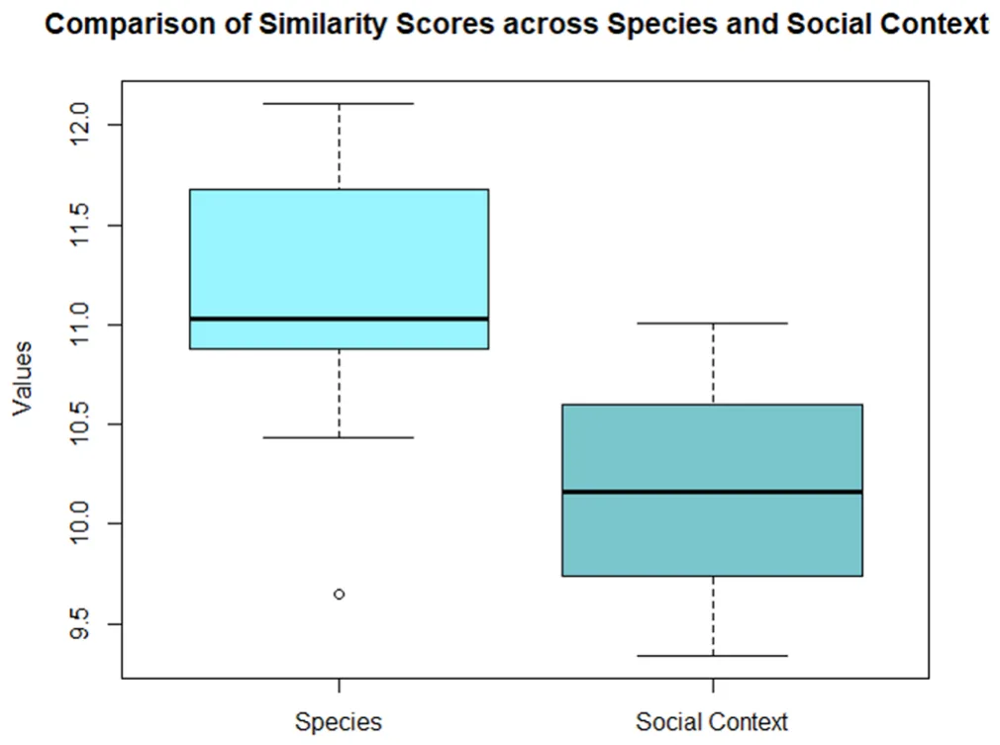

## Introduction

There has been a growing interest in the gestural communication of non-human primates (Pollick and Waal 2007; Corballis 2009; Tomasello and Call 2019, 2020), driven, at least in part, by the desire to identify evolutionary precursors to human language (Hauser et al. 2002; Corballis 2009). Gestures are generally understood as social behaviors performed intentionally and flexibly to influence others’ actions, helping the performer achieve specific social goals (Tomasello and Call 2019). Recent studies indicate that great apes produce numerous gestures, with over 50 morphologically distinct types reported in some species (Byrne et al. 2017; Grund et al. 2025). Many of these gestures involve the movement of hands and arms (Byrne et al. 2017), which we refer to these types of behaviors as “manual” gestures (Liebal and Call 2012a, b). In recent years, some researchers have also begun to explore whether primate facial behaviors are also produced in an intentional, flexible, and goal-oriented manner, stemming from the idea that the evolutionary origins of language may have been multimodal (we refer to these as “facial” gestures; (Waller et al. 2022). Primate facial behaviors have traditionally been viewed as emotional and reflexive (Ekman 1992), evolving primarily to seek help during urgent and high-arousal situations such as threats or distress (Schmidt and Cohn 2001). However, facial behaviors that are intentionally flexible and goal-oriented may be useful for navigating complex social interactions and, consequently, for social living, similar to manual gestures (Slocombe et al. 2011; Fröhlich and Hobaiter 2018). Primates possess a high degree of facial mobility, which has led to a wide and diverse range of ritualized facial behaviors, which may function as gestures (Van Hooff 1967, 2012; Preuschoft and van Hooff 1995). Partial support for this idea arises from observed similarities in regions of the primate brain responsible for both facial and manual actions (although there are also distinct neural activation patterns associated with these two types of actions; Ferrari et al. 2017).

One of the main challenges in studying primate gestures is separating gestural behaviors from non-gestural behaviors (Graham et al. 2020). This challenge is particularly important for studying facial gestures, as some facial behaviors may arise from reflexive rather than intentional mechanisms (Pollick and Waal 2007; Domínguez-Oliva et al. 2024). Researchers often differentiate great ape manual gestures from other actions by identifying specific observable characteristics that suggest these behaviors are social, intentional, flexible, and goal-oriented, with the number and types of characteristics varying across studies (Hobaiter and Byrne 2014; Halina et al. 2018; Graham et al. 2020; Rodrigues and Fröhlich 2024). This variability can lead to inconsistencies in the literature (Graham et al. 2020). For example, some researchers distinguish manual gestures based on factors such as mechanical ineffectiveness and whether they are associated with response waiting, gaze alternation, and persistence (Liebal and Call 2012a, b), whereas others focus on whether the behavior is socially directed and involves movement below the neck (Pollick and Waal 2007). While these criteria typically must be met before a manual gesture is included in the dataset, it is rarely reported how many behaviors were therefore excluded, which makes the prevalence of these features less clear (Graham et al. 2020). Some studies on facial gesturing have attempted to address these issues by examining a wide variety of characteristics identified in the gesture literature, for example in chimpanzees, hylobatids, and platyrrhine monkeys (Florkiewicz and Campbell 2021; Florkiewicz et al. 2025; Florkiewicz and Lazebnik 2025; Neal & Florkiewicz, In Review). In these studies, gesture characteristics are analyzed after a behavior has been added to the dataset, to evaluate their prevalence. Our recent findings with chimpanzees suggest that their facial behaviors may be gestural, as they demonstrate 10 characteristics (Table 1) previously associated with intentional, flexible, and goal-directed behavior in a manner that closely resembles their manual gestures (Florkiewicz and Campbell 2021; Florkiewicz and Lazebnik 2025). When evaluating the same 10 characteristics in the facial behaviors of hylobatids (*Hoolock leucogenys*, *Hylobates moloch*, *Hylobates pileatus*, and *Nomascus leucogenys*; (Florkiewicz et al. 2025) and species of platyrrhine monkeys such as *Pithecia pithecia* and *Callithrix geoffroyi* (Neal & Florkiewicz, In Review), the evidence for facial gesturing appears to be mixed compared to the facial and manual gesturing of chimpanzees.

Previously published studies with hylobatids and platyrrhine monkeys also highlight a significant challenge in studying facial (as well as manual) gesturing: the presence or absence of certain characteristics does not definitively indicate the existence of gestural capabilities (Graham et al. 2020; Florkiewicz and Campbell 2021). For example, a lack of response waiting associated with a given facial behavior may suggest either a general inability to produce facial gestures or that such characteristics were absent because the social goal of the interaction had already been met (Florkiewicz and Campbell 2021). To differentiate between these interpretations, researchers could examine the co-occurrence of multiple gesture characteristics (Graham et al. 2020). If a species lacks the ability for facial gesturing, we would expect most other common gesture-related characteristics to be absent as well (Graham et al. 2020). Previously, we investigated this co-occurrence within ritualized facial behaviors such as silent bared teeth displays (Florkiewicz and Campbell 2021; Florkiewicz et al. 2025), where a higher number of observed characteristics indicates a greater likelihood of interpreting these behaviors as gestures. However, this additive approach may overlook the specific interdependencies between gesture characteristics. For example, response waiting could be contingent upon observers’ attentional states and behavioral responses after a facial behavior is produced (Liebal and Call 2012a, b; Graham et al. 2020; Schel et al. 2022). Thus, studies on facial gesturing should broaden their focus by employing a comprehensive framework that models how individual gesture characteristics predict one another, highlighting their underlying interconnectedness and complex dependencies.

To examine differences in the predictive relationships among gesture characteristics and explore the evolution of gestural communication, comparative studies across multiple primate species are required. However, most studies have primarily focused on the facial or manual gesturing of a single species (Maestripieri and Wallen 1997; Liebal et al.

<figure class="table-figure" id="table-1">
<figcaption><strong>Table 1</strong> A list of 10 gesture characteristics examined in the facial behaviors of chimpanzees, hylobatids, and platyrrhine monkeys (Florkiewicz and Campbell 2021; Florkiewicz et al. 2025; Florkiewicz and Lazebnik 2025; Neal &amp; Florkiewicz, In Review)</figcaption>

<table><tr><th>Variable</th><th>Criteria for Presence</th><th>References</th></tr><tr><td>Mechanical Ineffectiveness</td><td>The facial behavior is not associated with activities related to biological maintenance or object manipulation.</td><td>Cartmill (2009) and Fröhlich and Hobaiter (2018)</td></tr><tr><td>Recipient ID</td><td>The facial behavior is produced (i.e., the head and body are turned) towards one clearly identifiable individual.</td><td>Fröhlich and Hobaiter (2018), Pika and Fröhlich (2019) and Tomasello and Call (2019)</td></tr><tr><td>Receiver Attention</td><td>The individual(s) involved in the social interaction have their head and body turned towards them.</td><td>Byrne et al. (2017), Graham et al. (2018) and Tomasello and Call (2019)</td></tr><tr><td>Response Waiting (at End)</td><td>The primate producing the facial behavior fixates their gaze on the individual(s) involved in the social interaction after it has ended.</td><td rowspan="2">Hobaiter and Byrne (2011), Byrne et al. (2017), Graham et al. (2018), Roberts et al. (2019) and Roberts and Roberts (2019)</td></tr><tr><td>Response Waiting (while Persisting)</td><td>The primate producing the facial behavior fixates their gaze on individual(s) involved in the social interaction while it is being produced</td></tr><tr><td>Elaboration</td><td>The primate modifies the physical characteristics of their facial behavior after its initial production. This may involve adding or removing movements of specific facial muscles within the same behavioral bout.</td><td>Leavens et al. (2005), Roberts et al. (2013) and Byrne et al. (2017)</td></tr><tr><td>Persistence</td><td>The primate either repeats the facial behavior after it has initially concluded or maintains the facial behavior after its initial production.</td><td>Leavens et al. (2005), Roberts et al. (2013) and Byrne et al. (2017)</td></tr><tr><td>Immediate Interaction Outcome</td><td>After the facial behavior is produced, the individual(s) involved in the social interaction show a noticeable change in their reactions.</td><td>Cartmill and Byrne (2010), Hobaiter and Byrne (2014) and Byrne et al. (2017)</td></tr><tr><td>Final Interaction Outcome</td><td>After the social interaction has concluded and all facial behaviors have been exhibited, the individual(s) involved show a noticeable change in their reactions, differing from their initial responses.</td><td>Cartmill and Byrne (2010), Hobaiter and Byrne (2014) and Byrne et al. (2017)</td></tr><tr><td>Presumed Goal</td><td>The primate producing the facial behavior seems to target a specific response from the recipient.</td><td>Cartmill and Byrne (2010), Hobaiter and Byrne (2014), Byrne et al. (2017) and Halina et al. (2018)</td></tr></table>

Each gesture characteristic is coded as binary, requiring specific criteria to be met in order to be considered present. References from the manual gesture literature that informed each characteristic are listed in the right column

</figure>

2004a, bLiebal et al. 2004a, b, 2006; Paukner et al. 2007; Anderson et al. 2010; Cartmill and Byrne 2010; Genty and Byrne 2010; Hobaiter and Byrne 2011; Laidre 2011, 2012; Demuru et al. 2015; Fröhlich et al. 2017; Grund et al. 2025; Corral et al. 2026) or closely related species (Maestripieri 2005; Graham et al. 2018; Amici and Liebal 2022).

There has also been an increasing focus on how social contexts may influence the prevalence of certain gesture characteristics. For example, studies on the manual gesturing of orangutans (*Pongo spp.*), gorillas (*Gorilla gorilla*), and spider monkeys (*Ateles geoffroyi*) have found that persistence is more commonly observed in high-arousal contexts, such as aggression and play (Genty and Byrne 2010; Tempelmann and Liebal 2012; Corral et al. 2026). Persistence may arise from reflexive processes, where increased arousal leads to a higher level of overall behavioral activity (Tempelmann and Liebal 2012). Persistence could also reflect an intentional act to communicate urgency and reduce the potential risk of injury, especially in aggressive or playful encounters. Although these explanations are not mutually exclusive (Corral et al. 2026), they highlight the importance of considering additional situational differences, such as social context. Failing to account for variations in gesturing behavior across different social contexts can lead to misleading conclusions regarding the significance of certain gesture characteristics for specific species (Corral et al. 2026). If one species engages in aggressive disputes or playful interactions more frequently than another, it may be mistakenly assumed that the first species possesses persistence as a defining characteristic of its facial behaviors, while the second species does not.

The goal of our current study is to investigate the characteristics linked to intentional, flexible, and goal-oriented communication, as well as the interrelationships among these characteristics, in the facial behaviors of chimpanzees (*Pan troglodytes*), four species of hylobatids (*Hoolock leucogenys*, *Hylobates moloch*, *Hylobates pileatus*, and *Nomascus leucogenys*; (Florkiewicz et al. 2025) and two species of platyrrhine monkeys (*Pithecia pithecia* and *Callithrix geoffroyi*; Neal & Florkiewicz, In Review). Specifically, we analyzed whether any differences in the predictive relationships of gesture characteristics were based on species or social contexts. First, we predicted that all studied species would exhibit consistent similarities in the predictive relationships of their facial gesturing characteristics. This expectation builds on findings that specific gesture characteristics (e.g., social directedness and elaboration) occur in the facial behaviors of orangutans and hylobatids (Waller et al. 2015; Scheider et al. 2016), as well as chimpanzees (Florkiewicz and Campbell 2021). Finding similar predictive relationships across chimpanzees, hylobatids, and platyrrhines would support the hypothesis that facial gesturing is widely prevalent across the primate lineage rather than restricted to hominids. Based on previous studies, we also expected differences in the predictive relationships among gesture variables to emerge related to differences in social contexts, specifically when comparing high-arousal contexts to lower-arousal contexts (Genty and Byrne 2010; Tempelmann and Liebal 2012; Corral et al. 2026).

To evaluate the predictive relationships between gesture characteristics, we created decision trees using Random Forests. This approach helps us understand how specific gesture characteristics influence the overall facial behaviors of each species and social context, moving beyond a simple assessment of presence or absence. In a decision tree, a node (or gesture characteristic) positioned higher up, closer to the root, indicates a feature with stronger predictive power and higher information gain for the entire dataset. Random Forests offer a more robust method for modeling non-linear relationships and interactions among our gesture characteristics, capturing the dynamics between them without specifying dependence beforehand (Breiman 2001). Moreover, Random Forests can account for missing/limited data and rare nodes (i.e., gesture characteristics), while reducing the risk of overfitting (Sunga et al. 2021; Xu et al. 2021). These considerations are particularly important because we are making comparisons across datasets where the number of facial behaviors varies, and some gesture characteristics are less common.

## Methods

As we used previously published datasets that were obtained from non-invasive behavioral observations, Institutional Animal Care and Use Committee (IACUC) approval was waived for this study. Our data collection and coding protocols adhered to the guidelines set forth by the Association for the Study of Animal Behaviour (No authorship 2020), and the American Society of Primatologists Principles for the Ethical Treatment of Non-Human Primates (https://asp.org/2021/04/20/principles-for-the-ethical-treatment-of-non-human-primates/).

### Data collection

Data were collected through video recordings (using Canon Vixia HD camcorders) at three different institutions: the Los Angeles Zoo (for chimpanzees), the Gibbon Conservation Center (for hylobatids), and the Little Rock Zoo (for platyrrhine monkeys). All enclosures were equipped with a variety of enrichment items to promote naturalistic behavior, and all primates had continuous access to water. Recordings were conducted exclusively in visitor viewing areas to ensure that the primates were not disturbed and that their caregiving routines remained uninterrupted. It is important to note that the video recording methods for the collection varied among institutions and species. This variation reflects the unique enclosure setups specific to each species, as well as the overall activity levels of the primates involved. The data collection protocols used at each institution are described in more detail below.

#### Chimpanzee data collection

Recordings of chimpanzees were made from June to August, 2017 to 2019, during peak activity hours (i.e., when the subjects were awake and physically active; 08:00 to 14:00). The chimpanzee group contained 18 individuals. Detailed demographic information can be found in the electronic supplement. In 2017, we employed the focal sampling method (Altmann 1974). This involved randomly selecting individuals within the group (provided they had not yet been recorded that week) and recording all their behaviors, along with the behaviors of neighboring chimpanzees, for a period of 30 min. The order and timing in which individuals were sampled was randomized each week. Using this method, we collected a total of 72 h of video footage (4 h per individual). Between 2018 and 2019, we shifted to an opportunistic sampling method to better reflect the varying activity levels of the chimpanzees. This approach involved following the most active portion of the troop and recording all social interactions, defined as the reciprocal exchange of behaviors between two or more individuals. Recordings began just before the onset of a social interaction (anticipated when one chimpanzee started to approached another) using our camcorder’s pre-record function, and continued until the chimpanzees dispersed or ceased the interaction. The length of our video recordings varied based on the duration of the social interactions. The opportunistic sampling method resulted in a total of 84.5 h of video footage. We combined video footage obtained using the focal and opportunistic sampling method, as we previously demonstrated that these methods produced similar distributions of observations across individuals and types of ritualized behavior (Florkiewicz and Campbell 2021). Altogether, we collected 156.5 h of footage.

#### Hylobatid data collection

Recordings of hylobatids were made during May to August in 2015, during peak activity hours (07:30 to 17:00). We observed 20 hylobatids (10 pairs) belonging to four different species, namely Javan gibbons (*Hylobates moloch*, *N* = 6), eastern hoolock gibbons (*Hoolock leuconedys*, *N* = 8), pileated gibbons (*Hylobates pileatus*, *N* = 2), and northern white-cheeked gibbons (*Nomasucs leucogenys*, *N* = 4). Detailed demographic information about these individuals can be found in the electronic supplement. As the gibbons were housed in pairs, we conducted pair focal sampling, which entailed randomly selecting pairs each week (as long as they had not already been recorded that week) and observing all their behaviors for a duration of 60 min. The order and timing of the sampled pairs were randomized each week. Using this method, we collected a total of 206 h of video footage: 38 h for *Hylobates moloch*, 96 h for *Hoolock leuconedys*, 24 h for *Hylobates pileatus*, and 48 h for *Nomascus leuconedys*.

#### Platyrrhine data collection

Recordings of platyrrhine monkeys were made between May and August in 2023, at peak activity hours (09:00 to 13:00). We observed 7 monkeys: 4 white-faced Saki monkeys (*Pithecia pithecia*) and 3 white-fronted marmosets (*Callithrix geoffroyi*). Monkeys were housed in two separate enclosures: the east enclosure, held 2 white-faced Saki monkeys and 3 white-fronted marmosets, and the west enclosure held 2 white-faced Saki monkeys. Detailed demographic information about these individuals can be found in the electronic supplement. We conducted opportunistic sampling for both enclosures, where focusing on social interactions (defined as the reciprocal exchange of behaviors between two or more individuals). Recordings began just before the onset of a social interaction (using our camcorder’s pre-record function) and continued until the monkeys dispersed or the interaction ceased. Video recording length varied based on the duration of the social interactions. The opportunistic sampling method resulted in a total of 20.65 h of video footage.

### Data coding

All video footage obtained was coded in ELAN (https://archive.mpi.nl/tla/elan) using a custom annotation template that included our 11 gesture variables of interest. The first step in our coding process for all seven species was to identify the onset, duration, and offset of all social interactions. *Social interactions* were defined as the reciprocal exchange of behaviors between two or more individuals. We began with this step because our focal and opportunistic sampling video clips often included multiple social interactions along with their associated facial behaviors. We differentiated social interactions based on their distinct socio-ecological contexts and related circumstances. For example, we noted the differences between two primates exchanging behaviors during a play session versus two primates sharing behaviors to initiate a grooming bout. Next, each social interaction (and its associated facial behaviors) was assigned one of 10 *social contexts* that best represent all behaviors being exchanged by the primates as well as the ecological circumstances, using previously published ethograms (Pollick and Waal 2007; Florkiewicz and Campbell 2021). Social contexts included affiliation, agonism, arousal (general), feeding, grooming, locomotion, playing, resting, sex, or unsure/unknown (Table 2). The social context assigned to each interaction was also linked to the facial behaviors produced in those interactions.

<figure class="table-figure" id="table-2">
<figcaption><strong>Table 2</strong> Social contexts considered in this study, informed by previously published ethograms (Pollick and Waal 2007; Florkiewicz and Campbell 2021)</figcaption>

<table><tr><th>Social context</th><th>Description</th></tr><tr><td>Affiliative</td><td>Nonagonistic body contact, or invitation for body contact by staring, approaching, and/or signaling to another, including greetings between individuals coming into contact.</td></tr><tr><td>Agonistic</td><td>Active aggression (barking, chasing, hitting, biting, screaming), conflict, or post-conflict behaviors (reconciliation, third-party support) between two or more individuals.</td></tr><tr><td>Arousal</td><td>Individuals perform or receive behaviors (e.g., rocking, pant-hooting, piloerection, running) where clear excitement is observed, but the triggering source or functional context cannot be assigned to any of the other categories in this table.</td></tr><tr><td>Food</td><td>Social interactions centered on food resources, including joint anticipation of provision, active food competition (grabbing, begging), peer-staring/peering, or nursing. (Note: solitary feeding was excluded).</td></tr><tr><td>Groom</td><td>Dyadic or group hair manipulation (giving, receiving, or mutual) or explicit invitations to groom (approaching, signaling). (Note: self-grooming was excluded).</td></tr><tr><td>Play</td><td>Non-agonistic, relaxed reciprocal wrestling, chasing, or pouncing, accompanied by play signals or invitations.</td></tr><tr><td>Sex</td><td>Mounts, genital stimulation, or explicit sexual invitations (presenting hindquarters, leg-spreading) directed at a partner. (Note: autosexual behavior was excluded).</td></tr><tr><td>Locomotion</td><td>Directed joint movement (following, walking/running together) or signaling to induce joint movement in the absence of play, agonism, or food-seeking.</td></tr><tr><td>Rest</td><td>Two or more individuals maintaining proximity in a relaxed, low-activity state (resting/sleeping together) without active grooming or play.</td></tr><tr><td>Unsure/unknown</td><td>It is unclear what the behavioral context of this interaction is; it could be any of the contexts above, or a combination of 2 or more relevant contexts.</td></tr></table>

</figure>

Next, for each social interaction, we identified the onset, duration, and offset of all *facial behaviors*, defined as one or more facial muscle movements produced and combined in distinct temporal bouts that can influence or alter the behavior of conspecifics, and also exhibit features suited for social transmission, such as stereotyped movements (Smith and Harper 1995). Our approach to identifying facial muscle movement was informed by FACS-based methods published for chimpanzees, hylobatids, and callitrichids (Parr et al. 2007; Waller et al. 2012; Correia-Caeiro et al. 2022, 2025). After identifying all facial behaviors, we used our binary gesture ethogram (Table 1) to code the presence or absence of each characteristic for each specific facial behavior. If the criteria listed in Table 1 were met, the characteristic was coded as present (1) for that facial behavior; if not, it was coded as absent (0). For instance, to be classified as mechanically ineffective, the facial muscle movements should not serve biological functions (such as yawning) or be involved in object manipulation (like using the front teeth to tear a food item). If these conditions were satisfied, the facial behavior was marked with a “1” for mechanical ineffectiveness. It is important to note that for immediate interaction outcomes, final interaction outcomes and presumed goals, we used information about the overarching social interaction in which the facial behavior occurred to inform these variables. Here we employed a binary coding approach, even though some of the variables we examine have been previously understood through categorical and continuous numerical frameworks (Hobaiter and Byrne 2014; Graham et al. 2020; Florkiewicz and Campbell 2021; Badihi et al. 2024). A binary coding approach ensures greater consistency when coding across species, especially when there are differences in anatomy and associated abilities. For example, in order to meet the criteria for elaboration, the individual must be able to alter the physical form of the facial behavior after its initial production, which could involve additional facial muscle movements. However, the types of facial muscle movements produced by each species sometimes vary (Parr et al. 2007; Waller et al. 2012, 2020; Correia-Caeiro et al. 2022, 2025), so our coding criteria must account for this possibility.

To ensure consistency in coding efforts across taxonomic groups, projects, and researchers (including the first author and her research assistants), inter-observer reliability was always assessed at the start of the coding process for each species. This involved coding approximately 10% of randomly sampled video clips from each database and comparing results (Florkiewicz and Campbell 2021; Florkiewicz et al. 2025). Researchers needed to reach a high level of agreement for each characteristic in Table 1 and for the social contexts listed in Table 2 before they could proceed to code the remaining 90% of the footage. For gesture characteristics (Table 1), all researchers needed to achieve > 70% agreement and a Gwet’s AC1 score of 0.60 or greater (Gwet 2002, 2019; Wongpakaran et al. 2013) Although many manual gesturing studies make use of Cohen’s kappa scores to assess reliability, we used Gwet’s AC1 scores, as Cohen’s kappa scores are penalized because of the binary nature of the data, even when there may be high percentages of agreement between raters (Gwet 2002, 2019; Wongpakaran et al. 2013). For social contexts (Table 2), which is a categorical variable, Cohen’s kappa was used, and a score of at least 0.61 or greater had to be achieved by all researchers.

### Data analysis

Following the data coding protocols described earlier, we obtained a data matrix for each primate species and social context that included our 10 gesture characteristic of interest (represented as columns) and observations of facial behaviors (represented as rows). These matrices used binary values to indicate the presence or absence of evidence for each gesture characteristic. To address class imbalance effects and ensure comparability among species and social contexts, subsets were downsampled to match the size of the smallest grouping using random sampling (Díaz García et al. 2017).

#### Feature importance estimation

To examine predictive relationships among gestural characteristics, we used a one-vs-rest predictive framework (Flanagan and Glavin 2023). In this approach, each gesture characteristic is treated in turn as the outcome variable, while all remaining gesture characteristic are used as predictors. This allowed us to ask, for each characteristic, how strongly its presence or absence could be predicted from the pattern of all other gesture characteristic. In other words, rather than testing whether a single variable differed between species or social contexts, this analysis estimated how gesture characteristic were interrelated within each species and social context type. For each gesture characteristic, we trained a binary classifier to predict whether that characteristic was present or absent using the remaining characteristic. We considered two complementary models: Logistic Regression (LR) (Nick and Campbell 2007) and Random Forests (RF) (Breiman 2001). Logistic regression was included because it is a relatively simple and interpretable model. As it estimates a coefficient for each predictor, it provides a direct indication of whether and how strongly each gesture characteristic contributes to predicting the target characteristic. Before fitting the logistic regression models, all gesture characteristics were standardized using z-score normalization so that coefficient magnitudes could be compared across predictors (Adeyemo et al. 2019). We then used the absolute values of the learned coefficients as proxy estimates of variable importance. Random Forests were included because they can capture more complex and non-linear relationships among variables that may not be detected by logistic regression (Couronné et al. 2018; Shami and Lazebnik 2024). A Random Forest is an ensemble model that combines many decision trees, each of which repeatedly splits the data according to the predictors that best distinguish the outcome classes. This makes the model useful when relationships among variables may involve interactions, threshold effects, or non-linear patterns. For the RF models, feature importance was estimated using the average decrease in impurity attributed to each predictor across the trees in the forest (Scornet, 2023). Characteristics that produced larger decreases in impurity were interpreted as contributing more strongly to the prediction of the target gesture variable.

Because LR and RF quantify predictor importance differently, their raw feature-importance magnitudes were not directly compared or averaged. Random Forest mean-decrease-in-impurity values were used as the primary feature-importance estimates reported in Tables 2 and 4 and were normalized within each species or social-context profile so that the importance values summed to 100%. Logistic Regression was used as a complementary robustness analysis. In order to determine whether the two modeling approaches identified similar predictive relationships, we compared the relative rankings of predictors generated by each model. For every valid one-vs-rest analysis, predictor gesture characteristics were ranked according to the absolute standardized LR coefficients and RF impurity-based importance estimates. Agreement between LR and RF rankings was quantified using Spearman’s rank correlation coefficient. We additionally recorded whether the two models identified the same highest-ranked predictor and the extent of overlap among their three highest-ranked predictors. Concordance was summarized using the median and interquartile range of the resulting Spearman correlations. Moreover, we repeated the similarity analysis independently using LR- and RF-derived importance profiles. Agreement between the resulting similarity profiles was evaluated using Spearman’s rank correlation.

Finally, we used a Kruskal-Wallis test to compare the distribution of average feature importance scores across high-arousal social contexts identified by previous studies (Genty and Byrne 2010; Tempelmann and Liebal 2012; Corral et al. 2026) and other contexts. High-arousal social contexts include agonism, arousal (general), play, and sex, whereas low-arousal social contexts include affiliation, food, grooming, locomotion, and rest (see Table 2 for a list of social contexts and definitions).

#### Similarity analysis

To compare species and social contexts in terms of how their gesture characteristic were internally related, we quantified the similarity between species-specific or context-specific feature-importance profiles. For each species and social context type, the one-vs-rest analyses produced a set of importance vectors: one vector for each gesture characteristic used as a target. Each vector summarized how strongly the remaining gesture characteristic predicted that target characteristic. Thus, these vectors represented the dependency pattern surrounding each gesture characteristic within a given species. We then compared these dependency patterns across species and social contexts using pairwise cosine similarity (Xia et al. 2015). Cosine similarity measures the extent to which two vectors point in the same direction, regardless of their absolute magnitude. This was appropriate for the present analysis because our main interest was whether species and social context showed similar patterns of relationships among gesture characteristics, rather than whether the overall importance values were identical in size.

For every gesture characteristic that served as a valid target in all species and context datasets, we compared the corresponding importance vectors extracted from the LR and RF models. For example, if “Receiver Attention” was treated as the target variable in multiple species and social context types, we compared the predictor patterns associated with “Receiver Attention” across those species and social contexts. We then calculated an overall similarity score as the mean cosine similarity across all shared target gesture characteristics. Higher similarity scores indicated that two species or two social contexts had more similar internal gestural dependency structures, whereas lower scores indicated more divergent patterns of relationships among gesture characteristics. This analysis therefore directly addressed whether species and social contexts differed not only in the relative importance of individual gesture characteristics, but also in the broader structure of associations among those characteristics.

## Results

Our multi-species dataset consisted of a total of 1651 facial behaviors (*N* = 1090 for chimpanzees, *N* = 484 for hylobatids, and *N* = 77 for platyrrhines). The relative importance rankings generated by Logistic Regression and Random Forest models were generally consistent. Across species-specific one-vs-rest analyses, the median Spearman correlation between LR and RF predictor rankings was 0.74 (IQR = 0.61–0.85). The two models identified the same highest-ranked predictor in 71% of analyses and shared at least two of their three highest-ranked predictors in 86% of analyses. Model agreement was lower across social contexts, the median Spearman correlation being 0.66 (IQR = 0.49– 0.79). Logistic Regression and Random Forests identified the same highest-ranked predictor in 62% of analyses and shared at least two of the three highest-ranked predictors in 79% of analyses. Thus, although the relative importance of some gesture characteristics depended on the modeling approach, particularly within specific social contexts, the broader importance structure was generally reproduced by both models. This agreement was also evident in the subsequent similarity analyses. Similarity profiles estimated independently from LR and RF were strongly correlated across gesture characteristics for both species (Spearman’s ρ = 0.84) and social contexts (ρ = 0.78).

<figure class="table-figure" id="table-3">
<figcaption><strong>Table 3</strong> Average feature importance values calculated for each species and associated gesture characteristic</figcaption>

<table><tr><th rowspan="2">Gesture Variable</th><th colspan="7">Average Feature Importance for Each Species</th></tr><tr><th><em>Pan troglodytes</em></th><th><em>Hoolock leucogenys</em></th><th><em>Hylobates moloch</em></th><th><em>Hylobates pileatus</em></th><th><em>Nomascus leucogenys</em></th><th><em>Callithrix geoffroyi</em></th><th><em>Pithecia pithecia</em></th></tr><tr><td>Mechanical Ineffectiveness</td><td>0.00</td><td>2.21</td><td>0.00</td><td>0.00</td><td>0.00</td><td>0.00</td><td>0.00</td></tr><tr><td>Recipient ID</td><td>19.68</td><td>10.41</td><td>14.49</td><td>14.72</td><td>11.82</td><td>16.71</td><td>17.46</td></tr><tr><td>Receiver Attention</td><td>12.55</td><td>8.06</td><td>10.38</td><td>14.73</td><td>12.74</td><td>9.47</td><td>20.86</td></tr><tr><td>Response Wait (End)</td><td>6.69</td><td>10.91</td><td>9.72</td><td>10.41</td><td>9.09</td><td>10.74</td><td>7.84</td></tr><tr><td>Response Wait (Persist)</td><td>18.58</td><td>10.97</td><td>14.37</td><td>8.11</td><td>10.48</td><td>10.28</td><td>13.07</td></tr><tr><td>Persistence</td><td>6.97</td><td>12.08</td><td>14.39</td><td>11.58</td><td>9.66</td><td>9.28</td><td>12.79</td></tr><tr><td>Elaboration</td><td>4.09</td><td>10.65</td><td>8.94</td><td>3.61</td><td>11.50</td><td>11.01</td><td>13.14</td></tr><tr><td>Immediate Interaction Outcome</td><td>9.65</td><td>9.30</td><td>3.91</td><td>9.33</td><td>11.62</td><td>7.82</td><td>14.83</td></tr><tr><td>Final Interaction Outcome</td><td>9.18</td><td>12.66</td><td>15.52</td><td>13.89</td><td>10.86</td><td>15.39</td><td>0.00</td></tr><tr><td>Presumed Goal</td><td>12.61</td><td>12.76</td><td>8.29</td><td>13.61</td><td>12.23</td><td>9.32</td><td>0.00</td></tr></table>

The highest values observed across all six species are highlighted in green, and the lowest in red (shading not reproduced in this web version)

</figure>

<figure class="table-figure" id="table-4">
<figcaption><strong>Table 4</strong> Similarity scores calculated for each gesture characteristic across all six species</figcaption>

<table><tr><th>Gesture characteristic</th><th>Similarity scores</th><th>Mean cosine similarity</th></tr><tr><td>Mechanical Ineffectiveness</td><td>NE</td><td>NE</td></tr><tr><td>Recipient ID</td><td>9.65</td><td>0.593</td></tr><tr><td>Receiver attention</td><td>11.02</td><td>0.677</td></tr><tr><td>Response wait (end)</td><td>10.43</td><td>0.641</td></tr><tr><td>Response wait (persist)</td><td>11.40</td><td>0.701</td></tr><tr><td>Persistence</td><td>12.11</td><td>0.744</td></tr><tr><td>Elaboration</td><td>11.80</td><td>0.725</td></tr><tr><td>Immediate interaction outcome</td><td>11.03</td><td>0.678</td></tr><tr><td>Final interaction outcome</td><td>11.68</td><td>0.718</td></tr><tr><td>Presumed goal</td><td>10.88</td><td>0.669</td></tr></table>

Mean cosine similarity reflects unscaled values. Similarity scores could not be estimated for mechanical ineffectiveness because only one species had a non-zero feature importance score for this characteristic

</figure>

### Species gestural characteristics

Table 3 shows average feature importance values for each species and gesture characteristic, and Table 4 presents the results of our similarity analysis. Across species, receiver attention had the highest average feature importance scores (median = 14.72, range = 10.41–19.86), whereas mechanical ineffectiveness had the lowest average feature importance scores (median = 0.00, range = 0.00–2.21). Similarity scores differed, with the lowest score assigned to recipient ID (similarity score = 9.65, mean cosine similarity = 0.593) and the highest to persistence (similarity score = 12.11, mean cosine similarity = 0.744; see Table 4).

### Social context gestural characteristics

Average feature importance values for each social context and gesture characteristic are displayed in Table 5, and the results of our similarity analysis can be found in Table 6. Because of the low number of observations, we excluded the unsure/unknown category from our analyses. Across social contexts, response waiting while persisting had the highest average feature importance scores (median = 13.99, range = 10.22–16.83). In contrast, mechanical ineffectiveness had the lowest average feature importance scores (median = 0.00, range = 0.00–6.08). Similarity scores differed, with the lowest score assigned to mechanical ineffectiveness (similarity score = 8.04, mean cosine similarity = 0.571) and the highest to recipient ID (similarity score = 10.81, mean cosine similarity = 0.769; see Table 6). The average feature importance scores for high-arousal social contexts did not differ significantly from those of other types of social contexts (*p* = 0.88).

<figure class="table-figure" id="table-5">
<figcaption><strong>Table 5</strong> Average feature importance values calculated for each social context and associated gesture characteristic</figcaption>

<table><tr><th rowspan="2">Gesture Characteristic</th><th colspan="9">Average Feature Importance for Each Context</th></tr><tr><th><em>Affil</em></th><th><em>Agoni</em></th><th><em>Arous</em></th><th><em>Food</em></th><th><em>Groom</em></th><th><em>Play</em></th><th><em>Locom</em></th><th><em>Rest</em></th><th><em>Sex</em></th></tr><tr><td>Mechanical Ineffectiveness</td><td>0.00</td><td>0.00</td><td>1.76</td><td>0.00</td><td>0.00</td><td>6.08</td><td>0.00</td><td>0.00</td><td>0.00</td></tr><tr><td>Recipient ID</td><td>11.52</td><td>18.72</td><td>11.81</td><td>12.36</td><td>9.19</td><td>10.87</td><td>15.17</td><td>10.96</td><td>0.00</td></tr><tr><td>Receiver Attention</td><td>12.92</td><td>11.89</td><td>7.88</td><td>13.51</td><td>10.85</td><td>9.28</td><td>8.38</td><td>7.95</td><td>11.33</td></tr><tr><td>Response Wait (End)</td><td>11.43</td><td>8.35</td><td>11.24</td><td>8.29</td><td>16.66</td><td>9.11</td><td>10.53</td><td>9.49</td><td>18.64</td></tr><tr><td>Response Wait (Persist)</td><td>14.80</td><td>15.95</td><td>10.22</td><td>14.86</td><td>13.40</td><td>13.99</td><td>10.76</td><td>11.81</td><td>16.83</td></tr><tr><td>Persistence</td><td>12.93</td><td>8.02</td><td>10.33</td><td>9.97</td><td>8.47</td><td>13.07</td><td>10.27</td><td>13.50</td><td>19.71</td></tr><tr><td>Elaboration</td><td>7.81</td><td>6.76</td><td>11.76</td><td>6.79</td><td>9.28</td><td>8.39</td><td>7.27</td><td>6.88</td><td>5.52</td></tr><tr><td>Immediate Interaction Outcome</td><td>10.76</td><td>10.41</td><td>11.19</td><td>11.65</td><td>11.66</td><td>11.65</td><td>11.57</td><td>7.84</td><td>18.16</td></tr><tr><td>Final Interaction Outcome</td><td>9.79</td><td>9.69</td><td>13.26</td><td>12.93</td><td>9.24</td><td>9.47</td><td>17.32</td><td>16.29</td><td>9.82</td></tr></table>

The highest values observed across all ten social contexts are highlighted in green, the lowest in red (shading not reproduced in this web version). Contexts are abbreviated as follows: affiliative (affil), agonistic (agoni), arousal (arous), and locomotion (locom)

</figure>

<figure class="table-figure" id="table-6">
<figcaption><strong>Table 6</strong> Similarity scores calculated for each gesture characteristic across all ten social contexts</figcaption>

<table><tr><th>Gesture characteristic</th><th>Similarity scores</th><th>Mean cosine similarity</th></tr><tr><td>Mechanical ineffectiveness</td><td>8.04</td><td>0.571</td></tr><tr><td>Recipient ID</td><td>10.81</td><td>0.769</td></tr><tr><td>Receiver attention</td><td>9.74</td><td>0.692</td></tr><tr><td>Response wait (end)</td><td>10.57</td><td>0.752</td></tr><tr><td>Response wait (persist)</td><td>10.16</td><td>0.722</td></tr><tr><td>Persistence</td><td>11.01</td><td>0.783</td></tr><tr><td>Elaboration</td><td>10.03</td><td>0.713</td></tr><tr><td>Immediate interaction outcome</td><td>10.60</td><td>0.753</td></tr><tr><td>Final interaction outcome</td><td>9.34</td><td>0.664</td></tr><tr><td>Presumed goal</td><td>9.70</td><td>0.690</td></tr></table>

Mean cosine similarity reflects unscaled values

</figure>

### Comparison of similarity scores

When comparing similarity scores for gesture characteristics among primate species and social contexts, similarity scores were generally higher among species (median = 11.03, range = 9.65–12.11) than across social contexts (median = 10.10, range = 8.04–11.01; Fig. 1). Additionally, the similarity scores were more variable in social contexts compared to primate species, ranging from about 2.97 to 2.46 points, respectively.

<figure id="fig-1">

<figcaption><strong>Fig. 1</strong> Comparison of gesture characteristic similarity scores across primate species and social contexts</figcaption>
</figure>

## Discussion

The goal of this study was to assess interrelationships among gesture characteristics using previously published data on the facial behaviors of chimpanzees, four species of hylobatids and two species of platyrrhine monkeys (Florkiewicz et al. 2025; Neal and Florkiewicz, In Review). Specifically, we tested whether predictive relationships between gesture characteristics differed by species and/or social context.

Previous studies have shown that the prevalence of certain gesture characteristics can vary depending on whether the social context is associated with higher or lower arousal levels (Genty and Byrne 2010; Tempelmann and Liebal 2012; Corral et al. 2026). To evaluate these predictive relationships, we utilized decision trees to calculate average feature importance scores. This helped us assess how effectively each gesture characteristic predicts others. Additionally, we computed similarity scores for each gesture characteristic to make comparisons across different species and social contexts.

Based on average feature importance scores, we found that primate species vary in which gesture characteristics are most informative for predicting others. In chimpanzees, social directedness (i.e., recipient ID) and response waiting (at the end of facial behaviors) were the two characteristics most predictive of others. These traits tend to be key for distinguishing between manual gestures and other manual behaviors in the great ape literature. However, for other primate species included in our study, the top two characteristics varied (although for four species, recipient ID ranked among the top two highest average feature importance scores). Social directedness and response waiting also had the lowest similarity scores across species. These findings may indicate differences in chimpanzee facial gestures compared to those of other primates (Tomasello and Call 2019). It may be that the ability for facial gestures is influenced by the unique physiology and psychology of chimpanzees and possibly other great apes. However, further comparative research on this issue is needed. Across all studied primate species, mechanical ineffectiveness showed little predictive power regarding other gestural characteristics. A plausible explanation for this independence is that mechanical ineffectiveness reflects the physical outcome of a movement (Cartmill and Byrne 2010), whereas features like response waiting and flexibility are driven by social outcomes and recipient attentiveness (Hobaiter and Byrne 2011). Thus, a gesture’s physical effectiveness and its social-communicative dynamics may represent distinct functional dimensions, each operating through separate cognitive mechanisms during signal production.

Average feature importance scores also varied based on social contexts. Response waiting (while persisting) was ranked among the top two gesture characteristics that predict others across five social contexts, although the remaining top gesture characteristics differed. Similar to primate species, mechanical ineffectiveness had the lowest average feature importance scores in all social contexts. Compared to primate species, social contexts exhibited some of the lowest similarity scores in gesture characteristics. Consistent with previous studies, we predicted that social contexts previously identified as high-arousal would significantly differ in their average feature importance scores compared to other types of contexts (Genty and Byrne 2010; Tempelmann and Liebal 2012; Corral et al. 2026). However, we found no evidence to support this prediction. Previous studies have highlighted differences in persistence rates within high-arousal social contexts (Genty and Byrne 2010; Tempelmann and Liebal 2012; Corral et al. 2026). Here, we found that persistence can sometimes predict other gesture characteristics in high-arousal social contexts such as play and sex. This predictive pattern is not always evident, as demonstrated in agonistic interactions. When we combined the average feature importance values, similarity scores, and the results of our Kruskal-Wallis test, it appeared that each context may be associated with a unique gestural characteristic profile. This could be attributed to the distinct social interactions and potential social goals related to each context (Bohn et al. 2022). Alternatively, these results may also highlight a notable limitation of our current study: we used more generalized social context categories that were based on the behaviors of the primates involved in the social interaction. Previous studies have cautioned against the use of such generalized categories, as combining behaviors may result in missing the nuances of social interactions (Oña et al. 2019). Social contexts can blend, such as during feeding disputes, leading to differing levels of arousal. Consequently, further research is required to determine if social contexts lead to distinct differences in the gestural characteristics of facial behaviors.

Future studies should also evaluate whether predictive relationships among gesture characteristics vary according to ritualized facial signal type and species. In the present study, the specific facial signals observed varied across taxa (*N* = 9 in chimpanzees, *N* = 6 in hylobatids, and *N* = 8 in platyrrhine monkeys), and sample sizes for certain signal types were too low to permit formal statistical modeling. However, qualitative inspection reveals substantial variation in the average number of gesture characteristics across facial signal types. For example, the average number of associated gesture characteristics ranged from 5.93 to 8.38 in chimpanzees, 3.86 to 8.00 in platyrrhines, and 3.33 to 5.11 in hylobatids. Two facial signal types were observed across all three primates: silent bared-teeth displays (SBT) and lip-smacking (LS). For these shared signals, platyrrhines exhibited the highest average number of gesture characteristics (SBT = 7.33; LS = 8.00), followed by chimpanzees (SBT = 6.15; LS = 5.93) and hylobatids (SBT = 4.67; LS = 3.33). Since no single factor appears to explains the observed patterns, these results could suggest potential interaction effects among species, social context, and facial signal types regarding the predictive relationships among gesture characteristics. Future studies should model these interactions accordingly, as primates may produce different facial signals types across social contexts as a flexible communicative strategy (Florkiewicz and Campbell 2021).

Taken together, our results suggest that the gestural characteristics of primate facial behaviors vary across species and social contexts, differences in social contexts should be considered when making claims about a species’ facial behavior characteristics (Corral et al. 2026). However, our study included data from only seven species and 45 individuals; clearly, further research involving more species and individuals is necessary. We included four species of hylobatids, but even within this group there is considerable variation in physiological and psychological attributes (Geissmann 1993; Ryne 1994; Liebal 2016; Geissmann et al. 2020). Further studies and additional species, both captive and wild, would also provide better insight into specific influences on the gestural characteristics of primate facial behaviors. Another limitation of the present study is that we did not explore potential differences based on multimodality (Fröhlich et al. 2019; Prieur et al. 2020). We previously discovered variations in the gestural characteristics of chimpanzee facial signals produced alongside vocalizations (Florkiewicz and Lazebnik 2025). Unfortunately, due to recording constraints we could not obtain reliable data on the vocalizations of the platyrrhine monkeys for comparative analyses. This leaves open an intriguing avenue for future research.

## Conclusion

Our study reveals the potential for variability in gestural characteristics of primate facial behaviors across species and social contexts. While social directedness and response waiting significantly predicted various gesture characteristics in chimpanzees, different gesture characteristics are important predictors in other primate species. These results might further suggest that great apes have distinct facial gesturing repertoires compared to other primates; however, further research is needed to clarify this issue. Social contexts are more influential than species in which gesture characteristics serve as important predictors, a factor future studies on the facial gesturing of non-human primates should take into account.

**Supplementary Information** The online version contains supplementary material available at https://doi.org/10.1007/s10329-026-01302-y.

**Funding** This research did not receive any specific grant from funding agencies in the public, commercial or not-for-profit sectors.

**Code and data availability** All data underlying our current study can be accessed in the electronic supplement.

### Declarations

**Competing interests** Both authors declare that they have no conflicts of interest.

**Generative AI and AI-assisted technologies** During the preparation of this work the authors used Grammarly for spelling and grammatical checks on this manuscript. After using this service, the authors reviewed and edited the content and take full responsibility for the content of the published article.

## References

- Adeyemo A, Wimmer H, Powell LM (2019) Effects of normalization techniques on logistic regression in data science. J Inf Syst Appl Res 12:37–44
- Altmann J (1974) Observational study of behavior: sampling methods. Behaviour 49(3):227–267
- Amici F, Liebal K (2022) The social dynamics of complex gestural communication in great and lesser apes (Pan troglodytes, Pongo abelii, Symphalangus syndactylus). Philos Trans R Soc Lond B Biol Sci 377:20210299. [doi:10.1098/rstb.2021.0299](https://doi.org/10.1098/rstb.2021.0299)
- Anderson JR, Kuroshima H, Hattori Y, Fujita K (2010) Flexibility in the use of requesting gestures in squirrel monkeys (Saimiri sciureus). Am J Primatol 72:707–714
- Badihi G, Graham KE, Grund C, Safryghin A, Soldati A, Donnellan E, Hashimoto C, Mine JG, Piel AK, Stewart F, Slocombe KE, Wilke C, Townsend SW, Zuberbühler K, Zulberti C, C Hobaiter (2024) Chimpanzee gestural exchanges share temporal structure with human language. Curr Biol 34:R673–R674. [doi:10.1016/j.cub.2024.06.009](https://doi.org/10.1016/j.cub.2024.06.009)
- Bohn M, Liebal K, Oña L, Tessler MH (2022) Great ape communication as contextual social inference: a computational modelling perspective. Philos Trans R Soc Lond B Biol Sci 377:20210096. [doi:10.1098/rstb.2021.0096](https://doi.org/10.1098/rstb.2021.0096)
- Breiman L (2001) Random forests. Mach Learn 45:5–32
- Byrne RW, Cartmill E, Genty E, Graham KE, Hobaiter C, Tanner J (2017) Great ape gestures: intentional communication with a rich set of innate signals. Anim Cogn 20:755–769. [doi:10.1007/s10071-017-1096-4](https://doi.org/10.1007/s10071-017-1096-4)
- Cartmill EA (2009) Gestural communication in orangutans (Pongo pygmaeus and Pongo abelii): a cognitive approach. University of St Andrews
- Cartmill EA, Byrne RW (2010) Semantics of primate gestures: intentional meanings of orangutan gestures. Anim Cogn 13:793–804. [doi:10.1007/s10071-010-0328-7](https://doi.org/10.1007/s10071-010-0328-7)
- Corballis MC (2009) Language as gesture. Hum Mov Sci 28:556–565. [doi:10.1016/j.humov.2009.07.003](https://doi.org/10.1016/j.humov.2009.07.003)
- Corral E, Cardoso Rodriguez S, Liebal K, Llorente M, Amici F (2026) Gestural Sequences in Wild Spider Monkeys (Ateles geoffroyi). Am J Primatol 88:e70156. [doi:10.1002/ajp.70156](https://doi.org/10.1002/ajp.70156)
- Correia-Caeiro C, Burrows A, Wilson DA, Abdelrahman A, Miyabe- Nishiwaki T (2022) CalliFACS: The common marmoset Facial Action Coding System. PLoS ONE 17:e0266442. [doi:10.1371/journal.pone.0266442](https://doi.org/10.1371/journal.pone.0266442)
- Correia-Caeiro C, Kuchenbuch PH, Oña LS, Wegdell F, Leroux M, Schuele A, Taglialatela J, Townsend S, Surbeck M, Waller BM (2025) Adapting the facial action coding system for chimpanzees (Pan troglodytes) to bonobos (Pan paniscus): the ChimpFACS extension for bonobos. PeerJ 13:e19484
- Couronné R, Probst P, Boulesteix A-L (2018) Random forest versus logistic regression: a large-scale benchmark experiment. BMC Bioinformatics 19:270
- Demuru E, Ferrari PF, Palagi E (2015) Emotionality and intentionality in bonobo playful communication. Anim Cogn 18:333–344. [doi:10.1007/s10071-014-0804-6](https://doi.org/10.1007/s10071-014-0804-6)
- Díaz García J, Brunet Crosa P, Navazo Álvaro I, PP Vázquez Alcocer (2017) Downsampling methods for medical datasets. Proceedings of the International conferences Computer Graphics, Visualization, Computer Vision and Image Processing 2017 and Big Data Analytics, Data Mining and Computational Intelligence 2017: Lisbon, Portugal, July 21–23, 2017. IADIS Press, pp 12–20
- Domínguez-Oliva A, Chávez C, Martínez-Burnes J, Olmos-Hernández A, Hernández-Avalos I, Mota-Rojas D (2024) Neurobiology and Anatomy of Facial Expressions in Great Apes: Application of the AnimalFACS and Its Possible Association with the Animal’s Affective State. Animals 14:3414
- Ekman P (1992) An argument for basicemotions. Cognition Emotion 6(3-4):169–200. [doi:10.1080/02699939208411068](https://doi.org/10.1080/02699939208411068)
- Ferrari PF, Gerbella M, Coudé G, Rozzi S (2017) Two different mirror neuron networks: The sensorimotor (hand) and limbic (face) pathways. Neuroscience 358:300–315. [doi:10.1016/j.neuroscience.2017.06.052](https://doi.org/10.1016/j.neuroscience.2017.06.052)
- Flanagan AR, Glavin FG A systematic review of multi-class and one-vs-rest classification techniques for near-infrared spectra of crop cultivars. 2023 31st Irish Conference on Artificial Intelligence and, Science C (2023) (AICS). IEEE, pp 1–8
- Florkiewicz BN, MW Campbell (2021) A Comparison of Focal and Opportunistic Sampling Methods when Studying Chimpanzee Facial and Gestural Communication. Folia Primatol 92:164–174. [doi:10.1159/000516315](https://doi.org/10.1159/000516315)
- Florkiewicz B, Campbell M (2021) Chimpanzee facial gestures and the implications for the evolution of language. PeerJ 9:e12237. [doi:10.7717/peerj.12237](https://doi.org/10.7717/peerj.12237)
- Florkiewicz BN, Lazebnik T (2025) Combinatorics and complexity of chimpanzee (Pan troglodytes) facial signals. Anim Cogn 28:34
- Florkiewicz BN, Kemp E, Campbell MW (2025) Gibbon Gestures: Hylobatid Facial Signals and Insights Into Language Evolution. Am J Biol Anthropol 188:e70185
- Fröhlich M, C Hobaiter (2018) The development of gestural communication in great apes. Behav Ecol Sociobiol 72:1–14
- Fröhlich M, Hobaiter C (2018) The development of gestural communication in great apes. Behav Ecol Sociobol. [doi:10.1007/s00265-018-2619-y](https://doi.org/10.1007/s00265-018-2619-y)
- Fröhlich M, Müller G, Zeiträg C, Wittig RM, Pika S (2017) Gestural development of chimpanzees in the wild: the impact of interactional experience. Anim Behav 134:271–282. [doi:10.1016/j.anbehav.2016.12.018](https://doi.org/10.1016/j.anbehav.2016.12.018)
- Fröhlich M, Sievers C, Townsend SW, Gruber T, van Schaik CP (2019) Multimodal communication and language origins: integrating gestures and vocalizations. Biol Rev Camb Philos Soc 94:1809– 1829. [doi:10.1111/brv.12535](https://doi.org/10.1111/brv.12535)
- Geissmann T (1993) Evolution of Communication in Gibbons (Hylobatidae). Ph.D. Dissertation. Zürich University
- Geissmann T, Rosenkranz-Weck S, Van Der JJGM, Loo M, Orgeldinger (2020) Taxon-Specific Pair Bonding in Gibbons (Hylobatidae). Updates on Veterinary Anatomy and Physiology [Working Title]. IntechOpen
- Genty E, Byrne RW (2010) Why do gorillas make sequences of gestures? Anim Cogn 13:287–301
- Graham KE, Hobaiter C, Ounsley J, Furuichi T, Byrne RW (2018) Bonobo and chimpanzee gestures overlap extensively in meaning. PLoS Biol 16:e2004825. [doi:10.1371/journal.pbio.2004825](https://doi.org/10.1371/journal.pbio.2004825)
- Graham KE, Wilke C, Lahiff NJ, Slocombe KE (2020) Scratching beneath the surface: intentionality in great ape signal production. Philosophical Trans Royal Soc B 375:20180403
- Grund C, Robbins MM, Hobaiter C (2025) The gestural repertoire of Bwindi mountain gorillas (Gorilla beringei beringei): gesture form and frequency of use. Anim Cogn 28:73. [doi:10.1007/s10071-025-01977-8](https://doi.org/10.1007/s10071-025-01977-8)
- Gwet K (2002) Inter-rater reliability: dependency on trait prevalence and marginal homogeneity. Statistical methods for inter-rater reliability assessment series 2:9
- Gwet K (2019) Computing Chance-Corrected Agreement Coefficients (CAC) version 1.0 (R package version 4.0)[Software]
- Halina M, Liebal K, Tomasello M (2018) The goal of ape pointing. PLoS ONE 13:e0195182. [doi:10.1371/journal.pone.0195182](https://doi.org/10.1371/journal.pone.0195182)
- Hauser MD, Chomsky N, Fitch WT (2002) The faculty of language: what is it, who has it, and how did it evolve? Science 298:1569–1579
- Hobaiter C, Byrne RW (2011) The gestural repertoire of the wild chimpanzee. Anim Cogn 14:745–767. [doi:10.1007/s10071-011-0409-2](https://doi.org/10.1007/s10071-011-0409-2)
- Hobaiter C, Byrne RW (2014) The meanings of chimpanzee gestures. Curr Biol 24:1596–1600. [doi:10.1016/j.cub.2014.05.066](https://doi.org/10.1016/j.cub.2014.05.066)
- Laidre ME (2011) Meaningful gesture in monkeys? Investigating whether mandrills create social culture. PLoS ONE 6:e14610. [doi:10.1371/journal.pone.0014610](https://doi.org/10.1371/journal.pone.0014610)
- Laidre ME (2012) Mandrill visual gestures. Developments Primate Gesture Res 6:113
- Leavens DA, Russell JL, Hopkins WD (2005) Intentionality as measured in the persistence and elaboration of communication by chimpanzees (Pan troglodytes). Child Dev 76:291–306
- Liebal K (2016) Communication and Cognition of Small Apes. In: Reichard UH, Hirai H, Barelli C (eds) Evolution of Gibbons and Siamang: Phylogeny, Morphology, and Cognition. Springer New York, New York, NY, pp 313–347
- Liebal K, Call J (2012a) The origins of non-human primates’ manual gestures. Philos Trans R Soc Lond B Biol Sci 367:118–128. [doi:10.1098/rstb.2011.0044](https://doi.org/10.1098/rstb.2011.0044)
- Liebal K, Call J (2012b) The origins of non-human primates’ manual gestures. Philosophical Trans Royal Soc B: Biol Sci 367:118
- Liebal K, Call J, Tomasello M (2004a) Use of gesture sequences in chimpanzees. Am J Primatol 64:377–396. [doi:10.1002/ajp.20087](https://doi.org/10.1002/ajp.20087)
- Liebal K, Pika S, Tomasello M (2004b) Social communication in siamangs (Symphalangus syndactylus): use of gestures and facial expressions. Primates 45:41–57. [doi:10.1007/s10329-003-0063-7](https://doi.org/10.1007/s10329-003-0063-7)
- Liebal K, Pika S, Tomasello M (2006) Gestural communication of orangutans (Pongo pygmaeus). Gesture 6:1–38. [doi:10.1075/gest.6.1.02lie](https://doi.org/10.1075/gest.6.1.02lie)
- Maestripieri D (2005) Gestural communication in three species of macaques (Macaca mulatta, M. nemestrina, M. arctoides): Use of signals in relation to dominance and social context. Gesture 5:57–73. [doi:10.1075/gest.5.1.06mae](https://doi.org/10.1075/gest.5.1.06mae)
- Maestripieri D, Wallen K (1997) Affiliative and submissive communication in rhesus macaques. Primates 38:127–138. [doi:10.1007/BF02382003](https://doi.org/10.1007/BF02382003)
- Nick TG, Campbell KM (2007) Logistic regression. Top biostatistics 307:273–301
- No authorship i (2020) Guidelines for the treatment of animals in behavioural research and teaching. Anim Behav 159:i–xi. [doi:10.1016/j.anbehav.2019.11.002](https://doi.org/10.1016/j.anbehav.2019.11.002)
- Oña LS, Sandler W, Liebal K (2019) A stepping stone to compositionality in chimpanzee communication. PeerJ 7:e7623. [doi:10.7717/peerj.7623](https://doi.org/10.7717/peerj.7623)
- Parr LA, Waller BM, Vick SJ, Bard KA (2007) Classifying chimpanzee facial expressions using muscle action. Emotion 7:172–181. [doi:10.1037/1528-3542.7.1.172](https://doi.org/10.1037/1528-3542.7.1.172)
- Paukner A, Anderson JR, Fogassi L, Ferrari PF (2007) Do facial gestures, visibility or speed of movement influence gaze following responses in pigtail macaques? Primates 48:241–244
- Pika S, M Fröhlich (2019) Gestural acquisition in great apes: the Social Negotiation Hypothesis. Anim Cogn 22:551–565. [doi:10.1007/s10071-017-1159-6](https://doi.org/10.1007/s10071-017-1159-6)
- Pollick AS, Waal FBM (2007) Ape gestures and language evolution. Proc Natl Acad Sci 104:8184–8189. [doi:10.1073/pnas.0702624104](https://doi.org/10.1073/pnas.0702624104)
- Preuschoft S, JARAM van Hooff (1995) Homologizing Primate Facial Displays: A Critical Review of Methods. Folia Primatol 65:121– 137. [doi:10.1159/000156878](https://doi.org/10.1159/000156878)
- Prieur J, Barbu S, Blois-Heulin C, Lemasson A (2020) The origins of gestures and language: history, current advances and proposed theories. Biol Rev 95:531–554. [doi:10.1111/brv.12576](https://doi.org/10.1111/brv.12576)
- Roberts AI, Roberts SGB (2019) Persistence in gestural communication predicts sociality in wild chimpanzees. Anim Cogn 22:605– 618. [doi:10.1007/s10071-018-1219-6](https://doi.org/10.1007/s10071-018-1219-6)
- Roberts AI, Vick SJ, Buchanan-Smith HM (2013) Communicative intentions in wild chimpanzees: persistence and elaboration in gestural signalling. Anim Cogn 16:187–196. [doi:10.1007/s10071-012-0563-1](https://doi.org/10.1007/s10071-012-0563-1)
- Roberts AI, Chakrabarti A, Roberts SGB (2019) Gestural repertoire size is associated with social proximity measures in wild chimpanzees. Am J Primatol 81:e22954. [doi:10.1002/ajp.22954](https://doi.org/10.1002/ajp.22954)
- Rodrigues ED, Fröhlich M (2024) Operationalizing intentionality in primate communication: social and ecological considerations. Int J Primatol 45:501–525
- Ryne P (1994) Dynamic Pair Bonds in Hylobatids: Implications regarding Monogamous Social Systems. Behaviour 128:65–101
- Scheider L, Waller BM, Oña L, Burrows AM, Liebal K (2016) Social Use of Facial Expressions in Hylobatids. PLoS ONE 11:e0151733. [doi:10.1371/journal.pone.0151733](https://doi.org/10.1371/journal.pone.0151733)
- Schel AM, Bono A, Aychet J, Pika S, Lemasson A (2022) Intentional gestural communication amongst red-capped mangabeys (Cercocebus torquatus). Anim Cogn 25:1313–1330
- Schmidt KL, Cohn FJ (2001) Human facial expressions as adaptations: Evolutionary questions in facial expression research. Am J Phys Anthropol 33:3–24. [doi:10.1002/ajpa.2001](https://doi.org/10.1002/ajpa.2001)
- Shami L, Lazebnik T (2024) Implementing machine learning methods in estimating the size of the non-observed economy. Comput Econ 63:1459–1476
- Slocombe KE, Waller BM, Liebal K (2011) The language void: the need for multimodality in primate communication research. Anim Behav 81(5):919–924. [doi:10.1016/j.anbehav.2011.02.002](https://doi.org/10.1016/j.anbehav.2011.02.002)
- Smith MJ, DGC Harper (1995) Animal Signals: Models and Terminology. J Theor Biol 177:305–311. [doi:10.1006/jtbi.1995.0248](https://doi.org/10.1006/jtbi.1995.0248)
- Smith LW, Delgado RA (2015) Body language: The interplay between positional behavior and gestural signaling in the genus Pan and its implications for language evolution. Am J Phys Anthropol 157:592–602. [doi:10.1002/ajpa.22751](https://doi.org/10.1002/ajpa.22751)
- Sunga J, Webber QMR, Broders HG (2021) Influence of number of individuals and observations per individual on a model of community structure. PLoS ONE 16:e0252471. [doi:10.1371/journal.pone.0252471](https://doi.org/10.1371/journal.pone.0252471)
- Tempelmann S, Liebal K (2012) Spontaneous use of gesture sequences in orangutans: a case for strategy? Developments in primate gesture research. John Benjamins Publishing Company, pp 73–92
- Tomasello M, J Call (2019) Thirty years of great ape gestures. Anim Cogn 22:461–469. [doi:10.1007/s10071-018-1167-1](https://doi.org/10.1007/s10071-018-1167-1)
- Tomasello M, J Call (2020) Ape gestures and the origins of language. The gestural communication of apes and monkeys. Psychology, pp 221–239
- Van Hooff JARAM (1967) The Facial Displays of the Catarrhine Monkeys and Apes. Primate ethology. AldineTransaction, New Brunswick, NJ, US, pp 7–68
- van Hooff JARAM (2012) Facial-vocal displays, gestures and language. Developments in primate gesture research. John Benjamins Publishing Company, Amsterdam, Netherlands, pp 13–31
- Waller BM, Lembeck M, Kuchenbuch P, Burrows AM, Liebal K (2012) GibbonFACS: A Muscle-Based Facial Movement Coding System for Hylobatids. Int J Primatol 33:809–821. [doi:10.1007/s10764-012-9611-6](https://doi.org/10.1007/s10764-012-9611-6)
- Waller BM, Caeiro CC, Davila-Ross M (2015) Orangutans modify facial displays depending on recipient attention. PeerJ 3:e827– e827. [doi:10.7717/peerj.827](https://doi.org/10.7717/peerj.827)
- Waller BM, Julle-Daniere E, Micheletta J (2020) Measuring the evolution of facial ‘expression’ using multi-species FACS. Neurosci Biobehavioral Reviews 113:1–11. [doi:10.1016/j.neubiorev.2020.02.031](https://doi.org/10.1016/j.neubiorev.2020.02.031)
- Waller BM, Kavanagh E, Micheletta J, Clark PR, Whitehouse J (2022) The face is central to primate multicomponent signals. Int J Primatol. [doi:10.1007/s10764-021-00260-0](https://doi.org/10.1007/s10764-021-00260-0)
- Wongpakaran N, Wongpakaran T, Wedding D, Gwet KL (2013) A comparison of Cohen’s Kappa and Gwet’s AC1 when calculating inter-rater reliability coefficients: a study conducted with personality disorder samples. BMC Med Res Methodol 13:61. [doi:10.1186/1471-2288-13-61](https://doi.org/10.1186/1471-2288-13-61)
- Xia P, Zhang L, Li F (2015).Learning similarity with cosine similarity ensemble. Inform Sci 307:39–52
- Xu H, Kinfu KA, LeVine W, Panda S, Dey J, Ainsworth M, Peng Y-C, Kusmanov M, Engert F, White CM (2021) When are deep networks really better than decision forests at small sample sizes, and how? arXiv preprint arXiv:2108.13637
- Springer Nature or its licensor (e.g. a society or other partner) holds
- exclusive rights to this article under a publishing agreement with the
- author(s) or other rightsholder(s); author self-archiving of the accepted
- manuscript version of this article is solely governed by the terms of
- such publishing agreement and applicable law.
