## Introduction

Academic grant funding is often considered to stimulate and reinforce international collaborations, with prior work reporting substantial effects on academic collaboration networks and research impact (Clark & Llorens, 2012; Leydesdorff et al., 2017; Zhou et al., 2020). Prior literature in this field predominantly explored large-scale, multi-national funding mechanisms such as the European Union Framework Programmes (e.g., Horizon 2020)1 which are explicitly directed at large-scale collaboration across many countries and institutions, and sometimes even mandate it, demonstrated their overall effects (Hoekman et al., 2013; Morillo, 2019). These prior studies largely credit multi-national funding programs with enhanced international co-authorship, network diversity, and research impact, especially for smaller or less-connected countries (Adams, 2024; Vieira, 2023).

While multi-national funding is the most studied mechanism for fostering international collaboration, other funding schemes may promote international collaborations as well. National funding, for example, has been studied in a few prior works as a potential catalyst for international collaborations (Abramo & D’Angelo, 2022; Wang et al., 2024). However, as these programs target excellence within a country’s own scientific system, such as the individual grants program of the Israeli Science Foundation2 or the German Research Foundation (Deutsche Forschungsgemeinschaft, DFG)3, their ability to foster international partnerships seems significantly more modest compared to multi-national funding schemes (Jacob & Lefgren, 2011; Shin et al., 2022; Ubfal & Maffioli, 2011). Interestingly, despite their global prevalence, bi-national funding programs remain under-researched compared to both national and multi-national schemes.

Bi-national funding schemes operate under very different dynamics than national or multinational ones. In particular, international collaborations are explicitly targeted through bi-national funding (as opposed to national schemes), yet these are mostly dyadic rather than consortium-based (as opposed to multi-national schemes), pre-sumably leading to different collaboration dynamics and outputs. For example, evidence from the Indo-German case (Smirnova et al., 2024; The rise of Indo-German collaborative research, 2024) suggests that such schemes do generate measurable bi-national co-authorship activity, yet it remains largely unclear whether they are associated with genuinely new connections or primarily with the reinforce-ment of existing ones, and to what extent co-authorship persists beyond the funded period. Considering the former, existing literature suggests that research funding typically consolidates existing communities rather than bridges disconnected ones (Davies et al., 2022; Defazio et al., 2009; Hicks et al., 2019). However, these dynamics are primarily observed within large-scale and national funding programmes, whether they apply to the smaller, dyadic structure of bi-national schemes remains an open question. Considering the latter, Network Theory suggests that resilient scientific ties are built through repeated, multi-contextual interactions that gradually accumulate shared infrastructure, mutual dependency, and interpersonal trust (Manning, 2010). Short-term, project-based funding, however, is often assumed to generate “weak ties” - connections activated by an external stimulus but lacking the structural embeddedness needed for long-term continuity (Granovetter, 1973; Jörg Sydow & Timo Braun., 2018; Meirmans, 2024).

Consistent with this view, several empirical studies have demonstrated that grant-induced collaboration tends to peak during the funding window and decline appreciably thereafter (Kosmützky, 2021; Urbanovics et al., 2024). However, because this decay is predominantly observed within multi-national and national funding programmes, whether, under bi-national funding, these transient ties persist as enduring partnerships remains an open question.

Our study seeks to address two open questions: 1) Are bi-national grants associated with the formation of new co-authorship ties between the involved countries, or primarily with the reinforcement of ties be-tween already-connected groups? and 2) Is bi-national co-authorship activity elevated before and during the grant period, and does it persist once the funding concludes? To address these questions, we conduct a comprehensive bibliometric case study of the highly successful and long-established German-Israeli Foundation for Scientific Research and Development (often abbreviated simply as *GIF*) program4. The GIF program was established in 1986 through an agreement between the Ministries of Science of the Federal Republic of Germany and the State of Israel, as an important instrument complementing the wider, fruitful socio-economic ties between the two countries (German-Israeli, 2024; Yair, 2019, 2020, 2023). GIF’s mandate is to strategically fund civilian research and development across both basic and applied research, maintaining disciplinary neutrality by evaluating proposals from all scientific fields without quotas or thematic restrictions (Library, 2024). Since its inception, the foundation has supported over 2000 research projects with total funding surpassing 270 million, involving approximately 4000 scientists from 300 academic institutions (German-Israeli, 2024). Aligned with the common practice in prior bibliometric studies of research collaboration (Subramanyan, 1983), we use co-authorship as a proxy for deeper collaborative relationship such as joint intellectual effort, shared resources, and mutual commitment (Kahn, 2018). Nevertheless, other collaborative activities, such as student ex-changes, shared datasets, joint infrastructure, or follow-on grant applications are not reflected through this proxy and hence considered outside the scope of this work (Bozeman & Corley, 2004; Sonnenwald, 2007).

Overall, the present study makes three primary contributions. First, it provides the most comprehensive bib-liometric study of a bi-national funding program to date–a funding scheme that, despite its global prevalence, has received little empirical attention thus far. Second, it presents a nuanced temporal perspective on co-authorship dynamics by tracing co-authorship activity throughout the full grant lifecycle, transcending the typical reliance on one-shot measures or aggregated pre- and post-funding comparisons (Jacob & Lefgren, 2011; Ubfal & Maffioli, 2011). Third, by integrating temporally-aware clustering with predictive modeling, the study demonstrates that standard team composition and sciento-metrics are largely insufficient in predicting long-term co-authorship dynamics and survival.

The remainder of this study is organized as follows. Section "Methods and materials" formally outlines the data collection and analytical approach. Section "Data collection" presents the obtained results in terms of descriptive statistics, clustering analysis, and ML-based prediction for cluster association. Finally, Section "Grant extraction and researcher identification" discusses the policy implications of the results and suggests avenues for future work.

## Methods and materials

In this section, we formally introduce the data collection process and analysis approach employed.

### Data collection

Data collection took place for two main sources: grant extraction and researcher identification, as well as bibliometric and demographic data of those researchers.

### Grant extraction and researcher identification

Our database draws information from two sources: the official GIF website and OpenAlex, a bibliographic cat-alogue of scientific papers, authors, and institutions with over 250 million scholarly works from 250 thousand sources (Culbert et al., 2025; Priem et al., 2205). Initially, we conducted a manual extraction of the complete grant portfolio from the GIF official website, capturing 1193 unique grant records across all available funding cycles and research programs. From these 1193 grant records, only 647 (54.2%) are explicitly associated with a German-Israeli “team”. Namely, each of these grants was awarded to at least a single Israeli grant recipient and at least a single German recipient, as indicated by their listed institutional affiliations. These grants alone are considered in our subsequent analysis. For each grant, we extracted its key available features as summarized in Table 2.

Next, we cross-referenced each researcher with their bibliometric data available through the OpenAlex scholarly database API (Culbert et al., 2025). This process employed a three-step researcher identification algorithm designed to handle the challenges of international name variations and institutional affiliations in our setting: For each researcher’s name, we first implemented exact institutional matching using an expert manually-curated dictionary of over 50 institutional name variants, accounting for the different languages (German, Hebrew, English), common abbreviations, and historical name changes. The dictionary included mappings for major German universities (e.g., “Johann Wolfgang Goethe University” was mapped to common variants such as “Goethe-Universität Frankfurt” and “University of Frankfurt”) and Israeli institutions (e.g., “Hebrew University” was mapped to “Hebrew University of Jerusalem”). Only when an exact match of both the researcher’s name and institution was not found, a second step was performed bidirectional word-subset matching with text normalization, including accounting for diacritical marks (ä, ö, ü to ae, oe, ue), standardization of transliterations, handling of common academic title variations, and systematic accounting of known institutional acronyms (for example, HUJI, BGU, BIU, TAU). If the above results in no match, a final step was conducted using historical affiliation verification by analyzing re-searchers’ complete OpenAlex institutional histories. This step intends to resolve cases where current affiliations differed from those recorded by the GIF. Only in rare cases (about 1%), where this process failed to produce an exact match, a manual annotation was performed by the first author, who accessed the institutional faculty directories and records online. This approach resulted in 99.7% researcher matching, leading to 8 researchers being removed from the dataset. Grants associated with these eight researchers were retained in the dataset, as they remained part of an explicit German-Israeli team following the researchers’ exclusion.To assess the reliability of the matching procedure, we perform a simple error analysis. First, a manual examination of the unmatched 8 researchers suggests that they are associated with either poor biographical information in OpenAlex or have very common names without clearly distinguishing institutional markers. Second, a random sample of 100 automatically-matched re-searchers was manually examined, comparing their matched entry to their online institutional faculty records, revealing no discrepancies.

Figure 1 illustrates the researcher matching procedure.

### Bibliometric and demographic data

As part of the researcher profile cross-referencing process, all indexed peer-reviewed publications and standard bibliometrics, as detailed in Table 2, were retrieved through OpenAlex’s API. Finally, as the researchers’ gender is not explicitly mentioned in our two data sources, we adopted the name-based gender-identification model of Hu et al. (2021), allocating gender only when the model predicted the gender with 95% confidence or more. We used this model to align with previous scientometric studies also using this model for gender identification (Alexi et al., 2024; Lazebnik & Rosenfeld, 2025; Rosenfeld et al., 2025). Of the 2386 researchers in the dataset, gender was successfully classified for 1716 researchers (71.9%), comprising 1341 males (56.2%) and 375 females (15.7%). The remaining 670 researchers (28.1%) were not classified and were assigned an indeterminate gender label (N). Unclassified cases arose from two sources: first names absent from the gender database (336 cases, 50.1%) and cases where the model’s confidence fell below the 95% threshold (334 cases, 49.9%). Accordingly, gender is treated as a supplementary descriptive variable in our analysis rather than a core predictor, and all gender-related findings should be interpreted with appropriate caution.

<figure id="fig-1">
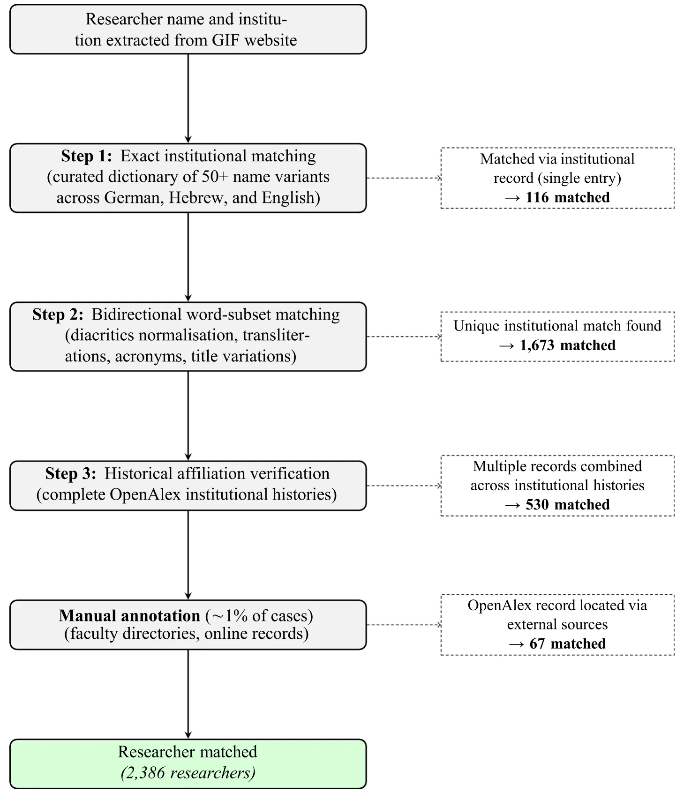
<figcaption><strong>Fig. 1</strong> Researcher identification and matching procedure</figcaption>
</figure>

Further examination of the 647 grants and their research teams led to 5 of them being classified as outliers in terms of their publication volume, which exceeded the average by a factor of at least 9 (range: 9.4–66.8), and subsequently removed from the data. Overall, our dataset comprises 642 grants, 2386 researchers, and 52,847 unique publication records spanning the years 1986–2024, with less than 0.4% missing values.

Figure 2 illustrates the grant extraction and filtering process.

<figure id="fig-2">
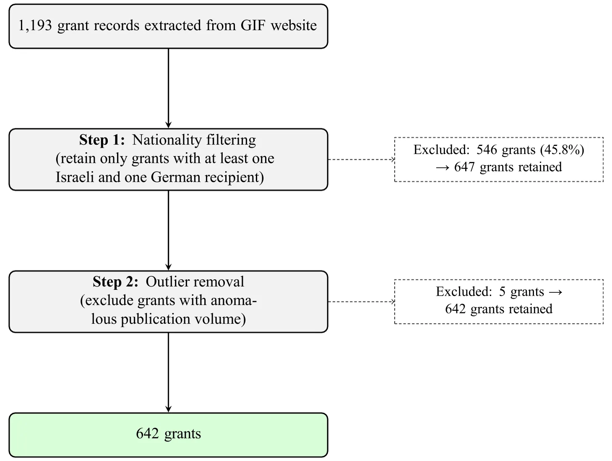
<figcaption><strong>Fig. 2</strong> Grant extraction and filtering process</figcaption>
</figure>

### Analytical approach

Since our study focuses on grants with an explicit German-Israeli team of recipients, we consider a publication to be “co-authored by the team” if and only if at least one of the Israeli grant recipients and at least one of the German grant recipients are listed in its byline. As such, our subsequent analysis explores the dynamics of these co-authored publications.

We start our analysis with a descriptive analysis of the awarded grants, focusing on their temporal co-authorship dynamics (i.e., the rate of grants with at least one co-authored publication for a given year), number of team members per awarded grant, and the distribution of key bibliometrics across funded teams. Then, we temporally divided the data into three distinct periods (pre-grant, during-grant, and post-grant) and performed a trend and survival analysis to test for temporal trends. Then, we conduct a multi-time clustering analysis and implement three distinct ML approaches to predict cluster membership based on their researchers’ characteristics. Clustering is used as a data-driven instrument to uncover prototypical collaboration dynamics of German-Israeli teams within the GIF’s funding program. The ML-based cluster membership prediction is used as a complementary tool to explore which teams are a prior more likely to present different collaboration dynamics.

### Trend and survival analysis

We first temporally divided the data into three distinct periods: *Pre-grant period*–ten years before the grant was awarded (denoted as*,* −2*,* −1); *During-grant period*–the years during which the grant is active (typically 3 years, denoted 0*,* 1*,...*) extended by 2 years to allow sufficient time for outcomes to be written, reviewed, and published (aligned with the common practice in prior work (Lyman, 2013; Emre Sarigöl, 2017)); and *Post-grant period*–ten years from the conclusion of the grant period onward.

To test for temporal trends in co-authorship rates, we applied Ordinary Least Squares linear regression (Ronald Aylmer Fisher, 1992) separately to the pre-grant decade (*t* ∈ [− 10*,* − 1]) and the post-grant decade (*t* ∈ (Bantilan et al., 2004; Defazio et al., 2009)), and compared the resulting slopes using a z-test. To assess co-authorship durability following the grant period, we conducted a Kaplan-Meier survival analysis (Kaplan & Meier, 1958) among the teams that were active during the grant period, treating the end of co-authorship activity as the event of interest. Specifically, survival time was measured in years from the end of the during-grant window. For each team, the survival time was defined as the number of years from grant end to the team’s final post-grant co-authored publication, and the event of interest (cessation of co-authorship) was treated as observed at that year; teams with no post-grant co-authored publication were assigned a survival time of zero. Teams whose final co-authored publication occurred in the last year of the post-grant observation window were right-censored, as continued co-authorship beyond the window could not be ruled out.

### Temporal clustering and statistical testing

Considering the temporal division outlined above, the clustering analysis was employed using the Dynamic Time Warping (DTW) metric (Sakoe & Chiba, 1978) combined with the K-means algorithm (MacQueen, 1967), utilising grid-search hyperparameter optimisation using the silhouette score metric (Rousseeuw, 1987) to find the optimal value for the number of clusters, *K*.

For robustness, we replicate the above analysis by varying both the distance metric and the temporal window. Specifically, we replaced DTW with the discrete Fréchet distance (Alt & Godau, 1995; Eiter & Mannila, 1994)–a curve-similarity measure that, unlike DTW, preserves the monotonicity of the time axis. In addition, we varied the length of each temporal window around the baseline values detailed above (pre-grant: 8 and 9 years; during-grant: 4 and 5 years; post-grant: 5 and 7 years). Jointly, 17 additional clustering execution configurations were examined.

We assessed the statistical differences between the identified clusters using chi-square tests for gender distribution (Pearson, 1900) and one-way analysis of variance (ANOVA) with post-hoc Mann-Whitney U tests with Bonferroni correction for continuous variables (Bonferroni, 1936; Mann & Whitney, 1947; Ronald Aylmer Fisher, 1992). Comparing co-authorship activity across disciplines was performed using a Kruskal-Wallis test (Kruskal & Wallis, 1952) and Mann-Whitney U tests. Statistical significance was set to *p* = 0*.*05.

### Machine learning prediction

For the prediction of cluster membership based on researchers’ characteristics, we implemented three standard ML models: Logistic Regression (Hosmer et al., 2013), Random Forest (Breiman, 2001; Shami & Lazebnik, 2024), and XGBoost (Chen & Guestrin, 2016). To ensure strict temporal separation between predictors and outcomes, we defined two separate prediction tasks: (1) from the pre-grant to the during-grant period (Pre → During), and (2) from the during-grant to the post-grant period (During → Post). All bibliometric features (i.e., h-index, i10-index, total publications, total citations, open access rate, and average number of collaborators) were recomputed using only publications falling within the relevant feature period. For instance, in the Pre → During model, a researcher’s h-index was calculated exclusively based on papers published before the grant award, rather than from the researcher’s cumulative career record. This design ensures that no predictor encodes information from the period used to define the target cluster. Table 1 specifies the temporal measurement window for each predictor across both transition models. A follow-up bivariate analysis using U-tests (Mann & Whitney, 1947) was performed to compare the average h-index, i10-index, total publications, and total citations between teams that sustained co-authorship after the grant and those that did not.

<figure class="table-figure" id="table-1">
<figcaption><strong>Table 1</strong> Predictor variables and their temporal measurement windows for each ML transition model</figcaption>

<table><tr><th>Feature</th><th>Definition</th><th></th></tr><tr><td>Academic age</td><td>Years since first publication h-index</td><td>Citation-based impact</td></tr><tr><td>i10-index</td><td>Papers with ≥ 10 citations</td><td></td></tr><tr><td>Total papers</td><td>Publication count</td><td></td></tr><tr><td>Total citations</td><td>Aggregate citation count Open access rate</td><td>Proportion of OA</td></tr><tr><td>publications Avg. collaborators</td><td>Mean co-authors per paper</td><td></td></tr><tr><td>Gender composition</td><td>Proportion of male researchers</td><td></td></tr></table>

Pre-grant window = 10 years before award year; During-grant window = award year through year + 6. All features computed separately for Israeli and German researchers within each grant team

</figure>

The model training and testing implemented an 80-20 percent split such that 80% is used for model training and the remaining 20% for the model’s evaluation (Shmuel et al., 2025). Model performance was evaluated using the K-fold stratified cross-validation method with *k* = 5 (Diamantidis et al., 2000). Results are compared against a majority-class (Zero-R) baseline that always predicts the most frequent cluster, providing a minimal performance reference, using chi-square tests.

For each model, we conducted a feature importance analysis (Lazebnik & Rosenfeld, 2024; Zien & Nicole Krämer., 2009) by incorporating an additional noise variable drawn from a standard normal distribution (*µ* = 0*, σ* = 1). Feature importance scores below the noise variable’s score were set to zero, and the remaining features underwent *L*1 normalisa-tion to enable comparison across algorithms.

## Results

First, we provide descriptive statistics of the collaboration dynamics. Next, we present the clustering analysis outcomes. Finally, we detail the ML-based predictions of cluster membership.

### Descriptive statistics

Out of the 642 grants analysed in this study, 100 (15.6%) grants were not associated with any team co-authored publication, indicating that these grants had no co-authorship at all before, during, or after the grant period. Excluding these grants from this temporal analysis, Figure 3 depicts the distribution of the portion of German-Israeli co-authorship rates over time. When focusing on the decade before and after the grant award year, the data approximates a normal distribution over time with *p* = 6 · 10−4 < 0*.*05, using a Wilk-Shapiro test (Shapiro & Wilk, 1965). The highest portion of co-authored publications are presented 4 years after the funding commences, with nearly half the teams (45.2%) publishing a co-authored publication in that year. Moreover, during the grant award year itself, 25% of the teams co-publish at least once. A wider pattern can also be observed with the co-authorship ratio increasing, nearly monotonically, in the range *t* ∈ [− 25*,* 4]. Specifically, in the decade prior to the grant award, the rate of co-authorship is relatively low, with less than 5% across the data. However, this rate sharply increases towards *t* = 0 and, in an almost symmetrical manner, following *t* = 4, it nearly monotonically decreases to the 5% range from *t* = 16 onward.

<figure id="fig-3">
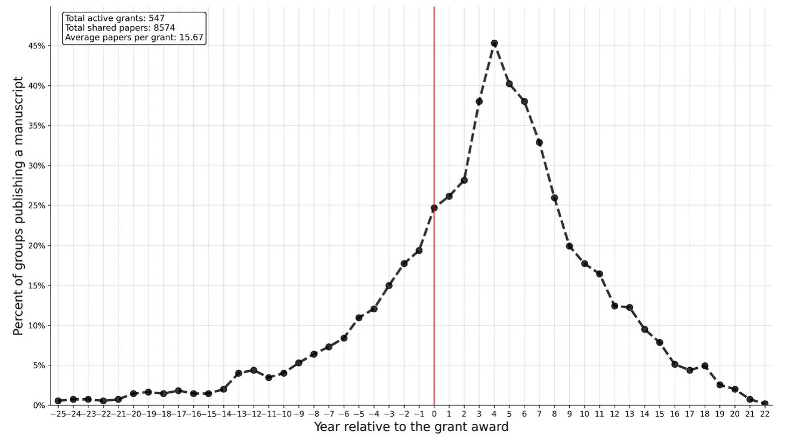
<figcaption><strong>Fig. 3</strong> The temporal distribution of German–Israeli co-authorship rates within the GIF funding framework. The X-axis presents a 48-year range from 25 years pre-award year to 22 years post-award year, with year zero marking the award year, highlighted by a red dashed vertical line</figcaption>
</figure>

Figure 4 presents the temporal variation in the average number of recipients per awarded grant. The error bars indicate one standard deviation within the data. As we focus on German-Israeli teams, it is safe to expect that all average values be higher than 2, as indeed indicated in the figure. Overall, no clear pattern can be observed with the number of recipients per grant ranging between 2.5 and 4 team members (mean of 3.23, median of 3.00 researchers) throughout the years in question. It is important to note that no data are available for the years 2019 and 2020 due to the absence of new grant awards during the COVID-19 pandemic period (Ciotti et al., 2020; Lazebnik & Bunimovich-Mendrazitsky, 2021). The error bars indicate substantial variation within each year, suggesting considerable diversity in team size across individual grants.

Figure 5 illustrates the distribution of key bibliometric diameters across research teams within the GIF funding scheme. A bibliometric diameter is defined as the largest difference in a given metric, *M*, between any two members *s*i*, s*j of a team *s*i*, s*j ∈ *S*. Formally, the diameter of metric *M*, denoted by *D*M over group *S*, is defined as *D*M (*S*) := max {∀*s*i*, s*j ∈ *S* : |*M* (*s*i)−*M* (*s*j)|}. Specifically, panel 5a presents the distribution of h-index diameters, panel 5b focuses on i10-index diameters, panel 5c reports the corresponding results for total citation counts, and panel 5 d for total publication counts. Across all four metrics, the distributions are markedly right-skewed, with strong Pareto distribution fitting (*R*2 ranging between 0.70 and 0.88). These underscore the prevalence of relatively homogeneous teams alongside a smaller subset with substantial intra-team disparities. The consistent pattern of means exceeding medians (h-index: 27.31 vs. 23.00; i10-index: 115.68 vs. 82.50; citations: 11,884.48 vs. 7,134.00; publications: 262.17 vs. 183.50) further highlights the presence of a long tail of highly heterogeneous teams. Taken together, panels 5a–5d demonstrate that while many grants are awarded to teams of comparable researchers’ standing, a non-negligible part thereof is awarded to teams with sharply contrasting academic standings. Supplementary analysis of open-access publishing patterns among GIF-funded researchers is provided in Appendix.

<figure id="fig-4">
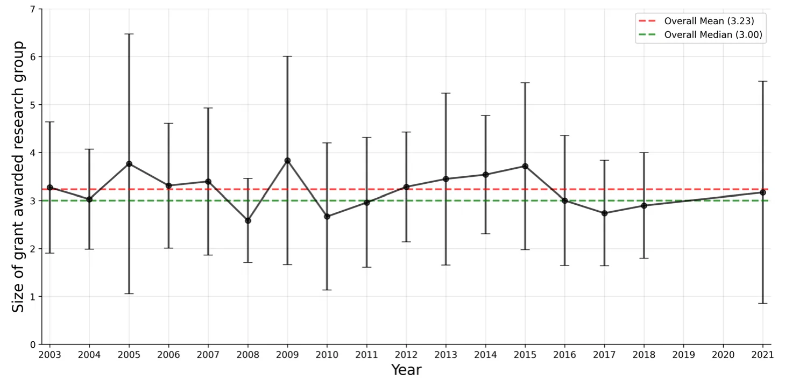
<figcaption><strong>Fig. 4</strong> The temporal variation in the average number of researchers per awarded grant. Error bars represent one standard deviation. No data are available for 2019–2020 due to the absence of new awards during the COVID-19 pandemic</figcaption>
</figure>

<figure id="fig-5">
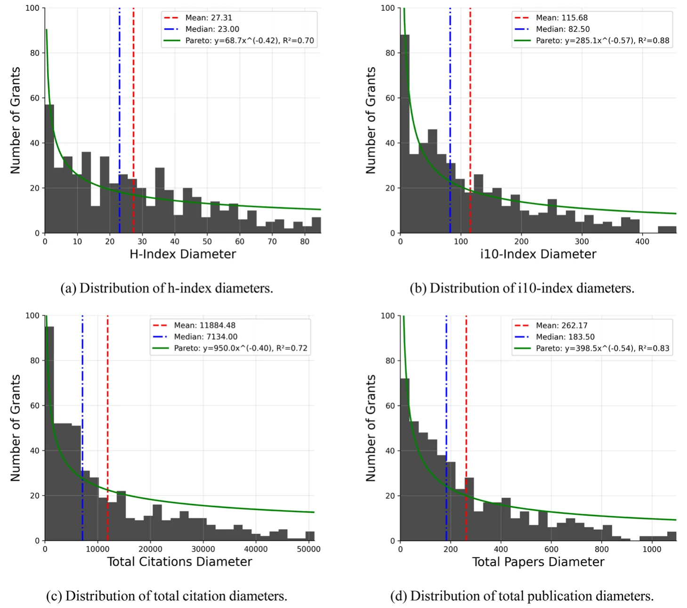
<figcaption><strong>Fig. 5</strong> Distributions of academic metric diameters across research teams supported by GIF grants. All four measures exhibit right-skewed distributions with Pareto-like tails</figcaption>
</figure>

### Trend and survival analysis

Linear regression on the pre-grant decade (*t* ∈ [− 10*,* − 1]) revealed a significant positive trend (*β* = 0*.*017, *R*2 = 0*.*97, *p* < 0*.*001), confirming that co-authorship rates rise consistently in the years leading up to the grant. On the post-grant decade (*t* ∈ (Bantilan et al., 2004; Defazio et al., 2009)), a significant negative trend of nearly twice the magnitude was found (*β* = − 0*.*030, *R*2 = 0*.*93, *p* < 0*.*001), indicating a sharper decline after the grant concludes than the rise that preceded it. The two slopes differ significantly (*Z* = 15*.*74, *p* < 0*.*001), establishing an asymmetry between co-authorship formation and dissolution around the funding period. Among the 451 teams active during the grant period, the survival analysis revealed a median post-grant co-authorship survival time of just two years, with 450 out of 451 teams eventually discontinued co-authorship within a decade.

### Clustering analysis

Our clustering analysis revealed three main clusters (see Appendix for the *K* value search graph). By manual investigation of the algorithmically derived cluster centroids, we chose to name these clusters as “No co-publications cluster”, “Several co-publications cluster”, and “High-volume publications cluster”, as the number of co-publications arises as a straightforward indicator to distinguish between them. Namely, the first cluster is associated with no co-publications at all, while the second and third clusters are associated with less than or equal to 3 co-publications per year on average, and more than 3 co-publications per year on average, respectively. Importantly, these labels and the associated thresholds are descriptive characterisations of the data-driven groupings; no predefined cutoffs were imposed on the clustering procedure.

Table 3 presents a comparison between the three clusters in the researcher-level bibliometrics across clusters in the pre-grant, during-grant, and post-grant periods. One can notice that teams with no pre-grant co-publications are not necessarily composed of early-career researchers. In fact, these teams display substantial productivity and impact, with an average h-index of 46.2 and more than 280 publications per researcher, roughly comparable with teams that already had several pre-grant co-publications. By contrast, high-volume pre-grant co-publications consist of more experienced and productive researchers, reflected by their higher average h-index (54.2), i10-index (171.4), and total output (398.5 publications on average). During the grant period, moderate and high-volume co-publication clusters are both characterised by higher average bibliometric scores than the no co-publication teams. High-volume teams, for example, average more than 345 publications and over 15,000 citations per researcher, compared to 225 publications and 10,027 citations for inactive teams. The average number of researchers per grant also increases with collaboration intensity, rising from about 3 for inactive or moderately productive teams to above 4 in high-output collaborations. In the post-grant period, academic age naturally increases across all clusters, but collaboration intensity continues to differentiate teams. High-volume post-grant groups again display the strongest metrics (h-index 52.7, i10-index 162.9, nearly 16,100 citations), and they also sustain the largest team sizes (4.68 researchers per grant). By contrast, inactive post-grant teams maintain lower bibliometric indicators despite similar academic age. Gender distribution remains stable across all clusters and periods, with male ratios consistently around 0.80–0.85.

Chi-square tests revealed no significant differences in gender distribution across clusters in any of the three time periods (pre-grant: *χ*2 = 1*.*29, *p* = 0*.*525; during grant: *χ*2 = 2*.*97, *p* = 0*.*227; post-grant: *χ*2 = 2*.*70, *p* = 0*.*259). Moreover, an ANOVA test presented statistically significant differences between clusters across all bibliometric measures in each time period. Post-hoc U tests show all pairs are also statistically significantly different.

Figure 6 illustrates the dynamics of collaboration intensity between three phases: pre-grant, during-grant, and post-grant. Each box represents the proportion of teams associated with each cluster. Arrows capture how teams transition across clusters between periods, with colours highlighting key types of trajectories: blue arrows denote funding-oriented activation paths where previously inactive or moderately active teams increase collaboration when funding becomes available, and decrease it when funding stops; green arrows represent seemingly desired transitions, where co-authorship is sustained or even strengthened beyond the funding period; red arrows mark collapse paths, where co-authorship ceases entirely once funding ends; and yellow arrows denote persistently inactive groups that fail to co-publish during and even after the funding. Gray arrows capture all other transitions. Starting with the pre- to during-grant transition, we see a strong funding-oriented transition. Notably, 241 out of 413 grants (58.4%) with no prior co-publication became collaborative (≤ 3 co-publications per year, on average) during the grant period (blue). An additional 14 grants (3.4%) leaped directly from inactivity to high output (> 3 publications per year, on average). In contrast, 32 out of 188 moderately active pre-grant teams (17.0%) produced no outputs during the grant, indicating occasional reversals. High-output teams before the grant (41 in total) largely maintained their co-authorship, with 20 (48.8%) remaining highly productive and another 20 (48.8%) reducing to moderate levels. The transition from the grant period to the post-grant period reveals the sustainability of these co-authorship ties. Here, 234 out of 398 (58.8%) moderately collaborative teams remained so, and 17 (4.3%) even advanced to high productivity (green). Among the most productive teams during the grant, 17 out of 53 (32.1%) remained highly productive post-grant, while 29 (54.7%) lowered to moderate levels (blue). However, a substantial fraction of co-authorship ties collapsed once funding ended. Specifically, 147 out of 398 (36.9%) moderately collaborative groups and 7 out of 53 (13.2%) highly collaborative teams produced no co-publications after the grant (red). At the same time, 132 out of 191 groups (69.1%) that were already inactive during the grant remained inactive afterward (yellow), representing missed opportunities where funded projects failed to spark co-authorship. Overall, more than half (58.4%) of previously inactive teams became active during the funding period. Moreover, sustainability is limited: almost one-quarter of all co-authorship ties (154 grants, 24.0%) collapsed after the grant ended. Furthermore, long-term success is uneven: while about one-third of high-performing teams sustained their co-authorship, nearly 70% of inactive teams never co-publish.

<figure id="fig-6">
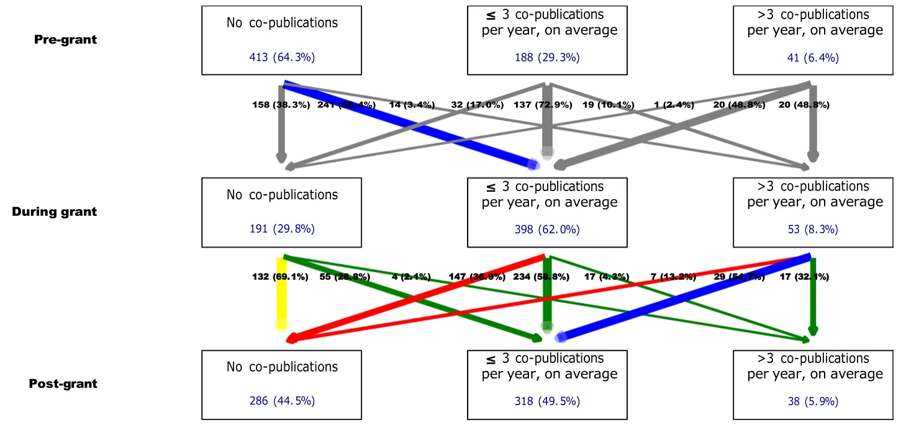
<figcaption><strong>Fig. 6</strong> Temporal cluster analysis of the co-authorship dynamics across pre-grant, during-grant, and post-grant periods. The colours highlight prototypical trajectories: blue–funding-oriented dynamics; green–successful sustained co-authorship; red–collapse after funding; yellow–persistently inactive teams; gray–other transitions. (Color figure online)</figcaption>
</figure>

To further examine whether post-grant co-authorship persistence varies by prior collaboration rates, we com-pared the pre-grant cluster membership of teams that sustained co-authorship after the grant against those that did not. Among teams that were active during the grant period (*n* = 452), 65.9% maintained at least some co-authorship activity post-grant, while 34.1% collapsed entirely. Persistent teams had a significantly higher pre-grant collaboration rates than non-persistent teams (*U* = 26990*.*5, *p* < 0*.*001). Specifically, among teams with no prior co-authorship (pre-grant), 59.6% remained active post-grant, compared to 70.5% of moderately active pre-grant teams and 87.5% of highly active pre-grant teams. This suggests that prior collaborative ties are a significant predictor of post-grant co-authorship persistence.

To examine whether co-authorship dynamics vary across disciplinary contexts, we grouped the grants into three broad categories: STEM (Physics, Chemistry, Mathematics, Computer Sciences, Electrical Engineering, Mechanical Engineering, and Engineering Sciences; *n* = 210), Life Sciences (Biology, Medicine, Biochemistry, Agricultural Sciences, Practical Medicine, Geology, and Environmental Sciences; *n* = 159), and Humanities and Social Sciences (Psychology, Economics, Law, History, Social Sciences, Language Sciences, Geography, Old and Oriental Culture, and History of Sciences; *n* = 73). Significant differences across disciplines in co-authorship activity were observed during the grant period (*H* = 13*.*13, *p* = 0*.*001), with STEM teams showing the highest active co-authorship rate (89.0%), followed by Life Sciences (82.4%) and Humanities and Social Sciences (68.5%). A chi-square test similarly confirmed significant differences in cluster distribution during the grant period (*χ*2 = 17*.*34, *p* = 0*.*002). However, post-grant persistence rates did not differ significantly across disciplines (*χ*2 = 4*.*19, *p* = 0*.*382), with rates of 70.6%, 71.0%, and 86.0% for STEM, Life Sciences, and Humanities and Social Sciences respectively.

The robustness analysis, conducted across all 17 configurations, consistently recovered three clusters whose composition and transition patterns closely mirror those reported in our main analysis. Specifically, in all configu-rations the optimal partition comprised the same three qualitative groups–inactive, moderately active, and highly active teams–with cluster sizes remaining broadly stable across configurations. Full results for all configurations are reported in Appendix.

### Machine learning prediction for cluster association

Table 4 presents the predictive performance of each model for both examined transitions (Pre → During and During → Post), alongside a majority-class (Zero-R) baseline. For the Pre → During transition, XGBoost achieves the most favorable performance (accuracy = 0.67), followed by Random Forest (accuracy = 0.51) and Logistic Regression (accuracy = 0.34). For the During → Post transition, XGBoost brings about the highest performance (accuracy = 0.60), followed by Random Forest (accuracy = 0.54) and Logistic Regression (accuracy = 0.36). Crucially, across both transitions, the best-performing ML model (XGBoost) does not outperform the majority-class baseline in accuracy. In fact, the baseline model achieves significantly higher accuracy than the Logistic Regression (both transitions) and the Random Forest (Pre → During).

A follow-up bivariate analysis of the average h-index, i10-index, total publications, and total citations be-tween teams that sustained co-authorship after the grant and those that did not revealed no statistically significant differences.

A feature analysis of the ML models are provided in Appendix.

## Discussion

Our results combine to suggest that while bi-national funding, exemplified by the GIF, is associated with increased collaborative activity during the grant period, this association rarely extends to new, lasting partnerships between the researchers involved. As Figure 3 demonstrates, co-authorship activity rises sharply slightly before and mainly during the grant period but declines rapidly afterward, returning to pre-grant levels within a decade. Similarly, the cluster flow analysis and Table 3 show that most “new” co-authorship ties (i.e., those with no prior co-publications) either dissolve entirely or regress to very low levels of co-authorship activity once funding ends. Thus, rather than being indicative of enduring collaborative partnerships, GIF-supported collaborations often appear as temporary alliances bounded by the grant cycle. In other words, the GIF appears to be associated with reinforcing existing ties and short-lived bursts of productivity, but is rarely associated with self-sustaining partnerships.

These findings align with prior work on the fragility of grant-induced co-authorship ties across funding scales. At the multinational level, studies of the EU Framework Programmes have documented similar patterns of post-funding attrition (Morillo, 2019). Comparable dynamics have been observed under national funding schemes in diverse contexts, including competitive research grants (Jacob & Lefgren, 2011; Saygitov, 2014; Ubfal & Maffioli, 2011), institutional incentive programmes (Schroen et al., 2012), and broader analyses of funding-induced collaboration networks (Russo et al., 2018; Shin et al., 2022). Additionally, network theory suggests that durable ties require repeated, multi-contextual interactions that build trust, shared infrastructure, and mutual dependency (Manning, 2010). However, by design, bi-national partnerships are dyadic, small-scale, and project-based. Without larger con-sortia or structural incentives to embed collaborations within institutional frameworks, partnerships lack resilience once the financial “glue” is removed (Bellotti et al., 2016). Moreover, the skewed distribution of differences in recipients’ biblio-metrics, as depicted in Figure 5, indicates that many teams pair researchers with very different levels of experience and standing. While such asymmetry may yield short-term complementarities, it is often assumed to undermine the reciprocity needed for long-term continuity (Alexi et al., 2024).

Across both examined transition phases (pre-grant to during-grant and during-grant to post-grant), standard bibliometric indicators demonstrated negligible discriminative power: even the highest-performing model failed to achieve predictive accuracy meaningfully beyond a naive majority-class baseline. Therefore, this result is primarily diagnostic and negative, indicating that standard bibliometric profiles of team mem-bers are poor predictors of cluster membership. This is not evidence about the mechanisms underlying co-authorship persistence. One hypothesis consistent with this negative result, which our analysis cannot itself confirm, is that co-authorship trajectories are shaped by latent contextual and relational factors that are not captured by standard bibliometrics. This interpretation is consistent with prior work suggesting that researcher mobility and structural enablers are associated with more durable international networks (Franzoni et al., 2017; Scellato et al., 2015) than individual researcher characteristics or isolated project-based funding (Bozeman & Corley, 2004; Ubfal & Maffioli, 2011).

Taken jointly, the GIF appears to be associated with short-term collaborative activity, yet the bibliometric data do not support the persistence of these activities. Recognizing this limitation opens the door for improving and even redesigning bi-national funding schemes in ways that move beyond temporary alliances and instead nurture resilient, long-lasting networks. With appropriate adjustments, such programmes can better align scientific collaboration with broader policy goals.

It is important to note that this study is not without limitations. First, we adopted the common bibliometric approach, where co-authorship is considered as a proxy for collaboration (Subramanyan, 1983). This approach overlooks other important forms of partnership, such as joint grant applications, student exchanges, or shared data (Kahn, 2018). In addition, our reliance on OpenAlex as the sole bibliometric data source introduces potential coverage biases, as certain publication types, languages, or regional journals may be underrepresented in the database (Priem et al., 2205). Therefore, future research could combine additional bibliometric data with surveys, interviews, and mobility records to capture a more nuanced perspective. Second, our design cannot fully disentangle whether GIF funding creates new collabo-rations or merely reinforces existing ones, suggesting that causal evaluation methods, such as matched controls or regression discontinuity designs, would strengthen future analyses (Imbens & Lemieux, 2008; Pearce, 2016). Furthermore, while our disciplinary analysis reveals that STEM teams are significantly more likely to co-author publications during the grant period than Humanities and Social Sciences teams, post-grant survival rates do not differ significantly across disciplines.

This suggests that disciplinary differences primarily shape the likelihood of initiating co-authorship rather than its durability once established. Nevertheless, field-normalised metrics and non-traditional outputs such as software, patents, or policy briefs, remain outside the scope of the current study (Alperin et al., 2022; Bantilan et al., 2004), and future work should incorporate these dimensions for a more complete picture.

## Conclusions

In this study, we explored the relationship between bi-national academic funding and long-term collaboration dynamics using the German-Israeli Foundation (GIF) as a case study. By tracking co-authorship trajectories across 642 grants and integrating temporally-aware clustering with machine learning, we demonstrated that while bi-national funding is reliably associated with elevated collaborative activity during the grant period, this activity rarely persists as enduring co-authorship. Co-authorship typically spikes around the funding window but regresses to pre-grant levels shortly after.Furthermore, our predictive modeling revealed that standard bibliometric indicators fail to forecast post-grant collaboration persistence; we hypothesise—though our analysis cannot establish this—that long-term scientific ties are shaped more by contextual and relational factors than by bibliometric ones. These findings contribute to the broader research policy literature by chal-lenging the assumption that dyadic, project-based funding inherently forges sustainable international networks.

Consequently, for funding agencies and research institutions, these insights highlight the potential limitations of relying solely on isolated funding cycles to overcome project-based attrition. If the goal is to build resilient net-works, alternative structural arrangements must be conceptualised and empirically tested. Potential mechanisms to investigate could include sequential funding opportunities, institutional anchoring (such as joint research cen-ters or shared infrastructure), and multi-nodal consortia that extend beyond dyadic pairings. Furthermore, given our finding that bibliometrics are an insufficient predictor of durable partnerships, alternative evaluation criteria warrant exploration. Shifting evaluation frameworks to reward signals of embedded cooperation–such as sustained trainee exchange or joint follow-up applications–provides a promising theoretical alternative that should be rigorously evaluated in future research.

Future investigations should also expand upon these descriptive foundations to build a more comprehensive model of network resilience. First, comparative studies across multiple funding programs–contrasting bi-national schemes with larger multi-national or strictly national initiatives–would help isolate the structural mechanisms that best support long-term collaboration. Second, the methodological reliance on co-authorship should be broadened to include additional collaborative indicators, such as joint grant applications, shared datasets, and patent co-inventions. Finally, a deeper exploration of disciplinary differences is warranted; while our findings suggest that STEM fields initiate co-authorship more readily during the grant window, understanding the specific mechanisms that allow different disciplines to sustain these ties over time could inform more tailored, domain-specific funding strategies.

## Appendix

### Cluster optimal size

Figure 7 presents the silhouette scores obtained for different numbers of clusters (*K*) across the three temporal phases. Despite some variation between the pre-grant, during-grant, and post-grant periods, the average score across all phases shows a clear global maximum at *K* = 3. This indicates that three clusters provide the most consistent and robust partitioning of the data when considering all periods jointly. Although higher values of *K* occasionally yield locally improved scores in specific periods (e.g., post-grant at *K* = 5), these solutions are not stable across the full temporal scope and result in a marked drop in the average silhouette score. By contrast, the three-cluster solution balances interpretability with statistical validity, offering a coherent structure that captures the main collaboration trajectories without overfitting (Fig. 8).

<figure id="fig-7">
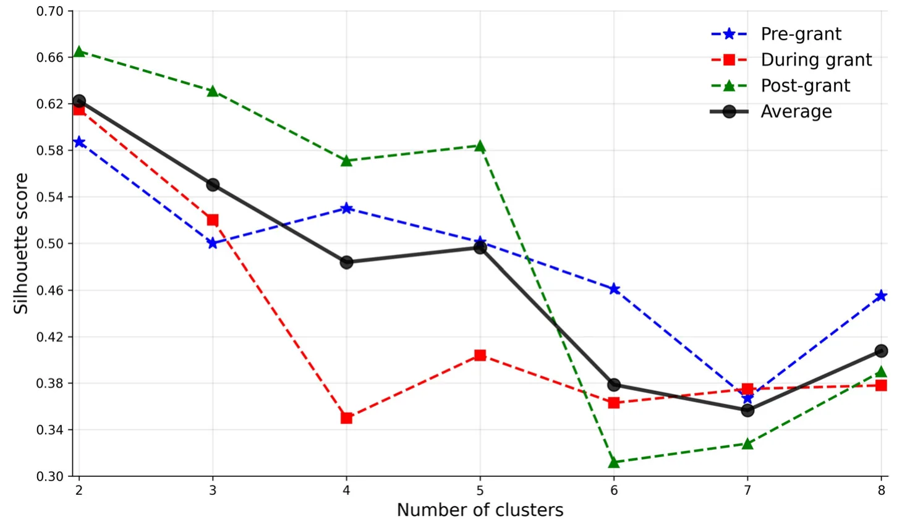
<figcaption><strong>Fig. 7</strong> Silhouette score over different number of clusters (<em>K</em>)</figcaption>
</figure>

<figure id="fig-8">
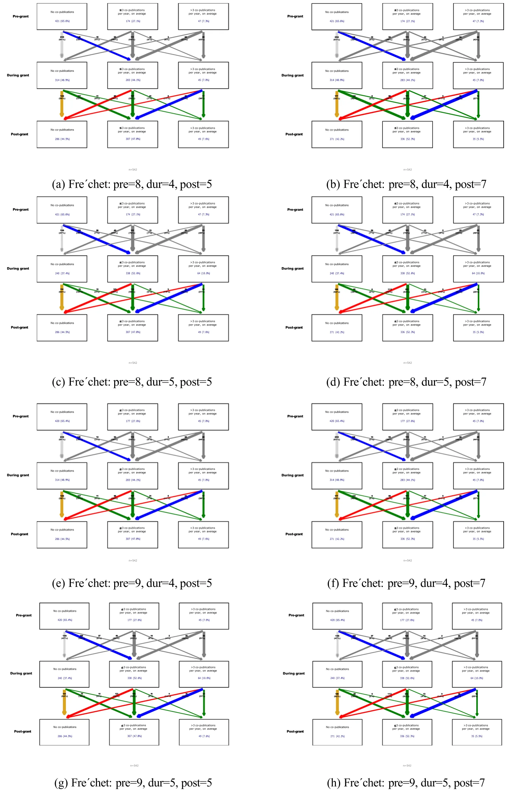
<figcaption><strong>Fig. 8</strong> Robustness analysis: cluster-flow diagrams. Arrow colours follow the same convention as Fig. 6. All 17 configurations consistently recover the same three-cluster structure and transition patterns reported in the main text</figcaption>
</figure>

<figure id="fig-8b">
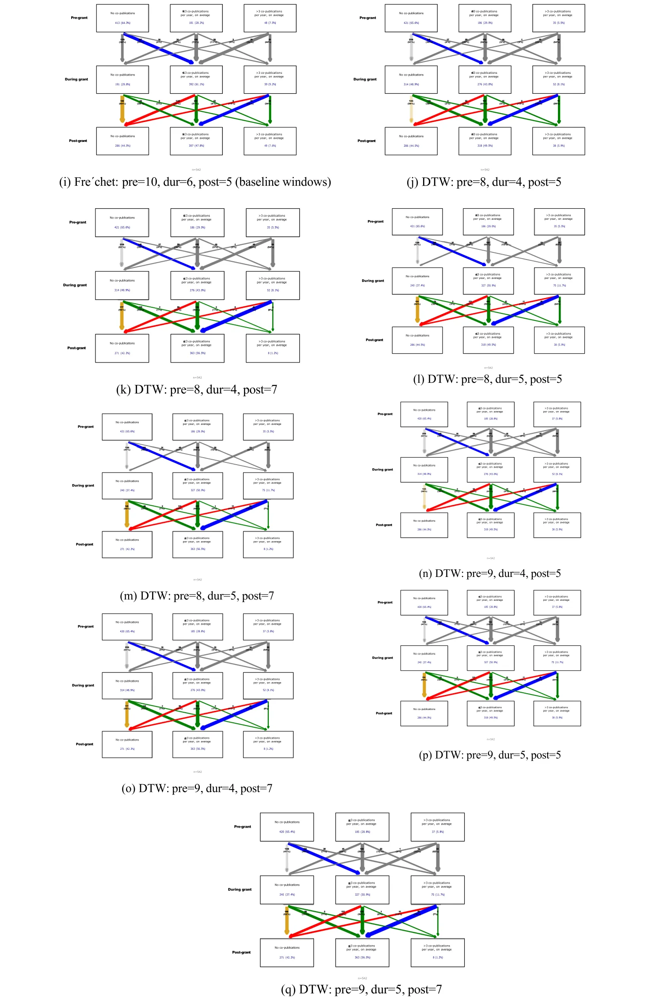
<figcaption><strong>Fig. 8</strong> (continued)</figcaption>
</figure>

### Clustering robustness

To verify that the three-cluster solution and the resulting co-authorship trajectories are not artefacts of a particular methodological choice, we conducted a systematic robustness analysis across 17 configurations. These configurations varied along two dimensions: (i) the distance metric–Dynamic Time Warping (DTW) (Sakoe & Chiba, 1978) versus the discrete Fréchet distance (Alt & Godau, 1995; Eiter & Mannila, 1994)–and (ii) the length of each temporal window (pre-grant: 8, 9, or 10 years; during-grant: 4, 5, or 6 years; post-grant: 5 or 7 years). In every configuration the same pipeline was applied: grants with zero co-publications in the relevant windows were separated into a dedicated cluster, the remaining grants were embedded via MDS on the pairwise distance matrix, and K-means with silhouette-score optimisation was used to select the number of active-grant clusters.

Across all 17 configurations, three qualitative findings remain stable. First, the optimal number of clusters (excluding the zero-publication group) is consistently two, yielding a total of three clusters that map onto the same substantive categories reported in the main text. Second, the dominant transition pattern is preserved: a majority of previously inactive teams become moderately active during the grant, yet a substantial share reverts to inactivity once funding ends. Third, the proportion of teams that sustain or strengthen co-authorship post-grant remains a minority across all configurations. Taken together, these results confirm that the trajectory typology and the associated policy conclusions are robust to reasonable perturbations of the distance metric and temporal window length.

### Feature analysis

We computed feature importance for each model across both transitions (Figure 9). For the Pre → During tran-sition, none of the three algorithms identifies features that consistently surpass the noise threshold, reflecting the limited predictive signal available in pre-grant bibliometrics. For the During → Post transition, XGBoost identifies four features above the noise threshold: average academic age of Israeli researchers (0.28), gender composition of the Israeli team (0.25), average academic age of German researchers (0.24), and gender composition of the German team (0.23). Importantly, standard impact metrics—h-index, i10-index, total citations, and total publica-tions—fall below the noise threshold across all models and both transitions, suggesting that the modest predictive signal that does exist is carried primarily by demographic and seniority characteristics rather than by measures of academic output. Because no model exceeded the majority-class baseline, however, these feature-importance and SHAP patterns should be read as suggestive descriptions of the limited within-model signal rather than as established determinants of co-authorship persistence.

In a complementary manner, Figure 10 summarises the SHAP (SHapley Additive exPlanations) values asso-ciated with each of the three ML-based models across both transitions, offering a more fine-grained perspective on how individual features influence predictions of cluster membership. For the Pre → During transition (left column), no feature consistently dominates across models, reflecting the limited predictive signal available in pre-grant bibliometrics. For the During → Post transition (right column), Logistic Regression assigns weight primarily to academic age and gender composition, though the spread of SHAP values indicates substantial variation across individuals. In the Random Forest model, no single feature dominates, with all features contributing negligibly. XGBoost provides a more balanced distribution, with academic age and gender composition of researchers from both countries contributing meaningfully to predictions. The SHAP distributions confirm that higher academic age tends to push predictions toward the active co-authorship clusters. However, the absence of strong contri-butions from bibliometric impact indicators across all models and both transitions reinforces the conclusion that co-authorship trajectory is not reliably predicted by the scientific standing of participating researchers.

<figure id="fig-9">
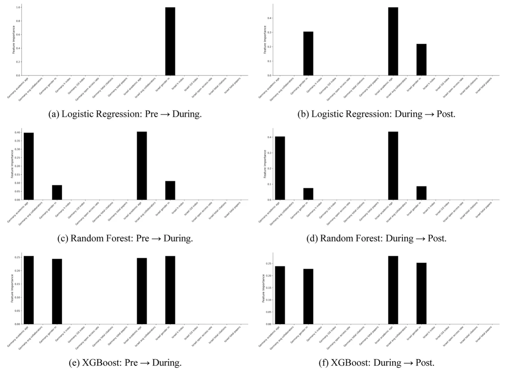
<figcaption><strong>Fig. 9</strong> Feature importance distribution for each ML-based cluster prediction model across both transitions. Left column: Pre → During; Right column: During → Post</figcaption>
</figure>

<figure id="fig-10">
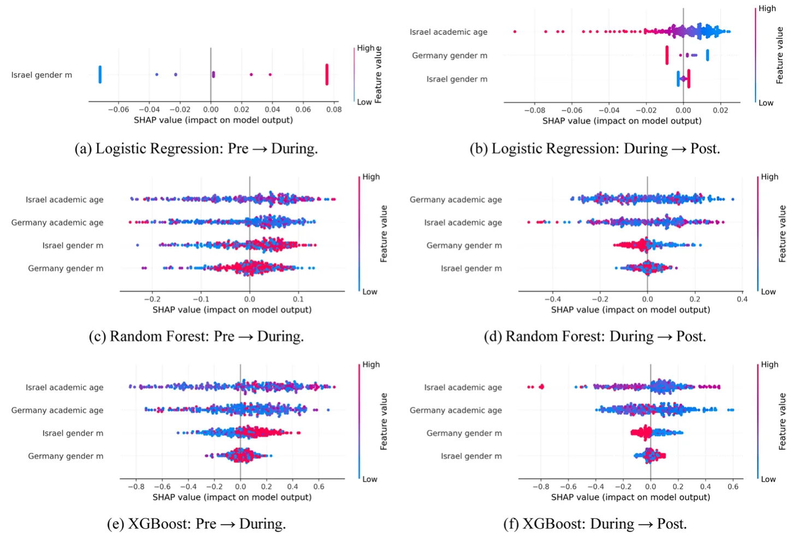
<figcaption><strong>Fig. 10</strong> SHAP analysis for each ML-based cluster prediction model across both transitions. Left column: Pre → During; Right column: During → Post</figcaption>
</figure>

**Supplementary analysis: open‑access publishing patterns among gif researchers**

The following analysis is offered as supplementary descriptive context, peripheral to the central findings on co-authorship trajectories. Publicly funded research schemes such as GIF carry an implicit expectation that their outputs be openly accessible to the broadest possible audience. Yet as the analysis below shows, this expectation is far from uniformly met in practice.

While out of the scope of the main claims in this manuscript, we include an examination of open access (OA) publishing patterns in the context of GIF grants. Research funding, especially when it originates from public sources, carries the expectation that funded results circulate as widely as possible. OA has emerged as one of the key vehicles for real-ising this ambition. Germany and Israel each bring distinct traditions and infrastructures into the shared GIF framework (Yair, 2019, 2020, 2023).

By examining publication patterns, we can observe how collaborations under the GIF engage with wider debates about access and dissemination. Figure 11 illustrates these dynamics: the distribution of grant-specific OA ratios is sharply bimodal, with peaks at both extremes: 247 researchers have no open access publications (ratio = 0.0), while nearly 192 researchers publish exclusively in open access formats (ratio = 1.0). The mean (0.487) and median (0.500) indicate that researchers tend to adopt either traditional publishing strategies, mixed approaches, or fully open access models (Table 2, Table 3, Table 4).

<figure id="fig-11">
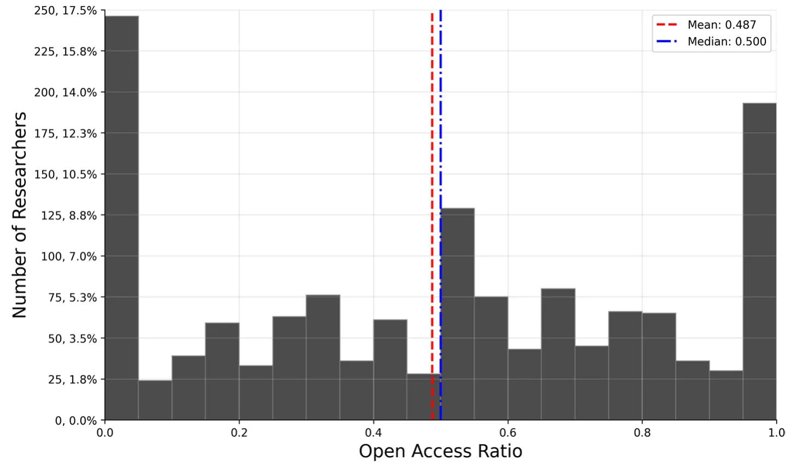
<figcaption><strong>Fig. 11</strong> The distribution of grant-specific open access publication ratios among researchers in cluster grants</figcaption>
</figure>

<figure class="table-figure" id="table-2">
<figcaption><strong>Table 2</strong> Features of the grant, researcher, and publication in the dataset</figcaption>

<table><tr><th>Feature category</th><th>Variables grant</th></tr><tr class="row-group"><td>Information</td><td></td></tr><tr><td>Title</td><td>Project title as extracted from GIF website</td></tr><tr><td>Researchers</td><td>Principal investigator names (used for OpenAlex matching)</td></tr><tr><td>Program</td><td>Research program classification</td></tr><tr><td>Research area</td><td>Scientific field or domain of the research project</td></tr><tr><td>Proposal year</td><td>Year the grant proposal was submitted and approved</td></tr><tr><td>Institution country</td><td>Country classification (Germany/Israel)</td></tr><tr><td>Researchers country</td><td>Principal investigator names (used for OpenAlex matching)</td></tr><tr class="row-group"><td>OpenAlex information</td><td></td></tr><tr><td>Researcher name</td><td>OpenAlex display name (may differ from original name) Original Name</td></tr><tr><td>Original name</td><td>Name from GIF database (used for matching)</td></tr><tr><td>Institution</td><td>Home institution from GIF (used for institutional matching)</td></tr><tr><td>OpenAlex ID</td><td>Author identifier (e.g., A5080334402)</td></tr><tr><td>ORCID</td><td>Open Researcher and Contributor ID when available</td></tr><tr class="row-group"><td>Bibliometric metrics</td><td></td></tr><tr><td>H-Index</td><td>Citation-based impact measure</td></tr><tr><td>i10-Index</td><td>Number of publications with at least 10 citations</td></tr><tr><td>Total papers</td><td>Complete publication count</td></tr><tr><td>Total citations</td><td>Aggregate citation count</td></tr><tr class="row-group"><td>Institutional affiliations</td><td></td></tr><tr><td>Institution name</td><td>Affiliated institution names</td></tr><tr><td>Institution country</td><td>Institution country codes</td></tr><tr class="row-group"><td>Publication details</td><td></td></tr><tr><td>Paper title</td><td>Individual publication titles</td></tr><tr><td>Publication year</td><td>Year of publication</td></tr><tr><td>Journal information</td><td>Journal name and ISSN</td></tr><tr><td>DOI</td><td>Digital Object Identifier</td></tr><tr><td>Citation count</td><td>Per-paper citation metrics</td></tr><tr><td>Publication type</td><td>Article, review, book chapter, etc</td></tr><tr><td>Open access</td><td>Open access availability status</td></tr><tr class="row-group"><td>Collaboration data</td><td></td></tr><tr><td>Collaborator names</td><td>Co-author names separated by vertical bars</td></tr><tr><td>Collaborator IDs</td><td>OpenAlex IDs of co-authors (normalised to primary IDs)</td></tr><tr class="row-group"><td>Gender information</td><td></td></tr><tr><td>First name</td><td>Extracted first name for gender prediction</td></tr><tr><td>Predicted gender</td><td>Predicted gender (M/F/N)</td></tr><tr><td>Gender confidence</td><td>Confidence score and percentage</td></tr></table>

</figure>

<figure class="table-figure" id="table-3">
<figcaption><strong>Table 3</strong> Average research-level bibliometrics for different clusters during the pre-grant, during-grant, and post-grant periods</figcaption>
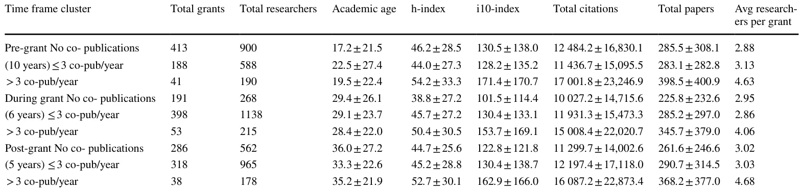

</figure>

<figure class="table-figure" id="table-4">
<figcaption><strong>Table 4</strong> Predictive performance of ML models and the majority-class baseline for two cluster transitions</figcaption>

<table><tr><th>Transition</th><th>Algorithm</th><th>Accuracy</th><th>F1 Score</th><th>Recall</th><th>Precision</th><th>AUC​</th></tr><tr><td>Pre → During</td><td>Majority class (Zero-R)</td><td>0.73</td><td>0.61</td><td>–</td><td>–</td><td>0.50</td></tr><tr><td></td><td>Logistic regression</td><td>0.34</td><td>0.39</td><td>0.34</td><td>0.51</td><td>0.43</td></tr><tr><td></td><td>Random forest</td><td>0.51</td><td>0.51</td><td>0.51</td><td>0.52</td><td>0.47</td></tr><tr><td></td><td>XGBoost</td><td>0.67</td><td>0.62</td><td>0.67</td><td>0.61</td><td>0.58</td></tr><tr><td>During → Post</td><td>Majority class (Zero-R)</td><td>0.57</td><td>0.42</td><td>–</td><td>–</td><td>0.50</td></tr><tr><td></td><td>Logistic regression</td><td>0.36</td><td>0.40</td><td>0.36</td><td>0.49</td><td>0.47</td></tr><tr><td></td><td>Random forest</td><td>0.54</td><td>0.54</td><td>0.54</td><td>0.53</td><td>0.56</td></tr><tr><td></td><td>XGBoost</td><td>0.60</td><td>0.60</td><td>0.60</td><td>0.61</td><td>0.66</td></tr></table>

All bibliometric features were computed exclusively from publications within the relevant temporal window

<strong>Author contributions</strong> Amit Bengiat: Conceptualization, Methodology, Software, Formal analysis, Data Curation, Writing—Original Draft, Visualization. Teddy Lazebnik: Software, Supervision, Formal analysis, Investigation, Validation, Resources, Writing—Review &amp; Editing, Visualization. Philipp Mayr: Validation, Writing—Review &amp; Editing. Ariel Rosenfeld: Conceptualization, Supervision, Methodology, Validation, Writing—Original Draft, Writing—Review &amp; Editing.

<strong>Funding</strong> Open access funding provided by Bar-Ilan University.

<strong>Data availability</strong> The code and data that have been used in this study are available from the corresponding author.

</figure>

## Declarations

**Conflicts of interest** The authors have no competing interests to declare that are relevant to the content of this article.

## References

- Abramo, G., & D’Angelo, C. A. (2022). The impact of Italian performance-based research funding sys-tems on the intensity of international research collaboration. Research Evaluation. [doi:10.1093/reseval/rvac026](https://doi.org/10.1093/reseval/rvac026)
- Adams, J. (2024). National research impact is driven by global collaboration, not rising performance. Scientometrics. [doi:10.1007/s11192-024-05010-6](https://doi.org/10.1007/s11192-024-05010-6)
- Alexi, A., Lazebnik, T., & Rosenfeld, A. (2024). The scientometrics and reciprocality underlying co-authorship panels in Google scholar profiles. Scientometrics, 129(6), 3303–3313. [doi:10.1007/s11192-024-05010-6](https://doi.org/10.1007/s11192-024-05010-6)
- Alperin, J. P., Schimanski, L. A., La, M., Niles, M. T., & McKiernan, E. C. (2022). 13 the value of data and other non-traditional scholarly outputs in academic review. The open handbook of linguistic data management (p. 171)
- Alt, H., & Godau, M. (1995). Computing the Fréchet distance between two polygonal curves. International Journal of Computational Geometry & Applications, 5, 75–91.
- Bantilan, M. C. S., Chandra, S., Mehta, P. K., & Keatinge, J. D. H. (2004). Dealing with diversity in scientific outputs: Implications for international research evaluation. Research Evaluation, 13(2), 87–93.
- Bellotti, E., Kronegger, L., & Guadalupi, L. (2016). The evolution of research collaboration within and across disciplines in Italian academia. Scientometrics, 109(2), 783–811.
- Bonferroni, C. (1936). Teoria statistica delle classi e calcolo delle probabilita. Pubblicazioni Del R Istituto Superiore di Scienze Economiche e Commericiali di Firenze, 8, 3–62.
- Bozeman, B., & Corley, E. (2004). Scientists’ collaboration strategies: Implications for scientific and technical human capital. Research Policy, 33(4), 599–616.
- Breiman, L. (2001). Random forests. Machine Learning, 45(1), 5–32.
- Ciotti, M., Ciccozzi, M., Terrinoni, A., Jiang, W.-C., Wang, C.-B., & Bernardini, S. (2020). The COVID-19 pandemic. Critical Reviews in Clinical Laboratory Sciences, 57(6), 365–388.
- Clark, B. Y., & Llorens, J. J. (2012). Investments in scientific research: Examining the funding threshold effects on scientific collaboration and variation by academic discipline. Policy Studies Journal, 40(4), 698–729.
- Culbert, J. H., Hobert, A., Jahn, N., Haupka, N., Schmidt, M., Donner, P., & Mayr, P. (2025). Reference coverage analysis of OpenAlex compared to Web of Science and Scopus. Scientometrics, 130(4), 2475–2492.
- Davies, B., Gush, J., Hendy, S. C., & Jaffe, A. B. (2022). Research funding and collaboration. Research Policy, 51(2), Article 104421.
- Defazio, D., Lockett, A., & Wright, M. (2009). Funding incentives, collaborative dynamics and scientific productivity: Evidence from the eu framework program. Research Policy, 38, 293–305.
- Diamantidis, N. A., Karlis, D., & Giakoumakis, E. A. (2000). Unsupervised stratification of cross-validation for accuracy estimation. Artificial Intelligence, 116(1–2), 1–16.
- Franzoni, C., Scellato, G., & Stephan, P. (2017). A mobility boost for research. Science, 356(6339), 694–694.
- German-Israeli Foundation for Scientific Research and Development. About us, 2024. Accessed: 2024.
- Granovetter, M. S. (1973). The strength of weak ties. American Journal of Sociology, 78(6), 1360–1380.
- Hicks, D. J., Coil, D., Stahmer, C., & Eisen, J. (2019). Network analysis to evaluate the impact of research funding on research community consolidation. PLoS ONE. [doi:10.1371/journal.pone.0218273](https://doi.org/10.1371/journal.pone.0218273)
- Hoekman, J., Scherngell, T., Frenken, K., & Tijssen, R. (2013). Acquisition of European research funds and its effect on international scientific collaboration. Journal of Economic Geography, 13(1), 23–52. [doi:10.1371/journal.pone.0218273](https://doi.org/10.1371/journal.pone.0218273)
- Hosmer, D. W., Jr., Lemeshow, S., & Sturdivant, R. X. (2013). Applied logistic regression (Vol. volume 398). John Wiley & Sons.
- Hu, Y., Hu, C., Tran, T., Kasturi, T., Joseph, E., & Gillingham, M. (2021). What’s in a name?—Gender classification of names with character-based machine learning models. Data Mining and Knowledge Discovery, 35(4), 1491–1512.
- Imbens, G. W., & Lemieux, T. (2008). Regression discontinuity designs: A guide to practice. Journal of Econometrics, 142(2), 615–635.
- Jacob, B. A., & Lefgren, L. (2011). The impact of research grant funding on scientific productivity. Journal of Public Economics, 95(9–10), 1168–1177.
- James MacQueen et al. Some methods for classification and analysis of multivariate observations. In Proceedings of the fifth Berkeley symposium on mathematical statistics and probability, volume 1, pages 281–297. Oakland, CA, USA, 1967.
- Jason Priem, Heather Piwowar, and Richard Orr. Openalex: A fully-open index of scholarly works, authors, venues, institutions, and concepts. arXiv preprint arXiv:2205.01833, 2022. [link](http://arxiv.org/abs/2205.01833)
- Jewish Virtual Library. German-israel foundation for scientific research & development (gif). Accessed: 2024. [link](http://arxiv.org/abs/2205.01833)
- Kahn, M. (2018). Co-authorship as a proxy for collaboration: A cautionary tale. Science and Public Policy, 45(1), 117–123.
- Kaplan, E. L., & Meier, P. (1958). Nonparametric estimation from incomplete observations. Journal of the American Statistical Association, 53(282), 457–481.
- Kosmützky, A. (2021). Varieties of collaboration: On the influence of funding schemes on forms and characteristics of international collaborative research projects (ICRPs). European Journal of Education, 56(2), 182–199.
- Kruskal, W. H., & Wallis, W. A. (1952). Use of ranks in one-criterion variance analysis. Journal of the American Statistical Association, 47(260), 583–621.
- Lazebnik, T., & Bunimovich-Mendrazitsky, S. (2021). The signature features of COVID-19 pandemic in a hybrid mathematical model—implications for optimal work–school lockdown policy. Advanced Theory and Simulations, 4(5), Article 2000298.
- Lazebnik, T., & Rosenfeld, A. (2024). A new definition for feature selection stability analysis. Annals of Mathematics and Artificial Intelligence, 92, 753–770.
- Lazebnik, T., & Rosenfeld, A. (2025). How lonely or influential is the lone wolf? an analysis of individual scholars’ solo-authorship dynamics. Scientometrics, 130(5), 3053–3069.
- Leydesdorff, L., Bornmann, L., & Wagner, C. (2017). The relative influences of government funding and interna-tional collaboration on citation impact. Journal of the Association for Information Science and Technology, 70, 198–201.
- Lyman, R. L. (2013). A three-decade history of the duration of peer review. Journal of Scholarly Publishing, 44(3), 211–220.
- Mann, H. B., & Whitney, D. R. (1947). On a test of whether one of two random variables is stochastically larger than the other. The Annals of Mathematical Statistics, 18(1), 50–60.
- Manning, S. (2010). The strategic formation of project networks: A relational practice perspective. Human Relations, 63(4), 551–573.
- Meirmans, S. (2024). How competition for funding impacts scientific practice: Building pre-fab houses but no cathedrals. Science and Engineering Ethics, 30(1), Article 6.
- Mir, A. A., Smirnova, N., Jeyshankar, R., & Mayr, P. (2024). The rise of Indo-German collaborative research: 1990–2022. Global Knowledge, Memory and Communication. [doi:10.1108/GKMC-09-2023-0328](https://doi.org/10.1108/GKMC-09-2023-0328)
- Morillo, F. (2019). Collaboration and impact of research in different disciplines with international funding (from the EU and other foreign sources). Scientometrics, 120, 807–823. [doi:10.1108/GKMC-09-2023-0328](https://doi.org/10.1108/GKMC-09-2023-0328)
- Nina Smirnova, Jack H. Culbert, and Philipp Mayr. Indo-German Literature Dataset, 2024. [doi:10.1136/bmj.i969](https://doi.org/10.1136/bmj.i969)
- Pearce, N. (2016). Analysis of matched case-control studies. BMJ. [doi:10.1136/bmj.i969](https://doi.org/10.1136/bmj.i969)
- Pearson, K. (1900). X. On the criterion that a given system of deviations from the probable in the case of a correlated system of variables is such that it can be reasonably supposed to have arisen from random sampling. The London, Edinburgh, and Dublin Philosophical Magazine and Journal of Science, 50(302), 157–175. [doi:10.1136/bmj.i969](https://doi.org/10.1136/bmj.i969)
- Ronald Aylmer Fisher. Statistical methods for research workers. Springer Science & Business Media, 1992. Originally published 1925.
- Rosenfeld, A., Alexi, A., Mushiev, L., & Lazebnik, T. (2025). The academic midas touch: A citation-based indicator of research excellence. Journal of Data and Information Science, 10(3), 1–14.
- Rousseeuw, P. J. (1987). Silhouettes: A graphical aid to the interpretation and validation of cluster analysis. Journal of Computational and Applied Mathematics, 20, 53–65.
- Russo, M., Caloffi, A., Rossi, F., & Righi, R. (2018). Innovation intermediaries as a response to system failures: Creating the right incentives. Geography, open innovation and entrepreneurship (pp. 19–42). Edward Elgar Publishing.
- Sakoe, H., & Chiba, S. (1978). Dynamic programming algorithm optimization for spoken word recognition. IEEE Transactions on Acoustics, Speech, and Signal Processing, 26(1), 43–49.
- Sarigöl, E., Garcia, D., Scholtes, I., & Schweitzer, F. (2017). Quantifying the effect of editor–author relations on manuscript handling times. Scientometrics, 113(1), 609–631.
- Saygitov, R. T. (2014). The impact of funding through the RF president’s grants for young scientists (the field–medicine) on research productivity: A quasi-experimental study and a brief systematic review. PLoS ONE, 9(1), Article e86969.
- Scellato, G., Franzoni, C., & Stephan, P. (2015). Migrant scientists and international networks. Research Policy, 44(1), 108–120.
- Schroen, A. T., Thielen, M. J., Turrentine, F. E., Kron, I. L., & Slingluff, C. L., Jr. (2012). Research incentive program for clinical surgical faculty associated with increases in research productivity. The Journal of Thoracic and Cardiovascular Surgery, 144(5), 1003–1009.
- Shami, L., & Lazebnik, T. (2024). Implementing machine learning methods in estimating the size of the non-observed economy. Computational Economics, 63(4), 1459–1476.
- Shapiro, S. S., & Wilk, M. B. (1965). An analysis of variance test for normality (complete samples). Biom-etrika, 52(3–4), 591–611.
- Shin, H., Kim, K., & Kogler, D. F. (2022). Scientific collaboration, research funding, and novelty in scientific knowledge. PLoS ONE, 17(7), Article e0271678.
- Shmuel, O., Glickman, A., & Lazebnik, T. (2025). A comprehensive benchmark of machine and deep learning models on structured data for regression and classification. Neurocomputing, 655, Article 131337.
- Sonnenwald, D. H. (2007). Scientific collaboration. Annual Review of Information Science and Technology, 41(1), 643–681.
- Subramanyan, K. (1983). Bibliometric studies of research collaboration: A review. Journal of Information Science, 6(1), 33–38.
- Sydow, J., & Braun, T. (2018). Projects as temporary organizations: An agenda for further theorizing the interorganizational dimension. International Journal of Project Management, 36(1), 4–11.
- Thomas Eiter and Heikki Mannila. Computing discrete Fréchet distance. In Technical Report CD-TR 94/64, Christian Doppler Laboratory for Expert Systems, TU Vienna, 1994.
- Tianqi Chen and Carlos Guestrin. Xgboost: A scalable tree boosting system. In Proceedings of the 22nd acm sigkdd international conference on knowledge discovery and data mining, pages 785–794, 2016.
- Ubfal, D., & Maffioli, A. (2011). The impact of funding on research collaboration: Evidence from a developing country. Research Policy, 40(9), 1269–1279.
- Urbanovics, A., Márkusz, I., Palla, G., Pollner, P., & Sasvári, P. (2024). Path of excellence: A co-authorship network analysis of European Research Council grant winners in social sciences. Heliyon, 10(12), Article e32403.
- Vieira, E. S. (2023). The influence of research collaboration on citation impact: The countries in the European innovation scoreboard. Scientometrics, 128(6), 3555–3579.
- Wang, C., Jesiek, B., & Zhang, W. (2024). Elevating international collaboration and academic outcomes through strategic research funding: A bibliometric analysis of China scholarship council funded publications. Scientometrics, 129, 4329–4351.
- Yair, G. (2019). Culture counts more than money: Israeli critiques of German science. Social Studies of Science, 49(6), 898–918.
- Yair, G. (2020). Hierarchy versus symmetry in German and Israeli science. American Journal of Cultural Sociology, 8(2), 214–245.
- Yair, G. (2023). Emotional reason: The Israeli scientific mind facing a German cultural mirror. International Journal of Comparative Sociology, 64(5), 437–453.
- Zhou, P., Cai, X., & Lyu, X. (2020). An in-depth analysis of government funding and international collaboration in scientific research. Scientometrics, 125(2), 1331–1347.
- Zien, A., Krämer, N., Sonnenburg, S., & Rätsch, G. (2009). The feature importance ranking measure. Joint European conference on machine learning and knowledge discovery in databases (pp. 694–709). Springer.
