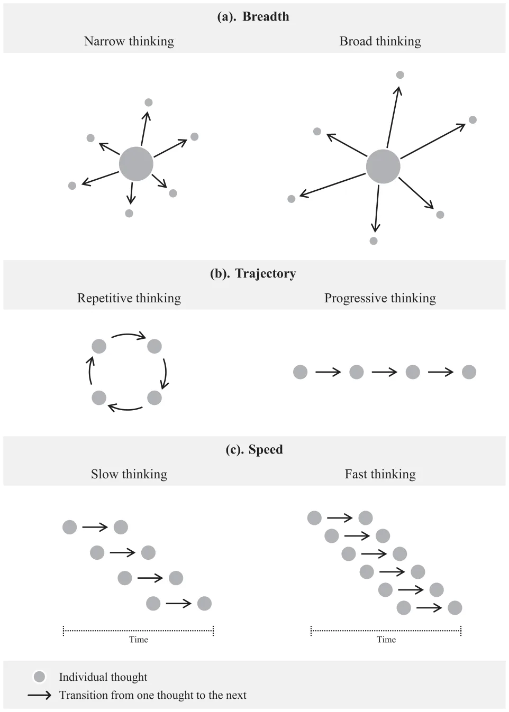
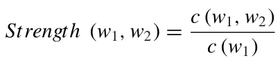
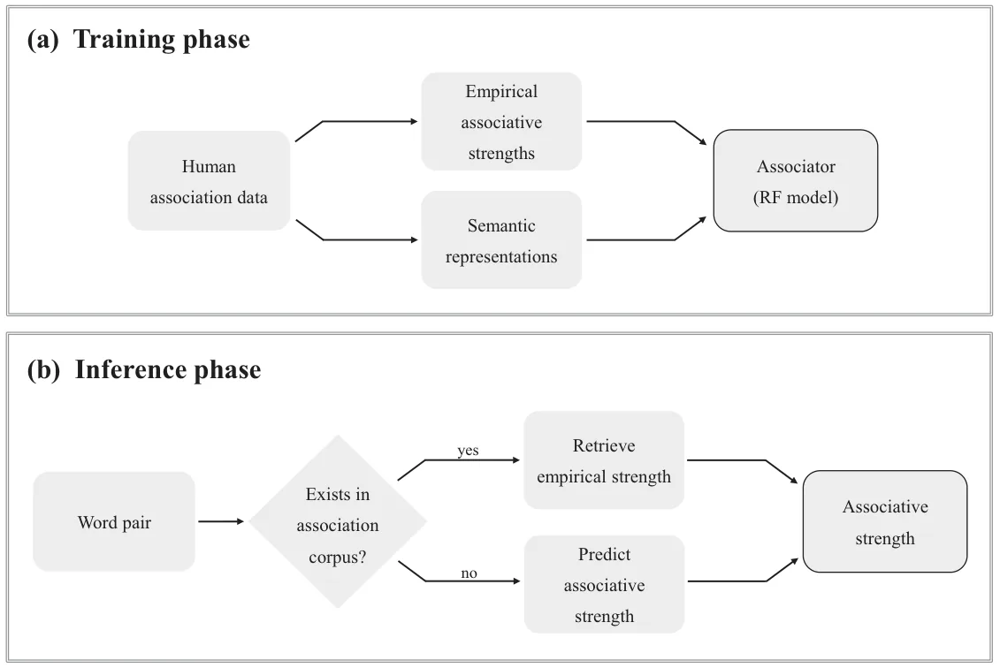
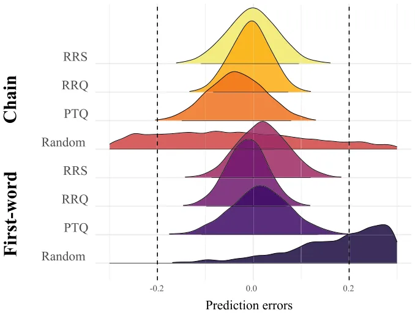
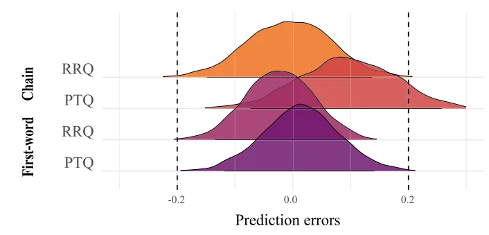

## 1. Introduction

Human thought unfolds as a continuous stream of ideas, associations, and mental leaps—a phenomenon first described by William James over a century ago (James, 1890). Since then, psychologists and neuroscientists have sought to map this “stream of consciousness” using methods ranging from free-association tasks to advanced neuroimaging. Yet, capturing the micro-dynamics of thought, particularly the structural features that differentiate how individuals move through associative space, remains a major challenge in cognitive science.

Recent work has begun to describe spontaneous thought along three structural dimensions: breadth, trajectory, and speed. Breadth refers to the semantic range between successive thoughts, from narrow and closely related ideas to broader, more flexible transitions (e.g., Brunyé et al., 2013). Trajectory captures whether associative sequences tend to loop back on themselves or progress into new semantic territory over time (e.g., Mason & Bar, 2012). Speed reflects the temporal pace of these transitions, how quickly thoughts shift from one idea to the next (e.g., Pronin & Wegner, 2006). Together, these characteristics provide a multidimensional picture of thought dynamics. For example, broader associative transitions may facilitate more progressive trajectories, whereas narrower associative transitions may contribute to repetitive or constrained patterns over time. Similarly, the temporal pace of thought may shape the rate at which associative exploration unfolds. These dimensions may help characterize individual differences in thought patterns, including tendencies toward repetitive or self-focused thinking. Fig. 1 presents schematic illustrations of these dimensions, which serve as the theoretical basis for the present behavioral and computational approach.

Patterns of thought are closely tied to mood, cognition, and personality. Broad, divergent thinking is associated with positive affect, whereas narrow or repetitive thinking tends to co-occur with negative mood (e.g., Vosburg, 1998). Faster thought pace has been linked to elevated mood and creativity (Pronin & Wegner, 2006). At the trait level, associative flexibility aligns with openness to experience (McCrae, 1987), while more rigid or repetitive thinking correlates with characteristics such as neuroticism (Muris, Roelofs, Rassin, Franken, & Mayer, 2005), perfectionism (Flett, Madorsky, Hewitt, & Heisel, 2002), and pessimism (MacLeod, Williams, & Bekerian, 1991). Variability in these thought patterns is also evident in extreme or dysregulated states: Schizophrenia is often marked by disorganized or incoherent associations, whereas mania involves accelerated, loosely structured thinking (American Psychiatric Association, 2013). In contrast, negatively valenced conditions such as depression, anxiety, post-traumatic stress disorder (PTSD), and obsessive-compulsive disorder (OCD) are associated with narrower and more repetitive patterns of thought (Ehring & Watkins, 2008; Harvey, Watkins, Mansell, & Shafran, 2004; Moulds & McEvoy, 2025).

Among these repetitive thought tendencies, rumination has been particularly well studied. Defined as a passive and recurrent focus on negative emotion and its causes (Nolen-Hoeksema & Morrow, 1991), rumination has been linked to the onset and persistence of depressive episodes (Treynor, Gonzalez, & Nolen-Hoeksema, 2003). More broadly, rumination has been characterized as a transdiagnostic style of thinking associated with a range of psychological conditions, including anxiety, PTSD, OCD, eating disorders, and substance use (Harvey et al., 2004; Watkins & Roberts, 2020). Rumination has also been associated with difficulties disengaging from self-referential content (Treynor et al., 2003). Over time, persistent engagement with such thoughts may constrain associative movement, limiting access to more distant or diverse concepts. Such narrowing may reinforce the cyclical and repetitive patterns that characterize ruminative thinking (e.g., Watkins & Roberts, 2020; Whitmer & Gotlib, 2013).

<figure id="fig-1">

<figcaption>Fig. 1. Schematic illustration of the three dimensions of thought dynamics. (a) Breadth refers to the associative distance between successive thoughts, ranging from narrow to broad transitions. (b) Trajectory reflects whether thought tends to return to previously activated regions (repetitive thinking) or move into new associative territory (progressive thinking). (c) Speed reflects the number of associative transitions occurring within an equivalent time interval.</figcaption>
</figure>

Recent computational approaches have begun to model associative dynamics directly, suggesting that the temporal organization of thought may reveal constrained or flexible patterns of thought dynamics. For example, Flynn, Herbers, Kurko, and Kan (2023) used a free association paradigm and found that when associative chains began with a positive seed word, the length of negative response chains predicted higher levels of trait repetitive negative thinking. This suggests that for individuals with higher repetitive thinking traits, once a negative state is triggered by a positive cue, they tend to remain in that state rather than disengaging. Similarly, Raffaelli et al. (2021) reported that individuals high in rumination exhibited restricted thought dynamics and a stronger narrowing of conceptual scope—particularly following negative content—as well as a reduced probability of transitioning into or maintaining positive states. These findings indicate that rumination involves a form of structural rigidity in which the mind becomes “stuck” in limited conceptual spaces.

Andrews-Hanna et al. (2022) advanced this view by demonstrating that the movement of thought is anchored in a specific associative architecture biased toward negative valence. They showed that ruminative tendencies are characterized by more frequent transitions from positive to negative content, as well as shorter positive associative chains. Together, these findings suggest that the repetitive nature of rumination is driven not only by the prevalence of negative content but also by a fundamental shift in how thoughts are structurally organized.

Building directly on this structural perspective, the present study uses machine learning (ML) to examine whether repetitive thinking can be understood in terms of the dynamics of thought rather than primarily through its explicit semantic or affective content. Whereas previous approaches have often relied on the emotional valence or thematic meaning of associations, recent transdiagnostic accounts have increasingly suggested that different forms of repetitive thinking may involve common underlying patterns in thought dynamics, despite differences in semantic content across disorders (e.g., Moulds & McEvoy, 2025). Consistent with this perspective, the present framework focuses on how thoughts unfold over time as an associative process. By shifting the focus from what is being thought to how thought evolves, this approach aims to illuminate the structural features of spontaneous thought that underlie individual differences in repetitive thinking.

To this end, we developed a predictive model trained on large-scale free association data to estimate associative strength between words and derive structural features of spontaneous thought, including breadth, trajectory, and temporal pace, from participants’ responses. Because rumination represents a well-characterized and reliably measured form of repetitive internal thought, it provides an ideal test case for examining whether these structural properties capture individual differences in thought patterns. More broadly, this approach seeks to clarify whether the organization of associative activity itself can predict tendencies toward repetitive thinking and demonstrate the utility of structural modeling for studying spontaneous cognition.

## 2. Modeling associative thought dynamics

Understanding the dynamics of repetitive thinking and rumination requires capturing how associations unfold in real time. Semantic memory network theory (Collins & Quillian, 1969) offers a foundational framework: Memory is structured as a network of concept nodes linked by associations, with activation spreading across these links (Balota & Lorch, 1986; Collins & Loftus, 1975). Recent large-scale association studies demonstrate that population-level association norms reveal stable patterns of semantic organization and associative strength (De Deyne, Verheyen, & Storms, 2016), providing a robust empirical basis for computational models of semantic structure. This perspective has been used to model how ideas evolve across time and context, including in work on spontaneous thought and associative reasoning (e.g., Kenett, Levi, Anaki, & Faust, 2017).

Two kinds of links typically structure such networks: semantic links, based on shared meaning (e.g., *cat–tiger*), and associative links, based on co-occurrence or contextual usage (e.g., *cat–dog*). Although both are supported by priming studies (Hutchison, 2003; Lucas, 2000), they differ in origins and structure: Semantic links are often bidirectional and taxonomic, whereas associative links tend to be unidirectional and shaped by usage frequency (Thompson-Schill, Kurtz, & Gabrieli, 1998). For modeling the dynamics of spontaneous thought, associative links are especially informative because they more closely reflect the temporal and individualized flow of internal cognition.

Computational approaches have leveraged these ideas by estimating distances between words from large-scale patterns of language use. Methods such as latent semantic analysis (Deerwester, Dumais, Furnas, Landauer, & Harshman, 1990) and Word2Vec (W2V; Mikolov, Chen, Corrado, & Dean, 2013) infer semantic distances from co-occurrence statistics in large corpora. Gray et al. (2019), for example, used such metrics to model semantic transitions in free-association tasks and link them to individual differences in creative thinking.

Building on this framework, we developed an ML model designed to estimate associative structure: The unfolding of thought in terms of the associative links people rely on and the patterns they tend to repeat. The model quantifies associative strength, with more frequent associations in human association data indicating stronger, more habitual links. Following Gray et al. (2019), transitions based on weaker associative links can be interpreted as markers of broader or more flexible movement through associative space, whereas stronger transitions reflect more familiar or constrained patterns. This perspective situates repetitive thinking within regions of the associative landscape characterized by reliance on stronger, more frequent links, consistent with narrower or more cyclical associative flow.

### 2.1. Associative strength model

To quantify associative structure, we developed a predictive model called the “Associator.” The model relies on human-generated association data as its empirical foundation. To extend coverage across the Hebrew lexicon, including word pairs not directly observed in the association corpus, we implemented a two-step prediction procedure: Semantic features were first extracted from W2V embeddings, and a random forest (RF) regression model was then trained to estimate associative strength based on these features.

#### 2.1.1. Training phase

The Associator was trained on a corpus of approximately 126,000 Hebrew cue–response word pairs derived from two sources: published Hebrew free-association norms (Rubinsten, Anaki, Henik, Drori, & Faran, 2005) and additional association datasets collected by our group across multiple studies. Preprocessing steps included spelling correction, removal of responses from non-native speakers, and normalization of morphological variants (e.g., tense, gender, number).

Associative strength was operationalized as the relative frequency with which a response was produced for a given cue:

where *c*(*w*1*, w*2) is the number of times *w*2 was produced in response to *w*1, and *c*(*w*1) is the total number of responses generated for *w*1.

To generalize beyond observed word pairs, we trained a model to learn the relationship between semantic representations and empirical associative strength. Using word pairs for which both empirical associative strength values (from human-generated responses) and semantic features derived from W2V embeddings (Levy & Goldberg, 2014) were available, we trained an RF regression model to predict associative strength from semantic features. During inference, when a word pair was absent from the corpus or lacked sufficient empirical observations, the RF model used the W2V vector representations, along with their cosine similarity measures (Park, Hong, & Kim, 2020), to generate a predicted associative strength value. This procedure enabled estimation of associative strength for previously unseen word pairs while maintaining consistency with observed human associations. Model hyperparameters (e.g., tree depth, split criteria, and pruning) were tuned using grid search to optimize performance (Lerman, 1980).

#### 2.1.2. Inference phase

During inference, new word pairs were first standardized to canonical forms. If a pair existed in the association corpus and had a sufficient number of observations (minimum 12, determined via the elbow method; Cui, 2020), its empirical associative strength was returned. Otherwise, associative strength was estimated from semantic features using the trained RF regressor. All strength values were normalized to a 0–10 scale, where higher values indicate stronger and more frequent associative links that may reflect more habitual or constrained associative patterns (Dumais, 2004). A schematic overview of the training and inference phases is shown in Fig. 2.

#### 2.1.3. Validation of the Associator model

Model accuracy was evaluated using five-fold cross-validation (Fushiki, 2011). In each fold, the model was trained on 80% of the data and tested on the remaining 20%. Predictive performance was assessed using the percentage prediction error between the model’s estimated associative strength values and the corresponding empirical values. The model yielded a mean prediction error of 2.98% (*SD* = 0.34%), equivalent to an average deviation of approximately 0.3 points on the 0–10 associative-strength scale, which indicates low and consistent prediction error across previously unseen word pairs.

<figure id="fig-2">

<figcaption>Fig. 2. Overview of the Associator modeling pipeline. (a) Training phase: Empirical associative strength values derived from human association data and semantic features derived from Word2Vec embeddings are used to train the RF regression model. (b) Inference phase: Associative strength is either retrieved from the association corpus or estimated by the model for previously unseen or sparsely observed word pairs. <em>Note</em>. RF = random forest.</figcaption>
</figure>

The Associator therefore provides a foundation for testing whether individual differences in associative structure, measured behaviorally and modeled computationally, predict rumination and repetitive thinking. These associative strength estimates were subsequently used to derive the associative indices described below.

### 2.2. Associative indices

Using the Associator, we derived two indices to characterize the structure of thought: Average Strength (AS), reflecting the average associative strength between stimuli and their responses (stimulus → response), and Strength Between Responses (SBR), representing the associative strength among participants’ responses independently of the stimulus (response → response). Together, these indices capture complementary aspects of associative structure.

Theoretically, AS reflects the extent to which responses rely on strong, conventional associative links, and is therefore interpreted as an index of associative breadth, with higher values indicating more constrained transitions. In contrast, SBR reflects the extent to which participants’ responses diverge to a greater extent in associative terms and is therefore interpreted as an index of the overall associative spread of responses, capturing aspects of trajectory.

Conceptually, the present indices operate within a similar conceptual space as existing approaches that quantify thought structure, such as semantic distance-based measures (e.g., SemDis; Beaty & Johnson, 2021) and the forward flow metric (Gray et al., 2019). However, whereas those approaches rely on semantic distance estimated from language corpora, the present indices are based on associative strength derived from human association data. In addition, whereas forward flow quantifies the progression of responses across a sequence, SBR reflects the overall extent to which responses diverge across associative space, indexing whether thought progresses into distinct regions rather than remaining locally constrained.

Response time (RT) was also recorded, providing an additional, albeit indirect, index of thought dynamics. As RT was not a primary focus of the present study, it is reported for completeness.

## 3. Experiment I: Predicting repetitive thought from associative structure

In Experiment I, we tested the hypothesis that the structural indices derived from the Associator would show linear relations with individual differences in repetitive thought, including rumination and related tendencies. Specifically, we examined whether structural features of spontaneous associative thought—breadth, trajectory, and RT—could be used to infer self-reported scores on repetitive thinking measures.

Since it was not clear a priori which aspects of repetitive thinking (e.g., negatively valenced rumination vs. more general or content-independent forms) would be most closely related to the associative indices, we administered three questionnaires to capture potentially distinct facets of repetitive thought and used two association tasks, allowing us to examine these relationships across measures and task formats.

### 3.1. Method

#### 3.1.1. Participants

A power analysis (Faul, Erdfelder, Buchner, & Lang, 2009) indicated that 89 participants were required to detect a medium effect with power = 0.95 in a regression model with seven predictors. Data were collected from 97 native Hebrew-speaking undergraduates (87% women; *M* age = 22.26, *SD* = 1.55). As part of the demographic information collected, participants were also optionally asked whether they were coping with any psychiatric or emotional condition and, if applicable, to specify it; this item could be skipped. Most participants (75%) reported not coping with such conditions, although several participants self-reported conditions including anxiety, depression, and OCD, indicating some variability in psychiatric and emotional conditions within the sample.

Data exclusions were based on predefined validity criteria for the association tasks (see Association Tasks section below) and incomplete questionnaire responses. After exclusions, 96 participants were retained for at least one analysis. Final sample sizes varied slightly across analyses due to task-specific exclusions and questionnaire-specific missing data (first-word task: *n* = 94–95; chain task: *n* = 82–83).

#### 3.1.2. Self-report questionnaires

Repetitive thought tendencies were assessed using three validated questionnaires. The Ruminative Response Scale (RRS) measures the propensity to focus on negative emotions, symptoms, and their implications, typically in depressive contexts (Nolen-Hoeksema, Wisco, & Lyubomirsky, 2008; Treynor et al., 2003). The Rumination-Reflection Questionnaire (RRQ) assesses broader tendencies toward self-focused recurrent thought (Trapnell & Campbell, 1999). The Perseverative Thinking Questionnaire (PTQ) captures repetitive negative thinking as a transdiagnostic cognitive process, independent of disorder-specific content (Ehring et al., 2011). Internal reliability was high for all measures (Cronbach’s *α* = 0.91 for RRS, 0.87 for RRQ, and 0.90 for PTQ). Questionnaire scores were analyzed as mean item scores rather than summed totals in order to preserve interpretability across measures with different numbers of items.

#### 3.1.3. Association tasks

In both association tasks described below, responses were collected in written form to minimize social interference. Participants were instructed to respond as quickly and spontaneously as possible. The tasks were self-paced, with no explicit response deadline. Participants were reassured that all associations were valid, as the tasks focused on spontaneous thought rather than accuracy or correctness.

**First-word association task.** This task was designed to capture the breadth of participants’ associative responses. Participants viewed 36 stimulus words in randomized order and typed the first word that came to mind. More conventional associations (e.g., decent → honest, liberty → freedom) were assigned higher associative strength scores (*M* = 6.6), consistent with stronger, more frequent associative links, whereas broader or less typical associations (e.g., decent → deal, liberty → capitalism) received lower strength scores (*M* = 2.0). Participants with more than 10 missing or invalid responses (e.g., nonwords, spelling variants, or multi-word responses) were excluded from this task’s analyses.

**Chain associations task.** This task was adapted from prior association-chain paradigms (e.g., Benedek, Könen, & Neubauer, 2012) to assess the trajectory of associative thought, specifically whether it remained constrained or progressed into broader semantic territory. Participants were presented with three stimulus words and asked to produce three separate chains of 10 consecutive associations, where each word had to be associated with the one immediately preceding it. More constrained chains (e.g., album → pictures → events → joy) received higher associative strength scores (*M* = 4.17), whereas broader associative chains (e.g., album → memories → thoughts → positive) received lower strength scores (*M* = 0.83). Invalid entries were defined using the same criteria as in the first-word task. Chains with more than three missing or invalid entries were excluded. Participants were included in the analyses only if they produced at least two valid chains.

**Word stimuli.** Stimuli were drawn from Hebrew free association norms (Rubinsten et al., 2005) and were not repeated across tasks. To control potential stimulus effects on responses, word lists were balanced for valence (positive, neutral, negative) and for typical associative breadth, defined as the extent to which a stimulus evokes a dominant versus a broader range of associations (Buades-Sitjar, Planchuelo, & Duñabeitia, 2021). The full list of stimulus words in Hebrew and their English translations is provided with the study materials.

Following prior work (e.g., Zeelenberg, Shiffrin, & Raaijmakers, 1999), the first-word task included 36 stimuli, evenly distributed across valence and breadth (six stimuli per category). For the chain task, three stimuli were selected, one per valence condition, with at least one stimulus exhibiting a dominant association and one eliciting a broader range of associations. Stimuli were randomized within each task.

**Generating indices.** We computed the following indices.

Average Strength (AS): For the first-word task, AS was computed across all 36 stimulus– response pairs; for the chain task, across consecutive word pairs within each chain. Measures were calculated separately by valence condition.

Strength Between Responses (SBR): For the first-word task, SBR was computed by averaging associative strength across all possible pairs among the 36 participant-generated responses; for the chain task, across all possible pairs among the 10 responses within each 10-response chain. Measures were calculated separately by valence condition.

Response Time (RT): RT was recorded as the interval between stimulus presentation and the first keystroke.

#### 3.1.4. Procedure

The experiment was administered via a custom-built web application. Participants provided informed consent and completed both association tasks and the self-report questionnaires in Hebrew, in randomized order, with the constraint that the two association tasks did not appear consecutively. Sessions lasted approximately 15 min, and participants received course credit for participation. The study was approved by the institutional ethics committee and conducted in accordance with the Declaration of Helsinki.

#### 3.1.5. Data analysis

Analyses were conducted in R version 4.3.1 (R Core Team, 2023) using RStudio (Posit Team, 2024). As elaborated in the Results section, nonlinear correlations in the data required a shift from linear modeling to an alternative analytic approach. Bayesian equivalence models were then estimated using the brms package (Bürkner, 2021).

### 3.2. Results

#### 3.2.1. Descriptive statistics

The dependent variables (RRS, RRQ, and PTQ scores) were approximately normally distributed, as confirmed by Shapiro-Wilk tests (0.98 ≤ *W*s ≤ 0.99; 0.27 ≤ *p*s ≤ 0.58). Mean scores were 2.03 (*SD* = 0.42) for RRS, 3.72 (*SD* = 0.44) for RRQ, and 2.95 (*SD* = 0.63) for PTQ.

<figure class="table-figure" id="table-1">
<figcaption>Table 1 Means and standard deviations (in parentheses) of associative indices across tasks and valence conditions in Experiment I</figcaption>

<table><tr><th>Chain Task</th><th></th><th></th><th></th></tr><tr><th></th><th>Neutral</th><th>Negative</th><th>Positive</th></tr><tr><td>AS</td><td>1.77 (0.47)</td><td>1.62 (0.39)</td><td>1.61 (0.33)</td></tr><tr><td>SBR</td><td>1.64 (0.18)</td><td>1.74 (0.18)</td><td>1.67 (0.19)</td></tr><tr class="row-group"><td>First-Word Task</td><td></td><td></td><td></td></tr><tr><td></td><td>Neutral</td><td>Negative</td><td>Positive</td></tr><tr><td>AS</td><td>3.44 (0.87)</td><td>2.97 (0.80)</td><td>2.62 (0.73)</td></tr><tr><td>SBR</td><td>1.67 (0.14)</td><td>1.80 (0.21)</td><td>1.82 (0.16)</td></tr></table>

<em>Note</em>. Both indices were derived from Associator estimates of associative strength. AS = Average Strength; SBR = Strength Between Responses.

</figure>

Associative responses were scored using the Associator model, yielding the AS and SBR indices, for each task and valence condition. Descriptive statistics for these measures are presented in Table 1.

As shown in Table 1, participants produced higher AS and SBR scores in the first-word task than in the chain task, which indicates that first-word responses tended to rely on stronger associative links than chain-based responses. AS values also showed greater inter-individual variability than SBR. Full distributions and intercorrelations are reported in the Supporting Information (Section 1).

#### 3.2.2. Building the Converter models

Associative indices were not significantly correlated with questionnaire scores in a linear manner (see Supporting Information, Section 2). This pattern suggested that the relationship between associative structure and self-reported repetitive thinking may involve more complex or nonlinear relations not adequately captured by standard linear approaches. We therefore adopted a more exploratory ML-based approach, training models referred to here as Converters to predict questionnaire scores from associative features.

We used AutoSklearn (Feurer et al., 2015) to automatically identify regression models that minimized prediction error. Data were randomly split into training (80%) and validation (20%) sets using five-fold cross-validation (Fushiki, 2011). For each combination of association task and questionnaire (six in total), the model yielding the lowest validation error across folds was selected (see Supporting Information, Section 3, for selected model configurations). Final Converter models were then retrained on the full dataset to generate participant-level predictions.

To evaluate whether the Converter captured systematic relationships rather than noise, we trained control models using randomly generated target values that matched the range of questionnaires while keeping all associative features unchanged.

<figure class="table-figure" id="table-2">
<figcaption>Table 2 Equivalence tests comparing predicted and observed questionnaire scores in Experiment I</figcaption>

<table><tr><th>Chain Task</th><th></th><th></th><th></th><th></th></tr><tr><th></th><th>N</th><th>Differences M (SD)</th><th>HDI Lower, Upper</th><th>Equivalence</th></tr><tr><td>RRS</td><td>83</td><td>−0.00 (0.48)</td><td>−0.11, 0.10</td><td>True</td></tr><tr><td>RRQ</td><td>83</td><td>−0.01 (0.36)</td><td>−0.09, 0.07</td><td>True</td></tr><tr><td>PTQ</td><td>82</td><td>−0.03 (0.55)</td><td>−0.15, 0.08</td><td>True</td></tr><tr><td>Random</td><td>83</td><td>−0.09 (2.09)</td><td>−0.52, 0.37</td><td>False</td></tr><tr class="row-group"><td>First-Word Task</td><td></td><td></td><td></td><td></td></tr><tr><th></th><th>N</th><th>Differences M (SD)</th><th>HDI Lower, Upper</th><th>Equivalence</th></tr><tr><td>RRS</td><td>94</td><td>0.02 (0.50)</td><td>−0.08, 0.13</td><td>True</td></tr><tr><td>RRQ</td><td>95</td><td>−0.01 (0.40)</td><td>−0.10, 0.07</td><td>True</td></tr><tr><td>PTQ</td><td>94</td><td>0.02 (0.59)</td><td>−0.11, 0.14</td><td>True</td></tr><tr><td>Random</td><td>95</td><td>0.39 (1.89)</td><td>0.01, 0.78</td><td>False</td></tr></table>

<em>Note</em>. Equivalence indicates whether the 95% HDI fell entirely within the predefined ROPE. RRS = Ruminative Response Scale; RRQ = Rumination-Reflection Questionnaire; PTQ = Perseverative Thinking Questionnaire; Random = models trained on random targets; HDI = highest-density interval.

</figure>

#### 3.2.3. Bayesian equivalence testing

To evaluate whether predicted scores were statistically equivalent to observed questionnaire scores, we used a Bayesian equivalence testing framework. Specifically, we compared the 95% highest density interval (HDI) of the difference distribution with a predefined region of practical equivalence (ROPE; Kruschke, 2018), set to [–0.2, 0.2]. This range reflects the maximum deviation in average scores considered functionally negligible for interpreting predicted and observed values as equivalent.

Although participants were not prospectively sampled for equivalence testing, we assessed the robustness of the conclusions via simulation. Simulated data were drawn from a normal distribution, *N*(0, 0.45), and HDIs were computed to determine whether they fell within the ROPE. Across 1000 iterations (with *N* = 80), the HDI lay entirely within the ROPE in 95.2% of simulations, indicating sufficient sensitivity to detect practical equivalence under our analytic assumptions.

Bayesian models treated the differences between observed and predicted scores as dependent variables, assuming normally distributed residuals. We specified weakly informative priors to reflect initial uncertainty about the parameters: a normal prior centered at zero with a standard deviation of 3 for the intercept and a Cauchy prior centered at zero with a scale of 2 for the residual *SD* (sigma). Models were run with four Markov Chain Monte Carlo chains each with 2000 iterations. To ensure reliable convergence and minimize divergent transitions, the adapt delta parameter in the Hamiltonian Monte Carlo algorithm was set to 0.95.

Table 2 reports sample sizes (*N*), mean and standard deviation of differences between predicted and observed scores, and 95% uncertainty intervals, along with the results of the equivalence test. Fig. 3 visualizes these uncertainty intervals relative to the ROPE.

<figure id="fig-3">

<figcaption>Fig. 3. Posterior distributions of prediction errors with 95% highest density intervals (HDIs) and ROPE boundaries (dashed lines at −0.2 and 0.2). For all six task-questionnaire pairs, the 95% HDI of the prediction error fell entirely within the ROPE, supporting practical equivalence. Random models (trained on random target values) are included as controls. <em>Note</em>. Chain = chain association task; First-word = first-word association task; RRS = Ruminative Response Scale; RRQ = Rumination-Reflection Questionnaire; PTQ = Perseverative Thinking Questionnaire; Random = models trained on random targets.</figcaption>
</figure>

As shown in Table 2 and Fig. 3, the 95% HDIs for all six task-questionnaire pairs fell entirely within the ROPE (±0.2), indicating that predicted scores were practically equivalent to the observed values.

This suggests that the Converter models captured meaningful variance related to individual differences reflected in the questionnaire measures. In contrast, models trained on randomly generated targets produced HDIs that extended beyond the ROPE, indicating that the observed equivalence for the questionnaire-based models was unlikely to reflect chance variation.

#### 3.2.4. Model validation: Correlations and R2

To further evaluate the performance of the Converter models, we examined the correspondence between predicted and observed questionnaire scores. Pearson correlations and R2 values were computed for each task-questionnaire pair, with R2 reflecting the proportion of variance in the observed scores accounted for by the model predictions. Table 3 summarizes the R2 values for each questionnaire across the two association tasks.

To examine the relative contribution of the associative indices to the Converter predictions, we conducted a permutation importance analysis (Breiman, 2001). The analysis did not reveal a single index that consistently dominated across tasks or questionnaires; rather, contributions were distributed and varied by measure. Permutation importance distributions for each index and questionnaire are provided in the Supporting Information (Section 4).

<figure class="table-figure" id="table-3">
<figcaption>Table 3 Variance captured (R2) by Converter predictions across tasks in Experiment I</figcaption>

<table><tr><th>Questionnaire</th><th>Chain Task</th><th>First-Word Task</th></tr><tr><td>RRS</td><td>0.56</td><td>0.47</td></tr><tr><td>RRQ</td><td>0.51</td><td>0.39</td></tr><tr><td>PTQ</td><td>0.62</td><td>0.19</td></tr></table>

<em>Note</em>. Values reflect squared correlations between predicted and observed questionnaire scores, computed separately for each association task. RRS = Ruminative Response Scale; RRQ = Rumination-Reflection Questionnaire; PTQ = Perseverative Thinking Questionnaire.

</figure>

### 3.3. Summary of Experiment I

Experiment I showed that patterns in participants’ associative responses were systematically related to questionnaire measures of rumination and repetitive thinking. Using ML-based Converter models, associative indices were used to generate predicted questionnaire scores that were statistically equivalent to the observed scores and accounted for a substantial proportion of their variance. These findings suggest that the models captured meaningful variation related to the self-report measures. In contrast, models trained on randomized target values showed no comparable predictive performance, supporting the specificity of the associative features.

Having established initial predictive performance in the first sample, Experiment II examined the external generalizability of the models in an independent sample.

## 4. Experiment II: External validation and generalization

In Experiment II, we examined the generalizability of the Converter models by testing their performance in an independent sample drawn from the general population. Participants completed association tasks and self-report questionnaires drawn from the experimental framework used in Experiment I. Importantly, the models and analytic procedures were held constant, providing a strict test of out-of-sample generalizability.

### 4.1. Method

#### 4.1.1. Participants

Sample size was determined using a Bayesian simulation framework aimed at achieving 80% power for equivalence testing. Simulated datasets were drawn from a normal distribution (*M* = 0, *SD* = 0.45), and the target criterion was defined as the 95% HDI falling entirely within the predefined ROPE (−0.2 to 0.2). Simulations indicated that a sample size of 50 would meet this criterion.

A total of 223 native Hebrew-speaking participants were recruited via Facebook groups. Ten were excluded due to invalid responses in the chain association task, yielding a final sample of 213 participants (65% women; age: *M* = 27.49, *SD* = 7.82). Most participants (70%) reported not coping with psychiatric or emotional conditions.

<figure class="table-figure" id="table-4">
<figcaption>Table 4 Means and standard deviations (in parentheses) of associative indices across tasks and valence conditions in Experiment II</figcaption>

<table><tr><th>Chain Task</th><th></th><th></th><th></th></tr><tr><th></th><th>Neutral</th><th>Negative</th><th>Positive</th></tr><tr><td>AS</td><td>1.84 (0.65)</td><td>1.71 (0.43)</td><td>1.76 (0.49)</td></tr><tr><td>SBR</td><td>1.66 (0.19)</td><td>1.71 (0.20)</td><td>1.71 (0.20)</td></tr><tr class="row-group"><td>First-Word Task</td><td></td><td></td><td></td></tr><tr><td></td><td>Neutral</td><td>Negative</td><td>Positive</td></tr><tr><td>AS</td><td>3.35 (0.92)</td><td>3.11 (1.01)</td><td>2.64 (0.84)</td></tr><tr><td>SBR</td><td>1.69 (0.16)</td><td>1.82 (0.26)</td><td>1.90 (0.23)</td></tr></table>

<em>Note</em>. Both indices were derived from Associator estimates of associative strength. AS = Average Strength; SBR = Strength Between Responses.

</figure>

#### 4.1.2. Self-report questionnaires

Participants completed one of two self-report measures of rumination and repetitive thinking that are not specific to any clinical condition: the RRQ and the PTQ. Internal consistency was excellent for both instruments (Cronbach’s *α* = 0.92 for RRQ; 0.91 for PTQ).

#### 4.1.3. Association tasks and data analysis

Procedures for the association tasks and subsequent analyses were identical to those in Experiment I, including task instructions, preprocessing, index computation, and modeling steps.

#### 4.1.4. Procedure

All participants provided informed consent prior to participation. Each participant completed one association task (either the first-word or chain association) and one self-report questionnaire (either the RRQ or PTQ), with both randomly assigned. Sessions lasted approximately 3–5 min. Participants were entered into a lottery for a 100 NIS prize as compensation. The study was approved by the institutional ethics committee.

### 4.2. Results

#### 4.2.1. Descriptive statistics

Mean scores were 3.56 (*SD* = 0.60) for the RRQ and 2.85 (*SD* = 0.71) for the PTQ. Associative strengths were calculated using the Associator model, yielding the same two structural indices as in Experiment I: AS and SBR. Descriptive statistics for these indices across task and valence conditions are presented in Table 4.

As in Experiment I, the first-word task yielded higher AS and SBR scores than the chain task, reflecting a greater reliance on strong, more conventional associative links. Across both tasks, AS showed larger inter-individual variability than SBR. Full distributions and intercorrelations of the indices are provided in the Supporting Information (Section 5). Linear relationships between associative indices and questionnaire scores were examined and found to be absent, consistent with Experiment I (Supporting Information, Section 6); this informed the application of the Converter models to this sample as well.

<figure class="table-figure" id="table-5">
<figcaption>Table 5 Equivalence tests comparing predicted and observed questionnaire scores in Experiment II</figcaption>

<table><tr><th>Chain Task</th><th></th><th></th><th></th><th></th></tr><tr><th></th><th>N</th><th>Differences M (SD)</th><th>HDI Lower, Upper</th><th>Equivalence</th></tr><tr><td>RRQ</td><td>46</td><td>−0.01 (0.47)</td><td>−0.15, 0.14</td><td>True</td></tr><tr><td>PTQ</td><td>38</td><td>0.09 (0.51)</td><td>−0.07, 0.26</td><td>False</td></tr><tr class="row-group"><td>First-Word Task</td><td></td><td></td><td></td><td></td></tr><tr><th></th><th>N</th><th>Differences M (SD)</th><th>HDI Lower, Upper</th><th>Equivalence</th></tr><tr><td>RRQ</td><td>65</td><td>−0.02 (0.47)</td><td>−0.13, 0.09</td><td>True</td></tr><tr><td>PTQ</td><td>64</td><td>0.02 (0.52)</td><td>−0.12, 0.14</td><td>True</td></tr></table>

<em>Note</em>. Equivalence indicates whether the 95% HDI fell entirely within the predefined ROPE. RRQ = Rumination-Reflection Questionnaire; PTQ = Perseverative Thinking Questionnaire; HDI = highest-density interval.

</figure>

#### 4.2.2. Converter prediction and Bayesian equivalence testing

We applied the Converter models trained in Experiment I to predict questionnaire scores in this independent sample. Bayesian models were specified using priors informed by the empirical distributions observed in Experiment I: the intercept followed a normal prior (*M* = 0, *SD* = 2), and the residual standard deviation (sigma) followed a Cauchy prior centered at 0 with a scale of 1. These priors reflected the expectation that prediction errors would be centered near zero while allowing moderate variability across participants.

Table 5 summarizes, for each task-questionnaire pair, the sample size (*N*), mean and standard deviation of the differences between predicted and observed scores, the 95% HDI ranges, and the outcomes of the equivalence tests. Fig. 4 presents the corresponding posterior distributions of prediction errors relative to the ROPE boundaries.

As shown in Table 5 and Fig. 4, the 95% HDIs fell entirely within the ROPE for three of the four task-questionnaire pairs, indicating practical equivalence between predicted and observed scores. This pattern suggests that the Converter models trained in Experiment I retained predictive performance in the independent sample. The only exception was the PTQ score predicted from the chain task, which did not meet the equivalence criterion.

#### 4.2.3. Model generalization: Correlations and R2

To further assess model performance in the independent sample, we examined the correspondence between predicted and observed questionnaire scores. Pearson correlations and R2 values were computed for each task-questionnaire pair, with R2 reflecting the proportion of variance in the observed scores accounted for by the model predictions. Table 6 summarizes the R2 values for each questionnaire across the two association tasks.

<figure id="fig-4">

<figcaption>Fig. 4. Posterior distributions of prediction errors with 95% HDIs and ROPE boundaries (dashed lines at −0.2 and 0.2). The 95% HDIs of the prediction errors fell entirely within the ROPE for all task-questionnaire pairs except the PTQ in the chain task, supporting practical equivalence. <em>Note</em>. Chain = chain association task; First-word = first-word association task; RRQ = Rumination-Reflection Questionnaire; PTQ = Perseverative Thinking Questionnaire.</figcaption>
</figure>

<figure class="table-figure" id="table-6">
<figcaption>Table 6 Variance captured (R2) by Converter predictions across tasks in Experiment II</figcaption>

<table><tr><th>Questionnaire</th><th>Chain task</th><th>First-word task</th></tr><tr><td>RRQ</td><td>0.46</td><td>0.46</td></tr><tr><td>PTQ</td><td>0.60</td><td>0.50</td></tr></table>

<em>Note</em>. Values reflect squared correlations between predicted and observed questionnaire scores, computed separately for each association task. RRQ = Rumination-Reflection Questionnaire; PTQ = Perseverative Thinking Questionnaire.

</figure>

Predicted scores captured a substantial proportion of the variance in the observed questionnaire scores, with R2 values ranging from 46% to 60%. For the PTQ, indices derived from the chain task accounted for more variance than those derived from the first-word task (R2 = 0.60 vs. 0.50). Notably, this pattern emerged despite the PTQ prediction from the chain association task not meeting the predefined equivalence criterion.

### 4.3. Summary of Experiment II

Experiment II showed that the Converter models trained in Experiment I retained predictive performance in an independent sample. Predicted scores were statistically equivalent to observed questionnaire scores in three of the four task-questionnaire pairs and accounted for substantial variance across all pairs. Together, these findings suggest that structural patterns in associative responses contain information related to individual differences in self-reported repetitive thought.

## 5. General discussion

This study tested whether individual differences in repetitive thought style—exemplified by rumination—are related to patterns in spontaneous association. We developed the Associator, an ML model trained on large-scale association data, to quantify associative strength: the empirical frequency with which a response is produced for a given cue in large-scale association norms. From participants’ responses in Experiment I, we computed two associative indices, AS and SBR, intended to reflect the breadth and trajectory of their associative flow, while RT was included as a secondary temporal index related to thought speed.

Notably, these features did not show reliable linear relationships with self-reported repetitive thinking. This result points to the possibility that individual differences in repetitive thought are related to complex or nonlinear properties of associative flow rather than to straightforward linear mappings. This interpretation is consistent with recent work suggesting that linear analyses may fail to capture aspects of cognitive structure. For example, Orwig, Luchini, Beaty, and Schacter (2025) showed that nonlinear models reveal aspects of semantic organization that linear approaches miss.

To further examine this possibility, we developed a second model, the Converter, which uses nonlinear mappings between associative structure and questionnaire scores. This two-stage approach enabled us to ask whether the organization of spontaneous cognition contains information related to repetitive thought tendencies, while focusing on structural properties of associative flow without relying primarily on explicit semantic or affective content. By emphasizing how associations are organized and unfold over time, this framework offers a novel route for characterizing individual differences in associative organization.

Empirically, the Converter yielded consistent predictive performance. In Experiment I, its predictions were statistically equivalent to observed questionnaire scores and accounted for a substantial proportion of variance across all three measures. Control analyses using randomly generated target values showed no such predictive accuracy, supporting the specificity of the observed associations between associative features and questionnaire scores. Because only the target values were randomized while the associative features remained unchanged, these findings suggest that the predictive performance depended on systematic relationships between associative features and questionnaire scores rather than on arbitrary structure in the data.

In Experiment II, the models showed comparable predictive performance in an independent sample: Model predictions again showed substantial correspondence with observed scores. The only exception was the PTQ prediction from the chain association task, which did not reach the equivalence threshold, although R2 values remained relatively high. This discrepancy may reflect sampling-related variability due to the smaller sample size for this task-questionnaire pair (*N* = 38) rather than a systematic limitation of the model.

Across both experiments, the chain association task was associated with broader and more variable associative responses than the first-word task and also accounted for more variance in questionnaire scores, particularly for the PTQ. These differences may reflect the chain task’s sensitivity to sequential patterns of associative thinking (e.g., trajectory), beyond immediate or dominant links (e.g., breadth). The PTQ, which is designed to assess general tendencies toward repetitive thought, may also be more sensitive to these dynamic aspects of associative flow. Together, these findings support the potential utility of structural measures of associative flow for characterizing individual differences in repetitive thought tendencies and related patterns of spontaneous cognition.

More broadly, the present findings suggest that repetitive thinking may be understood not only in terms of semantic content but also in terms of structural properties of thought dynamics. Repetitive thinking—especially in its negatively valenced forms—has often been conceptualized as a transdiagnostic cognitive process that appears across diverse mental conditions (Ehring & Watkins, 2008; Moulds & McEvoy, 2025). Existing work has emphasized the importance of semantic and affective content, including negatively biased or self-focused themes (e.g., Nolen-Hoeksema et al., 2008). The present findings suggest that structural properties of thought, including how associations are organized and constrained over time, may provide an additional dimension relevant to repetitive thinking tendencies. This perspective highlights the potential value of examining the organization of thought alongside its thematic content.

This perspective aligns with growing work on the structure and dynamics of thought processes in addition to semantic content. Raffaelli et al. (2021) demonstrated that dynamic features of spontaneous thought, such as thought duration and conceptual narrowing, predict repetitive thought tendencies even after accounting for thematic content. Similarly, Kenett, Anaki, and Faust (2014) showed that individual differences in semantic network topology predict broader cognitive tendencies, suggesting that properties of associative organization may reflect broader patterns of cognition. Relatedly, Hammerdahl, Vazquez, and Alperin (2025) described thought dynamics as a dimension relevant to psychopathology alongside semantic aspects of thought. Together, these converging perspectives reinforce the value of examining individual differences through the lens of the structural organization of spontaneous thought.

### 5.1. Implications

The present framework highlights the value of examining the structural dynamics of spontaneous thought. By modeling how associations unfold across sequences without relying primarily on explicit semantic content, this approach offers a way to characterize organizational properties of associative thinking that are often difficult to capture directly. Indices such as breadth and trajectory may reflect tendencies in how individuals generate and connect ideas, providing insight into patterns of associative organization in spontaneous thought.

This structural perspective aligns with growing work in cognitive science examining thought as a dynamic and sequential process. Research on semantic networks, associative memory, and spontaneous cognition increasingly emphasizes how thoughts transition, branch, and become constrained over time. Our findings contribute to this perspective by suggesting that aspects of these dynamics can be quantified from simple associative tasks and linked to individual differences in repetitive thought style.

More broadly, this framework brings together lines of research on semantic structure, associative dynamics, and individual differences in thinking style that are often studied separately. By focusing on the organization of associative flow, it links computational models of semantic structure with process-oriented accounts of spontaneous thought. From this perspective, repetitive thinking may reflect not only thematic content but also the way associative patterns become organized and constrained over time.

Taken together, these implications point to the potential of structural modeling to enrich theoretical accounts of repetitive and spontaneous thought by providing complementary information about patterns of associative organization.

### 5.2. Limitations

While the findings are promising, several limitations should be noted. First, the Associator model is susceptible to shifts in language use over time (concept drift), requiring periodic retraining on updated large-scale association data to maintain accuracy. Second, the models were developed using Hebrew-language data, limiting cross-linguistic generalizability; extending the framework will require native-language association norms and semantic embeddings in other languages. Third, the Converter’s nonlinear, high-dimensional structure supports predictive performance but limits the interpretability of individual feature contributions to predictions. Fourth, although the associative tasks were designed to elicit spontaneous thought, they do not fully capture the context-dependent, emotionally shaped dynamics of everyday thought, underscoring the need for ecological validation. Finally, the generalizability of the findings may be limited by the relatively limited demographic information collected (e.g., race, ethnicity, and socioeconomic status), as well as by the predominance of female participants in both samples.

### 5.3. Future directions

Future work should examine the generalizability of this framework across broader populations and cognitive contexts. In particular, it will be important to examine whether similar structural dynamics characterize repetitive thought in clinically diagnosed populations. Additionally, extending the approach to additional forms of recurrent thought—such as worry, intrusive mentation, or persistent self-referential thought—may help clarify which structural features are shared across forms of recurrent thought and which are distinct. Integrating associative tasks with real-time behavioral or physiological measures could further illuminate how the dynamics of associative flow relate to moment-to-moment cognitive states. Future work may also examine temporal aspects of associative dynamics more directly, including how response speed relates to broader versus more dominant associative transitions. Finally, developing tools for interpreting complex, high-dimensional models will be important for relating structural patterns of associative thought to more precise theoretical models of internal cognition.

### 5.4. Conclusion

This study suggests that spontaneous associative responses, captured through brief, low-burden tasks, contain information related to individual differences in repetitive thinking. By integrating large-scale association norms with nonlinear modeling, we introduce a framework for characterizing structural properties of associative dynamics in addition to semantic content. This framework offers a scalable, theory-guided approach for examining patterns of associative organization in spontaneous thought and highlights associative dynamics as a potentially informative dimension of repetitive thinking tendencies.

## Acknowledgments

This work was supported by the Israel Science Foundation (ISF), Grant No. 673/17, and by The Sagol Family.

## Conflict of Interest

The authors declare no conflicts of interest.

## Data Availability Statement

Materials, code, and datasets related to the present study are available on the Open Science Framework: [osf.io/52d8a](https://osf.io/52d8a/overview)

## Supporting Information

Additional supporting information may be found online in the Supporting Information section at the end of the article.

## References

- American Psychiatric Association. (2013). Diagnostic and statistical manual of mental disorders (5th ed). Washington, D.C.: American Psychiatric Association.
- Andrews-Hanna, J. R., Woo, C.-W., Wilcox, R., Eisenbarth, H., Kim, B., Han, J., Losin, E. A. R., & Wager, T. D. (2022). The conceptual building blocks of everyday thought: Tracking the emergence and dynamics of ruminative and nonruminative thinking. Journal of Experimental Psychology: General, 151(3), 628–642. [doi:10.1037/xge0001096](https://doi.org/10.1037/xge0001096)
- Balota, D. A., & Lorch, R. F. (1986). Depth of automatic spreading activation: Mediated priming effects in pronunciation but not in lexical decision. Journal of Experimental Psychology: Learning, Memory, and Cognition, 12(3), 336–345.
- Beaty, R. E., & Johnson, D. R. (2021). Automating creativity assessment with SemDis: An open platform for computing semantic distance. Behavior Research Methods, 53(2), 757–780. [doi:10.3758/s13428-020-01453-w](https://doi.org/10.3758/s13428-020-01453-w)
- Benedek, M., Könen, T., & Neubauer, A. C. (2012). Associative abilities underlying creativity. Psychology of Aesthetics, Creativity, and the Arts, 6(3), 273–281. [doi:10.1037/a0027059](https://doi.org/10.1037/a0027059)
- Breiman, L. (2001). Random forests. Machine Learning, 45, 5–32. [doi:10.1023/A:1010933404324](https://doi.org/10.1023/A:1010933404324)
- Brunyé, T. T., Gagnon, S. A., Paczynski, M., Shenhav, A., Mahoney, C. R., & Taylor, H. A. (2013). Happiness by association: Breadth of free association influences affective states. Cognition, 127(1), 93–98. [doi:10.1016/j.cognition.2012.11.015](https://doi.org/10.1016/j.cognition.2012.11.015)
- Buades-Sitjar, F., Planchuelo, C., & Duñabeitia, J. A. (2021). Valence, arousal and concreteness mediate word association. Psicothema, 33(4), 602–609. [link](https://hdl.handle.net/11162/214386)
- Bürkner, P. C. (2021). Bayesian item response modeling in R with brms and Stan. Journal of Statistical Software, 100(5), 1–54. [doi:10.18637/JSS.V100.I05](https://doi.org/10.18637/JSS.V100.I05)
- Collins, A. M., & Loftus, E. F. (1975). A spreading-activation theory of semantic processing. Psychological Review, 82(6), 407–428. [doi:10.1037/0033-295X.82.6.407](https://doi.org/10.1037/0033-295X.82.6.407)
- Collins, A. M., & Quillian, M. R. (1969). Retrieval time from semantic memory. Journal of Verbal Learning and Verbal Behavior, 8(2), 240–247.
- Cui, M. (2020). Introduction to the K-means clustering algorithm based on the elbow method. Accounting, Auditing and Finance, 1(1), 5–8. [doi:10.23977/accaf.2020.010102](https://doi.org/10.23977/accaf.2020.010102)
- De Deyne, S., Verheyen, S., & Storms, G. (2016). Structure and organization of the mental lexicon: A network approach derived from syntactic dependency relations and word associations. In A. Mehler, A. Lücking, S. Banisch, P. Blanchard, & B. Job (Eds.), Towards a theoretical framework for analyzing complex linguistic networks (pp. 47–79). Berlin: Springer. [doi:10.1007/978-3-662-47238-5_3](https://doi.org/10.1007/978-3-662-47238-5_3)
- Deerwester, S., Dumais, S. T., Furnas, G. W., Landauer, T. K., & Harshman, R. (1990). Indexing by latent semantic analysis. Journal of the American Society For Information Science, 41(6), 391–407.
- Dumais, S. T. (2004). Latent semantic analysis. Annual Review of Information Science and Technology (ARIST), 38, 189–230. [doi:10.1002/aris.1440380105](https://doi.org/10.1002/aris.1440380105)
- Ehring, T., & Watkins, E. R. (2008). Repetitive negative thinking as a transdiagnostic process. International Journal of Cognitive Therapy, 1(3), 192–205. [doi:10.1521/ijct.2008.1.3.192](https://doi.org/10.1521/ijct.2008.1.3.192)
- Ehring, T., Zetsche, U., Weidacker, K., Wahl, K., Schönfeld, S., & Ehlers, A. (2011). The Perseverative Thinking Questionnaire (PTQ): Validation of a content-independent measure of repetitive negative thinking. Journal of Behavior Therapy and Experimental Psychiatry, 42(2), 225–232. [doi:10.1016/j.jbtep.2010.12.003](https://doi.org/10.1016/j.jbtep.2010.12.003)
- Faul, F., Erdfelder, E., Buchner, A., & Lang, A. G. (2009). Statistical power analyses using G\*Power 3.1: Tests for correlation and regression analyses. Behavior Research Methods, 41(4), 1149–1160. [doi:10.3758/BRM.41.4.1149](https://doi.org/10.3758/BRM.41.4.1149)
- Feurer, M., Klein, A., Eggensperger, K., Springenberg, J., Blum, M., & Hutter, F. (2015). Efficient and robust automated machine learning. Advances in Neural Information Processing Systems, 28, Montreal, Quebec, Canada.
- Flett, G. L., Madorsky, D., Hewitt, P. L., & Heisel, M. J. (2002). Perfectionism cognitions, rumination, and psychological distress. Journal of Rational-Emotive and Cognitive-Behavior Therapy, 20(1), 33–47. [doi:10.1023/A:1015128904007](https://doi.org/10.1023/A:1015128904007)
- Flynn, A. J., Herbers, J. E., Kurko, S. A., & Kan, I. P. (2023). Using spreading activation to understand repetitive negative thinking. Cognition and Emotion, 37(3), 453–465. [doi:10.1080/02699931.2023.2176288](https://doi.org/10.1080/02699931.2023.2176288)
- Fushiki, T. (2011). Estimation of prediction error by using K-fold cross-validation. Statistics and Computing, 21(2), 137–146. [doi:10.1007/s11222-009-9153-8](https://doi.org/10.1007/s11222-009-9153-8)
- Gray, K., Anderson, S., Chen, E. E., Kelly, J. M., Christian, M. S., Patrick, J., & Lewis, K. (2019). “Forward Flow”: A New measure to quantify free thought and predict creativity. American Psychologist, 74(5), 539–554. [doi:10.1037/amp0000391.supp](https://doi.org/10.1037/amp0000391.supp)
- Hammerdahl, E., Vazquez, N., & Alperin, B. R. (2025). Clinically relevant aspects of thought across psychological disorders. Cognitive Processing, 26, 501–510. [doi:10.1007/s10339-025-01271-y](https://doi.org/10.1007/s10339-025-01271-y)
- Harvey, A. G., Watkins, E., Mansell, W., & Shafran, R. (2004). Cognitive behavioural processes across psychological disorders: A transdiagnostic approach to research and treatment. Oxford, England: Oxford University Press.
- Hutchison, K. A. (2003). Is semantic priming due to association strength or feature overlap? A microanalytic review. Psychonomic Bulletin and Review, 10(4), 785–813. [doi:10.3758/BF03196544](https://doi.org/10.3758/BF03196544)
- James, W. (1890). The principles of psychology. New York: Henry Holt and Company.
- Kenett, Y. N., Anaki, D., & Faust, M. (2014). Investigating the structure of semantic networks in low and high creative persons. Frontiers in Human Neuroscience, 8, 1–16. [doi:10.3389/fnhum.2014.00407](https://doi.org/10.3389/fnhum.2014.00407)
- Kenett, Y. N., Levi, E., Anaki, D., & Faust, M. (2017). The semantic distance task: Quantifying semantic distance with semantic network path length. Journal of Experimental Psychology: Learning Memory and Cognition, 43(9), 1470–1489. [doi:10.1037/xlm0000391](https://doi.org/10.1037/xlm0000391)
- Kruschke, J. K. (2018). Rejecting or accepting parameter values in Bayesian estimation. Advances in Methods and Practices in Psychological Science, 1(2), 270–280. [doi:10.1177/2515245918771304](https://doi.org/10.1177/2515245918771304)
- Lerman, P. M. (1980). Fitting segmented regression models by grid search. Applied Statistics, 29(1), 77–84. [doi:10.2307/2346413](https://doi.org/10.2307/2346413)
- Levy, O., & Goldberg, Y. (2014). Neural word embedding as implicit matrix factorization. Advances in Neural Information Processing Systems, 3, 2177–2185.
- Lucas, M. (2000). Semantic priming without association: A meta-analytic review. Psychonomic Bulletin and Review, 7(4), 618–630. [doi:10.3758/BF03212999](https://doi.org/10.3758/BF03212999)
- MacLeod, A. K., Williams, J. M. G., & Bekerian, D. A. (1991). Worry is reasonable: The role of explanations in pessimism about future personal events. Journal of Abnormal Psychology, 100(4), 478–486. [doi:10.1037//0021-843x.100.4.478](https://doi.org/10.1037//0021-843x.100.4.478)
- Mason, M. F., & Bar, M. (2012). The effect of mental progression on mood. Journal of Experimental Psychology: General, 141(2), 217–221. [doi:10.1037/a0025035](https://doi.org/10.1037/a0025035)
- McCrae, R. R. (1987). Creativity, divergent thinking, and openness to experience. Journal of Personality and Social Psychology, 52(6), 1258–1265. [doi:10.1037//0022-3514.52.6.1258](https://doi.org/10.1037//0022-3514.52.6.1258)
- Mikolov, T., Chen, K., Corrado, G., & Dean, J. (2013). Efficient estimation of word representations in vector space. 1st International Conference on Learning Representations, ICLR 2013–Workshop Track Proceedings, Scottsdale, AZ (pp. 1–12).
- Moulds, M. L., & McEvoy, P. M. (2025). Repetitive negative thinking as a transdiagnostic cognitive process. Nature Reviews Psychology, 4(2), 127–141. [doi:10.1038/s44159-024-00399-6](https://doi.org/10.1038/s44159-024-00399-6)
- Muris, P., Roelofs, J., Rassin, E., Franken, I., & Mayer, B. (2005). Mediating effects of rumination and worry on the links between neuroticism, anxiety and depression. Personality and Individual Differences, 39(6), 1105–1111. [doi:10.1016/j.paid.2005.04.005](https://doi.org/10.1016/j.paid.2005.04.005)
- Nolen-Hoeksema, S., & Morrow, J. (1991). A prospective study of depression and posttraumatic stress symptoms after a natural disaster: The 1989 Loma Prieta Earthquake. Journal of Personality and Social Psychology, 61(1), 115–121. [doi:10.1037/0022-3514.61.1.115](https://doi.org/10.1037/0022-3514.61.1.115)
- Nolen-Hoeksema, S., Wisco, B. E., & Lyubomirsky, S. (2008). Rethinking rumination. Perspectives on Psychological Science, 3(5), 400–424. [doi:10.1111/j.1745-6924.2008.00088.x](https://doi.org/10.1111/j.1745-6924.2008.00088.x)
- Orwig, W., Luchini, S. A., Beaty, R. E., & Schacter, D. L. (2025). A ‘sweet spot’ for creative ideation: Nonlinear associations between semantic distance and creativity. The Journal of Creative Behavior, 59(3), e70041. [doi:10.1002/jocb.70041](https://doi.org/10.1002/jocb.70041)
- Park, K., Hong, J. S., & Kim, W. (2020). A methodology combining cosine similarity with classifier for text classification. Applied Artificial Intelligence, 34(5), 396–411. [doi:10.1080/08839514.2020.1723868](https://doi.org/10.1080/08839514.2020.1723868)
- Posit Team. (2024). RStudio: Integrated development environment for R. [posit.co](http://www.posit.co/)
- Pronin, E., & Wegner, D. M. (2006). Manic Thinking: Independent effects of thought speed and thought content on mood. Psychological Science, 17(9), 807–813.
- R Core Team. (2023). R: A language and environment for statistical computing. R Foundation for Statistical Computing. [R-project.org](https://www.R-project.org/)
- Raffaelli, Q., Mills, C., de Stefano, N. A., Mehl, M. R., Chambers, K., Fitzgerald, S. A., Wilcox, R., Christoff, K., Andrews, E. S., Grilli, M. D., O’Connor, M.-F., & Andrews-Hanna, J. R. (2021). The think aloud paradigm reveals differences in the content, dynamics and conceptual scope of resting state thought in trait brooding. Scientific Reports, 11(1), 19362. [doi:10.1038/s41598-021-98138-x](https://doi.org/10.1038/s41598-021-98138-x)
- Rubinsten, O., Anaki, D., Henik, A., Drori, S., & Faran, Y. (2005). Free association norms in the Hebrew language. In Word norms in Hebrew (pp. 17–34). Be’er Sheva, Israel: Ben-Gurion University of the Negev Beersheba.
- Thompson-Schill, S. L., Kurtz, K. J., & Gabrieli, J. D. E. (1998). Effects of Semantic and Associative Relatedness on Automatic Priming. Journal of Memory and Language, 38, 440–458. [doi:10.1006/jmla.1997.2559](https://doi.org/10.1006/jmla.1997.2559)
- Trapnell, P. D., & Campbell, J. D. (1999). Private self-consciousness and the five-factor model of personality: Distinguishing rumination from reflection. Journal of Personality and Social Psychology, 76(2), 284–304. [doi:10.1037/0022-3514.76.2.284](https://doi.org/10.1037/0022-3514.76.2.284)
- Treynor, W., Gonzalez, R., & Nolen-Hoeksema, S. (2003). Rumination reconsidered: A psychometric analysis. Cognitive Therapy and Research, 27(3), 247–259. [doi:10.1023/A:1023910315561](https://doi.org/10.1023/A:1023910315561)
- Vosburg, S. K. (1998). The effects of positive and negative mood on divergent-thinking performance. Creativity Research Journal, 11(2), 165–172. [doi:10.1207/s15326934crj1102_6](https://doi.org/10.1207/s15326934crj1102_6)
- Watkins, E. R., & Roberts, H. (2020). Reflecting on rumination: Consequences, causes, mechanisms and treatment of rumination. Behaviour Research and Therapy, 127, 103573. [doi:10.1016/j.brat.2020.103573](https://doi.org/10.1016/j.brat.2020.103573)
- Whitmer, A. J., & Gotlib, I. H. (2013). An attentional scope model of rumination. Psychological Bulletin, 139(5), 1036–1061. [doi:10.1037/a0030923](https://doi.org/10.1037/a0030923)
- Zeelenberg, R., Shiffrin, R. M., & Raaijmakers, J. G. W. (1999). Priming in a free association task as a function of association directionality. Memory & Cognition, 27(5), 956–961. [doi:10.3758/BF03201226](https://doi.org/10.3758/BF03201226)
