## 1 Introduction

Federated learning (FL) enables multiple data holders to train machine learning models collaboratively without centralizing raw data [1–3]. By keeping data local and exchanging gradients or model updates, FL supports learning in settings where centralized data sharing is undesirable or infeasible because of privacy, governance, or institutional constraints. This is particularly relevant in domains such as healthcare, where sensitive data are often distributed across organizations [4–7]. However, keeping raw records local does not by itself guarantee privacy. Gradients and model updates communicated during training may reveal sensitive information about the client data that produced them [8, 9]. Gradient inversion attacks (GIAs) exploit this information by attempting to reconstruct private training examples from shared gradients or related updates [10, 11]. Early studies showed that gradients can reveal both inputs and labels [10, 12], while stronger optimization-based attacks demonstrated substantially more detailed reconstruction from shared gradients [8].

Although gradient inversion attacks (GIAs) have been extensively investigated in image-based settings [13, 14], their implications for tabular FL remain less systematically characterized. Tabular records combine heterogeneous numerical and categorical attributes, making reconstruction and its evaluation fundamentally different from visual reconstruction tasks. In particular, successful recovery of individual features does not necessarily imply recovery of complete private records. Previous work demonstrated that tabular information can be reconstructed from both FedSGD and FedAvg updates [11]. Nevertheless, the conditions under which such reconstruction remains feasible across different training configurations, update types, and model representations require further characterization. Accordingly, this study addresses one central research question: “Under which federated-training and model conditions do individual client updates reveal reconstructable private tabular information to an honest-but-curious server?”

We investigate this question through a structured empirical analysis. The primary focus is how the information exposed by communicated client updates changes with update aggregation, local computation, and training progression. These factors determine how much client information contributes to each observed update and at which stage of optimization the update is generated. We subsequently examine model architecture and input representation as additional factors associated with reconstruction vulnerability. Attacker label knowledge, client heterogeneity, and attack budget are evaluated as sensitivity analyses to determine whether the main findings persist under alternative experimental conditions. Finally, because partial feature recovery does not necessarily imply complete record reconstruction, we distinguish numerical and categorical recovery, baseline-relative reconstruction, and exact record recovery throughout the evaluation.

Model architecture and input representation are particularly relevant because they determine how private features enter the model and influence the resulting gradients. While the MLP and ResNet baselines in our study use one-hot categorical inputs, FT-Transformer employs learned representations of numerical and categorical features [15]. Other tabular architectures, including TabNet and TabTransformer, further illustrate the diversity of feature-processing mechanisms [16, 17]. Although neural models for tabular data have been extensively investigated from a predictive perspective [18, 19] and increasingly studied in federated settings [20, 21], the relationship between architecture, input representation, and reconstruction vulnerability remains insufficiently characterized.

To answer the central research question, we conduct a systematic empirical evaluation of optimization-based GIAs against tabular FL under an honest-but-curious server threat model. We first examine reconstruction from FedSGD gradients and FedAvg model deltas as client batch size, local computation, and training progression vary. We then investigate the influence of model architecture and input representation by comparing a one-hot multilayer perceptron (MLP), a one-hot ResNet, and FT-Transformer, together with architectural controls within the MLP family. These comparisons are evaluated across binary classification, multiclass classification, and regression tasks using MIMIC-IV and complementary benchmark datasets. Additional sensitivity analyses examine attacker label knowledge, client heterogeneity, and attack budget. Throughout the study, reconstruction is assessed at both the feature and complete-record levels, with explicit comparisons against baseline reconstruction strategies.

This study’s primary contribution is a systematic characterization of reconstruction vulnerability in tabular FL, identifying how leakage varies with the communicated update, training progression, attacker assumptions, and model architecture and input representation. This empirical contribution is supported by three methodological components. First, we employ an exposure-aligned evaluation protocol that measures training progress through effective client-data exposure rather than relying exclusively on communication-round counts. This supports more controlled comparisons across FL configurations. Second, we establish a tabular FL reconstruction and evaluation pipeline that distinguishes numerical and categorical recovery, baseline-relative reconstruction, and complete-record recovery. Third, we adapt the existing optimization-based gradient matching procedure to FT-Transformer through a differentiable categorical surrogate that enables reconstruction through learned categorical embeddings. These methodological components support a consistent empirical evaluation across heterogeneous tabular tasks and model families, including a clinically motivated MIMIC-IV in-hospital mortality prediction task, without introducing a new attack objective or claiming formal privacy guarantees.

The experiments show that tabular FL leakage is concentrated in weakly aggregated settings, particularly when communicated updates represent few client records. Increasing local aggregation generally reduces reconstruction for the one-hot baselines, although the strength and direction of this effect depend on the dataset, model, training stage, and local-computation setting. Under the optimization-based attack evaluated in this study, FT-Transformer generally exhibits lower reconstruction than the one-hot baselines, while substantial differences also occur among ordinary MLP configurations. The results further show that aggregate feature-level reconstruction can overstate complete record recovery, particularly for sparse tabular data. These findings characterize leakage under the evaluated attack and threat model rather than providing formal privacy guarantees.

## 2 Background

In standard FL, clients keep raw data local while communicating model updates to a coordinating server [1, 2]. The privacy relevance of these updates depends on the FL protocol and on what the server can observe [2, 22]. In FedSGD, the server observes a gradient tied closely to one local mini batch. In FedAvg, the server observes a model update that may combine several local steps and epochs [1]. Prior work on FedAvg leakage shows that local training complicates inversion because the attacker must reconstruct through several unobserved local optimizer steps rather than match a single batch gradient directly [23].

FL does not by itself provide a formal privacy guarantee. Secure aggregation can prevent the server from seeing individual client updates by revealing only an aggregate over many clients [22], and differential privacy can add formal protection by clipping and perturbing gradients or model updates [24, 25]. These defenses change the information available to the attacker. These mechanisms also change the interpretation of gradient inversion experiments. Under secure aggregation, the server considered in our threat model would no longer observe the individual client update used as the reconstruction target in the present experiments; instead, any attack would have to operate on an aggregate containing contributions from multiple clients. Differential privacy changes the observable in a different way by bounding and perturbing client contributions before or during aggregation. Consequently, the reconstruction levels reported in this study characterize leakage from directly observable non-private client updates. In contrast, our threat model studies the standard noncryptographic setting in which an honest-but-curious server observes individual client gradients or model deltas before aggregation. This setting isolates the privacy risk of ordinary FL communication rather than systems protected by secure aggregation or differential privacy.

Beyond defenses applied directly to FL communication, recent work on machine unlearning provides a complementary perspective on privacy preservation. Huang et al. proposed ROVER, a generative continual identity-unlearning framework designed to maintain identity removal across repeated unlearning requests while resisting malicious relearning attacks [26]. Although this setting differs from gradient leakage during FL, it highlights a broader privacy requirement where privacy mechanisms may need to remain robust against adaptive attempts to recover information that has previously been removed or suppressed.

GIAs challenge the assumption that gradients are safe to share. Deep Leakage from Gradients reconstructed private training examples by optimizing dummy inputs and labels so that their gradients match a shared gradient [10]. iDLG showed that, for differentiable models trained with cross-entropy over one-hot labels, labels can often be inferred directly from gradients [12]. Inverting Gradients strengthened this line of work through a magnitude invariant objective and improved optimization, recovering high fidelity images even from trained networks and identifying strong input recovery relationships for fully connected layers [8]. R-GAP added a recursive analytical perspective and connected gradient leakage to architectural rank properties [27].

Later work showed that gradient inversion success is not a fixed property of FL, but depends on the training configuration and the information available to the attacker. Evaluations of GIAs and defenses have shown that success depends strongly on label knowledge, batch size, model state, and the observed client update [9]. Other work has shown that leakage estimates can change substantially in more realistic FL settings, especially when local training dynamics, private batch normalization statistics, dropout behavior, architecture, input resolution, or post processing defenses are considered [9, 28–30]. These findings motivate experiments that vary attacker label knowledge, attack budget, client batch size, training stage, client heterogeneity, and FedAvg local computation in order to distinguish stable leakage patterns from artifacts of a single favorable attack setting.

Beyond the original convolutional image settings, later work has examined transformer architectures, additional modalities, and stronger attacker priors. GradViT demonstrated that vision transformers can be vulnerable to gradient inversion and argued that attention-based architectures introduce their own leakage behavior [14]. In language, attacks such as LAMP reconstruct text from gradients by combining gradient matching with language-model priors and mixed continuous and discrete optimization [30]. More recently, Shan et al. proposed Geminio, a language-guided GIA that uses a pretrained vision-language model to optimize a malicious global model so that the resulting gradients emphasize samples matching an attacker-specified natural-language query [31]. This enables semantically targeted reconstruction from large image batches and demonstrates how stronger external priors and server-side model manipulation can extend the gradient-inversion threat landscape. Geminio assumes a malicious server and image data, whereas our study considers an honest-but-curious server and tabular data; nevertheless, it illustrates that leakage measured under passive optimization-based attacks should not be interpreted as an upper bound on reconstruction risk. Together, these studies show that gradient leakage depends on architecture, representation, attacker knowledge, and attacker capabilities. Images and text also provide strong spatial, visual, or linguistic priors, whereas tabular records contain heterogeneous numerical and categorical columns whose correctness cannot be judged through such priors alone.

Tabular data introduces reconstruction and evaluation challenges that differ from standard image benchmarks. Categorical variables create a mixed discrete and continuous optimization problem, while numerical and categorical attributes require different evaluation rules. Feature level metrics are computed after aligning reconstructed and attacked rows, since gradient matching does not identify row order within the reconstructed batch. TabLeak addressed the reconstruction side of this problem through softmax relaxation, pooled ensembling, and entropy based uncertainty estimation, and introduced tabular reconstruction metrics for mixed feature types [11].

The choice of model architecture is especially important for tabular learning. Revisiting Deep Learning Models for Tabular Data showed that simple MLP style models remain strong baselines, that a ResNet architecture is a competitive tabular baseline, and that FT-Transformer is a strong transformer adaptation for tabular data, while also emphasizing that no single method universally dominates gradient boosted decision trees across datasets [15].

Neural tabular models are also increasingly studied in federated settings [20, 21], including structured clinical prediction tasks [6, 7]. These studies mainly evaluate predictive utility, communication behavior, or performance under client and institutional heterogeneity. They do not directly evaluate whether the chosen tabular architecture changes how easily client records can be reconstructed from the communicated FL update. This leaves open the privacy question studied here, namely whether embedded tabular representations reduce gradient inversion risk or mainly change the form of the attack.

Architecture also matters for privacy because gradients constrain the input through the model representation. One-hot MLP and ResNet models expose categorical features directly in the input representation, whereas FT-Transformer maps ordinal categorical inputs through learned embeddings before attention and feedforward layers. This changes the differentiable relationship available to an attacker and requires a relaxation that is aware of the model representation. Existing transformer leakage work shows that attention based models can leak in vision and language settings [14, 32]. In tabular FL, the corresponding question is how embedded categorical representations change inversion relative to direct one-hot inputs. This gap motivates a direct comparison between one-hot and embedded tabular architectures, together with tests of FT-Transformer categorical attack parameterizations and analyses of whether dropout accounts for the observed architecture level leakage differences.

## 3 Methodology

The experimental methodology begins with the honest-but-curious server threat model and then defines the FL setting, training protocols, datasets and preprocessing pipeline, model families, attack setup, and evaluation metrics.

### 3.1 Threat model

We study privacy leakage under a centralized FL threat model with an *honest-but-curious* server in a standard noncryptographic FL setting. The server coordinates training, distributes the global model, receives individual client updates, and applies the prescribed aggregation rule. It follows the protocol but uses the received updates to infer information about the private data that produced them. This setting isolates the privacy risk of standard FL training, where raw records remain local but individual client updates are still observed by the coordinating server. Below, we outline the elements of the GIA under this setting.

#### 3.1.1 Adversary position and observability

The training occurs over discrete communication rounds 𝑡 ∈ [1, 𝑇] where 𝑇 &lt; ∞. At communication round 𝑡, the server holds the current global model parameters 𝑤𝑡 and receives a client update from each participating client. We denote the observed update from client 𝑐 by 𝑢𝑐(𝑡). The exact form of 𝑢𝑐(𝑡) depends on the specific FL protocol.

In FedSGD, the observed update is the gradient computed on the local client batch 𝐵𝑐(𝑡): 𝑢𝑐(𝑡) = 𝑔𝑐(𝑡) = ∇𝑤ℒ(𝑤𝑡; 𝐵𝑐(𝑡)). Thus, each attacked FedSGD gradient corresponds directly to a single client mini batch in the default setting. In contrast, under FedAvg, the observed update is the model delta after local client training: 𝑢𝑐(𝑡) = Δ𝑐(𝑡) = 𝑤𝑡,𝑐local − 𝑤𝑡. In this case, the model delta may summarize several local optimization steps or local epochs before communication. The attacker observes a post-training model delta rather than a raw one-step gradient. This difference is important because FedAvg can either reduce leakage by mixing information across more local examples or preserve leakage when the same small local data are reused for several local steps.

#### 3.1.2 Adversary knowledge

The server is assumed to know the training pipeline that it coordinates, which includes the model architecture, current model parameters, loss function, optimizer, learning rates, local batch size, number of local steps or local epochs, aggregation rule, and the public input schema used to construct the model. In particular, the server is assumed to know the feature order, feature types, numerical and categorical positions, categorical cardinalities, and model input representation.

Conversely, the attacker does not know the private client records and does not receive direct access to the underlying raw client dataset. Reconstruction is performed only from the observed client update and the public training specification described above. Client local normalization statistics, client marginals, and evaluation baselines are not available to the attacker. They are retained only by the evaluator for decoding reconstructions, computing metrics, and interpreting leakage.

The reconstruction attack uses the known model representation. For one-hot MLP and ResNet models, the reconstructed variables are optimized directly in the model input space. For FT-Transformer, categorical features are optimized in an expanded continuous space where each categorical feature is represented by one block over its possible categories. Each block is converted to probabilities either by simplex normalization or by a softmax over logits, and the resulting probabilities are multiplied by the learned embedding matrix. This allows gradients to pass through the categorical embedding interface during reconstruction.

#### 3.1.3 Label knowledge

The main experiments use a strong label known attacker. Under this setting, the attacker is given the true labels or target values associated with the attacked batch and optimizes only the input features. This assumption provides an upper bound estimate of feature leakage and is consistent with prior gradient inversion evaluations in which label information may be inferred, leaked through gradients, or otherwise available to the attacker.

The label-known setting should be interpreted as a deliberately strong attacker assumption rather than as a requirement for the attack to operate in every deployment. The label-unknown experiments test a weaker information setting in which the server retains knowledge of the model and training pipeline but is not given the private batch targets. These experiments allow us to assess which leakage patterns persist when this particularly favorable attacker assumption is removed.

Due to the fact that label knowledge may not always be available in practice, we also evaluate label unknown attacks as a sensitivity analysis. In the label unknown setting, the attacker does not receive the true labels or target values. The attack uses dummy labels and optimizes only the input features. This distinction allows us to separate leakage caused by the feature gradients themselves from leakage that depends on a stronger label aware adversary.

#### 3.1.4 Adversary objective

The primary adversary objective is record reconstruction. Given an observed client update 𝑢𝑐(𝑡), the attacker attempts to recover the tabular feature matrix 𝑋𝑐(𝑡) used by client 𝑐 at round 𝑡. The attack produces a reconstructed batch 𝑋̂𝑐(𝑡) by solving an optimization problem that makes the gradient or model delta induced by the reconstructed batch match the observed client update.

The secondary objective is distributional inference. Even when exact record reconstruction is incomplete, the reconstructed batch may still reveal client level feature structure, such as categorical marginals, sparse history indicators, or numerical ranges. We distinguish record level recovery from feature level and distributional leakage throughout the evaluation.

Because the observed update is invariant to the order of rows within the attacked batch, reconstruction is evaluated after aligning reconstructed rows to true rows with Hungarian matching. The matching procedure and reconstruction metrics are described in the evaluation protocol.

The concrete optimization procedure used to produce 𝑋̂𝑐(𝑡) is described in the GIA setup below.

### 3.2 Federated learning setting

We study a centralized, simulation based horizontal FL setting with full client participation in each communication round. The experiments consider two operational update types. In FedSGD, each client communicates a gradient computed from one local mini batch. In FedAvg, each client communicates a model delta after local training.

In our FedSGD settings, each client computes gradients on one local mini batch per communication round in the standard setting used throughout the main experiments. Concretely, for client 𝑐 at round 𝑡, the server distributes the current global parameters 𝑤𝑡, the client evaluates the loss on its current local mini batch 𝐵𝑐(𝑡), and returns the corresponding gradient 𝑔𝑐(𝑡) = ∇𝑤ℒ(𝑤𝑡; 𝐵𝑐(𝑡)). The server then forms the unweighted mean over participating clients, 𝑔̄(𝑡) = (1/𝐾) ∑𝑐=1𝐾 𝑔𝑐(𝑡), and applies a single global stochastic gradient descent (SGD) step 𝑤𝑡+1 = 𝑤𝑡 − 𝜂𝑔̄(𝑡), where 𝜂 is the global learning rate. No server momentum or adaptive server optimizer is used in this protocol. In the default FedSGD setting, each client computes one mini batch gradient per communication round, so each observed client gradient corresponds to exactly one local client batch.

In our FedAvg settings, each client starts from the current global model 𝑤𝑡 and performs local SGD on its own client data, producing an updated local model 𝑤𝑡,𝑐local. The client transmits the model delta Δ𝑐(𝑡) = 𝑤𝑡,𝑐local − 𝑤𝑡. The server aggregates these deltas by a weighted average, 𝑤𝑡+1 = 𝑤𝑡 + ∑𝑐=1𝐾 (𝑚𝑐(𝑡) / ∑𝑗=1𝐾 𝑚𝑗(𝑡)) Δ𝑐(𝑡), where 𝑚𝑐(𝑡) is the number of examples processed locally by client 𝑐 in that round. Thus, unlike FedSGD, the communicated update is a post-training model delta rather than a raw gradient.

FedAvg local computation is varied through the number of local epochs and the amount of client data processed before communication. In the full pass setting, each local epoch iterates once through the client dataloader, so increasing the number of local epochs increases the amount of optimization performed before aggregation. The framework can also restrict a communication round to a fixed number of local mini batches, which allows the communicated update to represent a controlled amount of local computation. In all FedAvg settings, local optimization uses plain SGD style updates without momentum.

In both settings, a fixed communication round budget is not sufficient for fair comparison across batch sizes or local computation settings. Hence, the number of examples processed per round depends on the local batch size and on the amount of local computation performed before aggregation. As a result, two runs with the same number of rounds can correspond to substantially different amounts of data exposure and substantially different stages of model training. Since leakage changes over training, comparing configurations at matched round counts would confound the effect of the factor of interest with differences in optimization progress.

To reduce this confounding, we control training by a client exposure budget rather than by a fixed number of rounds. Formally, let 𝑛𝑐eff denote the effective number of training examples available to client 𝑐 after excluding incomplete final mini batches in the client dataloaders, i.e. 𝑛𝑐eff = ⌊𝑛𝑐/𝐵⌋ 𝐵, where 𝑛𝑐 is the raw client dataset size and 𝐵 is the local batch size. If client 𝑐 has processed 𝑠𝑐(𝑡) examples by round 𝑡, we define its exposure as 𝑒𝑐(𝑡) = 𝑠𝑐(𝑡)/𝑛𝑐eff. We then track 𝑒min(𝑡) = min𝑐 𝑒𝑐(𝑡), 𝑒avg(𝑡) = (1/𝐾) ∑𝑐=1𝐾 𝑒𝑐(𝑡), 𝑒max(𝑡) = max𝑐 𝑒𝑐(𝑡).

Training is budgeted by a minimum exposure target 𝐸. A run continues until the least exposed client reaches this target, i.e. until 𝑒min(𝑡) ≥ 𝐸. This design ensures that comparisons across batch sizes are made at approximately matched client level data exposure rather than at matched round counts.

Validation and attack evaluation are indexed by exposure. Attack points are defined in two ways. In the automatic schedule, we attack five communication round positions: the first round, approximately 25%, 50%, and 75% of the training trajectory, and the final round. The first automatic attack point is evaluated on the client update computed from the initialized global model before any server aggregation has occurred. Since the total round budget is derived from the minimum exposure budget, these automatically scheduled attack points usually correspond to approximately spaced exposure levels, but they are not explicit exposure milestones. Exposure scheduled attack points instead select the communication round whose client computation advances the least exposed client to a configured exposure milestone. The scheduling choice only determines when the attack is run. In both schedules, attack evaluation uses the client updates produced before server aggregation. These updates are per client gradients in FedSGD and per client model deltas in FedAvg.

Throughout the results, the initialized attack point refers to the client update attacked before any server aggregation, computed from the initial global model. The final attack point refers to the last attacked client update selected by the experiment’s attack schedule. In exposure scheduled analyses this corresponds to the final exposure milestone, while in automatically scheduled analyses it corresponds to the final communication round.

Our exposure metric is intended as the federated analogue of an epoch count. In centralized training, one epoch means one full pass over the training set. In FL, however, clients may have different effective dataset sizes and may process different numbers of examples per round. We measure progress in units of client local effective passes rather than server rounds.

### 3.3 Datasets and preprocessing

Our empirical study uses four tabular datasets covering binary classification, multiclass classification, and regression. This dataset suite is designed to test whether gradient inversion leakage patterns persist across task types while also validating the framework on a realistic clinical prediction problem using MIMIC-IV. Table 1 summarizes the datasets, prediction targets, scale, and experimental role of each dataset.

All datasets are processed through a common tabular pipeline before federated partitioning. We first separate targets from features, remove rows with missing targets, determine feature types from metadata for MIMIC-IV and from the training data for the other datasets, and apply minimal missing value handling by imputing numerical features with 0 and categorical features with the dataset specific missing token. We then create centralized train, validation, and test splits: benchmark datasets use 70%/15%/15%splits, with stratification for classification and shuffled splits for regression, while MIMIC-IV uses externally generated subject-disjoint splits. The training split is divided across clients using independent and identically distributed (IID) partitions by default, with stratified folds for classification and shuffled folds for regression; Dirichlet-based non-IID partitions are used only in the heterogeneity experiments, with regression targets first discretized into quantile buckets for partitioning. Categorical encoding depends on the target model: MLP and ResNet use one-hot encoding, whereas FT-Transformer uses ordinal encoding with an explicit \_\_UNK\_\_category for unseen values. Numerical features are normalized using centralized training statistics for validation and test data, while each client training partition uses its own local statistics; these local statistics are not available to the attacker and are used only by the evaluator to invert normalization and compute reconstruction metrics. For MIMIC-IV, the provided positive class weight is also used in the binary loss to account for class imbalance.

<figure class="table-figure" id="table-1">
<figcaption><strong>Table 1</strong> Summary of the tabular datasets used in the empirical study</figcaption>

<table><tr><th>Dataset</th><th>Prediction setting</th><th>Rows</th><th>Features (num./cat.)</th><th>Role and main characteristics</th></tr><tr><td>Adult [33]</td><td>Binary classification</td><td>32,561</td><td>14 (5/9)</td><td>U.S. Census income benchmark, target income above $50K</td></tr><tr><td>Private multiclass benchmark</td><td>Multiclass classification</td><td>6,000</td><td>101 (54/47)</td><td>Three-class benchmark with class proportions of approximately 30.0%, 30.9%, and 39.1%</td></tr><tr><td>California Housing [34, 35]</td><td>Regression</td><td>20,640</td><td>8 (8/0)</td><td>Continuous housing value prediction benchmark, target median house value</td></tr><tr><td>MIMIC-IV cohort [36]</td><td>Binary classification</td><td>30,000</td><td>219 (211/8)</td><td>In-hospital mortality prediction at the admission level, with 2.16% positive labels, subject-disjoint splits, and tier-3 features available at admission time</td></tr></table>

</figure>

### 3.4 Model families and training objectives

We evaluate three neural model families for tabular FL: a configurable multilayer perceptron (MLP), ResNet, and FT-Transformer. The default small MLP uses two hidden layers of width 32, LayerNorm, GELU activation, and no dropout. The MLP also serves as the model family for the architectural sensitivity analysis, where we vary hidden width, hidden depth, normalization, activation, and dropout. The architecture grid spans hidden widths {32, 64, 128}, numbers of hidden layers {1, 2, 3}, normalization layers {BatchNorm, LayerNorm}, activation functions {ReLU, GELU}, and dropout rates {0.0, 0.1}.

To complement this configurable baseline, we include two established deep tabular architectures, ResNet and FT-Transformer, using the tabular model implementations from prior work [15]. The ResNet baseline uses two residual blocks with block width 192, hidden multiplier 2.0, first dropout 0.15, and second dropout 0.0. For FT-Transformer, we use a reduced capacity variant rather than the full default configuration. This variant uses two transformer blocks with block width 128, four attention heads, attention dropout 0.1, feedforward network hidden multiplier 4/3, feedforward network dropout 0.1, and residual dropout 0.0. The smaller configuration keeps the repeated federated training and attack experiments practical while preserving the main architectural characteristics of FT-Transformer.

The input representation follows the model family. The baseline MLP and ResNet operate on one-hot encoded categorical features together with normalized numerical features, whereas FT-Transformer operates on ordinal encoded categorical inputs together with numerical features. This is not merely an implementation convenience. It ensures that each architecture is evaluated under the input representation it is designed to use, which is important both for utility and for attack realism.

We additionally evaluate an embedding-based MLP control to examine whether the categorical embedding interface alone accounts for FT-Transformer’s lower reconstruction. The control uses the same ordinal categorical encoding and embedding interface as FT-Transformer, with an independently initialized 128-dimensional embedding table for each categorical feature and a learned feature bias. The embeddings are flattened and concatenated with normalized numerical scalars, then passed through the Small MLP backbone: two hidden layers of width 32, LayerNorm, GELU activation, and no dropout. Numerical features are not passed through FT-Transformer’s numerical tokenization. The task head and loss follow the corresponding baseline. The control shares FT-Transformer’s differentiable categorical attack path, using logits with temperature 1 and initialization scale 5. This comparison tests whether reconstruction differences remain when both models use learned categorical embeddings, but does not isolate a single architectural effect: input width, parameter count, numerical feature processing, and downstream architecture differ.

Training objectives are matched to the prediction task. For binary classification, models are trained with binary cross-entropy with logits. For multiclass classification, we use multiclass cross-entropy, and for regression, we use mean squared error. For the imbalanced MIMIC-IV in-hospital mortality task, models are trained with binary cross-entropy with logits using a positive class weight of 13, as specified in the dataset metadata. This weights errors on positive mortality labels more strongly while leaving the attack pipeline otherwise unchanged.

### 3.5 Gradient inversion attack setup

We implement the attack pipeline on top of the open source LeakPro framework and adapt it to tabular FL. Concretely, our reconstruction pipeline builds on LeakPro’s implementation of an optimization based gradient matching attack [8], extending it with tabular preprocessing, tabular reconstruction metrics, and vectorized execution. The attack is always run by the server after observing the client update specified by the FL protocol. In FedSGD, this update is a per client batch gradient. In FedAvg, it is a per client model delta produced by local training. The attacker then optimizes a reconstructed batch so that the gradient or model delta induced by the reconstruction matches the observed client update as closely as possible.

Let 𝑢𝑐(𝑡) denote the observed client update after flattening the relevant gradient or model delta into a parameter vector, and let 𝑋̂𝑐(𝑡) denote the reconstructed client batch. The attack minimizes a matching objective of the form

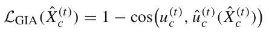

where 𝑢̂𝑐(𝑡)(𝑋̂𝑐(𝑡)) is the corresponding simulated gradient or model delta induced by the reconstruction under the same model, loss, local training rule, and number of local epochs as used by the attacked client. For FedSGD, 𝑢̂𝑐(𝑡)(𝑋̂𝑐(𝑡)) is a simulated gradient. For FedAvg, it is the model delta induced by replaying local training on the reconstructed batch. In practice, LeakPro computes this objective over the concatenated parameter space vector using cosine similarity.

For tabular data, the reconstruction variables are initialized as Gaussian noise in the model input space. When labels are assumed known, the true batch labels are copied into the attack setup. When labels are unknown, the attack uses dummy labels rather than the true batch labels, and only the input features are optimized. In the main experiments, labels are known to the attacker unless explicitly stated otherwise. The reconstruction variables are optimized with the Adam optimizer [37] using an initial attack learning rate of 0.06, followed by linear learning rate decay. We do not replace reconstruction gradients by their elementwise signs, unlike the signed gradient variant described for image reconstruction by Geiping et al. [8]. Unless noted otherwise, each attack is run for 10,000 optimization iterations and the iterate with the lowest attack loss is retained as the final reconstruction.

Client updates contain parameter gradients or model deltas, not nonparameter buffers such as BatchNorm running means or variances. For models with BatchNorm, client update computation and attack simulation use stored BatchNorm statistics rather than private batch statistics. This follows the more conservative setting discussed by Huang et al., where private batch statistics are not shared during federated training [9]. During reconstruction, the attacker optimizes in evaluation mode. This disables dropout in the simulated update and gives a more stable optimization objective, but it does not reveal the dropout masks used when a dropout enabled client update was produced [28].

A key implementation detail is that the reconstruction must be differentiable through the attacked model. For standard one-hot encoded tabular models such as the MLP and ResNet, the reconstructed inputs can be optimized directly in feature space. For FT-Transformer, however, categorical variables must pass through learned embeddings. We use a model aware differentiable surrogate that maps reconstructed categorical variables into the representation consumed by the transformer during the forward pass. This ensures that the attack objective remains end-to-end differentiable for ordinal encoded categorical features rather than relying on a nondifferentiable decode and reembed procedure.

For FT-Transformer, we use two differentiable categorical parameterizations. The *probability simplex* parameterization optimizes one expanded categorical block per feature and normalizes each block to the probability simplex before multiplying it by the learned categorical embedding matrix. The *categorical logits* parameterization optimizes the same expanded categorical blocks as logits and maps each block to probabilities with a softmax before the embedding lookup. Unless otherwise stated, the categorical logits parameterization uses softmax temperature *τ* = 1 and initialization scale 5. Tables and figures use the short labels *Categorical logits* and *Probability simplex*.

The attack framework supports two evaluation modes. In the standard attack point mode, the server attacks the client update observed at the selected attack point, with the corresponding client batch serving as ground truth for evaluation. In the fixed batch mode, the same client batch is attacked repeatedly across scheduled attack points, which separates changes caused by model training from changes caused by batch resampling. We use exposure scheduled attack points for fixed batch and FedAvg local computation experiments, where leakage must be compared at matched effective client exposure.

Importantly, relative to the original LeakPro implementation, our extensions are methodological and computational components supporting the empirical evaluation rather than modifications to the underlying gradient inversion objective. Specifically, we extend the implementation to support tabular preprocessing and reconstruction evaluation, vectorized attack execution across multiple clients, and differentiable categorical inputs for embedding-based tabular models. The optimization-based gradient matching objective is inherited from prior work [8].

### 3.6 Evaluation protocol

We evaluate both the predictive utility of the federated models and the privacy leakage of the corresponding GIAs. Because the study spans binary classification, multiclass classification, and regression, the exact utility metrics depend on the task objective. Privacy evaluation is based on feature level and record level reconstruction quality after aligning reconstructed and true client batches. Throughout, utility and privacy are evaluated at synchronized training states so that leakage can be interpreted relative to model quality at the same stage of training.

#### 3.6.1 Federated utility metrics

For federated model utility, we report task appropriate validation and test metrics computed from the current global model. In binary classification, we record loss, accuracy, F1 score, receiver operating characteristic area under the curve (ROC-AUC), and precision-recall area under the curve (PR-AUC). Binary class predictions are obtained by thresholding the sigmoid output at 0.5 for threshold dependent metrics such as accuracy and F1, while ROC-AUC and PR-AUC are computed from the predicted probabilities. For the MIMIC-IV in-hospital mortality task, ROC-AUC is used as the primary utility metric in the main plots and tradeoff analyses, while PR-AUC remains informative because of class imbalance.

For multiclass classification, we report loss, accuracy, macro precision, macro recall, macro F1, and weighted F1. Macro metrics are included because they are less dominated by large classes and provide a more balanced view of model quality under class imbalance. For regression, we report loss, mean squared error (MSE), mean absolute error (MAE), and *R*2. For plotting and privacy–utility analyses, the default validation utility metric is task dependent. We use validation ROC-AUC for binary classification, validation macro F1 for multiclass classification, and validation *R*2 for regression. Final held out test metrics are computed after restoring the best validation loss checkpoint.

#### 3.6.2 Privacy leakage metrics

Our primary privacy metric is reconstruction accuracy, adapted from TabLeak [11]. This metric evaluates each reconstructed row at the feature level and then averages over numerical and categorical attributes. For numerical feature *j*, a reconstruction is counted as correct if it falls within 𝜖𝑗 = 0.319𝜎𝑗 of the ground truth value, where 𝜎𝑗 is the client local standard deviation. For categorical features, correctness requires exact recovery of the category. The per row TabLeak accuracy is then the fraction of all numerical and categorical features recovered correctly, and the aggregate reconstruction accuracy is the mean of this quantity across rows in the attacked batch.

To make the reconstruction behavior more interpretable, we also report reconstruction accuracies by feature type, which average only over numerical or categorical features. In addition, we compute exact match reconstruction rates. The exact match rate (EMR) counts the fraction of rows with perfect reconstruction.

Because raw reconstruction accuracy can be difficult to interpret without context, we compare the attacker against two simple baselines. The first is a client marginal prior baseline that reconstructs each numerical feature by the client local mean and each categorical feature by the most likely category under the client marginals. The second is a uniform random baseline that samples numerical values uniformly from the observed global training support and categorical values uniformly over valid categories, averaged over repeated Monte Carlo draws. We report both baseline accuracies and the attack gains over these baselines. These baselines are used as evaluation reference points rather than as additional information given to the attacker.

We interpret these baselines as reference points for the strength of privacy leakage. Reconstructions close to the uniform random baseline indicate little usable feature information beyond uninformed guessing. Reconstructions above random but below the client marginal prior baseline indicate that the update reveals some feature level or distributional structure, but does not outperform a simple client marginal reconstruction. Reconstructions that exceed the client marginal prior baseline provide stronger evidence of attack specific leakage beyond marginal feature recovery. High EMRs indicate row level recovery and the strongest form of empirical privacy leakage measured in this study. These row level results are reported as auxiliary metrics.

Finally, we compute additional distributional diagnostics. These include the nearest neighbor distance from each reconstructed row to the true attacked batch and marginal likelihood statistics for reconstructed numerical and categorical values under the corresponding client distributions. These diagnostics are not used as the primary privacy outcome, but they help assess whether reconstructions preserve plausible client level feature structure beyond exact feature matches.

#### 3.6.3 Matching and reconstruction evaluation

Gradient matching is permutation invariant with respect to the order of the rows inside an attacked batch. A reconstruction may contain the correct records in the wrong order and still produce nearly the same matched gradient or model delta. Direct row wise comparison without alignment would underestimate reconstruction quality. To address this, we first align reconstructed and true rows using Hungarian matching [38] on the full encoded feature tensor with a row wise *L*1 cost. All reported privacy metrics are computed only after this assignment step.

Metric computation is performed in the original tabular feature space rather than in any internal attack parameterization. For numerical features, the evaluator transforms reconstructed values back from normalized client space to the original feature scale using the client local mean and standard deviation, which are not available to the attacker during reconstruction. For FT-Transformer, if the attack is optimized in a differentiable categorical surrogate space, the reconstruction is decoded back to ordinal input space before evaluation. This ensures that the reported privacy metrics correspond to recovered tabular records rather than to intermediate attack variables.

When labels are included in the attacked batch, they are retained in the attack artifacts for inspection. The main privacy metrics reported focus on feature reconstruction quality, since the central question is how much of the original client data can be inferred from the communicated client update.

## 4 Experiments

In this section, we outline the empirical evaluation of the proposed framework. We initially outline the experimental setup followed by the presentation of the obtained results.

### 4.1 Setup

The experiments are organized to address the central research question through three complementary stages. First, we characterize how reconstruction vulnerability changes with the information represented by communicated client updates, focusing on batch size, local computation, and training progression across different FL protocols and tabular prediction tasks. Second, we evaluate the robustness of these patterns under variations in attacker label knowledge, client heterogeneity, attack budget, and fixed versus resampled attacked batches. Third, we investigate architecture- and representation-dependent leakage by comparing MLP, ResNet, and FT-Transformer, together with the embedding-based MLP control, architectural variation within the MLP family, and alternative FT-Transformer categorical attack parameterizations. All experiments follow the same federated training, gradient matching, and reconstruction evaluation framework, allowing the results to be interpreted as complementary evidence concerning the conditions under which tabular client information becomes reconstructable.

Unless otherwise stated, FedSGD experiments use 10 clients, IID client partitioning, one mini batch gradient per client per round, global learning rate 0.01, and a minimum exposure budget of 25. Thus, the FedSGD setting does not perform a full local pass over each client dataset before communication. Each client contributes one gradient computed on the selected local mini batch. The FedSGD batch size comparisons use client batch sizes 1, 2, 4, 8, 16, 32, 64, 128, and 256. Fixed batch and MLP architecture experiments focus mainly on batch sizes 8 and 32, which provide representative intermediate settings where leakage remains measurable while aggregation effects are visible. Client heterogeneity experiments override the default IID partition with Dirichlet client splits. In addition, FedAvg experiments use 3 clients and vary the amount of local computation through the number of local epochs and the cap on client examples processed per round. These experiments use smaller batch sizes and local computation grids because each communicated update aggregates more local information than in FedSGD. The FedAvg local computation experiments use a minimum exposure budget of 24. This value is chosen because the local epoch grid contains 1, 2, and 4 local epochs. With 4 local epochs, one communication round advances client exposure by four effective local passes, so an exposure target of 24 aligns with all local epoch counts in the grid. An exposure target of 25 would force the four epoch runs to overshoot the target. Most FedSGD experiments use seeds 7, 13, and 42, while the FedAvg local computation experiments use seeds 0, 1, 7, 13, and 42.

We treat each run with a different random seed as one independent replicate. For representative MIMIC-IV FedSGD settings, we report two-sided 95% Student’s *t* confidence intervals in addition to means and standard deviations. For each model, batch size, and attack point, we average reconstruction accuracy over the ten clients in each run. We then calculate the mean 𝑥̄ and sample standard deviation *s* of these averages and report 𝑥̄ ± 𝑡0.975, 𝑛−1 𝑠/√𝑛. Here, *n* = 3 corresponds to seeds 7, 13, and 42, and 𝑡0.975, 2 = 4.303. These intervals assume that the averages from separate runs are independent and approximately normally distributed. With only three runs, this assumption is difficult to assess. Clients within a run share the same global model and training trajectory, so we show their individual results descriptively and do not treat them as independent replicates. We use the intervals to report uncertainty and do not perform significance tests across the full experimental grid.

These client counts are fixed to keep the empirical comparisons controlled and computationally tractable rather than to model a specific deployment scale. FedSGD uses 10 fully participating clients so that each round exposes multiple independent per client gradients while still allowing the batch size, dataset, and architecture comparisons to be repeated across seeds. FedAvg uses 3 clients because differentiating through local client training is substantially more expensive in memory and runtime. The learning rate is held fixed across comparable runs to avoid confounding privacy differences with model-specific optimizer tuning.

The default attack configuration uses LeakPro’s optimization based gradient inversion with known labels, an initial attack learning rate of 0.06 with linear decay, and 10,000 optimization iterations. Label knowledge and attack budget are varied only in the corresponding sensitivity experiments. Most FedSGD experiments use five automatically selected attack points. Fixed batch FedSGD experiments use exposure scheduled attack points at exposure milestones 0, 1, 5, 10, and 25, where 0 denotes the first client update from the initial global model. FedAvg local computation experiments use exposure scheduled attacks at the initialized update and the final aligned exposure milestone 24. Thus, fixed batch and FedAvg local computation attacks are compared at matched effective client data exposure rather than at matched communication rounds.

The embedding MLP control is evaluated on Adult and MIMIC-IV with client batch sizes 8 and 32 and seeds 7, 13, and 42, giving 12 new training runs. It uses FedSGD with ten fully participating IID clients, learning rate 0.01, and a minimum exposure budget of 25. Labels are known to the attacker, and each attack uses 10,000 optimization iterations with initial learning rate 0.06. Only the initialized and final communication rounds are attacked, with one attack per client at each point. Both attacks use updates computed before server aggregation; the final attack therefore targets the model immediately before the last training update. We reuse the one-hot Small MLP and FT-Transformer runs from the 10,000-iteration attack-budget comparisons in Tables 21, 22, 50, and 51. To match these runs, the MIMIC-IV control uses the historical cohort with seed-specific subject-disjoint train, validation, and test splits, rather than the externally supplied split files described above. Saved configurations and replayed batch features support matching of the data and client sampling; attack initializations are not assumed to be paired across architectures.

The fixed batch experiments repeatedly attack the same selected client batch across exposure-scheduled attack points. This design separates changes caused by model training from changes caused by attacking different sampled batches at different rounds. Across all experiments, results are written as per attack, per round, and per run summaries. Tables report means and standard deviations across seeds. Appendix Table 61 also reports confidence intervals for the representative MIMIC-IV settings.

### 4.2 Results

The results address one central question: under which conditions do communicated tabular FL updates expose reconstructable client information? We first characterize the effects of aggregation and training progression across task types and datasets. We then test the robustness of these patterns under changes in local computation, attacker knowledge, client heterogeneity, and attack configuration. Finally, we examine architecture and input representation as additional factors that modify the observed reconstruction behavior. In this context, we distinguish weakly aggregated settings, where the server observes updates from few client records, from settings where updates mix more records or pass through architectures with less direct input gradient relationships. Particular attention is given to FT-Transformer because its embedded categorical representation gives the attacker a different reconstruction problem than the one-hot MLP and ResNet baselines.

We first establish that gradient inversion remains feasible in federated tabular learning across multiple task types and datasets. The benchmark datasets span binary classification, multiclass classification, and regression, and serve as a controlled stage before the later MIMIC-IV analysis turns to a clinically motivated FL setting.

Table 2 shows that gradient inversion remains feasible after training across binary classification, multiclass classification, and regression. Across the one-hot ResNet and small MLP models, smaller client batches generally produce higher reconstruction accuracy, while larger batches reduce it. This pattern is clearest on Adult and the private multiclass benchmark, where reconstruction falls substantially as batch size increases. California Housing is the main final attack point exception. At batch size 1, reconstruction is lower than at several larger batch sizes, with ResNet increasing from 0.371 at batch size 1 to 0.748 at batch size 2, and the small MLP increasing from 0.462 to 0.815. This suggests that the regression setting can change the relationship between aggregation and reconstruction after training, especially at the smallest batch size. However, this does not mean that regression batch size 1 updates are generally less vulnerable. At the initialized attack point, Appendix Table 11 shows strong reconstruction for California Housing at batch size 1, with 0.992 for ResNet and 0.967 for the small MLP. The initialized results also show stronger leakage before training across the benchmark settings, indicating that training attenuates but does not remove the privacy risk.

Under the evaluated optimization-based GIA, FT-Transformer shows lower reconstruction than the one-hot baselines across these experiments, although substantial leakage remains in several settings. On Adult and California Housing, initialized attack point reconstruction exceeds 0.70 at batch size 1 and remains above 0.35 across the full batch size range. By the final attack point, reconstruction is generally lower than at initialization, although the decrease is less regular than for the one-hot baselines. Notably, the private multiclass benchmark behaves differently. It has 101 input features, compared with 14 for Adult and 8 for California Housing, and FT-Transformer starts from much lower initialized reconstruction on this dataset. Final attack point reconstruction is higher than initialized reconstruction at every batch size, with the largest increases at batch sizes 1 and 2, but remains below the one-hot baselines. This indicates that FT-Transformer changes the leakage profile, but should not be interpreted as a complete defense (Table 3).

We next analyze how leakage evolves during federated training on MIMIC-IV, using exposure aligned comparisons rather than communication round counts. Table 4 shows that client batch size remains a strong privacy lever on MIMIC-IV, but the effect is model dependent. For ResNet and the small MLP, reconstruction decreases substantially as batch size grows. At batch size 1, both one-hot models are almost perfectly reconstructed at the initialized attack point, whereas at batch sizes 128 and 256 reconstruction is much lower at both attack points. Training also reduces leakage for the one-hot models, although it does not remove it. At the final attack point, batch size 1 still reaches 0.669 for ResNet and 0.850 for the small MLP. As before, FT-Transformer behaves differently. It is consistently harder to invert than the one-hot baselines, but its leakage is less monotonic in batch size. Reconstruction peaks at batch size 16, reaching 0.426 at the initialized attack point and 0.462 at the final attack point, before dropping at larger batch sizes. This indicates that MIMIC-IV leakage is shaped by both aggregation and architecture specific reconstruction behavior. The EMR results in Appendix Table 42 further show that feature level reconstruction should not be equated with complete record recovery. At batch size 1, final attack point EMR reaches 0.500 for ResNet and 0.700 for the small MLP, but is 0.000 for FT-Transformer. The fixed client batch control in Appendix Table 40 presents results with similar patterns. Holding the attacked batch fixed changes the exact reconstruction levels, but it does not alter the main conclusion that the batch size trend is not explained by unusually easy or unusually hard batch draws. FT-Transformer remains harder to invert than the one-hot models, and larger one-hot batches remain less vulnerable than smaller ones.

<figure class="table-figure" id="table-2">
<figcaption><strong>Table 2</strong> Reconstruction accuracy at the final attack point across the benchmark datasets for ResNet and the small MLP under FedSGD batch size comparison</figcaption>

<table><tr><th rowspan="2">Batch size</th><th colspan="2">Adult</th><th colspan="2">Private multiclass</th><th colspan="2">California housing</th></tr><tr><th>ResNet</th><th>Small MLP</th><th>ResNet</th><th>Small MLP</th><th>ResNet</th><th>Small MLP</th></tr><tr><td>1</td><td>0.945 ± 0.025</td><td>0.964 ± 0.062</td><td>0.774 ± 0.034</td><td>0.813 ± 0.080</td><td>0.371 ± 0.128</td><td>0.462 ± 0.121</td></tr><tr><td>2</td><td>0.780 ± 0.096</td><td>0.926 ± 0.017</td><td>0.543 ± 0.023</td><td>0.453 ± 0.099</td><td>0.748 ± 0.069</td><td>0.815 ± 0.112</td></tr><tr><td>4</td><td>0.676 ± 0.068</td><td>0.823 ± 0.031</td><td>0.455 ± 0.009</td><td>0.388 ± 0.008</td><td>0.690 ± 0.067</td><td>0.717 ± 0.080</td></tr><tr><td>8</td><td>0.573 ± 0.019</td><td>0.675 ± 0.030</td><td>0.433 ± 0.041</td><td>0.375 ± 0.012</td><td>0.558 ± 0.056</td><td>0.583 ± 0.053</td></tr><tr><td>16</td><td>0.444 ± 0.014</td><td>0.550 ± 0.011</td><td>0.403 ± 0.023</td><td>0.371 ± 0.007</td><td>0.474 ± 0.016</td><td>0.578 ± 0.032</td></tr><tr><td>32</td><td>0.403 ± 0.026</td><td>0.456 ± 0.002</td><td>0.376 ± 0.005</td><td>0.310 ± 0.007</td><td>0.417 ± 0.017</td><td>0.534 ± 0.020</td></tr><tr><td>64</td><td>0.352 ± 0.037</td><td>0.354 ± 0.005</td><td>0.356 ± 0.005</td><td>0.240 ± 0.002</td><td>0.402 ± 0.002</td><td>0.462 ± 0.011</td></tr><tr><td>128</td><td>0.366 ± 0.034</td><td>0.307 ± 0.005</td><td>0.338 ± 0.013</td><td>0.218 ± 0.000</td><td>0.401 ± 0.026</td><td>0.407 ± 0.005</td></tr><tr><td>256</td><td>0.482 ± 0.003</td><td>0.300 ± 0.002</td><td>0.301 ± 0.023</td><td>0.221 ± 0.001</td><td>0.396 ± 0.007</td><td>0.397 ± 0.004</td></tr></table>

Each cell reports mean ± standard deviation across 3 seeds

</figure>

<figure class="table-figure" id="table-3">
<figcaption><strong>Table 3</strong> Reconstruction accuracy across the benchmark datasets for FT-Transformer under FedSGD batch size comparison</figcaption>

<table><tr><th rowspan="2">Batch size</th><th colspan="3">Initialized attack point</th><th colspan="3">Final attack point</th></tr><tr><th>Adult</th><th>Private multiclass</th><th>California housing</th><th>Adult</th><th>Private multiclass</th><th>California housing</th></tr><tr><td>1</td><td>0.721 ± 0.080</td><td>0.234 ± 0.032</td><td>0.721 ± 0.089</td><td>0.557 ± 0.075</td><td>0.320 ± 0.015</td><td>0.304 ± 0.051</td></tr><tr><td>2</td><td>0.495 ± 0.058</td><td>0.191 ± 0.021</td><td>0.496 ± 0.097</td><td>0.430 ± 0.021</td><td>0.295 ± 0.026</td><td>0.442 ± 0.080</td></tr><tr><td>4</td><td>0.424 ± 0.015</td><td>0.179 ± 0.006</td><td>0.384 ± 0.017</td><td>0.440 ± 0.024</td><td>0.231 ± 0.019</td><td>0.353 ± 0.011</td></tr><tr><td>8</td><td>0.373 ± 0.037</td><td>0.165 ± 0.006</td><td>0.414 ± 0.058</td><td>0.358 ± 0.048</td><td>0.217 ± 0.014</td><td>0.357 ± 0.059</td></tr><tr><td>16</td><td>0.374 ± 0.044</td><td>0.155 ± 0.006</td><td>0.424 ± 0.054</td><td>0.338 ± 0.025</td><td>0.206 ± 0.004</td><td>0.356 ± 0.012</td></tr><tr><td>32</td><td>0.377 ± 0.035</td><td>0.159 ± 0.007</td><td>0.434 ± 0.057</td><td>0.343 ± 0.011</td><td>0.188 ± 0.008</td><td>0.337 ± 0.031</td></tr><tr><td>64</td><td>0.383 ± 0.021</td><td>0.165 ± 0.010</td><td>0.485 ± 0.039</td><td>0.322 ± 0.021</td><td>0.183 ± 0.009</td><td>0.305 ± 0.015</td></tr><tr><td>128</td><td>0.396 ± 0.012</td><td>0.174 ± 0.012</td><td>0.503 ± 0.042</td><td>0.330 ± 0.010</td><td>0.198 ± 0.007</td><td>0.310 ± 0.017</td></tr><tr><td>256</td><td>0.412 ± 0.015</td><td>0.180 ± 0.010</td><td>0.537 ± 0.034</td><td>0.335 ± 0.014</td><td>0.190 ± 0.005</td><td>0.330 ± 0.025</td></tr></table>

Each cell reports mean ± standard deviation across 3 seeds

</figure>

Appendix B.7 reports 95% confidence intervals across the three independent runs in Table 61 and individual client results in Fig. 31 for representative MIMIC-IV FedSGD settings. We additionally examine the statistical robustness of these comparisons in Appendix E.7. Table 61 reports seed-level 95% confidence intervals and Fig. 31 reports the corresponding client-level distributions for representative batch sizes 8 and 32. For the one-hot models, the reduction in reconstruction from batch size 8 to 32 is observed at both the initialized and final attack points, while the FT-Transformer results exhibit greater between-run uncertainty. In particular, the final FT-Transformer result at batch size 8 varies substantially across the three independent runs. The client-level analysis also shows that similar run-level means can conceal substantial heterogeneity among individual clients. These results therefore support the main aggregation and architecture patterns while also showing that the magnitude of reconstruction for an individual client, and some FT-Transformer aggregate estimates, can vary considerably across batches and training runs.

<figure class="table-figure" id="table-4">
<figcaption><strong>Table 4</strong> Reconstruction accuracy at the initialized attack point and final attack point for MIMIC-IV</figcaption>

<table><tr><th rowspan="2">Batch size</th><th colspan="3">Initialized attack point</th><th colspan="3">Final attack point</th></tr><tr><th>FT-transformer</th><th>ResNet</th><th>Small MLP</th><th>FT-transformer</th><th>ResNet</th><th>Small MLP</th></tr><tr><td>1</td><td>0.254 ± 0.028</td><td>0.988 ± 0.010</td><td>0.989 ± 0.009</td><td>0.248 ± 0.028</td><td>0.669 ± 0.116</td><td>0.850 ± 0.038</td></tr><tr><td>2</td><td>0.300 ± 0.031</td><td>0.953 ± 0.026</td><td>0.970 ± 0.006</td><td>0.210 ± 0.107</td><td>0.635 ± 0.024</td><td>0.764 ± 0.085</td></tr><tr><td>4</td><td>0.343 ± 0.020</td><td>0.926 ± 0.053</td><td>0.962 ± 0.029</td><td>0.337 ± 0.096</td><td>0.607 ± 0.025</td><td>0.657 ± 0.010</td></tr><tr><td>8</td><td>0.357 ± 0.044</td><td>0.840 ± 0.021</td><td>0.901 ± 0.019</td><td>0.333 ± 0.186</td><td>0.703 ± 0.024</td><td>0.623 ± 0.016</td></tr><tr><td>16</td><td>0.426 ± 0.041</td><td>0.836 ± 0.065</td><td>0.822 ± 0.034</td><td>0.462 ± 0.230</td><td>0.736 ± 0.089</td><td>0.650 ± 0.037</td></tr><tr><td>32</td><td>0.384 ± 0.096</td><td>0.656 ± 0.079</td><td>0.624 ± 0.001</td><td>0.338 ± 0.100</td><td>0.504 ± 0.065</td><td>0.480 ± 0.044</td></tr><tr><td>64</td><td>0.248 ± 0.001</td><td>0.460 ± 0.097</td><td>0.471 ± 0.023</td><td>0.247 ± 0.001</td><td>0.332 ± 0.069</td><td>0.378 ± 0.058</td></tr><tr><td>128</td><td>0.363 ± 0.089</td><td>0.398 ± 0.071</td><td>0.358 ± 0.020</td><td>0.201 ± 0.048</td><td>0.212 ± 0.034</td><td>0.291 ± 0.015</td></tr><tr><td>256</td><td>0.396 ± 0.130</td><td>0.316 ± 0.031</td><td>0.302 ± 0.022</td><td>0.168 ± 0.048</td><td>0.192 ± 0.021</td><td>0.243 ± 0.016</td></tr></table>

Initialized attack point denotes the attack before any global model aggregation, and final attack point denotes the last attacked point under the exposure budget. Each cell reports mean ± standard deviation across 3 seeds

</figure>

The MIMIC-IV experiments require more careful interpretation than the benchmark datasets. MIMIC-IV contains many sparse clinical history indicators and repeated marginal patterns, so aggregate reconstruction accuracy can be inflated by correctly recovering common feature values. Appendix Table 41 reports the corresponding baselines: the client marginal prior remains near 0.94 across batch sizes, while uniform random reconstruction remains near 0.04–0.05. We interpret the MIMIC-IV results primarily through relative comparisons across models and aggregation levels, together with exact row recovery, rather than as direct evidence that each reconstruction uniquely identifies a record.

Figure 1 shows the final attack point privacy and utility tradeoff across client batch sizes on MIMIC-IV, connecting the batch size leakage results to model utility. Utility is measured by validation ROC-AUC at the synchronized final attack point. For ResNet and the small MLP, increasing the client batch size substantially reduces leakage while maintaining or improving utility. ResNet improves from 0.830 ROC-AUC at batch size 1 to 0.863 at batch size 32, while reconstruction falls from 0.669 to 0.504. The small MLP shows the same direction, with ROC-AUC rising from 0.823 to 0.863 and reconstruction falling from 0.850 to 0.480. FT-Transformer has lower leakage overall, but its tradeoff curve is less smooth: utility improves at small batch sizes, then declines at larger batch sizes, while leakage peaks at intermediate batch sizes.

Figure 2 shows how utility and leakage evolve together over training exposure. For ResNet and the small MLP, larger client batches start from lower utility at early exposure, but improve steadily and ultimately match or exceed the smaller batch settings. Their reconstruction accuracy is also lower throughout much of training and typically decreases further as exposure increases. FT-Transformer again shows a less regular dynamic, with intermediate batch sizes remaining among the more vulnerable settings over much of training and the largest batches becoming clearly more private only at later exposure.

In summary, the exposure trajectories show that larger client batches often provide sustained privacy gains for the one-hot baselines without sacrificing final utility, whereas the same relationship is weaker and less stable for FT-Transformer.

The FedAvg experiment tests whether the MIMIC-IV leakage patterns persist when client updates are produced by local training trajectories rather than single mini batch gradients. In this setting, each client is restricted to a fixed local dataset, so the same records contribute to the attacked update at each attack point. The comparison controls for changes in the attacked client record set across training. Here, *n* batches denotes how many mini batches are needed to process the fixed local dataset once, so larger values correspond to smaller local mini batches and more local optimizer steps per epoch, not to more distinct client examples.

In this context, Table 5 shows that FedAvg model deltas remain reconstructable. The initialized FedAvg update is already highly exposed for the one-hot baselines, with ResNet ranging from 0.683 to 0.894 and the small MLP ranging from 0.738 to 0.812. FT-Transformer remains substantially lower, between 0.262 and 0.335, preserving the same architecture ordering observed under FedSGD. Additional local epochs do not act as a uniform privacy mechanism. At the initialized attack point, increasing the number of local epochs raises reconstruction for all three model families at each mini batch granularity, which indicates that repeated local optimization over the same small client record set can strengthen the reconstructive signal rather than hide it. Furthermore, the benchmark FedAvg results in Appendix A.6 show the same broader pattern across Adult, the private multiclass benchmark, and California Housing. Reconstruction remains nontrivial when the server observes model deltas rather than one-step gradients, but FedAvg does not have a uniform privacy effect. Changing the number of local batches or local epochs can either reduce or increase reconstruction depending on the model and dataset. This supports the MIMIC-IV result that FedAvg leakage depends on how local computation is structured, not only on whether the observed update is a gradient or a model delta. On the *Adult* dataset with 32 local examples per client, the small MLP follows the direction reported by TabLeak, where more local epochs reduce reconstruction accuracy under FedAvg [11]. ResNet does not follow that pattern, since moving from 1 to 4 local epochs increases reconstruction across all three mini batch granularities. The MIMIC-IV results strengthen this point. With 16 local examples per client, additional local epochs usually preserve or increase leakage, especially for FT-Transformer and ResNet. Thus, the privacy effect of FedAvg local epochs is not universal. It depends on the architecture, dataset, local client dataset size, and attack formulation.

<figure id="fig-1">
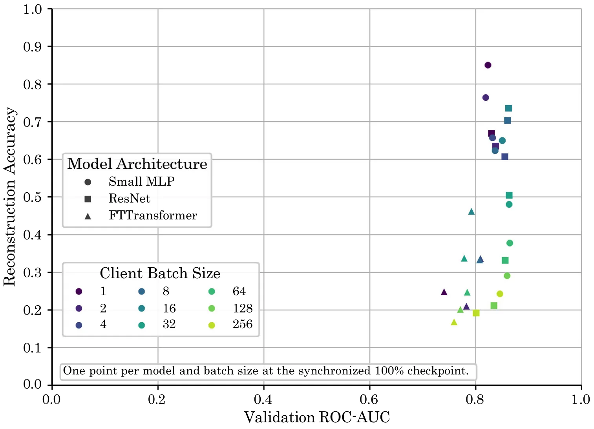
<figcaption><strong>Fig. 1</strong> Privacy and utility tradeoff at the final attack point across client batch sizes on MIMIC-IV</figcaption>
</figure>

<figure id="fig-2">
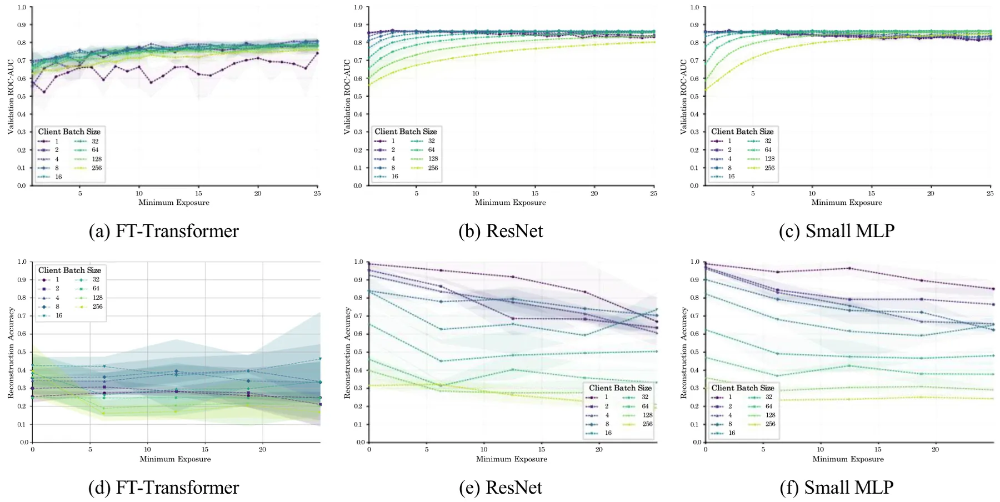
<figcaption><strong>Fig. 2</strong> The top row shows validation utility over exposure, and the bottom row shows reconstruction accuracy over exposure for MIMIC-IV</figcaption>
</figure>

The same FedAvg comparison with 64 local examples per client is reported in Appendix B.3. Increasing the fixed client dataset size lowers reconstruction substantially for the one-hot baselines, but the architecture ordering remains and the effect of local epochs is still not uniformly protective. This suggests that the 16-example result is partly amplified by the small client dataset, while the fact that local epochs are not uniformly protective persists beyond that most exposed setting.

Unlike the one-hot baselines, FT-Transformer does not expose categorical variables as direct input coordinates. Categorical features are ordinal encoded and passed through learned embeddings, so the attacker must optimize through a differentiable categorical surrogate. We compare two categorical attack parameterizations on MIMIC-IV: categorical logits and probability simplex. The categorical logits parameterization is used as the default FT-Transformer attacker in the main MIMIC-IV batch size experiment. These controls are reported up to batch size 128, while the main MIMIC-IV batch size experiment also includes batch size 256. Table 6 shows that the two categorical parameterizations lead to similar reconstruction levels and the same qualitative interpretation. The categorical logits parameterization is slightly stronger at several final attack points, including batch sizes 1, 4, 8, 16, and 32, while probability simplex is competitive or stronger in some settings, such as the final attack point at batch size 2 and the initialized attack point at batch size 64. The fixed batch control in Appendix Table 58 supports the same conclusion. Thus, the lower FT-Transformer leakage observed above is not explained by a single categorical relaxation choice.

Table 7 compares the one-hot Small MLP, embedding MLP, and FT-Transformer under the matched FedSGD protocol. FT-Transformer has lower mean reconstruction accuracy than the embedding MLP in all eight dataset, batch-size, and attack-stage settings. At the final attack point, embedding MLP reconstruction is 0.657 and 0.592 on Adult, compared with 0.383 and 0.341 for FT-Transformer, for batches 8 and 32 respectively. On MIMIC-IV, the corresponding values are 0.818 and 0.585 for the embedding MLP, compared with 0.322 and 0.262 for FT-Transformer. Replacing one-hot inputs with learned categorical embeddings does not consistently reduce reconstruction: the embedding MLP has higher mean reconstruction than the one-hot MLP in six of eight settings. The exceptions are Adult at batch 8 at the final attack point and MIMIC-IV at batch 32 at initialization. These descriptive results indicate that the shared categorical embedding interface alone does not account for FT-Transformer’s lower recovery under the evaluated attack.

The control is not parameter matched: the one-hot MLP, embedding MLP, and FT-Transformer have 5,153, 55,553, and 283,433 parameters on Adult, and 11,105, 55,233, and 333,353 on MIMIC-IV. Predictive utility also differs across settings. For example, at the exposure-25 validation checkpoint on MIMIC-IV with batch size 32, ROC-AUC is 0.793 ± 0.017, 0.799 ± 0.022, and 0.745 ± 0.008, respectively. These validation scores are measured after the final aggregation, whereas the final attack precedes that update. The control therefore does not establish a reconstruction difference at uniformly equal utility or attribute the difference solely to attention.

Dropout is a natural alternative explanation for the lower FT-Transformer leakage. Appendix Table 59 reports the initialized and final attack point results when attention and feedforward dropout are disabled. Removing dropout increases reconstruction most clearly at batch size 1, but the effect is not systematic across batch sizes or attack points. Figure 3 reports the full exposure trajectories to show whether dropout changes when leakage occurs during training. The exposure trajectories show that the dropout effect is strongly temporal. Without dropout, small batches produce a pronounced early training leakage spike. At batch size 1, reconstruction increases from 0.411 at the initialized attack point to 0.801 at the first post initialization attack point under categorical logits, and from 0.420 to 0.838 under probability simplex. With dropout enabled, the corresponding early spike is much weaker. By the final attack point, removing dropout does not produce uniformly higher reconstruction. Dropout affects the timing and stability of FT-Transformer leakage, rather than providing a sufficient explanation for the architecture level gap between FT-Transformer and the one-hot baselines. The corresponding EMRs in Appendix Table 43 show that this aggregate leakage rarely translates into complete row recovery.

Leakage in tabular gradient inversion is not determined by the training protocol alone, but also by the architectural choices used in the target model. Because tabular model performance is known to be dataset dependent, architecture level leakage patterns should also be interpreted relative to the data setting [15]. To isolate these effects within the MLP family, we evaluate a grid of standard NN modules and hyperparameters, including hidden width, hidden depth, normalization, activation, and dropout, while keeping the remaining training setup fixed. We first summarize the factor averaged effect of these choices on final attack point reconstruction accuracy, and then examine reconstruction trajectories over exposure to show how these effects interact across full configurations.

Tables 8 and 9 show clear factor averaged trends for MIMIC-IV. Structural choices still affect leakage through model capacity. Increasing hidden width increases reconstruction accuracy at both batch sizes, from 0.473 to 0.526 at batch size 8 and from 0.334 to 0.409 at batch size 32 when moving from width 32 to 128. Hidden depth is more dataset dependent. At batch size 8, deeper models are less vulnerable on average, with reconstruction accuracy decreasing from 0.540 for one hidden layer to 0.470 for three hidden layers. At batch size 32, the depth effect is weak. Module level choices also remain important. GELU is more vulnerable than ReLU at both batch sizes, and dropout reduces leakage on average. At batch size 8, switching from GELU to ReLU reduces the average reconstruction accuracy from 0.588 to 0.413, while adding dropout reduces it from 0.514 to 0.487. The same pattern holds at batch size 32, where ReLU reduces reconstruction accuracy from 0.422 to 0.321 and dropout reduces it from 0.398 to 0.345. LayerNorm is slightly less vulnerable than BatchNorm at both batch sizes, although the difference is smaller than the activation effect. These results indicate that architectural choices alone can shift leakage by a meaningful margin even when the training protocol is unchanged. A second consistent pattern is that the absolute leakage level is lower at the larger batch size. Larger client batches still reduce leakage overall, but within a fixed batch size setting, wider models and GELU activations remain systematically more vulnerable.

<figure class="table-figure" id="table-5">
<figcaption><strong>Table 5</strong> Reconstruction accuracy at the initialized attack point and final attack point for MIMIC-IV under FedAvg with 16 local examples per client</figcaption>

<table><tr><th rowspan="2">n. batches</th><th colspan="3">Initialized attack point</th><th colspan="3">Final attack point</th></tr><tr><th>FT-transformer</th><th>ResNet</th><th>Small MLP</th><th>FT-transformer</th><th>ResNet</th><th>Small MLP</th></tr><tr class="row-group"><td colspan="7">1 local epoch</td></tr><tr><td>1</td><td>0.304 ± 0.058</td><td>0.826 ± 0.060</td><td>0.744 ± 0.083</td><td>0.318 ± 0.069</td><td>0.845 ± 0.059</td><td>0.715 ± 0.051</td></tr><tr><td>2</td><td>0.279 ± 0.047</td><td>0.830 ± 0.078</td><td>0.738 ± 0.103</td><td>0.294 ± 0.067</td><td>0.769 ± 0.096</td><td>0.698 ± 0.070</td></tr><tr><td>4</td><td>0.262 ± 0.038</td><td>0.683 ± 0.119</td><td>0.756 ± 0.086</td><td>0.328 ± 0.079</td><td>0.689 ± 0.046</td><td>0.660 ± 0.076</td></tr><tr class="row-group"><td colspan="7">2 local epochs</td></tr><tr><td>1</td><td>0.309 ± 0.055</td><td>0.874 ± 0.079</td><td>0.763 ± 0.081</td><td>0.349 ± 0.075</td><td>0.872 ± 0.068</td><td>0.700 ± 0.087</td></tr><tr><td>2</td><td>0.301 ± 0.063</td><td>0.882 ± 0.055</td><td>0.780 ± 0.076</td><td>0.356 ± 0.062</td><td>0.820 ± 0.084</td><td>0.694 ± 0.056</td></tr><tr><td>4</td><td>0.291 ± 0.039</td><td>0.731 ± 0.119</td><td>0.768 ± 0.073</td><td>0.354 ± 0.122</td><td>0.709 ± 0.093</td><td>0.647 ± 0.076</td></tr><tr class="row-group"><td colspan="7">4 local epochs</td></tr><tr><td>1</td><td>0.335 ± 0.072</td><td>0.894 ± 0.064</td><td>0.773 ± 0.098</td><td>0.366 ± 0.084</td><td>0.866 ± 0.051</td><td>0.756 ± 0.061</td></tr><tr><td>2</td><td>0.318 ± 0.070</td><td>0.893 ± 0.052</td><td>0.812 ± 0.060</td><td>0.363 ± 0.097</td><td>0.822 ± 0.085</td><td>0.730 ± 0.081</td></tr><tr><td>4</td><td>0.302 ± 0.053</td><td>0.764 ± 0.120</td><td>0.796 ± 0.067</td><td>0.373 ± 0.105</td><td>0.746 ± 0.100</td><td>0.697 ± 0.060</td></tr></table>

Initialized attack point denotes the first client update computed from the initial global model, and final attack point denotes the last attacked point under the exposure budget. The row variable <em>n.</em> batches denotes how many local mini batches are needed to process the local client data once. Each cell reports mean ± standard deviation across 5 seeds

</figure>

<figure class="table-figure" id="table-6">
<figcaption><strong>Table 6</strong> Reconstruction accuracy at the initialized attack point and final attack point for MIMIC-IV under two FT-Transformer attack parameterizations</figcaption>

<table><tr><th rowspan="2">Batch size</th><th colspan="2">Initialized attack point</th><th colspan="2">Final attack point</th></tr><tr><th>Categorical logits</th><th>Probability simplex</th><th>Categorical logits</th><th>Probability simplex</th></tr><tr><td>1</td><td>0.254 ± 0.028</td><td>0.251 ± 0.011</td><td>0.248 ± 0.028</td><td>0.167 ± 0.086</td></tr><tr><td>2</td><td>0.300 ± 0.031</td><td>0.286 ± 0.016</td><td>0.210 ± 0.107</td><td>0.290 ± 0.088</td></tr><tr><td>4</td><td>0.343 ± 0.020</td><td>0.333 ± 0.026</td><td>0.337 ± 0.096</td><td>0.306 ± 0.116</td></tr><tr><td>8</td><td>0.357 ± 0.044</td><td>0.355 ± 0.048</td><td>0.333 ± 0.186</td><td>0.330 ± 0.111</td></tr><tr><td>16</td><td>0.426 ± 0.041</td><td>0.407 ± 0.037</td><td>0.462 ± 0.230</td><td>0.413 ± 0.174</td></tr><tr><td>32</td><td>0.384 ± 0.096</td><td>0.375 ± 0.100</td><td>0.338 ± 0.100</td><td>0.328 ± 0.105</td></tr><tr><td>64</td><td>0.248 ± 0.001</td><td>0.368 ± 0.081</td><td>0.247 ± 0.001</td><td>0.236 ± 0.068</td></tr><tr><td>128</td><td>0.363 ± 0.089</td><td>0.359 ± 0.087</td><td>0.201 ± 0.048</td><td>0.202 ± 0.046</td></tr></table>

Initialized attack point denotes the attack before any global model aggregation, and final attack point denotes the last attacked point under the exposure budget. Each cell reports mean ± standard deviation across 3 seeds

</figure>

<figure class="table-figure" id="table-7">
<figcaption><strong>Table 7</strong> Embedding MLP control under FedSGD with known labels and 10,000 attack iterations</figcaption>

<table><tr><th>Dataset / batch</th><th>Stage</th><th>One-hot MLP</th><th>Embedding MLP</th><th>FT-transformer</th></tr><tr><td>Adult / 8</td><td>Initialized</td><td>0.888 ± 0.034</td><td>0.955 ± 0.029</td><td>0.381 ± 0.021</td></tr><tr><td>Adult / 8</td><td>Final</td><td>0.668 ± 0.039</td><td>0.657 ± 0.074</td><td>0.383 ± 0.032</td></tr><tr><td>Adult / 32</td><td>Initialized</td><td>0.477 ± 0.009</td><td>0.813 ± 0.015</td><td>0.378 ± 0.028</td></tr><tr><td>Adult / 32</td><td>Final</td><td>0.454 ± 0.002</td><td>0.592 ± 0.009</td><td>0.341 ± 0.005</td></tr><tr><td>MIMIC-IV / 8</td><td>Initialized</td><td>0.891 ± 0.035</td><td>0.932 ± 0.017</td><td>0.391 ± 0.029</td></tr><tr><td>MIMIC-IV / 8</td><td>Final</td><td>0.620 ± 0.080</td><td>0.818 ± 0.009</td><td>0.322 ± 0.127</td></tr><tr><td>MIMIC-IV / 32</td><td>Initialized</td><td>0.639 ± 0.014</td><td>0.596 ± 0.042</td><td>0.413 ± 0.095</td></tr><tr><td>MIMIC-IV / 32</td><td>Final</td><td>0.445 ± 0.014</td><td>0.585 ± 0.072</td><td>0.262 ± 0.032</td></tr></table>

Reconstruction accuracy is reported as mean ± sample standard deviation across three seeds, after averaging the ten clients within each seed. Lower values indicate less recovery. Initialized and final attacks precede server aggregation; the final attack is in the last round of the minimum-exposure-25 budget. One-hot MLP and FT-Transformer values reuse the attack-budget appendix runs

</figure>

<figure id="fig-3">
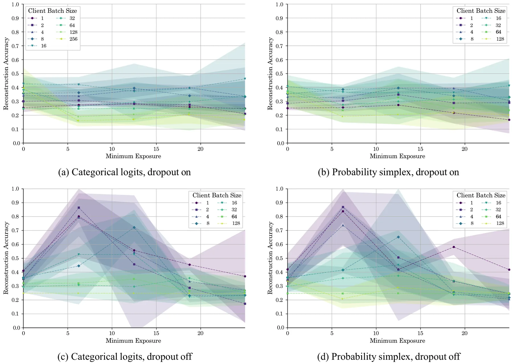
<figcaption><strong>Fig. 3</strong> FT-Transformer reconstruction accuracy over client exposure on MIMIC-IV under the two categorical attack parameterizations, with and without dropout in the target model</figcaption>
</figure>

The factor tables hide important interaction effects that become visible in the full configuration trajectories. As such, Fig. 4 shows that the marginal patterns depend strongly on the surrounding structural configuration. Consistent with the factor averages, the lowest trajectory averages are concentrated in LayerNorm and ReLU settings. The lowest full configuration over the batch size 8 trajectory is width 32, three hidden layers, LayerNorm, ReLU, and dropout 0.1, with mean reconstruction accuracy 0.208 across attack points. However, the interaction view also reveals exceptions that the marginal tables hide. For width 128 with one hidden layer, BatchNorm with GELU and dropout 0.1 has the lowest trajectory average within that structural setting, despite GELU being more vulnerable on average. Across the full batch size 8 grid, trajectory averaged reconstruction ranges from 0.208 to 0.799, a difference of 59.1 percentage points. This shows that ordinary MLP design choices can substantially change gradient inversion leakage.

<figure class="table-figure" id="table-8">
<figcaption><strong>Table 8</strong> Reconstruction accuracy at the final attack point for structural architectural factors on MIMIC-IV</figcaption>

<table><tr><th rowspan="2">Batch size</th><th colspan="3">Hidden width</th><th colspan="3">Hidden layers</th></tr><tr><th>32</th><th>64</th><th>128</th><th>1</th><th>2</th><th>3</th></tr><tr><td>8</td><td>0.473 ± 0.161</td><td>0.503 ± 0.147</td><td>0.526 ± 0.137</td><td>0.540 ± 0.139</td><td>0.492 ± 0.147</td><td>0.470 ± 0.154</td></tr><tr><td>32</td><td>0.334 ± 0.109</td><td>0.372 ± 0.109</td><td>0.409 ± 0.099</td><td>0.369 ± 0.095</td><td>0.376 ± 0.113</td><td>0.369 ± 0.123</td></tr></table>

Each cell reports mean ± standard deviation across the remaining configurations at the final attack point

</figure>

<figure class="table-figure" id="table-9">
<figcaption><strong>Table 9</strong> Reconstruction accuracy at the final attack point for module level architectural factors on MIMIC-IV</figcaption>

<table><tr><th rowspan="2">Batch size</th><th colspan="2">Normalization</th><th colspan="2">Activation</th><th colspan="2">Dropout</th></tr><tr><th>BatchNorm</th><th>LayerNorm</th><th>ReLU</th><th>GELU</th><th>0.0</th><th>0.1</th></tr><tr><td>8</td><td>0.554 ± 0.079</td><td>0.447 ± 0.180</td><td>0.413 ± 0.149</td><td>0.588 ± 0.081</td><td>0.514 ± 0.150</td><td>0.487 ± 0.146</td></tr><tr><td>32</td><td>0.380 ± 0.075</td><td>0.363 ± 0.136</td><td>0.321 ± 0.105</td><td>0.422 ± 0.088</td><td>0.398 ± 0.105</td><td>0.345 ± 0.108</td></tr></table>

Each cell reports mean ± standard deviation across the remaining configurations at the final attack point

</figure>

<figure id="fig-4">
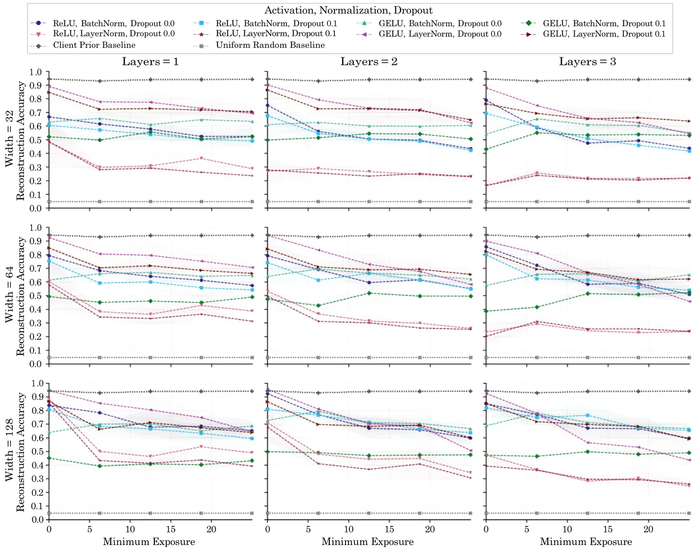
<figcaption><strong>Fig. 4</strong> Reconstruction accuracy from FedSGD GIAs during training for the structural and module configurations with client batch size 8 on MIMIC-IV</figcaption>
</figure>

<figure class="table-figure" id="table-10">
<figcaption><strong>Table 10</strong> Lowest and highest reconstruction module combinations on MIMIC-IV for batch size 32</figcaption>

<table><tr><th>Rank</th><th>Normalization</th><th>Activation</th><th>Dropout</th><th>Recon. Acc.</th></tr><tr class="row-group"><td colspan="5">Lowest reconstruction accuracy</td></tr><tr><td>1</td><td>LayerNorm</td><td>ReLU</td><td>0.1</td><td>0.215 ± 0.048</td></tr><tr><td>2</td><td>LayerNorm</td><td>ReLU</td><td>0.0</td><td>0.259 ± 0.064</td></tr><tr><td>3</td><td>BatchNorm</td><td>GELU</td><td>0.1</td><td>0.294 ± 0.016</td></tr><tr class="row-group"><td colspan="5">Highest reconstruction accuracy</td></tr><tr><td>1</td><td>LayerNorm</td><td>GELU</td><td>0.0</td><td>0.500 ± 0.024</td></tr><tr><td>2</td><td>LayerNorm</td><td>GELU</td><td>0.1</td><td>0.478 ± 0.028</td></tr><tr><td>3</td><td>BatchNorm</td><td>GELU</td><td>0.0</td><td>0.417 ± 0.059</td></tr></table>

Reconstruction accuracy is averaged over width and depth and reported at the final attack point

</figure>

Table 10 reports the lowest and highest reconstruction module combinations at batch size 32, averaged over width and depth. The complete module ranking for both evaluated batch sizes is reported in Appendix Table 44. These rankings are consistent with the trajectory analysis. At both batch sizes, the lowest average reconstruction accuracy is achieved by LayerNorm with ReLU and dropout 0.1, followed by LayerNorm with ReLU and no dropout. The highest reconstruction settings are GELU based, with LayerNorm plus GELU producing the most vulnerable combinations. The final attack point rankings support the same conclusion as the full trajectories. Activation is the clearest module level leakage driver, while width, depth, normalization, and dropout determine the final leakage level through their interaction in the complete architecture. In addition, the benchmark architecture grid results in Appendix A.7 show a related pattern across Adult, the private multiclass benchmark, and California Housing. In all three benchmark datasets, LayerNorm with GELU activation and no dropout is the highest reconstruction module combination at both evaluated batch sizes. MIMIC-IV is slightly less uniform, but its highest reconstruction settings are also GELU based. The utility rankings in Appendix Tables 45 and 46 show no clear utility advantage for the leakier MIMIC-IV configurations. At batch size 32, the best validation ROC-AUC is achieved by LayerNorm with ReLU and dropout 0.1, which is also the lowest reconstruction module combination. Thus, in this grid, lower leakage does not require a clear utility sacrifice.

Additional sensitivity analyses for client heterogeneity, attack budget, and label unknown attacks are reported in Appendix B.

## 5 Discussion

In this study, we systematically characterized reconstruction leakage from individual client updates in tabular FL under an honest-but-curious server threat model. The findings demonstrate that reconstruction vulnerability varies substantially with the FL configuration, training progression, and model architecture and input representation, but lower reconstruction under the evaluated attack does not constitute a formal privacy guarantee. At the same time, GIAs remain feasible across binary classification, multiclass classification, and regression. Leakage is highest when the observed update is weakly aggregated, especially for very small FedSGD client batches, direct one-hot input representations, and strong attacker assumptions such as known labels. In general, reconstruction decreases as client batch size increases and as the model representation becomes less directly tied to individual input features. The clearest example is FT-Transformer on MIMIC-IV. EMR is often zero, even when dropout is disabled. In the dropout disabled ablation, nonzero recovery appears only in the most exposed setting, categorical logits with batch size 1. Nonzero aggregate feature recovery does not necessarily imply complete record recovery.

Larger client batches often reduce reconstruction, but the effect depends on the model representation and does not by itself make the observed update private. As shown in Tables 2, 3 and 4, the strongest leakage appears when the observed update is weakly aggregated, especially for small FedSGD client batches. At the same time, the same tables show that increasing the batch size reduces reconstruction but does not eliminate it, and Table 5 further shows that FedAvg model deltas remain reconstructable even when the server observes a local training trajectory rather than a one-step gradient. FedSGD is used as the main controlled leakage setting because each observed update has a direct interpretation as the gradient of one client batch. FedAvg is closer to many deployment settings, but it is less controlled as an inversion target because each model delta reflects a local training trajectory, optimizer dynamics, and potentially many costly unrolled steps. This pattern agrees with prior evidence that collaborative updates may expose unintended client information and that aggregation can still preserve recoverable input structure [9, 11, 23]. The practical meaning is that larger batches and local training should be viewed as leakage reduction mechanisms, not as privacy guarantees. This is also visible in Figs. 1 and 2, where larger batches often reduce reconstruction while maintaining or improving utility for the one-hot baselines. The sensitivity analyses further show that client heterogeneity, attack budget, and label knowledge modulate measured leakage, but do not overturn the broader pattern that aggregation and model representation are the most stable determinants.

The label-unknown sensitivity analysis provides additional context for the strong label-known attacker used in the main experiments. Removing access to the true labels changes both the magnitude and the training-stage dynamics of reconstruction, but it does not uniformly eliminate leakage. On MIMIC-IV, small one-hot batches remain substantially reconstructable without true-label access, while larger batches continue to reduce reconstruction for the one-hot models. The effect is not uniformly monotonic, particularly across training stages and in the regression benchmark, indicating that label knowledge should be viewed as one component of attacker strength rather than as a binary condition determining whether leakage is possible.

The server-side observable is equally important for interpreting these results. Our FedSGD experiments expose individual client gradients, whereas the FedAvg experiments expose individual client model deltas after local optimization. The latter captures a more aggregated local training signal, and our results show that local computation alone does not provide a uniform privacy effect. However, both protocols still assume that the server can inspect each client’s update before server-side aggregation. Production systems using secure aggregation present a qualitatively different observation model because individual client updates are hidden within a multi-client aggregate. Likewise, server momentum, adaptive server optimizers, compression, clipping, or other update-processing mechanisms may further modify the signal available for reconstruction. These settings are outside the controlled protocol studied here, and the reported reconstruction levels should not be directly extrapolated to them.

The results also show that feature level reconstruction and complete record recovery should be interpreted separately. Table 4 shows substantial feature level reconstruction on MIMIC-IV, whereas Appendix Table 42 shows that EMR can be much lower, especially for FT-Transformer. This gap is important because sparse clinical tabular data may leak sensitive client level structure even when a full row is not perfectly recovered. The baseline comparisons point in the same direction: privacy risk is not limited to reconstructing a complete row, but also includes recovering sensitive feature structure or client specific distributions. Thus, the meaning of the MIMIC-IV results is not simply that some records are or are not recovered; rather, the combination of Table 4, Appendix Table 42, and the baseline comparisons in the appendix shows that tabular leakage must be evaluated at multiple levels: feature recovery, exact row recovery, and baseline relative gain.

The architecture comparisons show that measured reconstruction depends on the full model and input representation under the evaluated attack. The embedding MLP control in Table 7 narrows the interpretation: learned categorical embeddings alone do not explain FT-Transformer’s lower recovery, since the embedding MLP remains more reconstructable than FT-Transformer in all eight settings and exceeds the one-hot MLP in six. Its high initialized reconstruction also shows that untrained categorical embeddings are not sufficient to produce the low initialized recovery observed for FT-Transformer. The exposure trajectories in Fig. 3 remain consistent with training-dependent changes in the full learned representation, but do not identify a unique mechanism. Differences in numerical tokenization, capacity, dropout, and downstream processing remain possible contributors. These results are conditional on the optimization-based attack and do not establish inherent resistance to gradient inversion; transformer models have also been shown to leak in other modalities [14, 32]. The MLP grid likewise shows that width, activation, normalization, and dropout can change reconstruction without necessarily improving utility (Tables 8 and 9). Privacy assessment should therefore evaluate the full model update pipeline rather than use model complexity, categorical embeddings, or predictive utility as proxies for privacy.

This study has several limitations. First, the threat model is intentionally narrow. We study an honest-but-curious server that follows the FL protocol and reconstructs from individual client updates. We do not evaluate servers that manipulate training, malicious or colluding clients, secure aggregation, or differential privacy. These settings change either how client updates are generated or what update is available to the attacker. The results should be read as empirical leakage under the stated threat model. Second, the attack family is intentionally fixed in order to maintain a common reconstruction objective and evaluation protocol across datasets, FL configurations, and model families. Our reconstruction pipeline is based on the open-source LeakPro implementation of an optimization-based GIA. Consequently, the reported architecture-level differences are conditional on this attack family and should not be interpreted as establishing inherent resistance of any architecture to gradient inversion. Analytical attacks, attacks incorporating generative priors, and representation-specific attacks may exploit different information in the communicated update and may produce different reconstruction rankings across architectures. A rigorous comparison would require attack-specific implementation, hyperparameter tuning, convergence validation, and representation-aware adaptations for heterogeneous tabular inputs. Third, the attacker’s assumption used in the main experiments is strong. The label known setting provides an upper bound estimate of feature leakage, and our label unknown sensitivity analysis weakens this assumption only partially, since the attacker still knows the model architecture, training pipeline, feature types, column positions, and feature semantics. The empirical scope is also bounded by the chosen datasets, feature sets, and architectures; in particular, the architecture comparison covers MLP, ResNet, and FT-Transformer, but not other tabular architectures such as TabNet or TabTransformer. Fourth, the federated configuration is controlled to isolate leakage mechanisms. FedAvg local computation is restricted to plain SGD style updates without momentum, server side adaptive optimization, or update post processing. These choices make the experiments comparable across protocols, but limit how directly the conclusions transfer to larger production FL systems with more clients, heterogeneous compute, and additional optimizer machinery. Finally, the reconstruction metrics measure recoverability after row matching. They are well suited for comparing attacks and architectures, but they do not by themselves determine how severe a partial reconstruction is in privacy terms. Thus, as a future work, the architecture and aggregation findings should be tested together with formal, system level, and update level defenses. In addition, the threat model and attack family can also be expanded, including cases where adversaries do change the training process, including servers that manipulate the global model, modify the loss, or select clients to amplify reconstruction. Furthermore, other tabular NN architectures, including TabNet [16] and TabTransformer [17] encode feature interactions in different ways. Each of these models defines a different differentiable input gradient relationship, and the resulting reconstructability could differ significantly. A systematic comparison that includes these architectures, together with controlled embedding dimension and attention depth ablations, would help clarify which architectural primitives most strongly modulate gradient inversion risk in tabular settings.

Taken jointly, our results indicate that measured tabular FL leakage depends on the interaction between aggregation, architecture, data exposure, and dataset structure. Larger batches, dropout, and particular MLP configurations can reduce reconstruction under the studied threat model. Learned categorical embeddings, however, do not consistently reduce recovery in the embedding MLP control and do not by themselves explain FT-Transformer’s lower reconstruction. These empirical findings should inform model evaluation, but do not establish a formal privacy guarantee or replace dedicated protection mechanisms such as secure aggregation and differential privacy.

## A Benchmark robustness and sensitivity analyses

The benchmark robustness results support the main tabular FL analysis by extending the main attack point summary tables with exposure trajectories, exact row recovery summaries, fixed batch controls, client heterogeneity controls, attack budget controls, label unknown attacks, FedAvg results, and additional MLP architecture results. These results test whether the main conclusions persist across datasets, model families, attacker assumptions, and update protocols.

All reconstruction trajectory figures in this appendix report the five attack points sampled during FL training, with the horizontal axis showing minimum client exposure.

### A.1 Leakage across client batch sizes

Table 11 shows that the two one-hot baselines leak substantial information before the first global aggregation. At batch sizes 1 and 2, ResNet and the small MLP often reach near perfect reconstruction, especially on Adult and the private multiclass benchmark. California Housing also shows strong small batch leakage, although the decline with increasing batch size is less monotonic than for the two classification tasks. Across datasets, the dominant pattern is local aggregation: increasing the client batch size generally reduces reconstruction accuracy before any global model update has occurred. This establishes that federated tabular inversion is not confined to a single prediction objective, and that client batch size is already a major privacy lever at the initialized attack point. The corresponding benchmark baseline values are reported in Appendix Table 12. They provide the dataset specific reference levels for interpreting when reconstruction exceeds the client marginal or uniform random baselines.

Figures 5, 6 and 7 report utility and reconstruction jointly, while Figs. 8,9 and 10 isolate reconstruction accuracy across model families and client batch sizes. These trajectories support the attack point summary tables in the main text by showing that the batch size effect is present over training rather than only at the selected attack points.

Table 12 reports the client marginal prior and uniform random reconstruction reference values for the same benchmark FedSGD batch size experiments. These baselines are not additional attacker information. They provide evaluation reference points for interpreting aggregate reconstruction accuracy across datasets. The table shows that marginal recoverability differs by dataset, which helps separate attack specific leakage from reconstruction that is already explained by simple client local feature marginals.

Tables 13, 14 and 15 report EMRs for the same FedSGD batch size experiments. These row level results separate complete record recovery from feature level reconstruction. Exact row recovery is concentrated in the smallest one-hot settings and falls rapidly as client batch size increases. FT-Transformer produces almost no exact row recovery on Adult and the private multiclass benchmark, and only very low rates on California Housing. Thus, the benchmark results show that aggregate reconstruction corresponds to full record recovery mainly in highly exposed one-hot settings.

### A.2 Fixed client batches across training

Tables 16, 17, 18 and Fig. 11 report fixed batch controls for the benchmark datasets. These experiments attack the same selected client batches at the initialized attack point and final attack point. This separates changes caused by model training from changes caused by attacking different sampled batches.

<figure class="table-figure" id="table-11">
<figcaption><strong>Table 11</strong> Reconstruction accuracy at the initialized attack point across the benchmark datasets for ResNet and the small MLP under the FedSGD batch size comparison</figcaption>

<table><tr><th rowspan="2">Batch size</th><th colspan="2">Adult</th><th colspan="2">Private multiclass</th><th colspan="2">California Housing</th></tr><tr><th>ResNet</th><th>Small MLP</th><th>ResNet</th><th>Small MLP</th><th>ResNet</th><th>Small MLP</th></tr><tr><td>1</td><td>0.995 ± 0.004</td><td>1.000 ± 0.000</td><td>0.980 ± 0.019</td><td>0.961 ± 0.035</td><td>0.992 ± 0.014</td><td>0.967 ± 0.058</td></tr><tr><td>2</td><td>0.949 ± 0.013</td><td>0.980 ± 0.018</td><td>0.983 ± 0.013</td><td>0.872 ± 0.129</td><td>0.781 ± 0.063</td><td>0.892 ± 0.067</td></tr><tr><td>4</td><td>0.869 ± 0.037</td><td>0.970 ± 0.019</td><td>0.944 ± 0.032</td><td>0.679 ± 0.063</td><td>0.662 ± 0.054</td><td>0.792 ± 0.057</td></tr><tr><td>8</td><td>0.788 ± 0.016</td><td>0.903 ± 0.033</td><td>0.797 ± 0.024</td><td>0.554 ± 0.056</td><td>0.537 ± 0.016</td><td>0.729 ± 0.023</td></tr><tr><td>16</td><td>0.713 ± 0.018</td><td>0.748 ± 0.017</td><td>0.624 ± 0.016</td><td>0.456 ± 0.007</td><td>0.503 ± 0.025</td><td>0.663 ± 0.037</td></tr><tr><td>32</td><td>0.589 ± 0.011</td><td>0.482 ± 0.010</td><td>0.443 ± 0.008</td><td>0.322 ± 0.005</td><td>0.494 ± 0.013</td><td>0.609 ± 0.019</td></tr><tr><td>64</td><td>0.553 ± 0.007</td><td>0.358 ± 0.006</td><td>0.338 ± 0.010</td><td>0.248 ± 0.003</td><td>0.507 ± 0.016</td><td>0.601 ± 0.026</td></tr><tr><td>128</td><td>0.533 ± 0.007</td><td>0.326 ± 0.008</td><td>0.286 ± 0.009</td><td>0.225 ± 0.002</td><td>0.515 ± 0.009</td><td>0.605 ± 0.035</td></tr><tr><td>256</td><td>0.527 ± 0.012</td><td>0.324 ± 0.009</td><td>0.261 ± 0.010</td><td>0.225 ± 0.000</td><td>0.564 ± 0.013</td><td>0.624 ± 0.030</td></tr></table>

Each cell reports mean ± standard deviation across 3 seeds

</figure>

<figure id="fig-5">
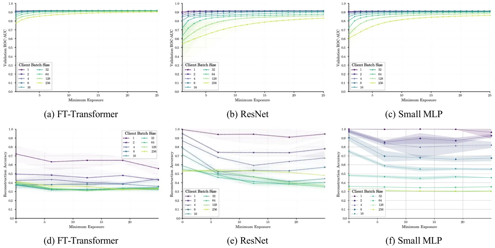
<figcaption><strong>Fig. 5</strong> The top row shows validation utility over exposure, and the bottom row shows reconstruction accuracy over exposure for Adult</figcaption>
</figure>

### A.3 Non-IID client partitions

Table 19 and Figs. 12, 13 and 14 report the non-IID benchmark controls. The Dirichlet concentration changes client composition while keeping the attack and evaluation pipeline fixed. These results test whether the benchmark leakage trends persist when client local data distributions are less evenly distributed.

Figures 15, 16 and 17 report validation utility under the same non-IID client partitions. These curves verify that the privacy comparisons are not separated from the corresponding predictive behavior of the trained models.

Table 20 shows that client heterogeneity changes leakage, but the direction and size of the effect are dataset dependent.

At the initialized attack point, reconstruction is still primarily governed by architecture and aggregation: FT-Transformer remains less vulnerable than the one-hot baselines on Adult and the private multiclass benchmark, while California Housing shows a smaller separation between model families. The effect of *α* is modest at this stage. At the final attack point, Adult is the clearest case in which the split closest to IID leaks more across all three model families. For example, the small MLP increases from 0.446 at *α* = 0.4 to 0.507 at *α* = 1.0, and FT-Transformer increases from 0.275 to 0.307. The private multiclass benchmark remains comparatively stable for FT-Transformer and the small MLP, while ResNet leaks more at *α* = 1.0 than under the more heterogeneous splits. California Housing does not show a consistent monotonic relationship with *α*. Overall, client heterogeneity modifies the client gradient or model update through class, feature, or target bucket skew, but architecture and aggregation remain more stable predictors of reconstruction than the Dirichlet concentration alone. The corresponding batch size 8 results are reported in Table 19.

<figure class="table-figure" id="table-12">
<figcaption><strong>Table 12</strong> Client marginal prior and uniform random reconstruction baselines for the benchmark FedSGD batch size experiments</figcaption>

<table><tr><th rowspan="2">Batch size</th><th colspan="2">Adult</th><th colspan="2">Private multiclass</th><th colspan="2">California Housing</th></tr><tr><th>Prior</th><th>Random</th><th>Prior</th><th>Random</th><th>Prior</th><th>Random</th></tr><tr><td>1</td><td>0.563 ± 0.056</td><td>0.111 ± 0.009</td><td>0.244 ± 0.020</td><td>0.148 ± 0.008</td><td>0.356 ± 0.045</td><td>0.067 ± 0.003</td></tr><tr><td>2</td><td>0.550 ± 0.022</td><td>0.119 ± 0.011</td><td>0.245 ± 0.013</td><td>0.150 ± 0.008</td><td>0.355 ± 0.037</td><td>0.081 ± 0.002</td></tr><tr><td>4</td><td>0.548 ± 0.020</td><td>0.129 ± 0.012</td><td>0.244 ± 0.011</td><td>0.152 ± 0.008</td><td>0.348 ± 0.022</td><td>0.099 ± 0.002</td></tr><tr><td>8</td><td>0.557 ± 0.016</td><td>0.144 ± 0.015</td><td>0.247 ± 0.005</td><td>0.155 ± 0.008</td><td>0.342 ± 0.018</td><td>0.120 ± 0.002</td></tr><tr><td>16</td><td>0.549 ± 0.013</td><td>0.161 ± 0.019</td><td>0.245 ± 0.004</td><td>0.158 ± 0.008</td><td>0.346 ± 0.017</td><td>0.142 ± 0.002</td></tr><tr><td>32</td><td>0.550 ± 0.008</td><td>0.180 ± 0.024</td><td>0.245 ± 0.004</td><td>0.161 ± 0.008</td><td>0.347 ± 0.013</td><td>0.163 ± 0.003</td></tr><tr><td>64</td><td>0.551 ± 0.004</td><td>0.198 ± 0.029</td><td>0.246 ± 0.002</td><td>0.164 ± 0.008</td><td>0.348 ± 0.007</td><td>0.183 ± 0.002</td></tr><tr><td>128</td><td>0.549 ± 0.004</td><td>0.216 ± 0.033</td><td>0.247 ± 0.002</td><td>0.167 ± 0.008</td><td>0.349 ± 0.007</td><td>0.199 ± 0.002</td></tr><tr><td>256</td><td>0.548 ± 0.003</td><td>0.233 ± 0.037</td><td>0.246 ± 0.001</td><td>0.169 ± 0.008</td><td>0.348 ± 0.006</td><td>0.212 ± 0.001</td></tr></table>

Values are computed on the same model runs and attack points as the main reconstruction experiments and reported as mean ± standard deviation. Prior denotes client marginal prior reconstruction accuracy, and Random denotes uniform random reconstruction accuracy

</figure>

<figure class="table-figure" id="table-13">
<figcaption><strong>Table 13</strong> EMR at the initialized attack point and final attack point for Adult</figcaption>

<table><tr><th rowspan="2">Batch size</th><th colspan="3">Initialized attack point</th><th colspan="3">Final attack point</th></tr><tr><th>FT-transformer</th><th>ResNet</th><th>Small MLP</th><th>FT-transformer</th><th>ResNet</th><th>Small MLP</th></tr><tr><td>1</td><td>0.033 ± 0.058</td><td>0.933 ± 0.058</td><td>1.000 ± 0.000</td><td>0.000 ± 0.000</td><td>0.867 ± 0.058</td><td>0.933 ± 0.115</td></tr><tr><td>2</td><td>0.000 ± 0.000</td><td>0.567 ± 0.104</td><td>0.933 ± 0.058</td><td>0.017 ± 0.029</td><td>0.583 ± 0.126</td><td>0.767 ± 0.029</td></tr><tr><td>4</td><td>0.000 ± 0.000</td><td>0.275 ± 0.132</td><td>0.908 ± 0.029</td><td>0.017 ± 0.014</td><td>0.317 ± 0.058</td><td>0.533 ± 0.072</td></tr><tr><td>8</td><td>0.000 ± 0.000</td><td>0.192 ± 0.085</td><td>0.679 ± 0.069</td><td>0.000 ± 0.000</td><td>0.158 ± 0.019</td><td>0.225 ± 0.025</td></tr><tr><td>16</td><td>0.000 ± 0.000</td><td>0.067 ± 0.031</td><td>0.229 ± 0.042</td><td>0.000 ± 0.000</td><td>0.050 ± 0.019</td><td>0.069 ± 0.041</td></tr><tr><td>32</td><td>0.000 ± 0.000</td><td>0.010 ± 0.002</td><td>0.009 ± 0.008</td><td>0.000 ± 0.000</td><td>0.014 ± 0.008</td><td>0.018 ± 0.013</td></tr><tr><td>64</td><td>0.000 ± 0.000</td><td>0.002 ± 0.000</td><td>0.000 ± 0.000</td><td>0.000 ± 0.000</td><td>0.001 ± 0.001</td><td>0.001 ± 0.001</td></tr><tr><td>128</td><td>0.000 ± 0.000</td><td>0.001 ± 0.001</td><td>0.000 ± 0.000</td><td>0.000 ± 0.000</td><td>0.000 ± 0.000</td><td>0.000 ± 0.000</td></tr><tr><td>256</td><td>0.000 ± 0.000</td><td>0.001 ± 0.001</td><td>0.000 ± 0.000</td><td>0.000 ± 0.000</td><td>0.000 ± 0.000</td><td>0.000 ± 0.000</td></tr></table>

Each cell reports mean ± standard deviation across 3 seeds

</figure>

<figure class="table-figure" id="table-14">
<figcaption><strong>Table 14</strong> EMR at the initialized attack point and final attack point for the private multiclass benchmark</figcaption>

<table><tr><th rowspan="2">Batch size</th><th colspan="3">Initialized attack point</th><th colspan="3">Final attack point</th></tr><tr><th>FT-transformer</th><th>ResNet</th><th>Small MLP</th><th>FT-transformer</th><th>ResNet</th><th>Small MLP</th></tr><tr><td>1</td><td>0.000 ± 0.000</td><td>0.867 ± 0.058</td><td>0.900 ± 0.100</td><td>0.000 ± 0.000</td><td>0.567 ± 0.058</td><td>0.533 ± 0.115</td></tr><tr><td>2</td><td>0.000 ± 0.000</td><td>0.850 ± 0.050</td><td>0.600 ± 0.328</td><td>0.000 ± 0.000</td><td>0.267 ± 0.076</td><td>0.100 ± 0.000</td></tr><tr><td>4</td><td>0.000 ± 0.000</td><td>0.667 ± 0.146</td><td>0.175 ± 0.115</td><td>0.000 ± 0.000</td><td>0.067 ± 0.029</td><td>0.033 ± 0.029</td></tr><tr><td>8</td><td>0.000 ± 0.000</td><td>0.083 ± 0.047</td><td>0.037 ± 0.037</td><td>0.000 ± 0.000</td><td>0.050 ± 0.025</td><td>0.013 ± 0.013</td></tr><tr><td>16</td><td>0.000 ± 0.000</td><td>0.000 ± 0.000</td><td>0.000 ± 0.000</td><td>0.000 ± 0.000</td><td>0.010 ± 0.004</td><td>0.000 ± 0.000</td></tr><tr><td>32</td><td>0.000 ± 0.000</td><td>0.000 ± 0.000</td><td>0.000 ± 0.000</td><td>0.000 ± 0.000</td><td>0.002 ± 0.002</td><td>0.000 ± 0.000</td></tr><tr><td>64</td><td>0.000 ± 0.000</td><td>0.000 ± 0.000</td><td>0.000 ± 0.000</td><td>0.000 ± 0.000</td><td>0.000 ± 0.000</td><td>0.000 ± 0.000</td></tr><tr><td>128</td><td>0.000 ± 0.000</td><td>0.000 ± 0.000</td><td>0.000 ± 0.000</td><td>0.000 ± 0.000</td><td>0.000 ± 0.000</td><td>0.000 ± 0.000</td></tr><tr><td>256</td><td>0.000 ± 0.000</td><td>0.000 ± 0.000</td><td>0.000 ± 0.000</td><td>0.000 ± 0.000</td><td>0.000 ± 0.000</td><td>0.000 ± 0.000</td></tr></table>

Each cell reports mean ± standard deviation across 3 seeds

</figure>

<figure id="fig-6">
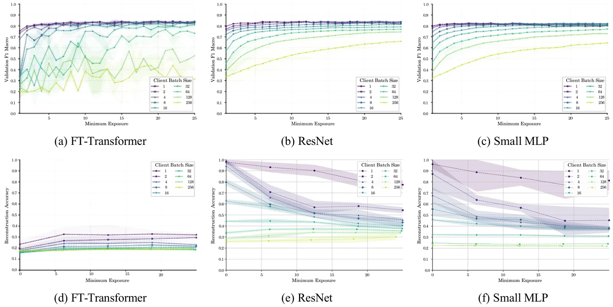
<figcaption><strong>Fig. 6</strong> The top row shows validation utility over exposure, and the bottom row shows reconstruction accuracy over exposure for the private multiclass benchmark</figcaption>
</figure>

<figure id="fig-7">
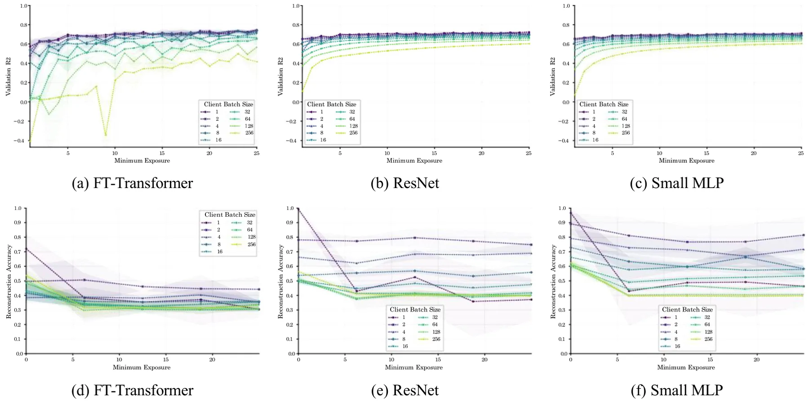
<figcaption><strong>Fig. 7</strong> The top row shows validation utility over exposure, and the bottom row shows reconstruction accuracy over exposure for California Housing</figcaption>
</figure>

Figures 12, 13 and 14 report the non-IID robustness analysis on the benchmark datasets. The curves compare FedSGD gradient inversion reconstruction accuracy across Dirichlet client partition settings and client batch sizes for each evaluated model family. The client marginal prior and uniform random baselines provide reference leakage levels for distribution aware and distribution free reconstruction, respectively.

<figure id="fig-8">
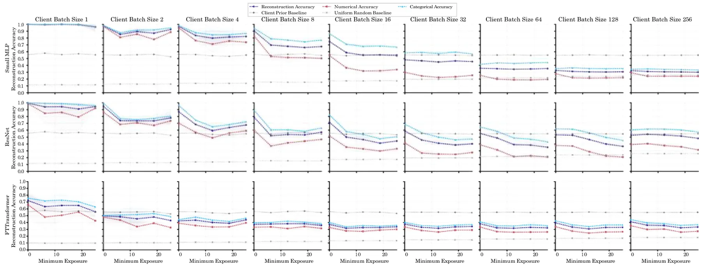
<figcaption><strong>Fig. 8</strong> Reconstruction trajectories across model families and client batch sizes on Adult</figcaption>
</figure>

<figure id="fig-9">
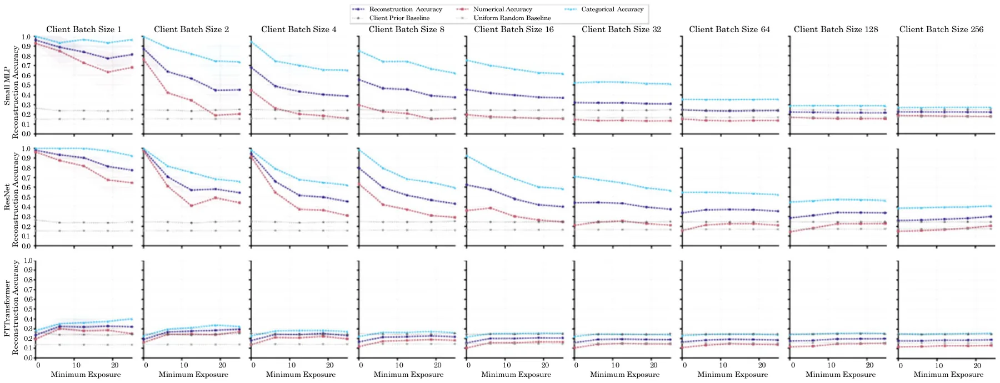
<figcaption><strong>Fig. 9</strong> Reconstruction trajectories across model families and client batch sizes on the private multiclass benchmark</figcaption>
</figure>

<figure id="fig-10">
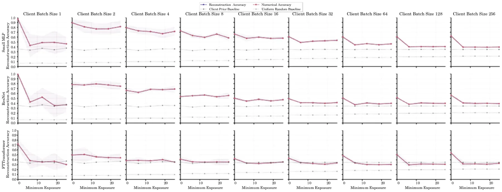
<figcaption><strong>Fig. 10</strong> Reconstruction trajectories across model families and client batch sizes on California Housing</figcaption>
</figure>

<figure class="table-figure" id="table-15">
<figcaption><strong>Table 15</strong> EMR at the initialized attack point and final attack point for California Housing</figcaption>

<table><tr><th rowspan="2">Batch size</th><th colspan="3">Initialized attack point</th><th colspan="3">Final attack point</th></tr><tr><th>FT-transformer</th><th>ResNet</th><th>Small MLP</th><th>FT-transformer</th><th>ResNet</th><th>Small MLP</th></tr><tr><td>1</td><td>0.067 ± 0.115</td><td>0.967 ± 0.058</td><td>0.967 ± 0.058</td><td>0.033 ± 0.058</td><td>0.233 ± 0.153</td><td>0.267 ± 0.115</td></tr><tr><td>2</td><td>0.017 ± 0.029</td><td>0.517 ± 0.126</td><td>0.750 ± 0.132</td><td>0.067 ± 0.058</td><td>0.617 ± 0.076</td><td>0.750 ± 0.132</td></tr><tr><td>4</td><td>0.008 ± 0.014</td><td>0.308 ± 0.052</td><td>0.617 ± 0.072</td><td>0.008 ± 0.014</td><td>0.425 ± 0.087</td><td>0.475 ± 0.164</td></tr><tr><td>8</td><td>0.004 ± 0.007</td><td>0.087 ± 0.037</td><td>0.396 ± 0.026</td><td>0.033 ± 0.007</td><td>0.212 ± 0.033</td><td>0.250 ± 0.078</td></tr><tr><td>16</td><td>0.006 ± 0.000</td><td>0.060 ± 0.013</td><td>0.296 ± 0.022</td><td>0.006 ± 0.011</td><td>0.100 ± 0.023</td><td>0.212 ± 0.041</td></tr><tr><td>32</td><td>0.001 ± 0.002</td><td>0.043 ± 0.012</td><td>0.207 ± 0.031</td><td>0.002 ± 0.002</td><td>0.041 ± 0.008</td><td>0.157 ± 0.021</td></tr><tr><td>64</td><td>0.009 ± 0.007</td><td>0.039 ± 0.003</td><td>0.146 ± 0.021</td><td>0.002 ± 0.002</td><td>0.013 ± 0.002</td><td>0.083 ± 0.010</td></tr><tr><td>128</td><td>0.010 ± 0.003</td><td>0.033 ± 0.012</td><td>0.097 ± 0.018</td><td>0.002 ± 0.001</td><td>0.007 ± 0.002</td><td>0.034 ± 0.004</td></tr><tr><td>256</td><td>0.012 ± 0.006</td><td>0.038 ± 0.008</td><td>0.083 ± 0.011</td><td>0.002 ± 0.001</td><td>0.002 ± 0.001</td><td>0.012 ± 0.005</td></tr></table>

Each cell reports mean ± standard deviation across 3 seeds

</figure>

<figure class="table-figure" id="table-16">
<figcaption><strong>Table 16</strong> Reconstruction accuracy at the initialized attack point and final attack point for Adult</figcaption>

<table><tr><th rowspan="2">Batch size</th><th colspan="3">Initialized attack point</th><th colspan="3">Final attack point</th></tr><tr><th>FT-transformer</th><th>ResNet</th><th>Small MLP</th><th>FT-transformer</th><th>ResNet</th><th>Small MLP</th></tr><tr><td>8</td><td>0.376 ± 0.026</td><td>0.766 ± 0.012</td><td>0.905 ± 0.018</td><td>0.364 ± 0.014</td><td>0.552 ± 0.014</td><td>0.673 ± 0.029</td></tr><tr><td>32</td><td>0.378 ± 0.020</td><td>0.584 ± 0.007</td><td>0.476 ± 0.016</td><td>0.349 ± 0.022</td><td>0.393 ± 0.016</td><td>0.449 ± 0.008</td></tr></table>

Initialized attack point denotes the attack before any global model aggregation, and final attack point denotes the last attacked point under the exposure budget. Each cell reports mean ± standard deviation across 3 seeds

</figure>

<figure class="table-figure" id="table-17">
<figcaption><strong>Table 17</strong> Reconstruction accuracy at the initialized attack point and final attack point for the private multiclass benchmark</figcaption>

<table><tr><th rowspan="2">Batch size</th><th colspan="3">Initialized attack point</th><th colspan="3">Final attack point</th></tr><tr><th>FT-transformer</th><th>ResNet</th><th>Small MLP</th><th>FT-transformer</th><th>ResNet</th><th>Small MLP</th></tr><tr><td>8</td><td>0.154 ± 0.011</td><td>0.820 ± 0.051</td><td>0.608 ± 0.047</td><td>0.212 ± 0.009</td><td>0.410 ± 0.029</td><td>0.362 ± 0.038</td></tr><tr><td>32</td><td>0.161 ± 0.012</td><td>0.434 ± 0.008</td><td>0.324 ± 0.003</td><td>0.194 ± 0.001</td><td>0.374 ± 0.018</td><td>0.313 ± 0.002</td></tr></table>

Initialized attack point denotes the attack before any global model aggregation, and final attack point denotes the last attacked point under the exposure budget. Each cell reports mean ± standard deviation across 3 seeds

</figure>

### A.4 Attack optimization budget

Table 21 and Figs. 18, 19 and 20 evaluate whether benchmark reconstruction depends strongly on the number of attack optimization iterations. The FL configuration is held fixed while the offline attack budget is varied. These controls test whether the reported attack point conclusions are artifacts of an insufficiently optimized attack.

Table 22 evaluates whether the benchmark conclusions depend on the number of attack optimization iterations. At batch size 32, increasing the attack budget from 5000 to 20,000 iterations produces only moderate and model dependent changes. The clearest increase is observed for the small MLP on Adult, where final attack point reconstruction increases from 0.423 to 0.477. FT-Transformer is comparatively stable on Adult and the private multiclass benchmark, while California Housing is not monotonic with respect to the attack budget. The same batch size 8 sensitivity is reported in Table 21.

<figure class="table-figure" id="table-18">
<figcaption><strong>Table 18</strong> Reconstruction accuracy at the initialized attack point and final attack point for California Housing</figcaption>

<table><tr><th rowspan="2">Batch size</th><th colspan="3">Initialized attack point</th><th colspan="3">Final attack point</th></tr><tr><th>FT-transformer</th><th>ResNet</th><th>Small MLP</th><th>FT-transformer</th><th>ResNet</th><th>Small MLP</th></tr><tr><td>8</td><td>0.402 ± 0.020</td><td>0.551 ± 0.042</td><td>0.712 ± 0.057</td><td>0.359 ± 0.011</td><td>0.534 ± 0.027</td><td>0.614 ± 0.023</td></tr><tr><td>32</td><td>0.442 ± 0.033</td><td>0.518 ± 0.022</td><td>0.592 ± 0.029</td><td>0.331 ± 0.041</td><td>0.420 ± 0.023</td><td>0.517 ± 0.016</td></tr></table>

Initialized attack point denotes the attack before any global model aggregation, and final attack point denotes the last attacked point under the exposure budget. Each cell reports mean ± standard deviation across 3 seeds

</figure>

<figure id="fig-11">
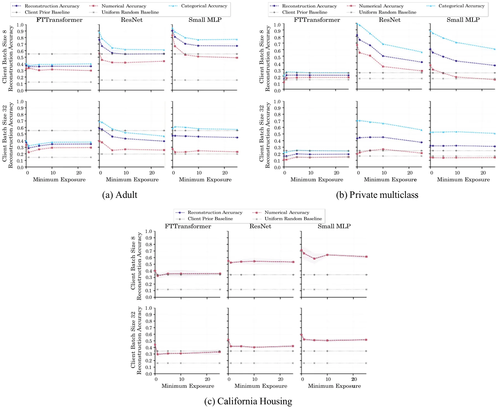
<figcaption><strong>Fig. 11</strong> Reconstruction accuracy over FL training using fixed batches per client for client batch sizes 8 and 32 across all three models and the three benchmark datasets</figcaption>
</figure>

Overall, the attack budget sensitivity does not indicate that the reported benchmark trends are an artifact of a single optimization budget. Larger budgets can improve some reconstructions, but they do not consistently increase leakage across datasets and architectures, nor do they change the broader ordering of model families observed in the benchmark experiments. The attack budget should be interpreted as a robustness check rather than as the primary privacy lever.

Figures 18, 19 and 20 evaluate whether benchmark reconstruction depends strongly on the number of attack optimization iterations. The FL configuration is held fixed while the offline attack budget is varied. These controls test whether the reported attack point conclusions are artifacts of an insufficiently optimized attack.

### A.5 Leakage without true batch labels

Table 23 and Fig. 21 report benchmark attacks without access to the true batch labels or regression targets. This setting removes target information from the attacker while preserving the same observed client updates and model families. The comparison tests whether the benchmark conclusions rely on the stronger label known assumption used by default.

The label unknown benchmark final attack point results are reported in Table 23, with label unknown trajectories shown in Fig. 21; the corresponding label known California Housing trajectories are shown in Fig. 10. These results generally support the batch size conclusion under the weaker attacker assumption, but California Housing reveals a regression specific label knowledge effect rather than a simple reduction in attacker strength. Under label known attacks, batch size 1 reconstruction drops during training for all three model families, from 0.721 to 0.304 for FT-Transformer, from 0.992 to 0.371 for ResNet, and from 0.967 to 0.463 for the small MLP. In the label unknown trajectories, the direction reverses, with initially weak reconstruction recovering during training, most clearly for ResNet. This suggests that regression targets interact with the gradient matching objective through the MSE residual, so label knowledge should be interpreted more carefully for regression than for classification.

<figure id="fig-12">
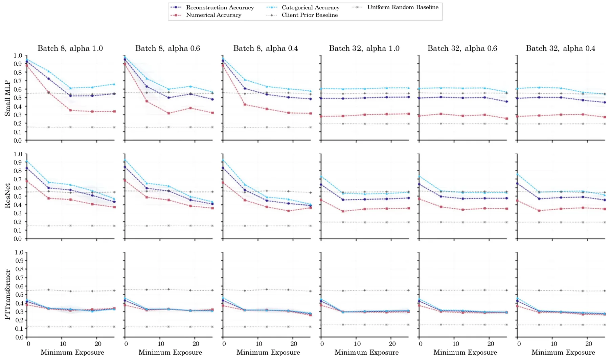
<figcaption><strong>Fig. 12</strong> Non-IID robustness analysis on Adult</figcaption>
</figure>

<figure id="fig-13">
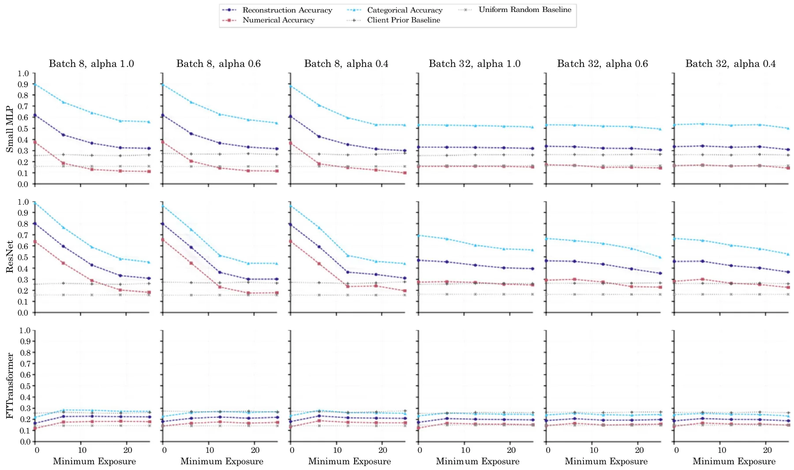
<figcaption><strong>Fig. 13</strong> Non-IID robustness analysis on the private multiclass benchmark</figcaption>
</figure>

<figure id="fig-14">
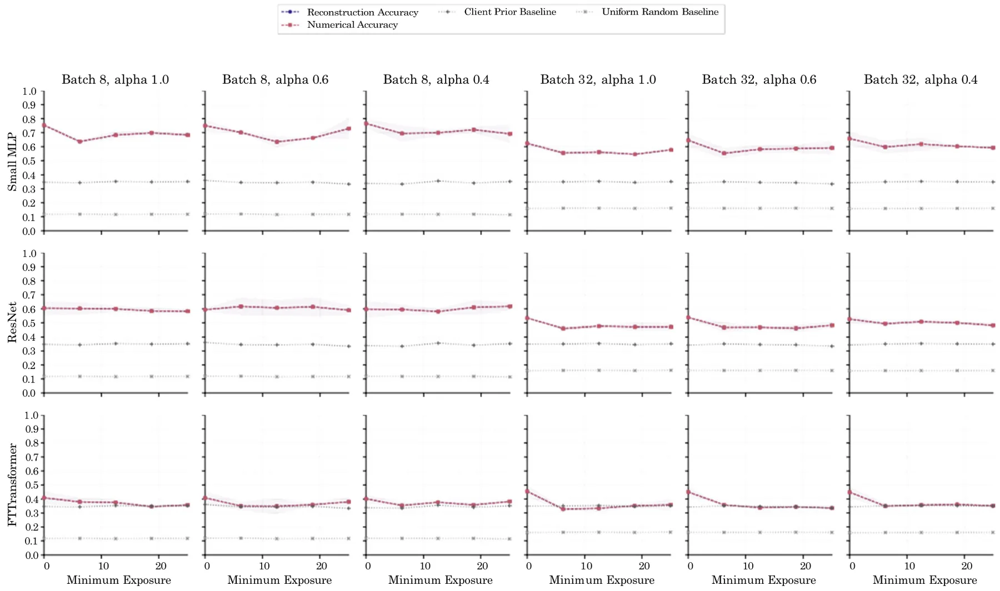
<figcaption><strong>Fig. 14</strong> Non-IID robustness analysis on California Housing</figcaption>
</figure>

<figure id="fig-15">
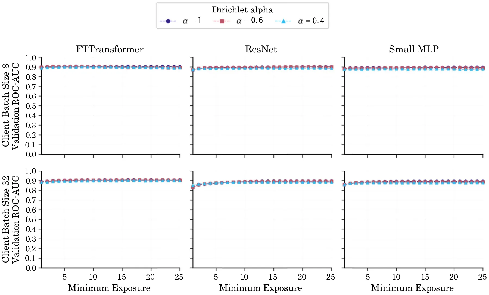
<figcaption><strong>Fig. 15</strong> Validation utility under non-IID client partitions on Adult. The figure uses the same Dirichlet client partitions as the reconstruction robustness analysis</figcaption>
</figure>

<figure class="table-figure" id="table-19">
<figcaption><strong>Table 19</strong> Reconstruction accuracy under non-IID client partitions at batch size 8</figcaption>

<table><tr><th rowspan="2">α</th><th colspan="3">Adult</th><th colspan="3">Private multiclass</th><th colspan="3">California housing</th></tr><tr><th>FT-transformer</th><th>ResNet</th><th>Small MLP</th><th>FT-transformer</th><th>ResNet</th><th>Small MLP</th><th>FT-transformer</th><th>ResNet</th><th>Small MLP</th></tr><tr class="row-group"><td colspan="10">Initialized attack point</td></tr><tr><td>α = 0.4</td><td>0.432 ± 0.028</td><td>0.832 ± 0.023</td><td>0.934 ± 0.019</td><td>0.180 ± 0.006</td><td>0.791 ± 0.022</td><td>0.608 ± 0.042</td><td>0.402 ± 0.026</td><td>0.597 ± 0.057</td><td>0.765 ± 0.031</td></tr><tr><td>α = 0.6</td><td>0.431 ± 0.008</td><td>0.842 ± 0.049</td><td>0.949 ± 0.040</td><td>0.181 ± 0.008</td><td>0.798 ± 0.014</td><td>0.618 ± 0.062</td><td>0.409 ± 0.041</td><td>0.593 ± 0.012</td><td>0.750 ± 0.039</td></tr><tr><td>α = 1.0</td><td>0.420 ± 0.033</td><td>0.829 ± 0.006</td><td>0.925 ± 0.043</td><td>0.165 ± 0.009</td><td>0.801 ± 0.022</td><td>0.619 ± 0.014</td><td>0.409 ± 0.042</td><td>0.604 ± 0.043</td><td>0.753 ± 0.011</td></tr><tr class="row-group"><td colspan="10">Final attack point</td></tr><tr><td>α = 0.4</td><td>0.275 ± 0.020</td><td>0.390 ± 0.036</td><td>0.485 ± 0.034</td><td>0.209 ± 0.006</td><td>0.311 ± 0.004</td><td>0.301 ± 0.005</td><td>0.383 ± 0.007</td><td>0.617 ± 0.028</td><td>0.692 ± 0.058</td></tr><tr><td>α = 0.6</td><td>0.315 ± 0.022</td><td>0.409 ± 0.022</td><td>0.480 ± 0.025</td><td>0.218 ± 0.007</td><td>0.302 ± 0.012</td><td>0.317 ± 0.022</td><td>0.381 ± 0.033</td><td>0.590 ± 0.032</td><td>0.729 ± 0.069</td></tr><tr><td>α = 1.0</td><td>0.333 ± 0.012</td><td>0.435 ± 0.044</td><td>0.545 ± 0.041</td><td>0.222 ± 0.007</td><td>0.309 ± 0.023</td><td>0.320 ± 0.021</td><td>0.358 ± 0.012</td><td>0.582 ± 0.013</td><td>0.683 ± 0.011</td></tr></table>

Each cell reports mean ± standard deviation across 3 seeds

</figure>

<figure class="table-figure" id="table-20">
<figcaption><strong>Table 20</strong> Reconstruction accuracy under non-IID client partitions at batch size 32</figcaption>

<table><tr><th rowspan="2">α</th><th colspan="3">Adult</th><th colspan="3">Private multiclass</th><th colspan="3">California housing</th></tr><tr><th>FT-transformer</th><th>ResNet</th><th>Small MLP</th><th>FT-transformer</th><th>ResNet</th><th>Small MLP</th><th>FT-transformer</th><th>ResNet</th><th>Small MLP</th></tr><tr class="row-group"><td colspan="10">Initialized attack point</td></tr><tr><td>α = 0.4</td><td>0.427 ± 0.009</td><td>0.649 ± 0.007</td><td>0.491 ± 0.021</td><td>0.186 ± 0.013</td><td>0.461 ± 0.012</td><td>0.336 ± 0.006</td><td>0.449 ± 0.037</td><td>0.526 ± 0.024</td><td>0.658 ± 0.042</td></tr><tr><td>α = 0.6</td><td>0.422 ± 0.017</td><td>0.640 ± 0.030</td><td>0.494 ± 0.023</td><td>0.189 ± 0.013</td><td>0.466 ± 0.004</td><td>0.340 ± 0.004</td><td>0.450 ± 0.030</td><td>0.538 ± 0.008</td><td>0.646 ± 0.045</td></tr><tr><td>α = 1.0</td><td>0.423 ± 0.016</td><td>0.635 ± 0.015</td><td>0.491 ± 0.014</td><td>0.174 ± 0.011</td><td>0.470 ± 0.002</td><td>0.332 ± 0.003</td><td>0.455 ± 0.038</td><td>0.534 ± 0.004</td><td>0.624 ± 0.017</td></tr><tr class="row-group"><td colspan="10">Final attack point</td></tr><tr><td>α = 0.4</td><td>0.275 ± 0.026</td><td>0.455 ± 0.051</td><td>0.446 ± 0.051</td><td>0.187 ± 0.002</td><td>0.366 ± 0.018</td><td>0.310 ± 0.006</td><td>0.351 ± 0.013</td><td>0.482 ± 0.014</td><td>0.592 ± 0.010</td></tr><tr><td>α = 0.6</td><td>0.292 ± 0.023</td><td>0.475 ± 0.013</td><td>0.455 ± 0.067</td><td>0.199 ± 0.003</td><td>0.354 ± 0.044</td><td>0.306 ± 0.008</td><td>0.335 ± 0.017</td><td>0.482 ± 0.017</td><td>0.591 ± 0.045</td></tr><tr><td>α = 1.0</td><td>0.307 ± 0.039</td><td>0.478 ± 0.019</td><td>0.507 ± 0.029</td><td>0.196 ± 0.005</td><td>0.396 ± 0.004</td><td>0.320 ± 0.012</td><td>0.358 ± 0.036</td><td>0.472 ± 0.021</td><td>0.577 ± 0.008</td></tr></table>

Each cell reports mean ± standard deviation across 3 seeds

</figure>

The final attack point table shows that the main batch size conclusion persists without true labels or targets. Averaged over the two one-hot models, Adult drops from 0.719 at batch size 1 to 0.344 at batch size 32, California Housing drops from 0.556 to 0.241, and the private multiclass benchmark drops from 0.438 to 0.199. Thus, the central conclusion is not conditional on the strongest label known attacker. Even when labels or targets are unavailable, small client batches remain the most exposed regime.

<figure class="table-figure" id="table-21">
<figcaption><strong>Table 21</strong> Reconstruction accuracy under attack budget variation at batch size 8</figcaption>
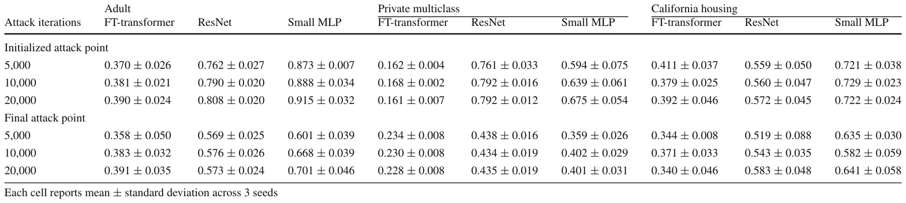

</figure>

<figure class="table-figure" id="table-22">
<figcaption><strong>Table 22</strong> Reconstruction accuracy under attack budget variation at batch size 32</figcaption>
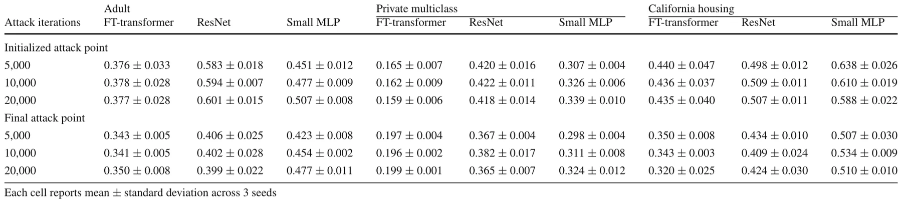

</figure>

<figure id="fig-16">
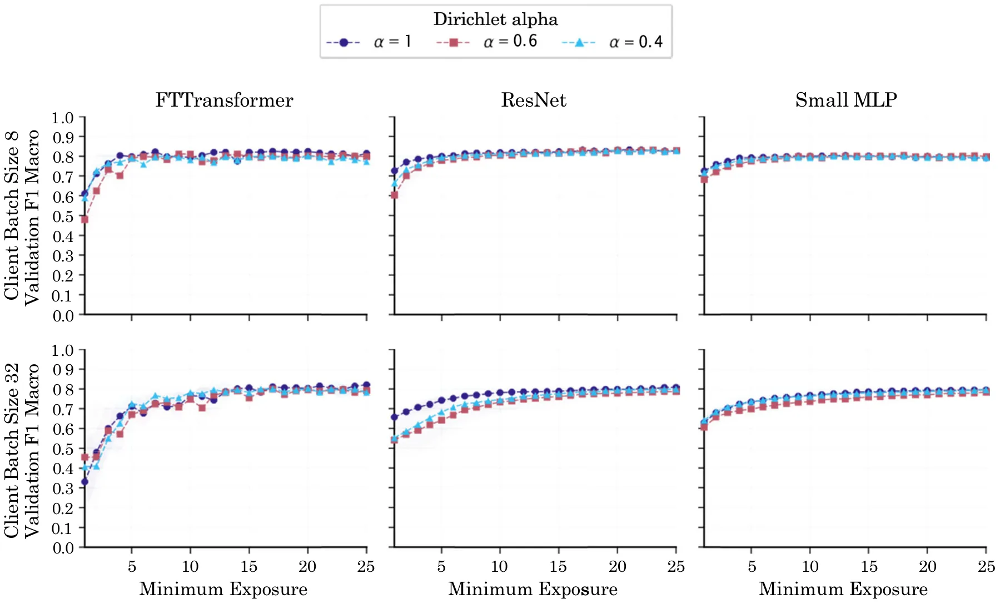
<figcaption><strong>Fig. 16</strong> Validation utility under non-IID client partitions on the private multiclass benchmark. The figure uses the same Dirichlet client partitions as the reconstruction robustness analysis</figcaption>
</figure>

<figure id="fig-17">
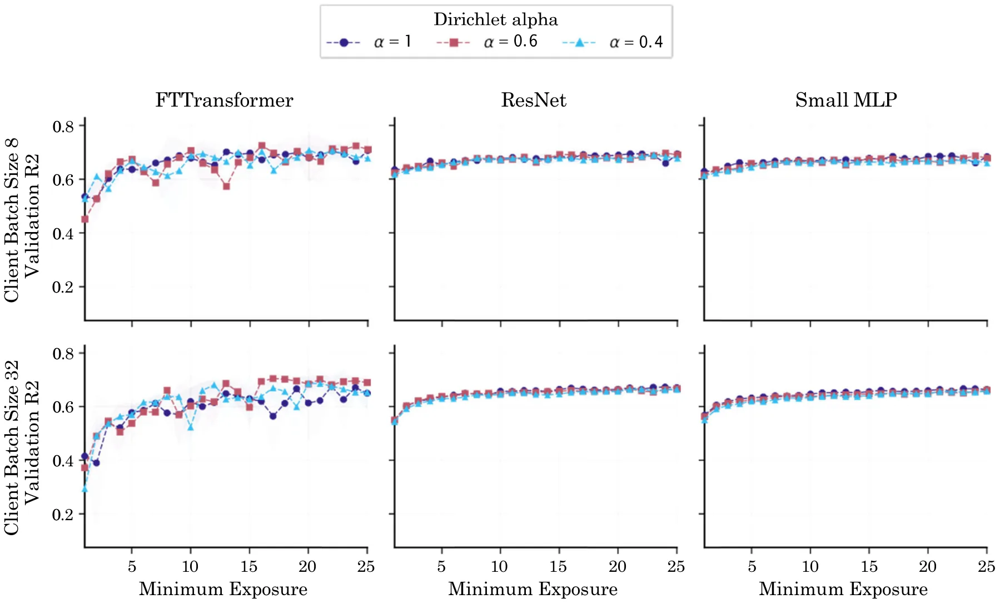
<figcaption><strong>Fig. 17</strong> Validation utility under non-IID client partitions on California Housing. The figure uses the same Dirichlet client partitions as the reconstruction robustness analysis</figcaption>
</figure>

<figure class="table-figure" id="table-23">
<figcaption><strong>Table 23</strong> Reconstruction accuracy at the final attack point for label unknown FedSGD attacks on the benchmark datasets</figcaption>

<table><tr><th rowspan="2">Batch size</th><th colspan="2">Adult</th><th colspan="2">Private multiclass</th><th colspan="2">California housing</th></tr><tr><th>ResNet</th><th>Small MLP</th><th>ResNet</th><th>Small MLP</th><th>ResNet</th><th>Small MLP</th></tr><tr><td>1</td><td>0.684 ± 0.058</td><td>0.753 ± 0.073</td><td>0.432 ± 0.031</td><td>0.443 ± 0.071</td><td>0.483 ± 0.044</td><td>0.628 ± 0.128</td></tr><tr><td>2</td><td>0.610 ± 0.015</td><td>0.662 ± 0.019</td><td>0.319 ± 0.005</td><td>0.337 ± 0.009</td><td>0.405 ± 0.039</td><td>0.450 ± 0.023</td></tr><tr><td>4</td><td>0.472 ± 0.028</td><td>0.519 ± 0.001</td><td>0.249 ± 0.016</td><td>0.294 ± 0.015</td><td>0.329 ± 0.035</td><td>0.382 ± 0.029</td></tr><tr><td>8</td><td>0.426 ± 0.015</td><td>0.452 ± 0.011</td><td>0.222 ± 0.003</td><td>0.288 ± 0.009</td><td>0.270 ± 0.015</td><td>0.298 ± 0.011</td></tr><tr><td>16</td><td>0.357 ± 0.027</td><td>0.379 ± 0.013</td><td>0.191 ± 0.010</td><td>0.262 ± 0.002</td><td>0.236 ± 0.023</td><td>0.263 ± 0.011</td></tr><tr><td>32</td><td>0.342 ± 0.005</td><td>0.346 ± 0.009</td><td>0.163 ± 0.002</td><td>0.235 ± 0.004</td><td>0.239 ± 0.015</td><td>0.243 ± 0.025</td></tr><tr><td>64</td><td>0.295 ± 0.007</td><td>0.301 ± 0.004</td><td>0.143 ± 0.002</td><td>0.212 ± 0.002</td><td>0.259 ± 0.005</td><td>0.263 ± 0.022</td></tr><tr><td>128</td><td>0.311 ± 0.012</td><td>0.300 ± 0.010</td><td>0.137 ± 0.006</td><td>0.200 ± 0.001</td><td>0.252 ± 0.008</td><td>0.271 ± 0.016</td></tr><tr><td>256</td><td>0.393 ± 0.023</td><td>0.304 ± 0.003</td><td>0.125 ± 0.007</td><td>0.197 ± 0.004</td><td>0.255 ± 0.010</td><td>0.281 ± 0.016</td></tr></table>

The attacker does not receive the true labels. Each cell reports mean ± standard deviation across 3 seeds

</figure>

Figure 21 shows the full label unknown trajectories. The California Housing curves reveal a regression specific label knowledge effect that is not visible from final attack point averages alone. In the label known batch size experiment, batch size 1 reconstruction drops during training for all model families, despite being the least aggregated setting. In the label unknown trajectories, reconstruction instead starts low and recovers during training, with the clearest reversal appearing for ResNet. This behavior is most pronounced in the continuous target setting. Under MSE, the observed gradient depends directly on the prediction residual, and training changes the scale and informativeness of that residual. Removing the true target changes the residual structure of the simulated gradient rather than only weakening the attacker.

### A.6 Leakage from FedAvg model updates

Tables 24, 25, 26, 27, 28 and 29 report benchmark FedAvg reconstruction accuracy with 32 local examples per client. These controls test whether leakage remains measurable these trajectories with the client marginal prior and uniform random baselines shows how much feature information remains in the observed update under the weaker target knowledge assumption when the server observes model deltas rather than one-step gradients. They complement the FedSGD benchmark analysis and the MIMIC-IV FedAvg results.

<figure id="fig-18">
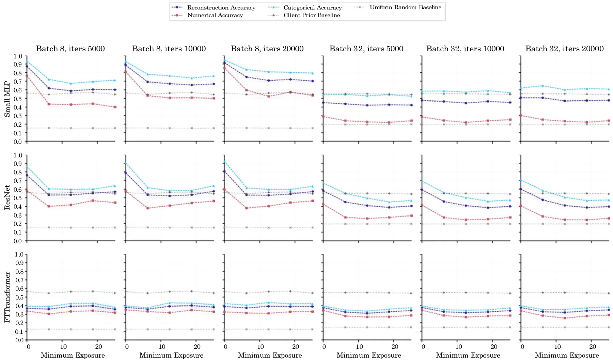
<figcaption><strong>Fig. 18</strong> Attack budget robustness analysis on Adult</figcaption>
</figure>

<figure id="fig-19">
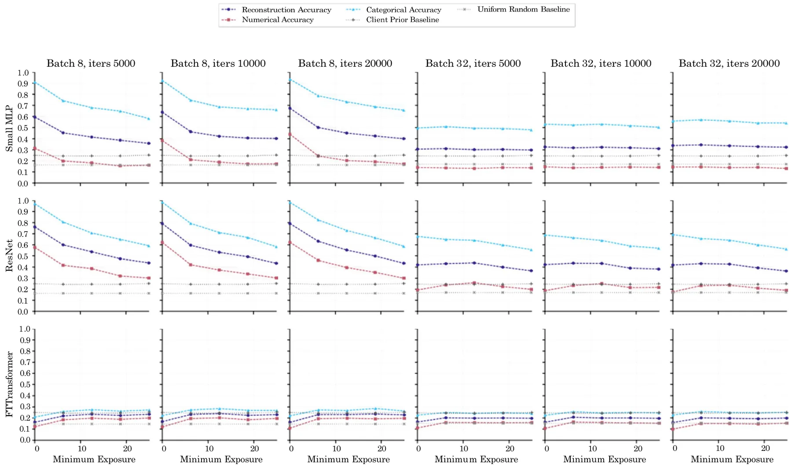
<figcaption><strong>Fig. 19</strong> Attack budget robustness analysis on the private multiclass benchmark</figcaption>
</figure>

<figure id="fig-20">
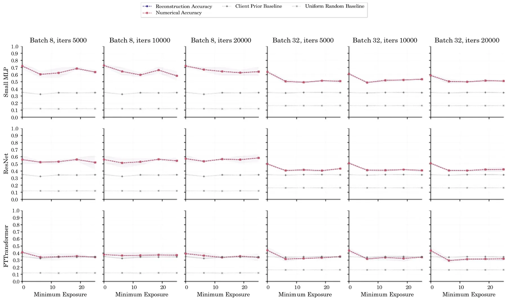
<figcaption><strong>Fig. 20</strong> Attack budget robustness analysis on California Housing</figcaption>
</figure>

<figure id="fig-21">
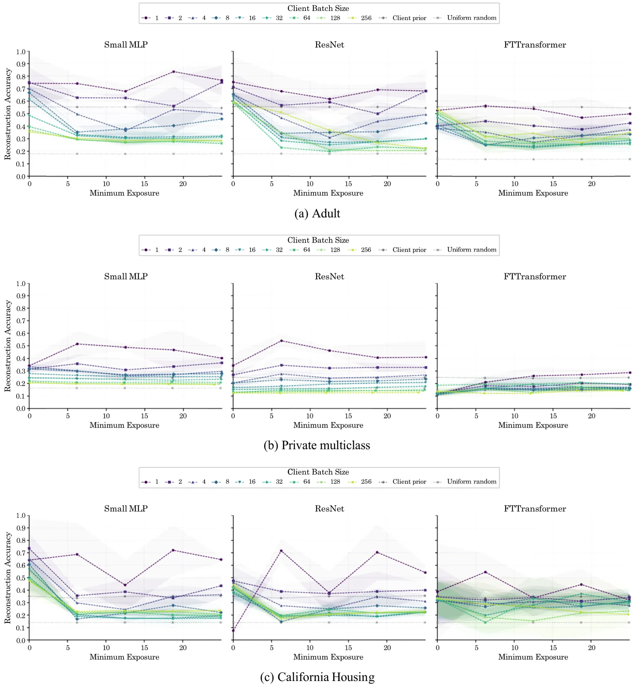
<figcaption><strong>Fig. 21</strong> Label unknown robustness analysis on the benchmark datasets. The curves report reconstruction accuracy over exposure when the attacker is not given the true labels or regression targets. Comparing</figcaption>
</figure>

### A.7 MLP architecture effects on reconstruction

The benchmark MLP architecture grid covers Adult, the private multiclass benchmark, and California Housing. Tables 30, 31, and 32 summarize the marginal effects of hidden width and hidden depth. Tables 33, 34, and 35 summarize the marginal effects of normalization, activation, and dropout. Tables 36, 37, and 38 rank the complete module combinations from lowest to highest final attack point reconstruction accuracy after averaging over width and depth. Table 39 reports the highest utility configurations at client batch size 8. Figures 22 and 23 report the Adult trajectories, Figs. 24 and 25 report the private multiclass benchmark trajectories, and Fig. 26 reports the California Housing trajectories. These results support the architecture analysis by testing whether module level leakage and utility patterns also appear across the benchmark tasks.

Adult favors wide LayerNorm configurations, mostly with GELU. The private multiclass benchmark has several nearly tied configurations, including both ReLU and GELU. California Housing favors dropout disabled configurations, which differs from the MIMIC-IV utility ranking where the top configurations use dropout 0.1. This is consistent with the broader tabular learning observation that architectural performance is dataset dependent. The benchmark utility table should be read together with the reconstruction rankings rather than as evidence for a universal best MLP architecture.

The benchmark rankings show a consistent high leakage module pattern. Across Adult, the private multiclass benchmark, and California Housing, the highest reconstruction configuration at both batch sizes is LayerNorm with GELU activation and no dropout. This supports the main MIMIC-IV architecture analysis by showing that the factor averaged trends are driven by module interactions rather than isolated choices alone. The benchmark results also reinforce that GELU based MLP configurations tend to be more vulnerable than ReLU based configurations, while the effect of normalization and dropout depends on the surrounding module combination.

## B MIMIC-IV sensitivity analyses

The MIMIC-IV sensitivity results support the main clinical benchmark analysis with full exposure trajectories, exact row recovery summaries, fixed batch trajectories, architecture grid supplements, a larger local data FedAvg control, and attack budget results.

### B.1 Leakage across client batch sizes on MIMIC-IV

Table 40 reports the fixed client batch control for MIMIC-IV. These attacks reuse the same selected client batch across exposure scheduled attack points, separating training stage effects from variation in the sampled attacked batch.

Figures 27 and 28 report MIMIC-IV reconstruction metrics over the five attack points used in the trajectory analyses. The first figure uses newly sampled client batches at each attack point, while the second reuses fixed client batches. Together, they show how aggregate, numerical, and categorical reconstruction vary with client exposure across model families and batch sizes.

Table 41 reports the baseline reference values for the same MIMIC-IV FedSGD batch size experiment. The client marginal prior baseline is high across all batch sizes, reflecting repeated and sparse clinical history indicators in the cohort. This means that aggregate reconstruction accuracy must be interpreted together with attack gains and EMRs. Uniform random reconstruction remains low, so values above random but below the client marginal prior indicate partial feature information rather than strong record recovery.

Table 42 reports EMRs for the MIMIC-IV FedSGD batch size experiment. These values distinguish complete row recovery from feature level reconstruction. Exact row recovery is substantial for the one-hot models at small batch sizes, but falls quickly as local aggregation increases. FT-Transformer shows no exact row recovery across the reported MIMIC-IV settings, despite nonzero feature level reconstruction accuracy.

Table 43 reports the corresponding EMRs for the dropout disabled FT-Transformer runs. Complete row recovery remains absent for probability simplex at all reported batch sizes and is observed for categorical logits only in the most exposed batch size 1 setting.

### B.2 MIMIC-IV MLP architecture sensitivity

The MIMIC-IV MLP architecture supplement contains the grid material not included in the main text. The appendix tables report the complete module combination ranking for batch sizes 8 and 32, together with utility ranked configurations. Figures 29 and 30 report utility, aggregate reconstruction, numerical reconstruction, and categorical reconstruction for batch sizes 8 and 32 (Tables 44, 45 and 46 ).

### B.3 FedAvg with 64 local examples

The 64-example FedAvg control repeats the MIMIC-IV local computation analysis with a larger fixed client dataset. It is included because increasing the fixed client dataset also changes the local mini batch size associated with each mini batch count. Table 47 reports this control and should be read as a FedAvg robustness check rather than as an isolated test of local epoch count.

<figure class="table-figure" id="table-24">
<figcaption><strong>Table 24</strong> Reconstruction accuracy at the initialized attack point for Adult</figcaption>

<table><tr><th rowspan="2">n. batches</th><th colspan="3">1 local epoch</th><th colspan="3">4 local epochs</th></tr><tr><th>FT-transformer</th><th>ResNet</th><th>Small MLP</th><th>FT-transformer</th><th>ResNet</th><th>Small MLP</th></tr><tr><td>1</td><td>0.383 ± 0.015</td><td>0.605 ± 0.023</td><td>0.492 ± 0.024</td><td>0.399 ± 0.019</td><td>0.631 ± 0.019</td><td>0.470 ± 0.022</td></tr><tr><td>2</td><td>0.345 ± 0.030</td><td>0.602 ± 0.022</td><td>0.479 ± 0.016</td><td>0.374 ± 0.030</td><td>0.625 ± 0.012</td><td>0.474 ± 0.033</td></tr><tr><td>4</td><td>0.321 ± 0.022</td><td>0.592 ± 0.018</td><td>0.492 ± 0.010</td><td>0.353 ± 0.015</td><td>0.614 ± 0.027</td><td>0.481 ± 0.022</td></tr></table>

Initialized attack point denotes the attack before any global model aggregation, and final attack point denotes the last attacked point under the exposure budget. Each cell reports mean ± standard deviation across 3 seeds

</figure>

<figure class="table-figure" id="table-25">
<figcaption><strong>Table 25</strong> Reconstruction accuracy at the final attack point for Adult</figcaption>

<table><tr><th rowspan="2">n. batches</th><th colspan="3">1 local epoch</th><th colspan="3">4 local epochs</th></tr><tr><th>FT-transformer</th><th>ResNet</th><th>Small MLP</th><th>FT-transformer</th><th>ResNet</th><th>Small MLP</th></tr><tr><td>1</td><td>0.325 ± 0.013</td><td>0.585 ± 0.026</td><td>0.492 ± 0.016</td><td>0.356 ± 0.028</td><td>0.615 ± 0.022</td><td>0.489 ± 0.018</td></tr><tr><td>2</td><td>0.316 ± 0.015</td><td>0.588 ± 0.032</td><td>0.486 ± 0.021</td><td>0.360 ± 0.017</td><td>0.618 ± 0.046</td><td>0.460 ± 0.022</td></tr><tr><td>4</td><td>0.310 ± 0.031</td><td>0.564 ± 0.047</td><td>0.480 ± 0.027</td><td>0.351 ± 0.016</td><td>0.616 ± 0.056</td><td>0.463 ± 0.029</td></tr></table>

Initialized attack point denotes the attack before any global model aggregation, and final attack point denotes the last attacked point under the exposure budget. Each cell reports mean ± standard deviation across 3 seeds

</figure>

<figure class="table-figure" id="table-26">
<figcaption><strong>Table 26</strong> Reconstruction accuracy at the initialized attack point for the private multiclass benchmark</figcaption>

<table><tr><th rowspan="2">n. batches</th><th colspan="3">1 local epoch</th><th colspan="3">4 local epochs</th></tr><tr><th>FT-transformer</th><th>ResNet</th><th>Small MLP</th><th>FT-transformer</th><th>ResNet</th><th>Small MLP</th></tr><tr><td>1</td><td>0.156 ± 0.007</td><td>0.436 ± 0.022</td><td>0.325 ± 0.017</td><td>0.180 ± 0.004</td><td>0.454 ± 0.012</td><td>0.325 ± 0.014</td></tr><tr><td>2</td><td>0.148 ± 0.008</td><td>0.417 ± 0.026</td><td>0.324 ± 0.008</td><td>0.175 ± 0.008</td><td>0.439 ± 0.013</td><td>0.329 ± 0.014</td></tr><tr><td>4</td><td>0.143 ± 0.010</td><td>0.417 ± 0.025</td><td>0.328 ± 0.011</td><td>0.163 ± 0.008</td><td>0.427 ± 0.017</td><td>0.331 ± 0.016</td></tr></table>

Initialized attack point denotes the attack before any global model aggregation, and final attack point denotes the last attacked point under the exposure budget. Each cell reports mean ± standard deviation across 3 seeds

</figure>

<figure class="table-figure" id="table-27">
<figcaption><strong>Table 27</strong> Reconstruction accuracy at the final attack point for the private multiclass benchmark</figcaption>

<table><tr><th rowspan="2">n. batches</th><th colspan="3">1 local epoch</th><th colspan="3">4 local epochs</th></tr><tr><th>FT-transformer</th><th>ResNet</th><th>Small MLP</th><th>FT-transformer</th><th>ResNet</th><th>Small MLP</th></tr><tr><td>1</td><td>0.177 ± 0.016</td><td>0.431 ± 0.025</td><td>0.315 ± 0.014</td><td>0.202 ± 0.012</td><td>0.464 ± 0.032</td><td>0.310 ± 0.010</td></tr><tr><td>2</td><td>0.179 ± 0.007</td><td>0.414 ± 0.027</td><td>0.311 ± 0.009</td><td>0.198 ± 0.008</td><td>0.452 ± 0.026</td><td>0.297 ± 0.010</td></tr><tr><td>4</td><td>0.178 ± 0.012</td><td>0.397 ± 0.046</td><td>0.309 ± 0.010</td><td>0.212 ± 0.012</td><td>0.446 ± 0.022</td><td>0.307 ± 0.010</td></tr></table>

Initialized attack point denotes the attack before any global model aggregation, and final attack point denotes the last attacked point under the exposure budget. Each cell reports mean ± standard deviation across 3 seeds

</figure>

<figure class="table-figure" id="table-28">
<figcaption><strong>Table 28</strong> Reconstruction accuracy at the initialized attack point for California Housing</figcaption>

<table><tr><th rowspan="2">n. batches</th><th colspan="3">1 local epoch</th><th colspan="3">4 local epochs</th></tr><tr><th>FT-transformer</th><th>ResNet</th><th>Small MLP</th><th>FT-transformer</th><th>ResNet</th><th>Small MLP</th></tr><tr><td>1</td><td>0.381 ± 0.034</td><td>0.460 ± 0.022</td><td>0.561 ± 0.043</td><td>0.394 ± 0.025</td><td>0.532 ± 0.030</td><td>0.477 ± 0.044</td></tr><tr><td>2</td><td>0.271 ± 0.023</td><td>0.445 ± 0.023</td><td>0.463 ± 0.039</td><td>0.285 ± 0.036</td><td>0.497 ± 0.011</td><td>0.468 ± 0.051</td></tr><tr><td>4</td><td>0.232 ± 0.033</td><td>0.414 ± 0.010</td><td>0.431 ± 0.048</td><td>0.230 ± 0.031</td><td>0.454 ± 0.031</td><td>0.429 ± 0.037</td></tr></table>

Initialized attack point denotes the attack before any global model aggregation, and final attack point denotes the last attacked point under the exposure budget. Each cell reports mean ± standard deviation across 3 seeds

</figure>

<figure class="table-figure" id="table-29">
<figcaption><strong>Table 29</strong> Reconstruction accuracy at the final attack point for California Housing</figcaption>

<table><tr><th rowspan="2">n. batches</th><th colspan="3">1 local epoch</th><th colspan="3">4 local epochs</th></tr><tr><th>FT-transformer</th><th>ResNet</th><th>Small MLP</th><th>FT-transformer</th><th>ResNet</th><th>Small MLP</th></tr><tr><td>1</td><td>0.222 ± 0.037</td><td>0.421 ± 0.027</td><td>0.499 ± 0.044</td><td>0.233 ± 0.047</td><td>0.471 ± 0.024</td><td>0.483 ± 0.038</td></tr><tr><td>2</td><td>0.265 ± 0.052</td><td>0.388 ± 0.030</td><td>0.483 ± 0.023</td><td>0.280 ± 0.016</td><td>0.436 ± 0.022</td><td>0.439 ± 0.028</td></tr><tr><td>4</td><td>0.223 ± 0.033</td><td>0.368 ± 0.025</td><td>0.472 ± 0.043</td><td>0.260 ± 0.027</td><td>0.420 ± 0.024</td><td>0.438 ± 0.019</td></tr></table>

Initialized attack point denotes the attack before any global model aggregation, and final attack point denotes the last attacked point under the exposure budget. Each cell reports mean ± standard deviation across 3 seeds

</figure>

<figure class="table-figure" id="table-30">
<figcaption><strong>Table 30</strong> Reconstruction accuracy at the final attack point for structural architectural factors on Adult</figcaption>

<table><tr><th rowspan="2">Batch size</th><th colspan="3">Hidden width</th><th colspan="3">Hidden layers</th></tr><tr><th>32</th><th>64</th><th>128</th><th>1</th><th>2</th><th>3</th></tr><tr><td>8</td><td>0.510 ± 0.074</td><td>0.559 ± 0.090</td><td>0.607 ± 0.103</td><td>0.552 ± 0.095</td><td>0.564 ± 0.102</td><td>0.561 ± 0.099</td></tr><tr><td>32</td><td>0.378 ± 0.034</td><td>0.421 ± 0.063</td><td>0.478 ± 0.095</td><td>0.407 ± 0.068</td><td>0.434 ± 0.085</td><td>0.436 ± 0.083</td></tr></table>

Each cell reports mean ± standard deviation across the remaining configurations at the final attack point

</figure>

<figure class="table-figure" id="table-31">
<figcaption><strong>Table 31</strong> Reconstruction accuracy at the final attack point for structural architectural factors on the private multiclass benchmark</figcaption>

<table><tr><th rowspan="2">Batch size</th><th colspan="3">Hidden width</th><th colspan="3">Hidden layers</th></tr><tr><th>32</th><th>64</th><th>128</th><th>1</th><th>2</th><th>3</th></tr><tr><td>8</td><td>0.320 ± 0.048</td><td>0.347 ± 0.058</td><td>0.370 ± 0.063</td><td>0.361 ± 0.061</td><td>0.346 ± 0.059</td><td>0.331 ± 0.057</td></tr><tr><td>32</td><td>0.263 ± 0.029</td><td>0.295 ± 0.049</td><td>0.345 ± 0.080</td><td>0.295 ± 0.044</td><td>0.307 ± 0.075</td><td>0.301 ± 0.074</td></tr></table>

Each cell reports mean ± standard deviation across the remaining configurations at the final attack point

</figure>

<figure class="table-figure" id="table-32">
<figcaption><strong>Table 32</strong> Reconstruction accuracy at the final attack point for structural architectural factors on California Housing</figcaption>

<table><tr><th rowspan="2">Batch size</th><th colspan="3">Hidden width</th><th colspan="3">Hidden layers</th></tr><tr><th>32</th><th>64</th><th>128</th><th>1</th><th>2</th><th>3</th></tr><tr><td>8</td><td>0.409 ± 0.124</td><td>0.451 ± 0.124</td><td>0.481 ± 0.107</td><td>0.422 ± 0.110</td><td>0.460 ± 0.125</td><td>0.458 ± 0.127</td></tr><tr><td>32</td><td>0.338 ± 0.099</td><td>0.368 ± 0.106</td><td>0.398 ± 0.106</td><td>0.343 ± 0.081</td><td>0.377 ± 0.111</td><td>0.384 ± 0.120</td></tr></table>

Each cell reports mean ± standard deviation across the remaining configurations at the final attack point

</figure>

<figure class="table-figure" id="table-33">
<figcaption><strong>Table 33</strong> Reconstruction accuracy at the final attack point for module level architectural factors on Adult</figcaption>

<table><tr><th rowspan="2">Batch size</th><th colspan="2">Normalization</th><th colspan="2">Activation</th><th colspan="2">Dropout</th></tr><tr><th>BatchNorm</th><th>LayerNorm</th><th>ReLU</th><th>GELU</th><th>0.0</th><th>0.1</th></tr><tr><td>8</td><td>0.537 ± 0.076</td><td>0.581 ± 0.112</td><td>0.511 ± 0.051</td><td>0.606 ± 0.109</td><td>0.599 ± 0.108</td><td>0.518 ± 0.064</td></tr><tr><td>32</td><td>0.406 ± 0.073</td><td>0.445 ± 0.081</td><td>0.393 ± 0.034</td><td>0.458 ± 0.097</td><td>0.459 ± 0.093</td><td>0.393 ± 0.043</td></tr></table>

Each cell reports mean ± standard deviation across the remaining configurations at the final attack point

</figure>

<figure class="table-figure" id="table-34">
<figcaption><strong>Table 34</strong> Reconstruction accuracy at the final attack point for module level architectural factors on the private multiclass benchmark</figcaption>

<table><tr><th rowspan="2">Batch size</th><th colspan="2">Normalization</th><th colspan="2">Activation</th><th colspan="2">Dropout</th></tr><tr><th>BatchNorm</th><th>LayerNorm</th><th>ReLU</th><th>GELU</th><th>0.0</th><th>0.1</th></tr><tr><td>8</td><td>0.363 ± 0.038</td><td>0.329 ± 0.071</td><td>0.310 ± 0.052</td><td>0.382 ± 0.043</td><td>0.354 ± 0.067</td><td>0.338 ± 0.051</td></tr><tr><td>32</td><td>0.313 ± 0.062</td><td>0.289 ± 0.067</td><td>0.266 ± 0.043</td><td>0.336 ± 0.065</td><td>0.319 ± 0.079</td><td>0.283 ± 0.041</td></tr></table>

Each cell reports mean ± standard deviation across the remaining configurations at the final attack point

</figure>

<figure class="table-figure" id="table-35">
<figcaption><strong>Table 35</strong> Reconstruction accuracy at the final attack point for module level architectural factors on California Housing</figcaption>

<table><tr><th rowspan="2">Batch size</th><th colspan="2">Normalization</th><th colspan="2">Activation</th><th colspan="2">Dropout</th></tr><tr><th>BatchNorm</th><th>LayerNorm</th><th>ReLU</th><th>GELU</th><th>0.0</th><th>0.1</th></tr><tr><td>8</td><td>0.436 ± 0.122</td><td>0.458 ± 0.120</td><td>0.415 ± 0.081</td><td>0.479 ± 0.145</td><td>0.540 ± 0.086</td><td>0.354 ± 0.065</td></tr><tr><td>32</td><td>0.356 ± 0.097</td><td>0.380 ± 0.114</td><td>0.332 ± 0.060</td><td>0.403 ± 0.128</td><td>0.442 ± 0.093</td><td>0.294 ± 0.051</td></tr></table>

Each cell reports mean ± standard deviation across the remaining configurations at the final attack point

</figure>

### B.4 MIMIC-IV non-IID client partitions

The non-IID control tests whether client partitioning changes the MIMIC-IV leakage patterns observed under the default IID setting. Table 49 reports client batch size 32, and Table 48 reports the corresponding batch size 8 results. Together, these tables compare Dirichlet concentration values *α* ∈ {1.0, 0.6, 0.4} across the three model families (Table 49).

Client heterogeneity changes reconstruction levels, but it does not overturn the broader hierarchy of privacy factors. Averaged over models and batch sizes, final attack point reconstruction is highest for the split closest to IID, with 0.338 at *α* = 1.0, compared with 0.248 at *α* = 0.6 and 0.260 at *α* = 0.4. Thus, lower *α* does not systematically increase leakage in this setting. The model ordering is more stable than the *α*-effect: FT-Transformer remains least vulnerable, with final attack point reconstruction of 0.145, followed by ResNet at 0.314 and the small MLP at 0.387. Batch size remains relevant, especially early in training, where increasing the batch size from 8 to 32 reduces initialized reconstruction from 0.665 to 0.519. By the final attack point, this difference is smaller and slightly reversed, with 0.266 for batch size 8 and 0.298 for batch size 32, because the smaller batch runs lose more reconstructive information over training. Overall, the non-IID results refine rather than contradict the main findings: client heterogeneity changes leakage in the clinical cohort, but architecture and local aggregation remain more reliable privacy factors.

### B.5 Attack optimization budget on MIMIC-IV

Tables 50 and 51 report the MIMIC-IV attack budget sensitivity analysis for client batch sizes 32 and 8. The experiment varies the number of attack optimization iterations while keeping the FL training configuration fixed. Batch size 32 represents the less exposed intermediate setting, while batch size 8 provides a more exposed counterpart.

<figure class="table-figure" id="table-36">
<figcaption><strong>Table 36</strong> Complete ranking of module combinations by final attack point reconstruction accuracy on Adult for batch sizes 8 and 32</figcaption>

<table><tr><th>Rank</th><th>Normalization</th><th>Activation</th><th>Dropout</th><th>Recon. Acc.</th></tr><tr class="row-group"><td colspan="5">Batch size 8</td></tr><tr><td>1</td><td>BatchNorm</td><td>GELU</td><td>0.1</td><td>0.469 ± 0.013</td></tr><tr><td>2</td><td>LayerNorm</td><td>ReLU</td><td>0.1</td><td>0.478 ± 0.047</td></tr><tr><td>3</td><td>LayerNorm</td><td>ReLU</td><td>0.0</td><td>0.510 ± 0.047</td></tr><tr><td>4</td><td>BatchNorm</td><td>ReLU</td><td>0.1</td><td>0.527 ± 0.049</td></tr><tr><td>5</td><td>BatchNorm</td><td>ReLU</td><td>0.0</td><td>0.529 ± 0.051</td></tr><tr><td>6</td><td>LayerNorm</td><td>GELU</td><td>0.1</td><td>0.599 ± 0.034</td></tr><tr><td>7</td><td>BatchNorm</td><td>GELU</td><td>0.0</td><td>0.622 ± 0.079</td></tr><tr><td>8</td><td>LayerNorm</td><td>GELU</td><td>0.0</td><td>0.736 ± 0.065</td></tr><tr class="row-group"><td colspan="5">Batch size 32</td></tr><tr><td>1</td><td>BatchNorm</td><td>GELU</td><td>0.1</td><td>0.355 ± 0.016</td></tr><tr><td>2</td><td>BatchNorm</td><td>ReLU</td><td>0.1</td><td>0.384 ± 0.024</td></tr><tr><td>3</td><td>LayerNorm</td><td>ReLU</td><td>0.1</td><td>0.389 ± 0.031</td></tr><tr><td>4</td><td>BatchNorm</td><td>ReLU</td><td>0.0</td><td>0.396 ± 0.043</td></tr><tr><td>5</td><td>LayerNorm</td><td>ReLU</td><td>0.0</td><td>0.403 ± 0.039</td></tr><tr><td>6</td><td>LayerNorm</td><td>GELU</td><td>0.1</td><td>0.444 ± 0.041</td></tr><tr><td>7</td><td>BatchNorm</td><td>GELU</td><td>0.0</td><td>0.492 ± 0.095</td></tr><tr><td>8</td><td>LayerNorm</td><td>GELU</td><td>0.0</td><td>0.544 ± 0.091</td></tr></table>

Rows are ordered from lowest to highest reconstruction accuracy. Reconstruction accuracy is averaged over width and depth and reported at the final attack point

</figure>

<figure class="table-figure" id="table-37">
<figcaption><strong>Table 37</strong> Complete ranking of module combinations by final attack point reconstruction accuracy on the private multiclass benchmark for batch sizes 8 and 32</figcaption>

<table><tr><th>Rank</th><th>Normalization</th><th>Activation</th><th>Dropout</th><th>Recon. Acc.</th></tr><tr class="row-group"><td colspan="5">Batch size 8</td></tr><tr><td>1</td><td>LayerNorm</td><td>ReLU</td><td>0.1</td><td>0.265 ± 0.019</td></tr><tr><td>2</td><td>LayerNorm</td><td>ReLU</td><td>0.0</td><td>0.268 ± 0.021</td></tr><tr><td>3</td><td>BatchNorm</td><td>ReLU</td><td>0.0</td><td>0.349 ± 0.039</td></tr><tr><td>4</td><td>BatchNorm</td><td>GELU</td><td>0.1</td><td>0.351 ± 0.015</td></tr><tr><td>5</td><td>BatchNorm</td><td>ReLU</td><td>0.1</td><td>0.358 ± 0.027</td></tr><tr><td>6</td><td>LayerNorm</td><td>GELU</td><td>0.1</td><td>0.380 ± 0.037</td></tr><tr><td>7</td><td>BatchNorm</td><td>GELU</td><td>0.0</td><td>0.393 ± 0.050</td></tr><tr><td>8</td><td>LayerNorm</td><td>GELU</td><td>0.0</td><td>0.403 ± 0.046</td></tr><tr class="row-group"><td colspan="5">Batch size 32</td></tr><tr><td>1</td><td>LayerNorm</td><td>ReLU</td><td>0.1</td><td>0.231 ± 0.014</td></tr><tr><td>2</td><td>LayerNorm</td><td>ReLU</td><td>0.0</td><td>0.237 ± 0.018</td></tr><tr><td>3</td><td>BatchNorm</td><td>ReLU</td><td>0.1</td><td>0.288 ± 0.030</td></tr><tr><td>4</td><td>BatchNorm</td><td>GELU</td><td>0.1</td><td>0.293 ± 0.024</td></tr><tr><td>5</td><td>BatchNorm</td><td>ReLU</td><td>0.0</td><td>0.307 ± 0.044</td></tr><tr><td>6</td><td>LayerNorm</td><td>GELU</td><td>0.1</td><td>0.320 ± 0.034</td></tr><tr><td>7</td><td>BatchNorm</td><td>GELU</td><td>0.0</td><td>0.364 ± 0.096</td></tr><tr><td>8</td><td>LayerNorm</td><td>GELU</td><td>0.0</td><td>0.368 ± 0.056</td></tr></table>

Rows are ordered from lowest to highest reconstruction accuracy. Reconstruction accuracy is averaged over width and depth and reported at the final attack point

</figure>

<figure class="table-figure" id="table-38">
<figcaption><strong>Table 38</strong> Complete ranking of module combinations by final attack point reconstruction accuracy on California Housing for batch sizes 8 and 32</figcaption>

<table><tr><th>Rank</th><th>Normalization</th><th>Activation</th><th>Dropout</th><th>Recon. Acc.</th></tr><tr class="row-group"><td colspan="5">Batch size 8</td></tr><tr><td>1</td><td>BatchNorm</td><td>GELU</td><td>0.1</td><td>0.292 ± 0.042</td></tr><tr><td>2</td><td>LayerNorm</td><td>ReLU</td><td>0.1</td><td>0.328 ± 0.037</td></tr><tr><td>3</td><td>BatchNorm</td><td>ReLU</td><td>0.1</td><td>0.387 ± 0.060</td></tr><tr><td>4</td><td>LayerNorm</td><td>GELU</td><td>0.1</td><td>0.408 ± 0.047</td></tr><tr><td>5</td><td>LayerNorm</td><td>ReLU</td><td>0.0</td><td>0.462 ± 0.046</td></tr><tr><td>6</td><td>BatchNorm</td><td>ReLU</td><td>0.0</td><td>0.483 ± 0.066</td></tr><tr><td>7</td><td>BatchNorm</td><td>GELU</td><td>0.0</td><td>0.582 ± 0.048</td></tr><tr><td>8</td><td>LayerNorm</td><td>GELU</td><td>0.0</td><td>0.633 ± 0.035</td></tr><tr class="row-group"><td colspan="5">Batch size 32</td></tr><tr><td>1</td><td>BatchNorm</td><td>GELU</td><td>0.1</td><td>0.236 ± 0.009</td></tr><tr><td>2</td><td>LayerNorm</td><td>ReLU</td><td>0.1</td><td>0.270 ± 0.032</td></tr><tr><td>3</td><td>BatchNorm</td><td>ReLU</td><td>0.1</td><td>0.315 ± 0.022</td></tr><tr><td>4</td><td>LayerNorm</td><td>ReLU</td><td>0.0</td><td>0.350 ± 0.059</td></tr><tr><td>5</td><td>LayerNorm</td><td>GELU</td><td>0.1</td><td>0.354 ± 0.030</td></tr><tr><td>6</td><td>BatchNorm</td><td>ReLU</td><td>0.0</td><td>0.395 ± 0.038</td></tr><tr><td>7</td><td>BatchNorm</td><td>GELU</td><td>0.0</td><td>0.480 ± 0.039</td></tr><tr><td>8</td><td>LayerNorm</td><td>GELU</td><td>0.0</td><td>0.544 ± 0.074</td></tr></table>

Rows are ordered from lowest to highest reconstruction accuracy. Reconstruction accuracy is averaged over width and depth and reported at the final attack point

</figure>

<figure class="table-figure" id="table-39">
<figcaption><strong>Table 39</strong> Top raw architectural configurations on the benchmark datasets ranked by best validation utility for client batch size 8</figcaption>

<table><tr><th>Rank</th><th>Width</th><th>Layers</th><th>Normalization</th><th>Activation</th><th>Dropout</th><th>Validation utility</th></tr><tr class="row-group"><td colspan="7">Adult</td></tr><tr><td>1</td><td>128</td><td>1</td><td>LayerNorm</td><td>GELU</td><td>0.1</td><td>0.913 ± 0.005</td></tr><tr><td>2</td><td>128</td><td>1</td><td>LayerNorm</td><td>GELU</td><td>0.0</td><td>0.913 ± 0.005</td></tr><tr><td>3</td><td>128</td><td>2</td><td>LayerNorm</td><td>GELU</td><td>0.1</td><td>0.913 ± 0.005</td></tr><tr><td>4</td><td>128</td><td>3</td><td>LayerNorm</td><td>GELU</td><td>0.1</td><td>0.913 ± 0.005</td></tr><tr><td>5</td><td>128</td><td>1</td><td>LayerNorm</td><td>ReLU</td><td>0.1</td><td>0.913 ± 0.004</td></tr><tr class="row-group"><td colspan="7">Private multiclass</td></tr><tr><td>1</td><td>128</td><td>2</td><td>LayerNorm</td><td>ReLU</td><td>0.0</td><td>0.831 ± 0.014</td></tr><tr><td>2</td><td>128</td><td>1</td><td>LayerNorm</td><td>GELU</td><td>0.1</td><td>0.831 ± 0.005</td></tr><tr><td>3</td><td>64</td><td>2</td><td>BatchNorm</td><td>GELU</td><td>0.0</td><td>0.830 ± 0.005</td></tr><tr><td>4</td><td>128</td><td>2</td><td>LayerNorm</td><td>ReLU</td><td>0.1</td><td>0.830 ± 0.009</td></tr><tr><td>5</td><td>64</td><td>1</td><td>LayerNorm</td><td>GELU</td><td>0.1</td><td>0.830 ± 0.002</td></tr><tr class="row-group"><td colspan="7">California Housing</td></tr><tr><td>1</td><td>128</td><td>3</td><td>LayerNorm</td><td>GELU</td><td>0.0</td><td>0.710 ± 0.012</td></tr><tr><td>2</td><td>64</td><td>3</td><td>LayerNorm</td><td>GELU</td><td>0.0</td><td>0.708 ± 0.013</td></tr><tr><td>3</td><td>128</td><td>2</td><td>LayerNorm</td><td>ReLU</td><td>0.0</td><td>0.706 ± 0.014</td></tr><tr><td>4</td><td>128</td><td>2</td><td>LayerNorm</td><td>GELU</td><td>0.0</td><td>0.706 ± 0.011</td></tr><tr><td>5</td><td>128</td><td>3</td><td>LayerNorm</td><td>ReLU</td><td>0.0</td><td>0.705 ± 0.014</td></tr></table>

Adult is ranked by validation ROC-AUC, the private multiclass benchmark by validation macro F1, and California Housing by validation <em>R</em>2. Scores are reported as mean ± standard deviation across seeds at the best validation checkpoint for each configuration

</figure>

<figure class="table-figure" id="table-40">
<figcaption><strong>Table 40</strong> Reconstruction accuracy at the initialized attack point and final attack point for MIMIC-IV on the same client batch</figcaption>

<table><tr><th rowspan="2">Batch size</th><th colspan="3">Initialized attack point</th><th colspan="3">Final attack point</th></tr><tr><th>FT-transformer</th><th>ResNet</th><th>Small MLP</th><th>FT-transformer</th><th>ResNet</th><th>Small MLP</th></tr><tr><td>8</td><td>0.341 ± 0.020</td><td>0.785 ± 0.042</td><td>0.881 ± 0.024</td><td>0.367 ± 0.111</td><td>0.705 ± 0.040</td><td>0.642 ± 0.009</td></tr><tr><td>32</td><td>0.330 ± 0.009</td><td>0.605 ± 0.012</td><td>0.598 ± 0.049</td><td>0.365 ± 0.059</td><td>0.549 ± 0.084</td><td>0.471 ± 0.062</td></tr></table>

Initialized attack point denotes the attack before any global model aggregation, and final attack point denotes the last attacked point under the exposure budget. Each cell reports mean ± standard deviation across 3 seeds

</figure>

<figure class="table-figure" id="table-41">
<figcaption><strong>Table 41</strong> Client marginal prior and uniform random reconstruction baselines for MIMIC-IV in the FedSGD batch size experiment</figcaption>

<table><tr><th>Batch size</th><th>Client marginal prior recon. acc.</th><th>Uniform random recon. acc.</th></tr><tr><td>1</td><td>0.941 ± 0.011</td><td>0.044 ± 0.001</td></tr><tr><td>2</td><td>0.945 ± 0.008</td><td>0.044 ± 0.001</td></tr><tr><td>4</td><td>0.942 ± 0.005</td><td>0.046 ± 0.001</td></tr><tr><td>8</td><td>0.939 ± 0.006</td><td>0.047 ± 0.001</td></tr><tr><td>16</td><td>0.939 ± 0.004</td><td>0.048 ± 0.001</td></tr><tr><td>32</td><td>0.940 ± 0.003</td><td>0.049 ± 0.001</td></tr><tr><td>64</td><td>0.940 ± 0.002</td><td>0.051 ± 0.001</td></tr><tr><td>128</td><td>0.940 ± 0.002</td><td>0.052 ± 0.002</td></tr><tr><td>256</td><td>0.940 ± 0.001</td><td>0.053 ± 0.002</td></tr></table>

Values are computed on the same model runs and attack points as the main reconstruction experiment and reported as mean ± standard deviation

</figure>

<figure id="fig-22">
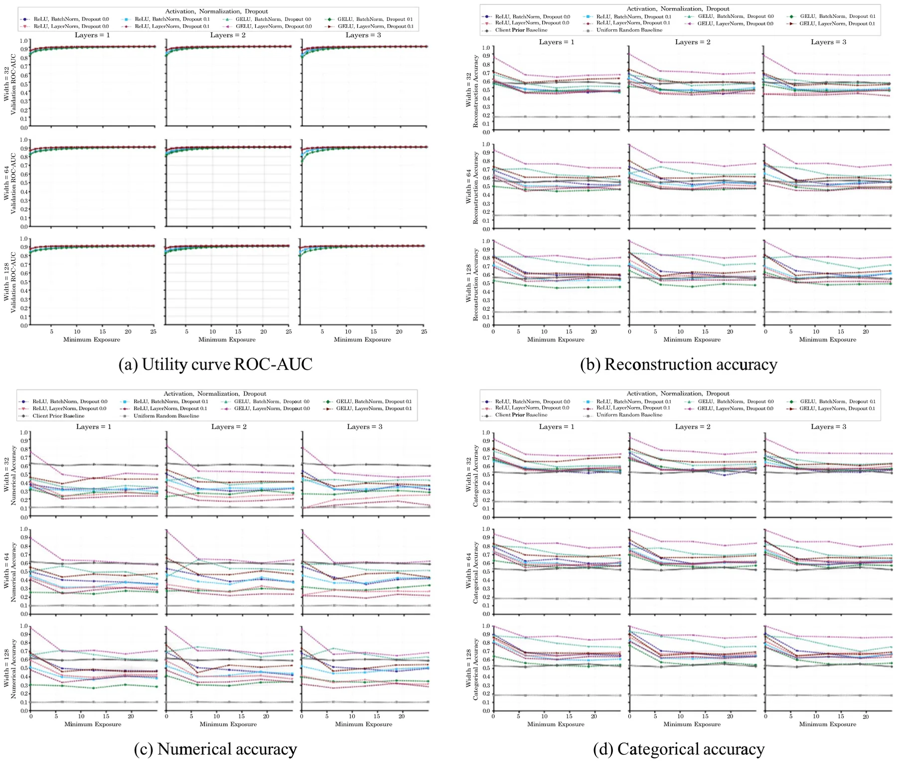
<figcaption><strong>Fig. 22</strong> Utility and inversion accuracy metrics over FL training for the MLP architecture grid using client batch size 8 on Adult</figcaption>
</figure>

<figure class="table-figure" id="table-42">
<figcaption><strong>Table 42</strong> EMR at the initialized attack point and final attack point for MIMIC-IV</figcaption>

<table><tr><th rowspan="2">Batch size</th><th colspan="3">Initialized attack point</th><th colspan="3">Final attack point</th></tr><tr><th>FT-transformer</th><th>ResNet</th><th>Small MLP</th><th>FT-transformer</th><th>ResNet</th><th>Small MLP</th></tr><tr><td>1</td><td>0.000 ± 0.000</td><td>0.900 ± 0.000</td><td>0.933 ± 0.058</td><td>0.000 ± 0.000</td><td>0.500 ± 0.100</td><td>0.700 ± 0.100</td></tr><tr><td>2</td><td>0.000 ± 0.000</td><td>0.533 ± 0.153</td><td>0.817 ± 0.029</td><td>0.000 ± 0.000</td><td>0.450 ± 0.050</td><td>0.417 ± 0.076</td></tr><tr><td>4</td><td>0.000 ± 0.000</td><td>0.250 ± 0.152</td><td>0.800 ± 0.066</td><td>0.000 ± 0.000</td><td>0.267 ± 0.088</td><td>0.233 ± 0.080</td></tr><tr><td>8</td><td>0.000 ± 0.000</td><td>0.083 ± 0.059</td><td>0.342 ± 0.044</td><td>0.000 ± 0.000</td><td>0.196 ± 0.019</td><td>0.104 ± 0.019</td></tr><tr><td>16</td><td>0.000 ± 0.000</td><td>0.006 ± 0.006</td><td>0.044 ± 0.029</td><td>0.000 ± 0.000</td><td>0.069 ± 0.029</td><td>0.056 ± 0.013</td></tr><tr><td>32</td><td>0.000 ± 0.000</td><td>0.000 ± 0.000</td><td>0.001 ± 0.002</td><td>0.000 ± 0.000</td><td>0.009 ± 0.003</td><td>0.021 ± 0.005</td></tr><tr><td>64</td><td>0.000 ± 0.000</td><td>0.000 ± 0.000</td><td>0.002 ± 0.002</td><td>0.000 ± 0.000</td><td>0.002 ± 0.002</td><td>0.006 ± 0.001</td></tr><tr><td>128</td><td>0.000 ± 0.000</td><td>0.000 ± 0.000</td><td>0.000 ± 0.000</td><td>0.000 ± 0.000</td><td>0.000 ± 0.000</td><td>0.001 ± 0.001</td></tr><tr><td>256</td><td>0.000 ± 0.000</td><td>0.000 ± 0.000</td><td>0.000 ± 0.000</td><td>0.000 ± 0.000</td><td>0.000 ± 0.000</td><td>0.000 ± 0.000</td></tr></table>

Each cell reports mean ± standard deviation across 3 seeds

</figure>

<figure id="fig-23">
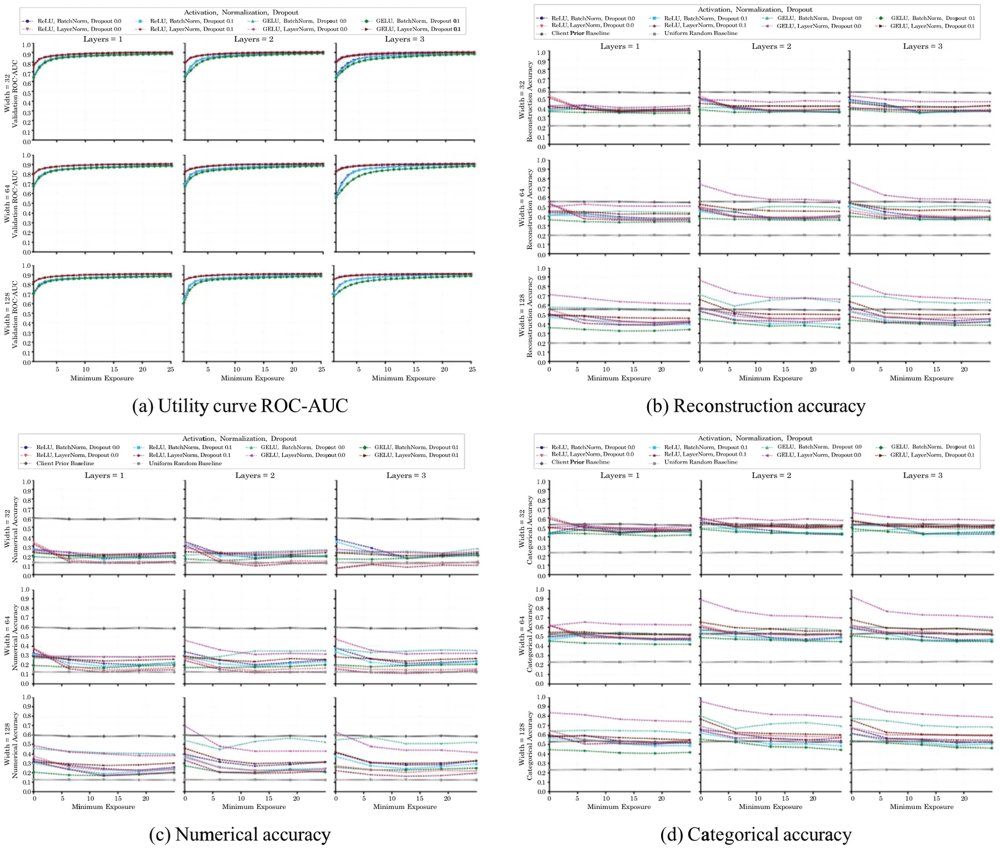
<figcaption><strong>Fig. 23</strong> Utility and inversion accuracy metrics over FL training for the MLP architecture grid using client batch size 32 on Adult</figcaption>
</figure>

<figure class="table-figure" id="table-43">
<figcaption><strong>Table 43</strong> EMR at the initialized attack point and final attack point for MIMIC-IV under two FT-Transformer attack parameterizations with attention and feedforward dropout set to zero in the target model</figcaption>

<table><tr><th rowspan="2">Batch size</th><th colspan="2">Initialized attack point</th><th colspan="2">Final attack point</th></tr><tr><th>Categorical logits</th><th>Probability simplex</th><th>Categorical logits</th><th>Probability simplex</th></tr><tr><td>1</td><td>0.033 ± 0.058</td><td>0.000 ± 0.000</td><td>0.167 ± 0.289</td><td>0.000 ± 0.000</td></tr><tr><td>2</td><td>0.000 ± 0.000</td><td>0.000 ± 0.000</td><td>0.000 ± 0.000</td><td>0.000 ± 0.000</td></tr><tr><td>4</td><td>0.000 ± 0.000</td><td>0.000 ± 0.000</td><td>0.000 ± 0.000</td><td>0.000 ± 0.000</td></tr><tr><td>8</td><td>0.000 ± 0.000</td><td>0.000 ± 0.000</td><td>0.000 ± 0.000</td><td>0.000 ± 0.000</td></tr><tr><td>16</td><td>0.000 ± 0.000</td><td>0.000 ± 0.000</td><td>0.000 ± 0.000</td><td>0.000 ± 0.000</td></tr><tr><td>32</td><td>0.000 ± 0.000</td><td>0.000 ± 0.000</td><td>0.000 ± 0.000</td><td>0.000 ± 0.000</td></tr><tr><td>64</td><td>0.000 ± 0.000</td><td>0.000 ± 0.000</td><td>0.000 ± 0.000</td><td>0.000 ± 0.000</td></tr><tr><td>128</td><td>0.000 ± 0.000</td><td>0.000 ± 0.000</td><td>0.000 ± 0.000</td><td>0.000 ± 0.000</td></tr></table>

Each cell reports mean ± standard deviation across 3 seeds

</figure>

<figure id="fig-24">
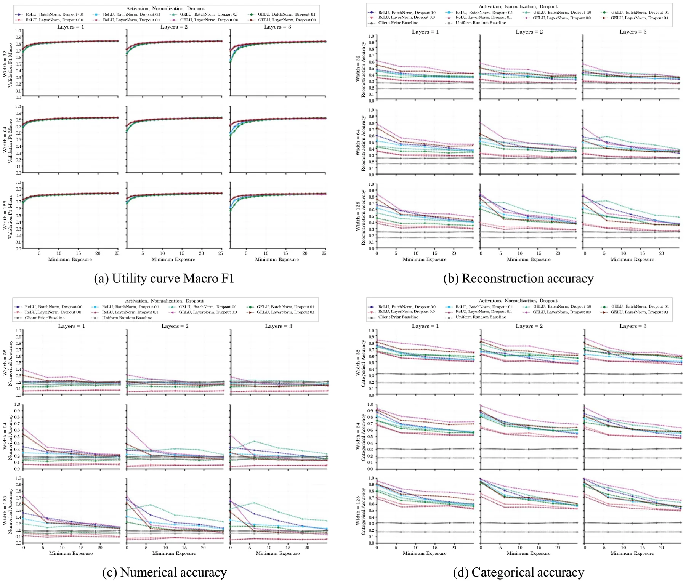
<figcaption><strong>Fig. 24</strong> Utility and inversion accuracy metrics over FL training for the MLP architecture grid using client batch size 8 on the private multiclass benchmark</figcaption>
</figure>

Increasing the attack budget does not materially change the main privacy conclusions. At batch size 32, final attack point reconstruction averaged over the three model families changes only modestly from 0.383 at 5,000 iterations to 0.395 at 10,000 and 0.397 at 20,000. At batch size 8, the corresponding averages do not increase, moving from 0.562 to 0.558 and 0.543. FT-Transformer remains the least vulnerable model family, and the one-hot models remain more exposed. The attack budget functions as a robustness check rather than a primary explanation for the observed leakage patterns.

### B.6 MIMIC-IV label unknown attacks

Table 52 reports MIMIC-IV FedSGD attacks without true batch labels for the completed batch size settings up to 128. This setting weakens the main label known attacker by replacing the true labels with dummy labels while keeping the same observed client updates, model families, and reconstruction pipeline.

Removing label knowledge reduces initialized attack point reconstruction for the one-hot models, but the final attack point effect is not uniformly monotone. Small one-hot clinical batches can still leak strongly without labels, with final attack point reconstruction of 0.852 for ResNet and 0.819 for the small MLP at batch size 1. Increasing client batch size still reduces label unknown reconstruction for the one-hot models. ResNet falls from 0.852 at batch size 1 to 0.399 at batch size 32 and 0.228 at batch size 128, while the small MLP falls from 0.819 to 0.353 and 0.287. FT-Transformer remains lower overall, with 0.226 at batch size 1, although its batch size pattern is less monotonic and peaks at batch size 16. Thus, true label access strengthens the attacker, but the main aggregation and architecture patterns remain visible under the weaker label unknown setting.

<figure id="fig-25">
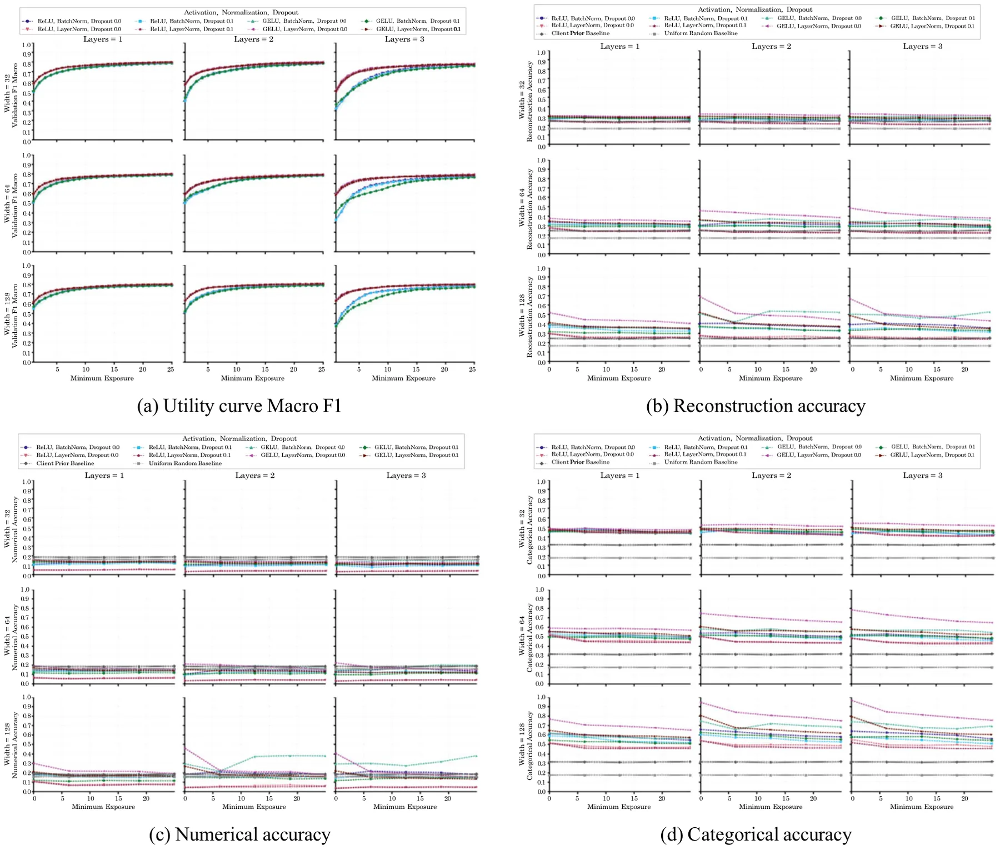
<figcaption><strong>Fig. 25</strong> Utility and inversion accuracy metrics over FL training for the MLP architecture grid using client batch size 32 on the private multiclass benchmark</figcaption>
</figure>

### B.7 Statistical robustness and variability among clients

We use the original saved attack results to examine uncertainty in mean reconstruction accuracy and variation among clients for representative MIMIC-IV FedSGD settings. The analysis covers Small MLP, ResNet, and FT-Transformer at client batch sizes 8 and 32, at the initialized and final attack points. These batch sizes were already used elsewhere in the study as representative intermediate aggregation settings. The twelve combinations of model, batch size, and attack point each have three independent runs, with ten clients per run. Confidence intervals describe uncertainty in the mean reconstruction accuracy across runs. The thirty client observations for each condition are shown descriptively. This analysis required no additional training runs or attacks (Table 53).

Table 61 shows that reconstruction decreases from batch size 8 to 32 for both one-hot models at both attack points in each of the three seeds. At the final attack point, the Small MLP mean decreases from 0.623 to 0.480, and the ResNet mean decreases from 0.703 to 0.504. FT-Transformer has a lower mean than either one-hot model for every seed at both batch sizes and attack points. However, some of its estimates vary considerably across runs. At batch size 8, its final means are 0.226, 0.225, and 0.548 for seeds 7, 13, and 42. The overall mean is 0.333, with a 95% *t* interval of [−0.130, 0.796]. The negative lower bound is a consequence of the interval calculation and does not represent a possible accuracy value. We retain the calculated interval to show the uncertainty in this estimate. Small differences between models should therefore be interpreted cautiously. We do not use the overlap or separation of confidence intervals as a test of statistical significance.

<figure id="fig-26">
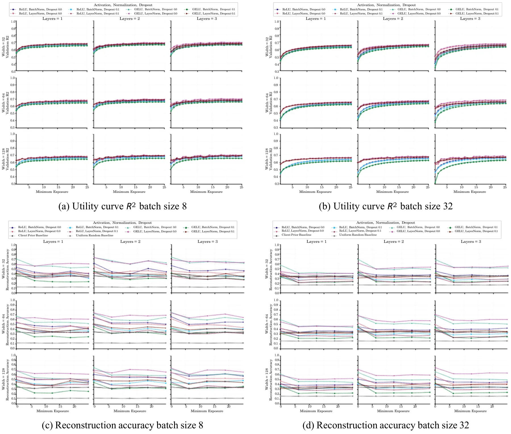
<figcaption><strong>Fig. 26</strong> Utility and reconstruction accuracy over FL training for the MLP architecture grid using client batch sizes 8 and 32 on California Housing; reconstruction accuracy equals numerical accuracy because the dataset contains only numerical input features</figcaption>
</figure>

Figure 31 shows that reconstruction can vary substantially among clients even when the means are similar across runs.

For the Small MLP at batch size 32 and initialization, the means are approximately 0.6227, 0.6253, and 0.6231, while individual client accuracies range from approximately 0.417 to 0.750. The final FT-Transformer results at batch size 8 also show a higher mean for seed 42 than for seeds 7 and 13. Each point summarizes one attacked batch, so the spread can reflect batch composition and reconstruction difficulty as well as differences among clients. These observations describe variation within runs and do not increase the number of independent replicates.

<figure id="fig-27">
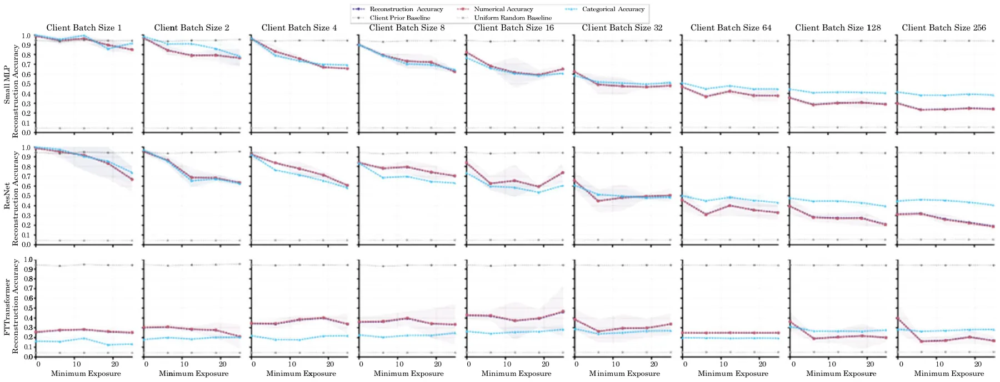
<figcaption><strong>Fig. 27</strong> Reconstruction trajectories across model families and client batch sizes on MIMIC-IV</figcaption>
</figure>

<figure id="fig-28">
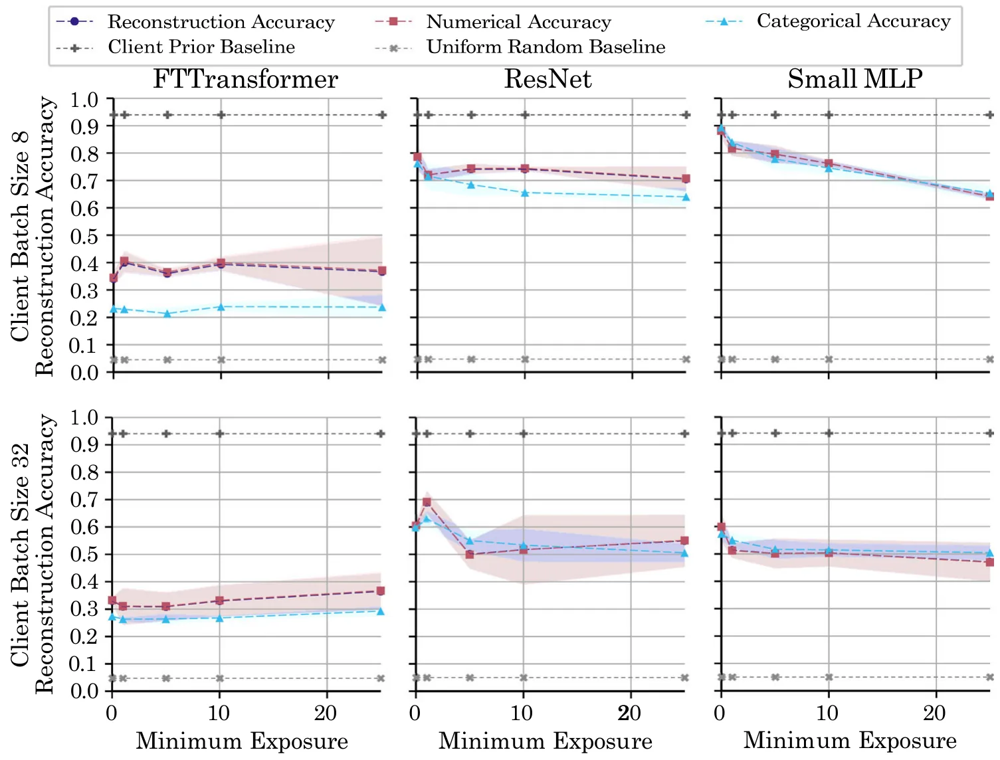
<figcaption><strong>Fig. 28</strong> Reconstruction trajectories for fixed client batches across model families and client batch sizes on MIMIC-IV</figcaption>
</figure>

## C Additional FT-transformer analyses and ablations

The FT-Transformer analyses provide model-specific validation and supporting results for the main architecture analysis. The Adult validation tables test whether the differentiable surrogate produces the intended training update. The MIMIC-IV tables and trajectories then report reconstruction behavior under the two categorical parameterizations and dropout settings.

### C.1 Attack parameterization validation

We run these implementation ablations on Adult because it contains both numerical and categorical features while remaining small enough for controlled repeated checks. The purpose of the ablation is not to estimate dataset specific privacy risk. Instead, it verifies that the differentiable FT-Transformer attack parameterization produces the same training update as the native ordinal forward path. Larger datasets such as MIMIC-IV and the private multiclass benchmark are unnecessary for this validation. Those datasets are used in the main attack experiments where dataset specific reconstruction difficulty matters.

<figure class="table-figure" id="table-44">
<figcaption><strong>Table 44</strong> Complete ranking of module combinations by final attack point reconstruction accuracy on MIMIC-IV for batch sizes 8 and 32</figcaption>

<table><tr><th>Rank</th><th>Normalization</th><th>Activation</th><th>Dropout</th><th>Recon. Acc.</th></tr><tr class="row-group"><td colspan="5">Batch size 8</td></tr><tr><td>1</td><td>LayerNorm</td><td>ReLU</td><td>0.1</td><td>0.272 ± 0.056</td></tr><tr><td>2</td><td>LayerNorm</td><td>ReLU</td><td>0.0</td><td>0.300 ± 0.091</td></tr><tr><td>3</td><td>BatchNorm</td><td>GELU</td><td>0.1</td><td>0.496 ± 0.030</td></tr><tr><td>4</td><td>BatchNorm</td><td>ReLU</td><td>0.1</td><td>0.539 ± 0.084</td></tr><tr><td>5</td><td>BatchNorm</td><td>ReLU</td><td>0.0</td><td>0.542 ± 0.074</td></tr><tr><td>6</td><td>LayerNorm</td><td>GELU</td><td>0.0</td><td>0.577 ± 0.098</td></tr><tr><td>7</td><td>BatchNorm</td><td>GELU</td><td>0.0</td><td>0.637 ± 0.041</td></tr><tr><td>8</td><td>LayerNorm</td><td>GELU</td><td>0.1</td><td>0.640 ± 0.034</td></tr><tr class="row-group"><td colspan="5">Batch size 32</td></tr><tr><td>1</td><td>LayerNorm</td><td>ReLU</td><td>0.1</td><td>0.215 ± 0.048</td></tr><tr><td>2</td><td>LayerNorm</td><td>ReLU</td><td>0.0</td><td>0.259 ± 0.064</td></tr><tr><td>3</td><td>BatchNorm</td><td>GELU</td><td>0.1</td><td>0.294 ± 0.016</td></tr><tr><td>4</td><td>BatchNorm</td><td>ReLU</td><td>0.1</td><td>0.393 ± 0.062</td></tr><tr><td>5</td><td>BatchNorm</td><td>ReLU</td><td>0.0</td><td>0.416 ± 0.075</td></tr><tr><td>6</td><td>BatchNorm</td><td>GELU</td><td>0.0</td><td>0.417 ± 0.059</td></tr><tr><td>7</td><td>LayerNorm</td><td>GELU</td><td>0.1</td><td>0.478 ± 0.028</td></tr><tr><td>8</td><td>LayerNorm</td><td>GELU</td><td>0.0</td><td>0.500 ± 0.024</td></tr></table>

Rows are ordered from lowest to highest reconstruction accuracy. Reconstruction accuracy is averaged over width and depth and reported at the final attack point

</figure>

<figure class="table-figure" id="table-45">
<figcaption><strong>Table 45</strong> Top raw architectural configurations on MIMIC-IV ranked by best validation ROC-AUC for batch size 8</figcaption>

<table><tr><th>Rank</th><th>Width</th><th>Layers</th><th>Normalization</th><th>Activation</th><th>Dropout</th><th>Val ROC-AUC</th></tr><tr><td>1</td><td>32</td><td>1</td><td>LayerNorm</td><td>ReLU</td><td>0.1</td><td>0.871 ± 0.002</td></tr><tr><td>2</td><td>64</td><td>1</td><td>LayerNorm</td><td>ReLU</td><td>0.1</td><td>0.869 ± 0.010</td></tr><tr><td>3</td><td>64</td><td>1</td><td>LayerNorm</td><td>GELU</td><td>0.1</td><td>0.868 ± 0.006</td></tr><tr><td>4</td><td>32</td><td>1</td><td>LayerNorm</td><td>ReLU</td><td>0.0</td><td>0.867 ± 0.003</td></tr><tr><td>5</td><td>32</td><td>1</td><td>LayerNorm</td><td>GELU</td><td>0.1</td><td>0.867 ± 0.000</td></tr></table>

Scores are reported as mean ± standard deviation across seeds at the best validation checkpoint for each configuration

</figure>

<figure class="table-figure" id="table-46">
<figcaption><strong>Table 46</strong> Top raw architectural configurations on MIMIC-IV ranked by best validation ROC-AUC for batch size 32</figcaption>

<table><tr><th>Rank</th><th>Width</th><th>Layers</th><th>Normalization</th><th>Activation</th><th>Dropout</th><th>Val ROC-AUC</th></tr><tr><td>1</td><td>32</td><td>1</td><td>LayerNorm</td><td>ReLU</td><td>0.1</td><td>0.868 ± 0.005</td></tr><tr><td>2</td><td>32</td><td>2</td><td>LayerNorm</td><td>ReLU</td><td>0.1</td><td>0.868 ± 0.005</td></tr><tr><td>3</td><td>32</td><td>1</td><td>LayerNorm</td><td>GELU</td><td>0.1</td><td>0.867 ± 0.005</td></tr><tr><td>4</td><td>32</td><td>2</td><td>LayerNorm</td><td>GELU</td><td>0.1</td><td>0.867 ± 0.005</td></tr><tr><td>5</td><td>64</td><td>1</td><td>LayerNorm</td><td>GELU</td><td>0.1</td><td>0.866 ± 0.009</td></tr></table>

Scores are reported as mean ± standard deviation across seeds at the best validation checkpoint for each configuration

</figure>

To verify that the FT-Transformer attack does not optimize against an unrelated surrogate, we compare the updates produced by the native ordinal FT-Transformer forward pass with the corresponding updates produced by the differentiable GIA forward pass on the same batches. For FedSGD we compare per client gradients, and for FedAvg we compare one-step model deltas. The probability simplex parameterization reproduces the native update up to numerical precision, since one-hot relaxed probabilities induce the same embedding lookup as the native categorical path. The categorical logits parameterization used in the study, with *τ* = 1 and scale 5, is a smooth approximation to the same path. Its induced update remains nearly collinear with the native update across all tested batch sizes. The resulting agreement is summarized in Table 54.

<figure class="table-figure" id="table-47">
<figcaption><strong>Table 47</strong> Reconstruction accuracy at the initialized attack point and final attack point for MIMIC-IV under FedAvg with 64 local examples per client</figcaption>

<table><tr><th rowspan="2">n. batches</th><th colspan="3">Initialized attack point</th><th colspan="3">Final attack point</th></tr><tr><th>FT-transformer</th><th>ResNet</th><th>Small MLP</th><th>FT-transformer</th><th>ResNet</th><th>Small MLP</th></tr><tr class="row-group"><td colspan="7">1 local epoch</td></tr><tr><td>1</td><td>0.326 ± 0.104</td><td>0.420 ± 0.085</td><td>0.417 ± 0.035</td><td>0.215 ± 0.081</td><td>0.494 ± 0.079</td><td>0.373 ± 0.024</td></tr><tr><td>2</td><td>0.269 ± 0.101</td><td>0.456 ± 0.100</td><td>0.426 ± 0.041</td><td>0.184 ± 0.071</td><td>0.480 ± 0.077</td><td>0.364 ± 0.026</td></tr><tr><td>4</td><td>0.246 ± 0.074</td><td>0.441 ± 0.086</td><td>0.417 ± 0.055</td><td>0.190 ± 0.075</td><td>0.426 ± 0.037</td><td>0.362 ± 0.049</td></tr><tr class="row-group"><td colspan="7">2 local epochs</td></tr><tr><td>1</td><td>0.268 ± 0.116</td><td>0.480 ± 0.096</td><td>0.423 ± 0.047</td><td>0.200 ± 0.079</td><td>0.540 ± 0.078</td><td>0.367 ± 0.022</td></tr><tr><td>2</td><td>0.243 ± 0.087</td><td>0.495 ± 0.100</td><td>0.408 ± 0.049</td><td>0.181 ± 0.104</td><td>0.522 ± 0.081</td><td>0.362 ± 0.042</td></tr><tr><td>4</td><td>0.221 ± 0.064</td><td>0.508 ± 0.076</td><td>0.396 ± 0.041</td><td>0.191 ± 0.077</td><td>0.465 ± 0.051</td><td>0.358 ± 0.050</td></tr><tr class="row-group"><td colspan="7">4 local epochs</td></tr><tr><td>1</td><td>0.245 ± 0.111</td><td>0.523 ± 0.086</td><td>0.403 ± 0.039</td><td>0.203 ± 0.082</td><td>0.553 ± 0.080</td><td>0.365 ± 0.032</td></tr><tr><td>2</td><td>0.235 ± 0.091</td><td>0.524 ± 0.111</td><td>0.393 ± 0.045</td><td>0.201 ± 0.083</td><td>0.546 ± 0.099</td><td>0.361 ± 0.042</td></tr><tr><td>4</td><td>0.213 ± 0.073</td><td>0.527 ± 0.089</td><td>0.386 ± 0.039</td><td>0.200 ± 0.088</td><td>0.466 ± 0.045</td><td>0.358 ± 0.035</td></tr></table>

Initialized attack point denotes the first client update computed from the initial global model, and final attack point denotes the last attacked point under the exposure budget. The row variable <em>n.</em> batches denotes how many local mini batches are needed to process the local client data once. Each cell reports mean ± standard deviation across 5 seeds

</figure>

<figure class="table-figure" id="table-48">
<figcaption><strong>Table 48</strong> MIMIC-IV non-IID sensitivity under FedSGD at client batch size 8</figcaption>

<table><tr><th rowspan="2">Model</th><th rowspan="2">Split</th><th>Initialized attack point</th><th colspan="3">Final attack point</th></tr><tr><th>Recon. Acc.</th><th>Recon. Acc.</th><th>Num. acc.</th><th>Cat. acc.</th></tr><tr><td>FT-Transformer</td><td>α = 1.0</td><td>0.365 ± 0.053</td><td>0.138 ± 0.044</td><td>0.132 ± 0.047</td><td>0.298 ± 0.025</td></tr><tr><td>FT-Transformer</td><td>α = 0.6</td><td>0.348 ± 0.056</td><td>0.083 ± 0.030</td><td>0.077 ± 0.031</td><td>0.239 ± 0.050</td></tr><tr><td>FT-Transformer</td><td>α = 0.4</td><td>0.370 ± 0.046</td><td>0.098 ± 0.027</td><td>0.091 ± 0.027</td><td>0.265 ± 0.028</td></tr><tr><td>ResNet</td><td>α = 1.0</td><td>0.764 ± 0.018</td><td>0.370 ± 0.030</td><td>0.369 ± 0.029</td><td>0.401 ± 0.039</td></tr><tr><td>ResNet</td><td>α = 0.6</td><td>0.742 ± 0.128</td><td>0.264 ± 0.007</td><td>0.260 ± 0.006</td><td>0.361 ± 0.034</td></tr><tr><td>ResNet</td><td>α = 0.4</td><td>0.769 ± 0.051</td><td>0.285 ± 0.055</td><td>0.282 ± 0.055</td><td>0.347 ± 0.057</td></tr><tr><td>Small MLP</td><td>α = 1.0</td><td>0.885 ± 0.036</td><td>0.436 ± 0.046</td><td>0.431 ± 0.048</td><td>0.555 ± 0.012</td></tr><tr><td>Small MLP</td><td>α = 0.6</td><td>0.851 ± 0.058</td><td>0.340 ± 0.052</td><td>0.336 ± 0.052</td><td>0.447 ± 0.063</td></tr><tr><td>Small MLP</td><td>α = 0.4</td><td>0.892 ± 0.033</td><td>0.380 ± 0.123</td><td>0.378 ± 0.126</td><td>0.447 ± 0.057</td></tr></table>

Initialized attack point denotes the first attacked point, and final attack point denotes the last attacked point under the exposure budget. Numerical and categorical accuracies are reported at the final attack point. Each cell reports mean ± standard deviation across 3 seeds

</figure>

<figure class="table-figure" id="table-49">
<figcaption><strong>Table 49</strong> MIMIC-IV non-IID sensitivity under FedSGD at client batch size 32</figcaption>

<table><tr><th rowspan="2">Model</th><th rowspan="2">Split</th><th>Initialized attack point</th><th colspan="3">Final attack point</th></tr><tr><th>Recon. Acc.</th><th>Recon. Acc.</th><th>Num. acc.</th><th>Cat. acc.</th></tr><tr><td>FT-Transformer</td><td>α = 1.0</td><td>0.361 ± 0.114</td><td>0.227 ± 0.010</td><td>0.225 ± 0.011</td><td>0.267 ± 0.011</td></tr><tr><td>FT-Transformer</td><td>α = 0.6</td><td>0.342 ± 0.023</td><td>0.173 ± 0.058</td><td>0.169 ± 0.061</td><td>0.290 ± 0.028</td></tr><tr><td>FT-Transformer</td><td>α = 0.4</td><td>0.408 ± 0.049</td><td>0.150 ± 0.008</td><td>0.145 ± 0.008</td><td>0.282 ± 0.009</td></tr><tr><td>ResNet</td><td>α = 1.0</td><td>0.606 ± 0.051</td><td>0.374 ± 0.072</td><td>0.372 ± 0.074</td><td>0.415 ± 0.016</td></tr><tr><td>ResNet</td><td>α = 0.6</td><td>0.541 ± 0.056</td><td>0.284 ± 0.019</td><td>0.280 ± 0.019</td><td>0.384 ± 0.009</td></tr><tr><td>ResNet</td><td>α = 0.4</td><td>0.602 ± 0.030</td><td>0.306 ± 0.068</td><td>0.304 ± 0.069</td><td>0.368 ± 0.041</td></tr><tr><td>Small MLP</td><td>α = 1.0</td><td>0.612 ± 0.030</td><td>0.484 ± 0.035</td><td>0.483 ± 0.036</td><td>0.508 ± 0.002</td></tr><tr><td>Small MLP</td><td>α = 0.6</td><td>0.584 ± 0.016</td><td>0.343 ± 0.125</td><td>0.338 ± 0.128</td><td>0.466 ± 0.036</td></tr><tr><td>Small MLP</td><td>α = 0.4</td><td>0.610 ± 0.021</td><td>0.339 ± 0.087</td><td>0.334 ± 0.090</td><td>0.462 ± 0.013</td></tr></table>

Initialized attack point denotes the first attacked point, and final attack point denotes the last attacked point under the exposure budget. Numerical and categorical accuracies are reported at the final attack point. Each cell reports mean ± standard deviation across 3 seeds

</figure>

<figure id="fig-29">
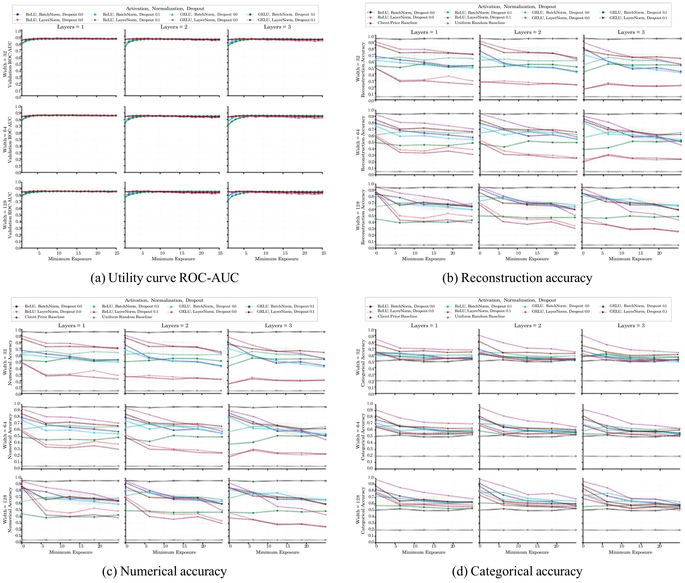
<figcaption><strong>Fig. 29</strong> Utility and inversion accuracy metrics over FL training for the MLP architecture grid using client batch size 8 on MIMIC-IV</figcaption>
</figure>

Table 55 verifies that both FT-Transformer categorical parameterizations define an optimizable differentiable surrogate. Starting from the GIA space reconstruction, gradient based updates consistently reduce the gradient matching loss computed against gradients generated by the native FT-Transformer forward pass.

### C.2 FT-Transformer reconstruction decomposition

The reconstruction decomposition separates FT-Transformer performance into aggregate, numerical, and categorical accuracy on MIMIC-IV. The tables summarize the initialized attack point and final attack point across client batch sizes, categorical parameterizations, and dropout settings.

Tables 56 and 57 show that numerical accuracy closely tracks aggregate reconstruction, while categorical accuracy remains lower at both attack points. This supports the architecture interpretation that categorical variables are harder to recover when they are represented through the FT-Transformer embedding interface. The same pattern appears under both categorical logits and probability simplex parameterizations, which indicates that the decomposition is not an artifact of a single attack parameterization.

<figure id="fig-30">
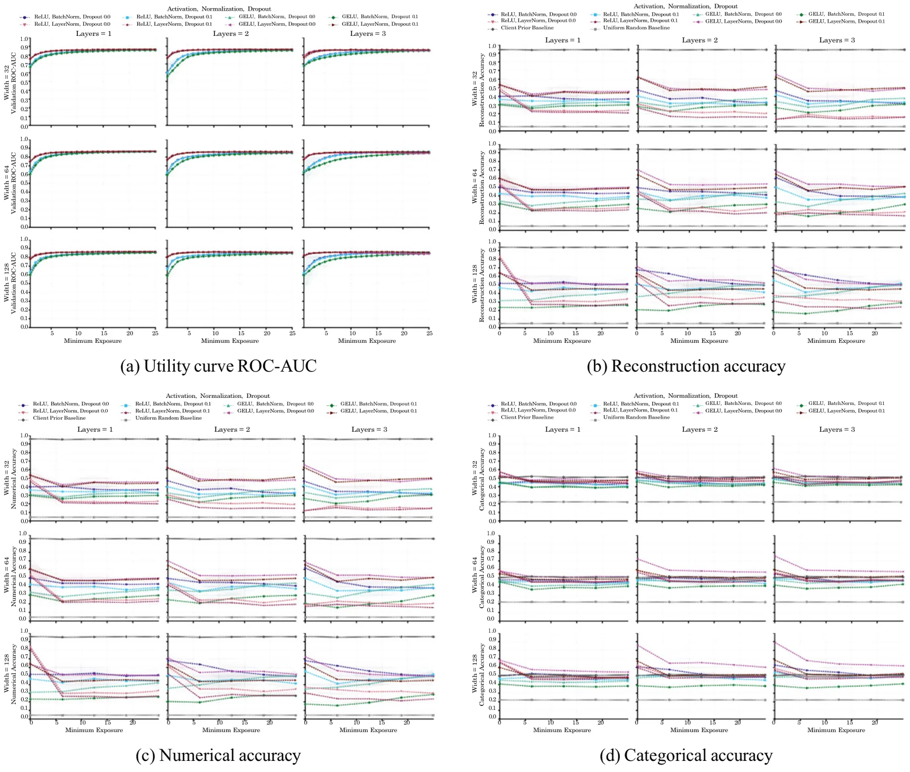
<figcaption><strong>Fig. 30</strong> Utility and inversion accuracy metrics over FL training for the MLP architecture grid using client batch size 32 on MIMIC-IV</figcaption>
</figure>

### C.3 FT-Transformer leakage over training exposure

Figure 32 reports FT-Transformer reconstruction over client exposure using the same five attack points as the other trajectory analyses. Each panel plots aggregate, numerical, and categorical reconstruction accuracy for one categorical parameterization and dropout setting. The comparison shows that the FT-Transformer reconstruction behavior is visible across the training trajectory and not only at the initialized attack point and final attack point.

The dropout disabled trajectories also show why initialized attack point and final attack point summaries are insufficient for this ablation. On MIMIC-IV, removing dropout produces a sharp early leakage spike for small client batches under both categorical parameterizations, followed by a later decline. This supports the interpretation that dropout affects the timing and stability of FT-Transformer leakage, not only its final attack point magnitude.

Table 58 reports the fixed client batch control for the two FT-Transformer categorical parameterizations. The fixed batch comparison preserves the main result from the resampled batch experiment. Categorical logits and probability simplex produce similar reconstruction levels, with only modest differences at batch sizes 8 and 32. This supports the main text conclusion that the lower FT-Transformer leakage is not driven by a single categorical relaxation choice.

<figure class="table-figure" id="table-50">
<figcaption><strong>Table 50</strong> MIMIC-IV attack budget sensitivity under FedSGD at client batch size 8</figcaption>

<table><tr><th rowspan="2">Attack iterations</th><th colspan="3">Initialized attack point</th><th colspan="3">Final attack point</th></tr><tr><th>FT-transformer</th><th>ResNet</th><th>Small MLP</th><th>FT-transformer</th><th>ResNet</th><th>Small MLP</th></tr><tr><td>5,000</td><td>0.381 ± 0.030</td><td>0.801 ± 0.037</td><td>0.864 ± 0.039</td><td>0.313 ± 0.129</td><td>0.743 ± 0.019</td><td>0.631 ± 0.054</td></tr><tr><td>10,000</td><td>0.391 ± 0.029</td><td>0.785 ± 0.039</td><td>0.891 ± 0.035</td><td>0.322 ± 0.127</td><td>0.731 ± 0.030</td><td>0.620 ± 0.080</td></tr><tr><td>20,000</td><td>0.394 ± 0.033</td><td>0.787 ± 0.032</td><td>0.897 ± 0.035</td><td>0.324 ± 0.126</td><td>0.692 ± 0.033</td><td>0.613 ± 0.070</td></tr></table>

The row variable gives the number of attack optimization iterations. Results are shown for the initialized attack point and the final attack point. Each cell reports reconstruction accuracy as mean ± standard deviation across 3 seeds

</figure>

<figure class="table-figure" id="table-51">
<figcaption><strong>Table 51</strong> MIMIC-IV attack budget sensitivity under FedSGD at client batch size 32</figcaption>

<table><tr><th rowspan="2">Attack iterations</th><th colspan="3">Initialized attack point</th><th colspan="3">Final attack point</th></tr><tr><th>FT-transformer</th><th>ResNet</th><th>Small MLP</th><th>FT-transformer</th><th>ResNet</th><th>Small MLP</th></tr><tr><td>5,000</td><td>0.413 ± 0.089</td><td>0.603 ± 0.039</td><td>0.554 ± 0.012</td><td>0.266 ± 0.028</td><td>0.472 ± 0.067</td><td>0.410 ± 0.041</td></tr><tr><td>10,000</td><td>0.413 ± 0.095</td><td>0.567 ± 0.061</td><td>0.639 ± 0.014</td><td>0.262 ± 0.032</td><td>0.479 ± 0.068</td><td>0.445 ± 0.014</td></tr><tr><td>20,000</td><td>0.421 ± 0.101</td><td>0.534 ± 0.072</td><td>0.679 ± 0.014</td><td>0.262 ± 0.030</td><td>0.480 ± 0.072</td><td>0.448 ± 0.024</td></tr></table>

The row variable gives the number of attack optimization iterations. Results are shown for the initialized attack point and the final attack point. Each cell reports reconstruction accuracy as mean ± standard deviation across 3 seeds

</figure>

<figure class="table-figure" id="table-52">
<figcaption><strong>Table 52</strong> Label unknown reconstruction accuracy at the initialized attack point and final attack point for MIMIC-IV under FedSGD, reported for the completed batch size settings up to 128</figcaption>

<table><tr><th rowspan="2">Batch size</th><th colspan="3">Initialized attack point</th><th colspan="3">Final attack point</th></tr><tr><th>FT-transformer</th><th>ResNet</th><th>Small MLP</th><th>FT-transformer</th><th>ResNet</th><th>Small MLP</th></tr><tr><td>1</td><td>0.254 ± 0.028</td><td>0.954 ± 0.076</td><td>0.963 ± 0.061</td><td>0.226 ± 0.013</td><td>0.852 ± 0.119</td><td>0.819 ± 0.162</td></tr><tr><td>2</td><td>0.300 ± 0.031</td><td>0.827 ± 0.075</td><td>0.925 ± 0.065</td><td>0.202 ± 0.102</td><td>0.568 ± 0.027</td><td>0.662 ± 0.020</td></tr><tr><td>4</td><td>0.343 ± 0.020</td><td>0.810 ± 0.085</td><td>0.917 ± 0.054</td><td>0.326 ± 0.106</td><td>0.658 ± 0.004</td><td>0.572 ± 0.050</td></tr><tr><td>8</td><td>0.354 ± 0.042</td><td>0.740 ± 0.034</td><td>0.871 ± 0.033</td><td>0.331 ± 0.182</td><td>0.712 ± 0.037</td><td>0.583 ± 0.081</td></tr><tr><td>16</td><td>0.426 ± 0.042</td><td>0.702 ± 0.059</td><td>0.802 ± 0.011</td><td>0.468 ± 0.219</td><td>0.650 ± 0.052</td><td>0.593 ± 0.054</td></tr><tr><td>32</td><td>0.246 ± 0.003</td><td>0.517 ± 0.047</td><td>0.628 ± 0.023</td><td>0.246 ± 0.002</td><td>0.399 ± 0.060</td><td>0.353 ± 0.017</td></tr><tr><td>64</td><td>0.365 ± 0.089</td><td>0.372 ± 0.064</td><td>0.488 ± 0.016</td><td>0.240 ± 0.084</td><td>0.308 ± 0.011</td><td>0.325 ± 0.032</td></tr><tr><td>128</td><td>0.389 ± 0.112</td><td>0.325 ± 0.082</td><td>0.413 ± 0.048</td><td>0.215 ± 0.059</td><td>0.228 ± 0.024</td><td>0.287 ± 0.018</td></tr></table>

The attacker does not receive the true labels. Initialized attack point denotes the attack before any global model aggregation, and final attack point denotes the last attacked point under the exposure budget. Each cell reports mean ± standard deviation across 3 seeds

</figure>

Table 59 reports the same initialized and final attack point comparison with attention and feedforward dropout disabled in the target model. Removing dropout increases leakage most clearly at batch size 1, where initialized attack point reconstruction rises from 0.254 to 0.411 under categorical logits and from 0.251 to 0.420 under probability simplex. Beyond the smallest batch setting, however, dropout removal does not produce a consistent increase. At batch sizes 8, 16, and 32, final attack point reconstruction is lower than in the corresponding dropout enabled runs for both categorical parameterizations.

## D Additional implementation ablations

The implementation checks support the experimental pipeline by verifying that vectorized training and attack execution preserve the same FL updates and attack objectives as the standard client wise implementation, up to finite precision. These checks are not intended to estimate dataset specific privacy risk.

### D.1 Vectorized training and attack equivalence

We validate the vectorized implementation by comparing it against the standard client wise implementation on Adult with ten clients and three seeds. The standard and vectorized paths implement the same mathematical computation for each client. The vectorized path does not change the FL objective, the attack objective, or the gradients used by the attack. It only changes how independent client computations are scheduled. Instead of looping over clients one at a time, the vectorized implementation evaluates the same per client computation in a batched form. This trades higher peak memory use and GPU utilization for increased throughput in the full experimental evaluation.

<figure class="table-figure" id="table-53">
<figcaption><strong>Table 53</strong> Uncertainty in mean reconstruction accuracy for representative MIMIC-IV FedSGD settings</figcaption>

<table><tr><th>Model</th><th>Batch</th><th>Attack point</th><th>Mean</th><th>SD</th><th>95% CI</th></tr><tr><td>FT-Transformer</td><td>8</td><td>Initialized</td><td>0.357</td><td>0.044</td><td>[0.248, 0.467]</td></tr><tr><td>FT-Transformer</td><td>8</td><td>Final</td><td>0.333</td><td>0.186</td><td>[−0.130, 0.796]</td></tr><tr><td>ResNet</td><td>8</td><td>Initialized</td><td>0.840</td><td>0.021</td><td>[0.789, 0.891]</td></tr><tr><td>ResNet</td><td>8</td><td>Final</td><td>0.703</td><td>0.024</td><td>[0.644, 0.762]</td></tr><tr><td>Small MLP</td><td>8</td><td>Initialized</td><td>0.901</td><td>0.019</td><td>[0.854, 0.948]</td></tr><tr><td>Small MLP</td><td>8</td><td>Final</td><td>0.623</td><td>0.016</td><td>[0.583, 0.664]</td></tr><tr><td>FT-Transformer</td><td>32</td><td>Initialized</td><td>0.384</td><td>0.096</td><td>[0.146, 0.621]</td></tr><tr><td>FT-Transformer</td><td>32</td><td>Final</td><td>0.338</td><td>0.100</td><td>[0.090, 0.585]</td></tr><tr><td>ResNet</td><td>32</td><td>Initialized</td><td>0.656</td><td>0.079</td><td>[0.461, 0.851]</td></tr><tr><td>ResNet</td><td>32</td><td>Final</td><td>0.504</td><td>0.065</td><td>[0.344, 0.665]</td></tr><tr><td>Small MLP</td><td>32</td><td>Initialized</td><td>0.624</td><td>0.001</td><td>[0.620, 0.627]</td></tr><tr><td>Small MLP</td><td>32</td><td>Final</td><td>0.480</td><td>0.044</td><td>[0.370, 0.591]</td></tr></table>

Intervals use <em>t</em>0.975,2 = 4.303 and are not truncated to [0, 1]. The calculation can produce bounds outside the range of possible accuracy values when uncertainty is large. The number of independent replicates remains three Means, sample standard deviations (SD), and two-sided 95% Student’s <em>t</em> confidence intervals are calculated from three independent runs. Each run contributes the average accuracy over ten clients

</figure>

<figure id="fig-31">
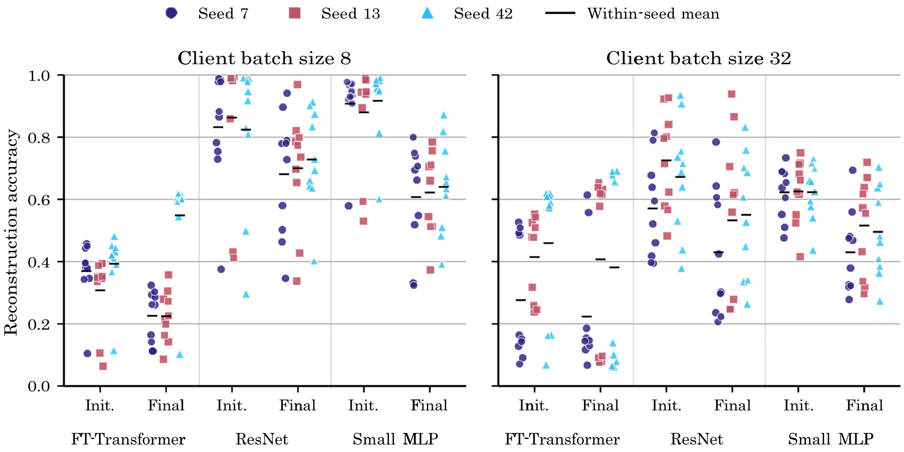
<figcaption><strong>Fig. 31</strong> Variation in reconstruction accuracy among clients for representative MIMIC-IV FedSGD settings at client batch sizes 8 and 32. Each point represents one client’s attacked batch. Colors and marker shapes identify the three training seeds. Black horizontal bars show the mean over ten clients within each seed and condition. Initialized (Init.) and final attack points are shown separately. The 30 observations per condition are descriptive and are not treated as independent replicates</figcaption>
</figure>

<figure class="table-figure" id="table-54">
<figcaption><strong>Table 54</strong> Native FT-Transformer training update versus the differentiable GIA surrogate update on Adult</figcaption>

<table><tr><th>FL protocol</th><th>Attack parameterization</th><th>Max abs. err.</th><th>Mean abs. err.</th><th>Rel. ℓ2 err.</th><th>Cosine</th></tr><tr><td>FedSGD</td><td>Probability simplex</td><td>1.49×10−8</td><td>4.19×10−12</td><td>8.04×10−9</td><td>1.000000</td></tr><tr><td>FedSGD</td><td>Categorical logits</td><td>8.86×10−3</td><td>7.04×10−6</td><td>2.89×10−3</td><td>0.999996</td></tr><tr><td>FedAvg</td><td>Probability simplex</td><td>7.45×10−9</td><td>3.47×10−14</td><td>1.73×10−7</td><td>1.000000</td></tr><tr><td>FedAvg</td><td>Categorical logits</td><td>2.99×10−5</td><td>6.42×10−8</td><td>2.17×10−3</td><td>0.999998</td></tr></table>

Entries report the worst case over batch sizes <em>B</em> ∈{1, 8, 32, 128} and three clients

</figure>

<figure class="table-figure" id="table-55">
<figcaption><strong>Table 55</strong> FT-Transformer GIA forward validity check on Adult</figcaption>

<table><tr><th rowspan="2">Batch size</th><th>Categorical logits</th><th>Probability simplex</th></tr><tr><th>Mean loss change</th><th>Mean loss change</th></tr><tr><td>1</td><td>−0.017</td><td>−0.201</td></tr><tr><td>8</td><td>−0.054</td><td>−0.460</td></tr><tr><td>32</td><td>−0.027</td><td>−0.134</td></tr><tr><td>128</td><td>−0.043</td><td>−0.191</td></tr></table>

The table reports the mean change in gradient matching loss after 25 attack steps across three clients. Negative values indicate that the GIA space reconstruction reduced the loss against gradients produced by the native FT-Transformer forward pass. All clients improved in every setting

</figure>

<figure class="table-figure" id="table-56">
<figcaption><strong>Table 56</strong> FT-Transformer reconstruction decomposition at the initialized attack point on MIMIC-IV</figcaption>

<table><tr><th rowspan="2">Attack parameterization</th><th colspan="3">Dropout on</th><th colspan="3">Dropout off</th></tr><tr><th>Recon. Acc.</th><th>Num. acc.</th><th>Cat. acc.</th><th>Recon. Acc.</th><th>Num. acc.</th><th>Cat. acc.</th></tr><tr><td>Categorical logits</td><td>0.334 ± 0.074</td><td>0.338 ± 0.076</td><td>0.231 ± 0.059</td><td>0.337 ± 0.068</td><td>0.341 ± 0.071</td><td>0.233 ± 0.038</td></tr><tr><td>Probability simplex</td><td>0.342 ± 0.070</td><td>0.346 ± 0.071</td><td>0.227 ± 0.047</td><td>0.341 ± 0.072</td><td>0.345 ± 0.075</td><td>0.243 ± 0.043</td></tr><tr><td>Values are aggregated over batch sizes</td><td>client batch sizes 1,</td><td>2, 4, 8, 16, 32, 64,</td><td>and 128. Each cell</td><td>reports mean ± standard</td><td>deviation across</td><td>seeds and client</td></tr></table>

</figure>

<figure class="table-figure" id="table-57">
<figcaption><strong>Table 57</strong> FT-Transformer reconstruction decomposition at the final attack point on MIMIC-IV</figcaption>

<table><tr><th rowspan="2">Attack parameterization</th><th colspan="3">Dropout on</th><th colspan="3">Dropout off</th></tr><tr><th>Recon. Acc.</th><th>Num. acc.</th><th>Cat. acc.</th><th>Recon. Acc.</th><th>Num. acc.</th><th>Cat. acc.</th></tr><tr><td>Categorical logits</td><td>0.297 ± 0.132</td><td>0.300 ± 0.136</td><td>0.228 ± 0.053</td><td>0.256 ± 0.114</td><td>0.255 ± 0.115</td><td>0.266 ± 0.098</td></tr><tr><td>Probability simplex</td><td>0.284 ± 0.116</td><td>0.287 ± 0.120</td><td>0.210 ± 0.043</td><td>0.258 ± 0.107</td><td>0.259 ± 0.110</td><td>0.237 ± 0.062</td></tr></table>

Values are aggregated over client batch sizes 1, 2, 4, 8, 16, 32, 64, and 128. Each cell reports mean ± standard deviation across seeds and client batch sizes

</figure>

<figure id="fig-32">
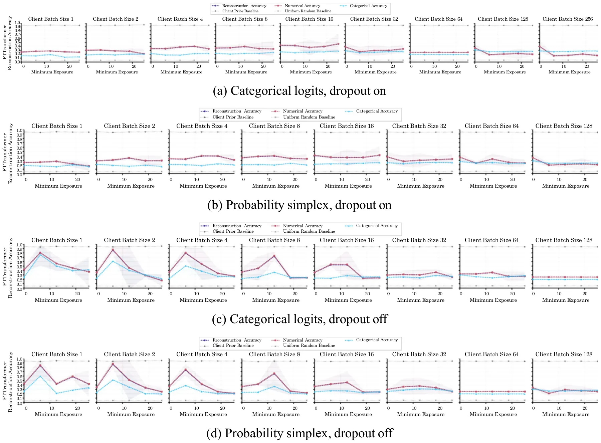
<figcaption><strong>Fig. 32</strong> FT-Transformer reconstruction trajectories on MIMIC-IV over the five attack points used in the trajectory analyses. Each panel reports aggregate, numerical, and categorical reconstruction accuracy across client batch sizes for one categorical parameterization and dropout setting. The dropout disabled panels show a pronounced early leakage spike for small client batches. Panel (a) includes batch size 256. The remaining panels omit this batch size for computational reasons</figcaption>
</figure>

<figure class="table-figure" id="table-58">
<figcaption><strong>Table 58</strong> Reconstruction accuracy at the initialized attack point and final attack point for MIMIC-IV under two FT-Transformer attack parameterizations with fixed client batches</figcaption>

<table><tr><th rowspan="2">Batch size</th><th colspan="2">Initialized attack point</th><th colspan="2">Final attack point</th></tr><tr><th>Categorical logits</th><th>Probability simplex</th><th>Categorical logits</th><th>Probability simplex</th></tr><tr><td>8</td><td>0.341 ± 0.020</td><td>0.340 ± 0.025</td><td>0.367 ± 0.111</td><td>0.330 ± 0.129</td></tr><tr><td>32</td><td>0.330 ± 0.009</td><td>0.334 ± 0.012</td><td>0.365 ± 0.059</td><td>0.357 ± 0.048</td></tr><tr><td>Initialized attack the last attacked</td><td>point denotes the point under the</td><td>attack before any global exposure budget. Each cell</td><td>model aggregation, and final reports mean ± standard</td><td>attack point denotes deviation across 3 seeds</td></tr></table>

</figure>

<figure class="table-figure" id="table-59">
<figcaption><strong>Table 59</strong> Reconstruction accuracy at the initialized attack point and final attack point for MIMIC-IV under two FT-Transformer attack parameterizations with attention and feedforward dropout set to zero in the target model</figcaption>

<table><tr><th rowspan="2">Batch size</th><th colspan="2">Initialized attack point</th><th colspan="2">Final attack point</th></tr><tr><th>Categorical logits</th><th>Probability simplex</th><th>Categorical logits</th><th>Probability simplex</th></tr><tr><td>1</td><td>0.411 ± 0.059</td><td>0.420 ± 0.100</td><td>0.370 ± 0.297</td><td>0.418 ± 0.261</td></tr><tr><td>2</td><td>0.351 ± 0.051</td><td>0.341 ± 0.044</td><td>0.173 ± 0.117</td><td>0.244 ± 0.095</td></tr><tr><td>4</td><td>0.359 ± 0.059</td><td>0.366 ± 0.056</td><td>0.270 ± 0.004</td><td>0.206 ± 0.041</td></tr><tr><td>8</td><td>0.361 ± 0.095</td><td>0.360 ± 0.091</td><td>0.234 ± 0.022</td><td>0.217 ± 0.016</td></tr><tr><td>16</td><td>0.351 ± 0.096</td><td>0.361 ± 0.093</td><td>0.233 ± 0.043</td><td>0.237 ± 0.052</td></tr><tr><td>32</td><td>0.294 ± 0.017</td><td>0.298 ± 0.009</td><td>0.251 ± 0.065</td><td>0.249 ± 0.054</td></tr><tr><td>64</td><td>0.321 ± 0.023</td><td>0.248 ± 0.001</td><td>0.267 ± 0.095</td><td>0.247 ± 0.001</td></tr><tr><td>128</td><td>0.249 ± 0.001</td><td>0.336 ± 0.031</td><td>0.248 ± 0.001</td><td>0.249 ± 0.039</td></tr></table>

Each cell reports mean ± standard deviation across 3 seeds

</figure>

The observed FL updates match up to finite precision for both FedSGD and FedAvg, as summarized in Table 60. We also compare the GIA objective after one and ten attack steps using the attack learning rate used in the main experiments. The one-step comparison checks the immediate vectorized attack update, while the ten step comparison verifies that numerical differences remain small across repeated optimization. The cosine matching loss computes the cosine similarity in double precision after flattening the compared gradient tensors. Thus, the loss comparison itself is not a low precision reduction.

The one-step discrepancies are at the scale of single precision roundoff. This is expected because the standard and vectorized implementations evaluate the same algebraic computation with different execution orders. The ten step differences reflect the accumulation of these finite precision effects through repeated reconstruction optimizer updates. These results support using the vectorized implementation in the full experimental evaluation.

## E Mechanistic and applicative interpretation of the empirical findings

The preceding experiments provide a broad empirical profile of gradient-inversion leakage across aggregation levels, training stages, attacker assumptions, FL protocols, and model architectures. This section synthesizes those observations to examine the mechanisms that are consistent with the measured behavior and their implications for practical tabular FL design. The goal is not to claim that the experiments establish a unique causal mechanism for every observed difference. Gradient inversion is a nonlinear inverse problem whose behavior depends jointly on the target model, the current parameter state, the attacked batch, and the attack optimizer. Instead, we use quantitative contrasts across controlled experiments to distinguish explanations that are supported repeatedly from those that remain model- or setting-dependent.

### E.1 Aggregation as superposition of record-specific gradient information

The clearest and most repeated empirical pattern is the relationship between the number of client records represented in an update and reconstruction accuracy. For FedSGD, a client batch *B* produces a gradient of the form 𝑔𝐵 = |𝐵|−1 ∑𝑖∈𝐵 ∇𝑤ℓ(𝑤; 𝑥𝑖, 𝑦𝑖). The attacker therefore observes the superposition of multiple record-specific gradient contributions rather than a separate gradient for each record. At batch size 1, the observed gradient is generated by a single input-target pair. As the batch grows, the dimensionality of the observed model update is fixed by the target model, while the number of unknown record-specific input values that must be recovered grows approximately with the batch size. In addition, the update is invariant to permutations of the records. These properties make larger-batch reconstruction increasingly ambiguous even when the communicated gradient remains high dimensional.

<figure class="table-figure" id="table-60">
<figcaption><strong>Table 60</strong> Equivalence of standard and vectorized FL and GIA implementations on Adult</figcaption>

<table><tr><th>FL protocol</th><th>GIA steps</th><th>FL max err.</th><th>GIA total loss diff.</th><th>GIA client loss diff.</th></tr><tr><td>FedSGD</td><td>1</td><td>2.38×10−7</td><td>4.77×10−7</td><td>2.98×10−8</td></tr><tr><td>FedSGD</td><td>10</td><td>2.38×10−7</td><td>3.02×10−3</td><td>4.68×10−4</td></tr><tr><td>FedAvg</td><td>1</td><td>1.19×10−7</td><td>4.77×10−7</td><td>1.49×10−7</td></tr><tr><td>FedAvg</td><td>10</td><td>1.19×10−7</td><td>3.23×10−3</td><td>4.79×10−4</td></tr></table>

Values are worst cases over seeds 7, 13, and 42, ten clients, and both vectorized attack comparison directions

</figure>

The MIMIC-IV results quantify the magnitude of this effect particularly clearly for the one-hot models. At the final attack point, increasing the client batch size from 1 to 256 reduces reconstruction accuracy from 0.669 to 0.192 for ResNet, a reduction of 0.477, and from 0.850 to 0.243 for the small MLP, a reduction of 0.607. The initialized attack point shows an even larger separation: ResNet falls from 0.988 to 0.316, while the small MLP falls from 0.989 to 0.302. Similar decreases occur for the one-hot models on Adult and the private multiclass benchmark. The recurrence of the pattern across datasets and training stages supports gradient superposition as a central explanation for the aggregation effect rather than an artifact of a particular attacked batch.

The effect is nevertheless not a universal monotonic law. California Housing provides an important counterexample after training: reconstruction at batch size 1 is lower than at several slightly larger batch sizes even though the initialized model is highly reconstructable at batch size 1. FT-Transformer also shows a non-monotonic relationship on MIMIC-IV, where final reconstruction increases from 0.248 at batch size 1 to 0.462 at batch size 16 before falling to 0.168 at batch size 256. These exceptions show that aggregation interacts with the loss geometry and the trained representation. Increasing the number of records makes the inverse problem less directly determined by individual records, but it does not guarantee a monotonic reduction for every architecture and training state.

The practical implication is that the effective number of distinct records represented in a communicated update is a more meaningful privacy variable than communication-round count alone. Very small client updates deserve particular scrutiny because a single gradient can be closely tied to one or a few records. Conversely, increasing the number of distinct local examples represented in an update can substantially reduce empirical reconstructability, but should be interpreted as risk reduction rather than as a formal privacy mechanism.

### E.2 Training progression changes both gradient magnitude and gradient structure

A second important pattern is that reconstruction changes over the course of federated training. This effect cannot be explained by aggregation because the attacked batch size can remain unchanged while the model parameters and the resulting input-to-gradient map evolve. For a classification model, the gradient propagated from the output layer depends in part on the prediction residual. As the model becomes more confident on correctly predicted examples, this component of the gradient can decrease, reducing the record-specific signal available for inversion. At the same time, training changes the internal representation and may make gradients more structured with respect to particular categories or feature interactions. Training can therefore either weaken or reorganize the reconstructive signal.

The one-hot MIMIC-IV models mainly exhibit the first behavior. At batch size 1, ResNet reconstruction decreases from 0.988 at initialization to 0.669 at the final attack point, while the small MLP decreases from 0.989 to 0.850. At batch size 32, the corresponding changes are 0.656 to 0.504 for ResNet and 0.624 to 0.480 for the small MLP. Thus, training attenuates leakage in these settings but does not remove it.

FT-Transformer demonstrates why the opposite interpretation cannot be generalized. On the private multiclass benchmark, final reconstruction is higher than initialized reconstruction across the evaluated batch sizes, and on MIMIC-IV the direction of change depends on batch size. This is consistent with the possibility that learned embeddings and downstream feature interactions become more informative about categorical structure during training even while other components of the gradient signal decrease. The experiments therefore indicate that training stage itself is a privacy-relevant state variable rather than a simple progression from more leakage to less leakage.

From an applicative perspective, evaluating only the final trained model can underestimate the exposure that occurs during earlier communication rounds, while evaluating only initialization can also miss architecture-specific leakage that emerges after useful representations have been learned. Privacy auditing of FL training should therefore consider several training stages, particularly the initialized and early-training updates as well as the final model state. This motivates the exposure trajectories used throughout the present study.

### E.3 Architecture and input representation modify the inverse mapping

The cross-model results show large differences between the one-hot MLP and ResNet models and FT-Transformer, but these differences should be interpreted through the input-to-gradient pathway rather than through architectural complexity alone. For a linear layer receiving an input vector 𝑥𝑖, the weight gradient for one record has the outer-product form 𝛿𝑖𝑥𝑖⊤, where 𝛿𝑖 denotes the upstream error signal. For a batch, these contributions are summed. In a one-hot representation, the active categorical coordinates therefore participate directly in the first parameterized transformation, and the corresponding gradient structure can provide strong information about which input coordinates were active.

FT-Transformer changes this relationship because a categorical value is first converted into an embedding before subsequent attention and feedforward processing. If 𝑝𝑖𝑗 denotes the categorical indicator for feature 𝑗, 𝐸𝑗 its embedding matrix, and 𝑒𝑖𝑗 = 𝐸𝑗⊤𝑝𝑖𝑗 the resulting embedding, then the embedding gradient is determined jointly by the active category and the downstream derivative with respect to 𝑒𝑖𝑗. In the transformer, this downstream derivative also reflects interactions with other feature tokens through the learned network. At the batch level, these record-specific embedding gradients are again aggregated. Thus, the attacker must invert a signal in which categorical identity has passed through a learned representation and subsequent feature interactions rather than appearing as a direct one-hot coordinate.

The main batch-size comparisons show large cross-family differences. On MIMIC-IV at batch size 8, final reconstruction is 0.333 for FT-Transformer, 0.703 for ResNet, and 0.623 for the small MLP; at batch size 32, the corresponding values are 0.338, 0.504, and 0.480. The embedding MLP control in Table 7, which reuses the separate attack-budget baseline runs, helps interpret these differences. Despite sharing FT-Transformer’s categorical embedding interface, the embedding MLP has higher mean reconstruction than FT-Transformer in all eight evaluated settings. Categorical embeddings alone therefore do not explain the observed FT-Transformer pattern. This does not isolate transformer processing as the cause, because numerical tokenization, capacity, dropout, and downstream architecture also differ.

Two existing ablations already narrow the mechanism. First, the categorical-logit and probability-simplex parameterizations produce similar final reconstruction in many settings. At batch size 32, for example, final FT-Transformer reconstruction is 0.338 and 0.328, respectively, and at batch size 128 it is 0.201 and 0.202. Although individual attack points can differ, the broad FT-Transformer pattern is therefore not explained by one particular continuous relaxation of categorical variables. Second, disabling FT-Transformer dropout changes the temporal leakage profile and produces a pronounced early leakage spike for small batches, but it does not make the architecture behave uniformly like the one-hot baselines. Dropout is therefore one contributor to the optimization landscape rather than a sufficient explanation for the cross-family difference.

The practical conclusion is not that embeddings or transformers should be regarded as privacy defenses. The experiments instead show that model representation changes the information geometry faced by the attacker. Architecture and preprocessing should consequently be included explicitly in empirical privacy assessments. A privacy result measured for a one-hot MLP cannot automatically be transferred to an embedding-based model, and the lower leakage of an embedded model under one attack formulation does not replace secure aggregation, differential privacy, or other mechanisms designed to provide formal protection.

### E.4 Local computation is not equivalent to aggregation over distinct records

The FedAvg results clarify an important distinction between performing more local optimization and mixing information from more distinct client records. Under the plain local SGD used in the experiments, a client model delta after 𝑆 local steps can be written as Δ = −𝜂 ∑𝑠=0𝑆−1 ∇𝑤ℒ(𝑤𝑠; 𝐵𝑠), where each gradient is evaluated at the evolving local parameter state 𝑤𝑠. The communicated delta therefore aggregates information across a local optimization trajectory. However, this does not imply that it aggregates information from many distinct records. If a small local dataset is reused across several epochs, the same records contribute repeatedly to the delta.

This distinction explains why increasing the number of local epochs is not uniformly protective in the experiments. On MIMIC-IV with 16 local examples and one local batch per epoch, increasing from one to four local epochs changes final reconstruction from 0.318 to 0.366 for FT-Transformer, from 0.845 to 0.866 for ResNet, and from 0.715 to 0.756 for the small MLP. The same qualitative behavior appears for several other mini-batch granularities. Repeating additional optimization over the same small record set can therefore preserve or even strengthen the reconstructive signal rather than hiding it.

The larger-local-dataset control provides the complementary observation. Increasing the number of distinct local records reduces reconstruction more clearly for the one-hot models. Taken together, these experiments suggest that the relevant privacy quantity is not simply the number of local SGD steps or local epochs, but the combination of repeated optimization and the number of distinct records contributing to the communicated delta.

This has a direct deployment implication. FedAvg should not be treated as inherently more private than FedSGD merely because the server receives a model delta rather than a one-step gradient. A local training configuration with many repeated steps over a very small client dataset can remain highly exposed. Privacy assessments of FedAvg should therefore report both local optimization depth and the number of distinct examples represented in each communicated update.

### E.5 Label knowledge strengthens the threat model but is not the sole source of leakage

The label-unknown experiments help separate leakage inherent in feature gradients from leakage that depends on providing the attacker with the true target values. Removing label knowledge changes the reconstruction problem because the attacker no longer optimizes with the true batch targets. Nevertheless, the MIMIC-IV results show that substantial feature information remains recoverable from small one-hot updates. At batch size 1, final label-unknown reconstruction reaches 0.852 for ResNet and 0.819 for the small MLP. At batch size 32, these values decrease to 0.399 and 0.353, and at batch size 128 to 0.228 and 0.287, respectively.

The effect of label knowledge is not uniformly monotonic across all models and training stages. This is expected for an optimization-based attack because removing the correct target changes both the information available to the attacker and the objective landscape through which the reconstructed features are optimized. The sensitivity experiment should therefore not be interpreted as a formal information-theoretic ordering between the two attacks. Its stronger empirical implication is that the aggregation pattern survives removal of true-label access: small individual-client updates can remain strongly reconstructable even when the attacker does not receive the private labels.

Consequently, label secrecy should not be treated as a privacy mechanism for federated training. It weakens the attacker assumption, but substantial feature leakage can remain. Deployment-level protection must address the communicated update itself rather than rely on target values remaining unavailable to the coordinating server.

### E.6 Ordinary neural-network design choices produce quantitatively large leakage shifts

The MLP architecture grid provides an important within-family control because the input representation, FL protocol, dataset, and attack formulation are held fixed while standard network-design choices are varied. The resulting differences therefore cannot be attributed to the one-hot-versus-embedding distinction. At batch size 8, increasing hidden width from 32 to 128 changes final reconstruction from 0.473 to 0.526, while at batch size 32 it changes reconstruction from 0.334 to 0.409. A wider first hidden representation produces more parameter-gradient coordinates that depend on the same input, which can provide the inversion procedure with additional constraints. The observed increase with width is consistent with this mechanism, although model capacity also changes the trained parameter state and therefore width should not be interpreted as an isolated causal quantity.

Activation produces the largest and most stable marginal difference in the MIMIC-IV grid. Replacing ReLU with GELU increases average final reconstruction from 0.413 to 0.588 at batch size 8, a difference of 0.175, and from 0.321 to 0.422 at batch size 32, a difference of 0.101. One plausible explanation lies in the input-to-gradient Jacobian. ReLU suppresses the derivative of inactive units completely, whereas GELU provides a smooth graded derivative over a broader range of pre-activation values. Under gradient-matching reconstruction, a smoother differentiable path can provide useful optimization information over a larger portion of the candidate-input space. The repeated GELU–ReLU separation across aggregation levels is consistent with this explanation, although the experiment does not establish activation derivative structure as the only cause.

The other factors are less uniform. Changing BatchNorm to LayerNorm reduces average reconstruction by 0.107 at batch size 8 but only 0.017 at batch size 32. Adding dropout changes reconstruction by −0.027 and −0.053 at batch sizes 8 and 32, respectively. Increasing depth from one to three hidden layers reduces reconstruction by 0.070 at batch size 8, but produces essentially no marginal change at batch size 32. These weaker or unstable effects are analytically important because they show that architectural complexity itself is not a monotonic proxy for privacy. Deeper models are not automatically safer, normalization is not uniformly protective, and dropout does not act as a reliable privacy defense.

Interaction effects are larger than many individual marginal effects. Across the complete batch-size-8 MIMIC-IV architecture grid, trajectory-averaged reconstruction ranges from 0.208 to 0.799, a spread of 0.591. This means that ordinary choices within the same broad MLP model family can move the measured leakage level by far more than several protocol-level sensitivity changes. For practical FL development, the target network configuration should therefore be included in privacy testing rather than treating privacy as a property of FedSGD or FedAvg alone. At the same time, the interactions observed in the grid argue against selecting one module, such as ReLU or dropout, as a stand-alone privacy intervention.

### E.7 Statistical robustness and variability among clients

In order to complement the mean and standard deviation summaries reported in the main experiments, we examined uncertainty across independent runs and variability among clients for representative MIMIC-IV FedSGD settings. We consider Small MLP, ResNet, and FT-Transformer at client batch sizes 8 and 32, evaluated at both the initialized and final attack points. These batch sizes represent intermediate aggregation settings in which reconstruction remains measurable while differences between configurations are clearly visible. Each condition contains three independently seeded federated runs, with ten clients participating in each run. We treat the seed-level run as the independent statistical replicate. Accordingly, confidence intervals are calculated from the three run-level means, while individual client observations are presented descriptively and are not treated as independent replicates.

<figure class="table-figure" id="table-61">
<figcaption><strong>Table 61</strong> Uncertainty in mean reconstruction accuracy for representative MIMIC-IV FedSGD settings</figcaption>

<table><tr><th>Model</th><th>Batch</th><th>Attack point</th><th>Mean</th><th>SD</th><th>95% CI</th></tr><tr><td>FT-Transformer</td><td>8</td><td>Initialized</td><td>0.357</td><td>0.044</td><td>[0.248, 0.467]</td></tr><tr><td>FT-Transformer</td><td>8</td><td>Final</td><td>0.333</td><td>0.186</td><td>[−0.130, 0.796]</td></tr><tr><td>ResNet</td><td>8</td><td>Initialized</td><td>0.840</td><td>0.021</td><td>[0.789, 0.891]</td></tr><tr><td>ResNet</td><td>8</td><td>Final</td><td>0.703</td><td>0.024</td><td>[0.644, 0.762]</td></tr><tr><td>Small MLP</td><td>8</td><td>Initialized</td><td>0.901</td><td>0.019</td><td>[0.854, 0.948]</td></tr><tr><td>Small MLP</td><td>8</td><td>Final</td><td>0.623</td><td>0.016</td><td>[0.583, 0.664]</td></tr><tr><td>FT-Transformer</td><td>32</td><td>Initialized</td><td>0.384</td><td>0.096</td><td>[0.146, 0.621]</td></tr><tr><td>FT-Transformer</td><td>32</td><td>Final</td><td>0.338</td><td>0.100</td><td>[0.090, 0.585]</td></tr><tr><td>ResNet</td><td>32</td><td>Initialized</td><td>0.656</td><td>0.079</td><td>[0.461, 0.851]</td></tr><tr><td>ResNet</td><td>32</td><td>Final</td><td>0.504</td><td>0.065</td><td>[0.344, 0.665]</td></tr><tr><td>Small MLP</td><td>32</td><td>Initialized</td><td>0.624</td><td>0.001</td><td>[0.620, 0.627]</td></tr><tr><td>Small MLP</td><td>32</td><td>Final</td><td>0.480</td><td>0.044</td><td>[0.370, 0.591]</td></tr></table>

Confidence intervals use <em>t</em>0.975,2 = 4.303 and are not truncated to the interval [0, 1]. Means, sample standard deviations (SD), and two-sided 95% Student’s <em>t</em> confidence intervals are calculated from three independent runs. Each run contributes the mean reconstruction accuracy across its ten clients

</figure>

Table 61 shows that the batch-size effect is comparatively stable for the one-hot models. For both ResNet and Small MLP, reconstruction accuracy decreases from batch size 8 to batch size 32 at both the initialized and final attack points. The FT-Transformer has lower mean reconstruction than the one-hot models in these representative comparisons, but its estimates exhibit substantially greater between-run uncertainty. This is most apparent at the final attack point for batch size 8, where the three seed-level means are approximately 0.226, 0.225, and 0.548, yielding an overall mean of 0.333 and a wide 95% confidence interval of [−0.130, 0.796]. The negative lower bound is an artifact of the unbounded Student’s *t* interval and does not represent a possible reconstruction accuracy. More generally, the width of several FT-Transformer intervals indicates that relatively small differences between aggregate means should be interpreted cautiously rather than as statistically established differences.

**Author Contributions** Ivo Österberg Nilsson: Conceptualization, Methodology, Software, Formal analysis, Investigation, Writing - Original Draft, Writing - review & editing, Visualization, Data Curation, Validation. Maximilian Birr Engvall: Conceptualization, Methodology, Software, Formal analysis, Investigation, Writing - Original Draft, Visualization, Data Curation, Validation. Viktor Valadi: Methodology, Validation, Resources, Writing - review & editing, Supervision, Project administration. Teddy Lazebnik: Conceptualization, Validation, Resources, Data Curation, Writing - Review & Editing, Supervision.

**Funding** Open access funding provided by Jönköping University. This work was supported by Vinnova - Sweden’s Innovation Agency - through the Advanced Digitalization Research and Innovation Programme (grant no. 2025-03066). The funder had no role in the study design, data collection, analysis, interpretation, manuscript preparation, or decision to submit the article for publication.

**Data availability** The source code used for this study is publicly available at https://github.com/scaleoutsystems/tabular-GIA/. The Adult and California Housing datasets are publicly available from their sources. The MIMIC-IV v3.1 cohort is governed by the PhysioNet credentialed access process; researchers who have completed the required training and data use agreement can obtain MIMIC-IV from PhysioNet. The private multiclass benchmark used as an intermediate evaluation dataset cannot be shared because it contains sensitive data.

### Declarations

**Conflict of interest** The authors declare that they have no conflict of interest.

**Declaration of generative AI and AI-assisted technologies in the manuscript preparation process** The authors used AI-based tools for language editing, code assistance, and manuscript preparation support. All content was manually reviewed and edited by the authors, who take full responsibility for the final manuscript.

**Open Access** This article is licensed under a Creative Commons Attribution 4.0 International License, which permits use, sharing, adaptation, distribution and reproduction in any medium or format, as long as you give appropriate credit to the original author(s) and the source, provide a link to the Creative Commons licence, and indicate if changes were made. The images or other third party material in this article are included in the article’s Creative Commons licence, unless indicated otherwise in a credit line to the material. If material is not included in the article’s Creative Commons licence and your intended use is not permitted by statutory regulation or exceeds the permitted use, you will need to obtain permission directly from the copyright holder. To view a copy of this licence, visit http://creativecommons.org/licenses/by/4.0/.

## References

1. McMahan,H.B., Moore,E., Ramage,D., Hampson,S., y Arcas,B.A.: Communication-efficient learning of deep networks from decentralized data. In: Aarti, S., and Jerry, Z., (eds.), Proceedings of the 20th International Conference on Artificial Intelligence and Statistics, vol. 54 of Proceedings of Machine Learning Research, pp. 1273–1282. PMLR (2017)
2. Kairouz, P., McMahan, H.B., Avent, B., Bellet, A., Bennis, M., Bhagoji, A.N., Bonawitz, K., Charles, Z., Cormode, G., Cummings, R., D’Oliveira, R.G.L., Eichner, H., El Rouayheb, S., Evans, D., Gardner, J., Garrett, Z., Gascón, A., Ghazi, B., Gibbons, P.B., Gruteser, M., Harchaoui, Z., He, C., He, L., Huo, Z., Hutchinson, B., Hsu, J., Jaggi, M., Javidi, T., Joshi, G., Khodak, M., Koněcný, J., Korolova, A., Koushanfar, F., Koyejo, S., de Lepoint, T., Liu, Y., Mittal, P., Mohri, M., Nock, R., Özgür, A., Pagh, R., Qi, H., Ramage, D., Raskar, R., Raykova, M., Song, D., Song, W., Stich, S.U., Sun, Z., Suresh, A.T., Tramèr, F., Vepakomma, P., Wang, J., Xiong, L., Xu, Z., Yang, Q., Yu, F.X., Yu, H., Zhao, S.: Advances and open problems in federated learning. Found. Trends Mach. Learn. 14(1–2), 1–210 (2021)
3. Yang, Q., Liu, Y., Chen, T., Tong, Y.: Federated machine learning: concept and applications. ACM Trans. Intell. Syst. Technol. 10(2), 1–19 (2019)
4. Antunes, R.S., da Costa, C.A., Küderle, A., Yari, I.A., Eskofier, B.: Federated learning for healthcare: systematic review and architecture proposal. ACM Trans. Intell. Syst. Technol. 13(4), 1–23 (2022)
5. Jie, X., Glicksberg, B.S., Chang, S., Walker, P., Bian, J., Wang, F.: Federated learning for healthcare informatics. J. Healthc. Inf. Res. 5(1), 1–19 (2021)
6. Vaid, A., Jaladanki, S.K., Xu, J., Teng, S., Kumar, A., Lee, S., Somani, S., Paranjpe, I., De Freitas, J.K., Wanyan, T., Johnson, K.W., Bicak, M., Klang, E., Kwon, Y.J., Costa, A., Zhao, S., Miotto, R., Charney, A.W., Böttinger, E., Fayad, Z.A., Nadkarni, G.N., Wang, F., Glicksberg, B.S.: Federated learning of electronic health records to improve mortality prediction in hospitalized patients with covid-19: Machine learning approach. JMIR Med. Inform. 9(1), e24207 (2021)
7. Pan, W., Zhenxing, X., Rajendran, S., Wang, F.: An adaptive federated learning framework for clinical risk prediction with electronic health records from multiple hospitals. Patterns 5(1), 100898 (2024)
8. Geiping,J., Bauermeister,H., Dröge,H., Moeller,M.: Inverting gradients - how easy is it to break privacy in federated learning? In: Larochelle, H., Ranzato, M., Hadsell, R., Balcan, M.F., and Lin, H. (eds.), Advances in Neural Information Processing Systems, vol. 33, pp. 16937–16947. Curran Associates, Inc. (2020)
9. Huang,Y., Gupta,S., Song,Z., Li,K., Arora,S.: Evaluating gradient inversion attacks and defenses in federated learning. In: Ranzato, M., Beygelzimer, A., Dauphin, Y., Liang, P.S., and Wortman Vaughan, J. (eds.), Advances in Neural Information Processing Systems, vol. 34, pp. 7232–7241. Curran Associates, Inc. (2021)
10. Zhu,L., Liu,Z., Han,S.: Deep leakage from gradients. In: Wallach, H., Larochelle, H., Beygelzimer, A., d’ Alché-Buc, F., Fox, E., and Garnett, R. (eds.), Advances in Neural Information Processing Systems, vol. 32. Curran Associates, Inc. (2019)
11. Vero,M., Balunovíc,M., Dimitrov,D.I., Vechev,M.: TabLeak: Tabular data leakage in federated learning. In: Andreas, K., Emma, B., Kyunghyun, C., Barbara, E., Sivan, S., and Jonathan, S., (eds.), Proceedings of the 40th International Conference on Machine Learning, vol. 202 of Proceedings of Machine Learning Research, pp. 35051–35083. PMLR (2023)
12. Zhao, B., Reddy Mopuri, K., Bilen, H.: iDLG: Improved deep leakage from gradients, (2020). arXiv preprint arXiv:2001.02610 [link](http://arxiv.org/abs/2001.02610)
13. Yin, H., Mallya, A., Vahdat, A., Alvarez, J.M., Kautz, J., Molchanov, P.: See through gradients: Image batch recovery via GradInversion. In: 2021 IEEE/CVF Conference on Computer Vision and Pattern Recognition (CVPR), pp. 16332–16341 (2021)
14. Hatamizadeh, A., Yin, H., Roth, H., Li, W., Kautz, J., Xu, D., Molchanov, P.: GradViT: Gradient inversion of vision transformers. In: 2022 IEEE/CVF Conference on Computer Vision and Pattern Recognition (CVPR), pp. 10011–10020 (2022)
15. Gorishniy,Y., Rubachev,I., Khrulkov,V., Babenko,A.: Revisiting deep learning models for tabular data. In: Ranzato, M., Beygelzimer, A., Dauphin, Y., Liang, P.S., and Wortman Vaughan, J. (eds.), Advances in Neural Information Processing Systems, vol. 34, pp. 18932–18943. Curran Associates, Inc. (2021)
16. Arik, S.Ö., Pfister, T.: TabNet: attentive interpretable tabular learning. Proc. AAAI Conf. Artif. Intell. 35(8), 6679–6687 (2021)
17. Huang, X., Khetan, A., Cvitkovic, M., Karnin, Z.: TabTransformer: tabular data modeling using contextual embeddings, (2020). arXiv preprint arXiv:2012.06678 [link](http://arxiv.org/abs/2012.06678)
18. Borisov, V., Leemann, T., Seßler, K., Haug, J., Pawelczyk, M., Kasneci, G.: Deep neural networks and tabular data: a survey. IEEE Trans. Neural Netw. Learn. Syst. 35(6), 7499–7519 (2024)
19. Shmuel, A., Glickman, O., Lazebnik, T.: A comprehensive benchmark of machine and deep learning models on structured data for regression and classification. Neurocomputing 655, 131337 (2025)
20. Lindskog, W., Prehofer, C.: A federated learning benchmark on tabular data: Comparing tree-based models and neural networks. In: 2023 Eighth International Conference on Fog and Mobile Edge Computing (FMEC), pp. 239–246 (2023)
21. Lindskog, W., Prehofer, C.: Federated learning for tabular data using TabNet: a vehicular use-case. In: 2022 IEEE 18th International Conference on Intelligent Computer Communication and Processing (ICCP), pp. 105–111 (2022)
22. Bonawitz, K., Ivanov, V., Kreuter, B., Marcedone, A., McMahan, H.B., Patel, S., Ramage, D., Segal, A., Seth, K.: Practical secure aggregation for privacy-preserving machine learning. In: Proceedings of the 2017 ACM SIGSAC Conference on Computer and Communications Security, CCS ’17, pp. 1175–1191, New York, NY, USA, (2017). Association for Computing Machinery
23. Dimitrov, D.I., Balunovic, M., Konstantinov, N., Vechev, M.: Data leakage in federated averaging. Trans. Mach. Learn. Res. 37, 106768–106799 (2022)
24. Abadi, M., Chu, A., Goodfellow, I., McMahan, H.B., Mironov, I., Talwar, K., Zhang, L.: Deep learning with differential privacy. In: Proceedings of the 2016 ACM SIGSAC Conference on Computer and Communications Security, CCS ’16, pp. 308–318, New York, NY, USA, (2016). Association for Computing Machinery
25. McMahan, H.B., Ramage, D., Talwar, K., Zhang, L.: Learning differentially private recurrent language models. In: International Conference on Learning Representations (2018)
26. Huang, T., Chen, Q., Beibei, H., Zhao, Y., Hongyan, X., Chen, Z., Chen, Y., Xiu, S.: Rover: Robust generative continual identity unlearning against relearning attacks. In: Proceedings of the AAAI Conference on Artificial Intelligence, vol. 40(7), pp. 5122–5130 (2026)
27. Zhu, J., Blaschko, M.B.: R-GAP: Recursive gradient attack on privacy. In: International Conference on Learning Representations (2021)
28. Scheliga, D., Maeder, P., Seeland, M.: Dropout is not all you need to prevent gradient leakage. In: Proceedings of the AAAI Conference on Artificial Intelligence, vol. 37(8), pp. 9733–9741 (2023)
29. Hatamizadeh, A., Yin, H., Molchanov, P., Myronenko, A., Li, W., Dogra, P., Feng, A., Mona, G., Flores, J., Kautz, D., Xu, H.R.: Roth: Do gradient inversion attacks make federated learning unsafe? IEEE Trans. Med. Imaging 42(7), 2044–2056 (2023)
30. Valadi, V., Åkesson, M., Östman, J., Hoseini, F., Toor, S., Hellander, A.: Practical feasibility of gradient inversion attacks in federated learning, (2026). arXiv preprint arXiv:2508.19819 [link](http://arxiv.org/abs/2508.19819)
31. Shan, J., Zhao, Z., Lu, J., Zhang, R., Yiu, S.M., Chow, K.H.: Geminio: language-guided gradient inversion attacks in federated learning. In: Proceedings of the IEEE/CVF International Conference on Computer Vision (ICCV), pp. 2718–2727 (2025)
32. Balunovíc, M., Dimitrov, D., Jovanovíc, N., Vechev, M.: LAMP: Extracting text from gradients with language model priors. In: Koyejo, S., Mohamed, S., Agarwal, A., Belgrave, D., Cho, K., and Oh, A. (eds.), Advances in Neural Information Processing Systems, vol. 35, pp. 7641–7654. Curran Associates, Inc., (2022)
33. Becker, B., Kohavi, R.: Adult [data set], (1996)
34. Pedregosa, F., Varoquaux, G., Gramfort, A., Michel, V., Thirion, B., Grisel, O., Blondel, M., Prettenhofer, P., Weiss, R., Dubourg, V., Vanderplas, J., Passos, A., Cournapeau, D., Brucher, M., Perrot, M., Duchesnay, E.: Scikit-learn: machine learning in Python. J. Mach. Learn. Res. 12, 2825–2830 (2011)
35. Kelley Pace, R., Barr, R.: Sparse spatial autoregressions. Stat. Probab. Lett. 33(3), 291–297 (1997)
36. Johnson, A., Bulgarelli, L., Pollard, T., Gow, B., Moody, B., Horng, S., Celi, L.A., Mark, R.: MIMIC-IV [data set. PhysioNet, (2024). (Version 3.1)
37. Kingma, D. P., Ba, J.: Adam: a method for stochastic optimization. In: Yoshua, B., and Yann, L. (eds.), 3rd International Conference on Learning Representations, ICLR 2015 (2015)
38. Kuhn, H.W.: The Hungarian method for the assignment problem. Naval Res. Logist. Quarterly 2(1–2), 83–97 (1955)
