## Lay summary

Malaria control often focuses on killing adult mosquitoes, but mosquito larvae are concentrated in water bodies where they can also be targeted using fish that feed on them. Such biological control may reduce disease transmission, yet introduced fish can compete with native species and damage aquatic ecosystems. We developed a spatial simulation that links human infections, mosquito movement and reproduction, and interactions between larvivorous control fish and native fish populations. The model compares a fixed fish-release plan chosen before an outbreak with an adaptive strategy that updates releases using ongoing ecological and epidemiological monitoring. In a historically inspired Panama Canal landscape, both strategies reduced the human infection burden by about two thirds. The adaptive strategy achieved nearly the same level of disease control while generally causing less harm to native fish. These findings show how malaria interventions can be designed to balance public-health benefits with ecological protection.

## 1 Introduction

Malaria remains one of the most consequential mosquito-borne diseases worldwide, imposing a persistent burden on public health and economic development, especially in regions where environmental exposure, poverty, and uneven access to treatment reinforce transmission dynamics (Greenwood et al. 2005; Malaria et al. 2005; Tuteja 2007). Although major progress has been achieved through case management and vector control, malaria prevention still depends heavily on interventions directed at adult mosquitoes (Tizifa et al. 2018; Russell et al. 2013; Brady et al. 2015). The long-term effectiveness of such measures is increasingly challenged by insecticide resistance, logistical barriers, operational cost, and environmental externalities, motivating renewed interest in complementary approaches that target other stages of the mosquito life cycle (Greenwood et al. 2008; Walker and Lynch 2007; Gachelin et al. 2018).

Among these alternatives, larval control is particularly attractive because immature mosquitoes are confined to aquatic habitats and cannot evade interventions as readily as adult vectors (Killeen et al. 2002; Floore 2006; Worrall and Fillinger 2011; Tusting et al. 2013). This ecological bottleneck has motivated the use of larvivorous fish as a biological control tool in ponds, canals, reservoirs, and other breeding sites (Kamareddine 2012; Griffin and Knight 2012; Al-Akel and Suliman 2011). Field and *in silico* evidence suggests that fish-based control can substantially reduce larval mosquito abundance and, under favorable conditions, contribute to malaria suppression as part of integrated management programs (Chandra et al. 2008; Howard et al. 2007). Nevertheless, this apparent promise comes with an ecological dilemma. The deliberate introduction or augmentation of predatory fish may alter aquatic food webs, compete with or displace native fish, and generate non-target effects that are not captured by control strategies focused solely on epidemiological outcomes (Igbani et al. 2024; Collins et al. 2019).

These competing objectives expose a central limitation in much of the existing modeling of the phenomenon. Previous malaria models provide a principled foundation for studying transmission, and spatial extensions of these models have clarified how movement, diffusion, and environmental heterogeneity shape disease persistence (Aron and May 1982; Lou and Zhao 2010). Related eco-epidemiological studies have also shown that predator-prey interactions can indirectly influence vector-borne disease dynamics (Moore et al. 2010). However, these attempts do not explicitly represent urban spatial structure, adaptive deployment, or conservation trade-offs involving native aquatic species (Lou and Zhao 2011a; Wu et al. 2023; Blanchard and Perkin 2026; Saravanan et al. 2025). As a result, an important general policy question remains unresolved: how should biological control be deployed across heterogeneous urban landscapes when public-health gains must be balanced against ecological protection?

Addressing this question, in this study we develop a reduced phenomenological spatio-temporal eco-epidemiological model that couples malaria transmission at the host–vector level, mosquito population movement and reproduction, and two interacting fish populations: an intervention fish introduced to consume mosquito larvae and a native fish population that must be preserved. We proposed a partial differential equations (PDEs) based model to describe city-scale spread, dispersal, and environmental structure. Within this framework, we compare two intervention paradigms: a one-time offline optimization that determines fish deployment before the outbreak unfolds, and a dynamic monitoring strategy that updates deployment in response to observed system states over time. Our aim is not only to reduce cumulative human infections, but also to minimize collateral damage to native fish populations.

The remainder of the paper is organized as follows. Section 2 reviews related work on malaria modeling, biological vector control, and hybrid spatio-temporal methods. Section 3 formally introduces the proposed model and formalizes the intervention objectives. Section 4 describes the experimental design, calibration choices, and optimization protocols as well as outlines the obtained *in silico* experimental results. Finally, Section 5 discusses the implications, limitations, and directions for future work.

## 2 Related Work

This section is organized into three complementary parts. We begin with epidemiological modeling, first reviewing compartmental models and its extentions that include vector-borne transmission and spatio-temporal epidemic models that incorporate movement and spatial heterogeneity. Next, we turn to ecological population modeling, focusing on the theoretical foundations of predator–prey dynamics, structured populations, and spatial dispersal that motivate the fish– mosquito interaction layer of our framework. Lastly, we cover mosquito life-cycle models, larvivorous-fish control strategies, and within-human malaria dynamics, to outline the eco-epidemiological dynamics of the modeled system.

### 2.1 Epidemiological modeling

Compartmental models provide the conceptual foundation of modern epidemic theory by reducing transmission into flows between epidemiological states while retaining enough structure to study thresholds, outbreak size, and intervention effects. The canonical starting point is the susceptible–infectious–removed (SIR)

model introduced by Kermack and McKendrick, in which a closed population is divided into susceptible, infectious, and removed classes, denoted by 𝑆(𝑡), 𝐼(𝑡), and 𝑅(𝑡), respectively. In its classical deterministic form, the dynamics are written as

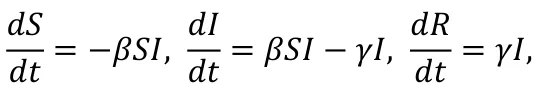

where 𝛽 is the transmission rate and 𝛾 is the recovery rate. Although simple, this formulation established several enduring principles of epidemic analysis, including the existence of threshold behavior, the central role of susceptible depletion in epidemic decline, and the relation between transmission intensity and final epidemic size (Kermack and McKendrick 1927). For that reason, the SIR framework remains the natural reference point for more detailed epidemic models (Steindorf et al. 2022; Lazebnik 2023a; Cooper et al. 2020; Weiss 2013; Aguiar et al. 2020).

Due to its simplistic form, the SIR model is able to capture a pandemic in general, but it fails to capture more refined epidemiological processes. As such, the SIR model has been enriched in order to capture persistence, intervention, and realistic disease progression (Milgroom 2023; Hens et al. 2012). For example, Keeling and Grenfell showed this clearly in their work on measles persistence, where a stochastic reformulation with a more biologically realistic infectious period improved the ability of the model to reproduce critical community size and recurrent transmission in medium-sized populations (Keeling and Grenfell 1997). Gumel et al. incorporate public-health operations in the context of SARS by adding compartments associated with quarantine and isolation, thereby demonstrating how the compartmental paradigm can be adapted for policy evaluation during an ongoing outbreak rather than only for retrospective description (Gumel et al. 2004). Wearing et al. argued that the common assumption of exponentially distributed residence times in SIR and SEIR (E - exposed) models can distort inference and overstate the expected effectiveness of interventions, and they advocated staged exposed and infectious classes as a more faithful but still tractable alternative (Wearing et al. 2005).

Specifically, vector-borne diseases require a different level of mechanistic detail because transmission is mediated by an interacting host–vector system rather than by direct host-to-host contact. This shift is already evident in Macdonald’s malaria work, which placed mosquito biting, mosquito survival, and the parasite’s extrinsic incubation period at the center of transmission analysis and thereby established the coupled human-vector viewpoint that still underlies malaria theory today (Macdonald 1952). Later studies extended this idea to other mosquito-borne infections and to explicit intervention analysis. For instance, Newton and Reiter developed a dengue model with human and mosquito compartments, including latent and infectious states, and used it to study how the timing and intensity of insecticide spraying influence epidemic control (Newton and Reiter 1992). Likewise, Esteva and Vargas examined dengue in a human-mosquito compartmental system and showed how vector demography shapes invasion thresholds and endemic persistence in a mathematically transparent setting (Esteva and Vargas 1998). Moreover, Wonham et al. broadened the perspective further in their study of West Nile virus, where the amplifying host is not human but avian, and where seasonal mosquito abundance and surveillance-oriented risk measures play a central role; importantly, their results illustrated that vector-borne systems can respond in counterintuitive ways to ecological interventions, including cases where reducing one host population does not reduce risk as expected (Wonham et al. 2004).

However, these studies are limited by the fact they consider only the temporal dynamics, ignoring the spatially structured of the epidemiological dynamics (Angulo et al. 2013; Wang et al. 2022). One example is the work of Grenfell et al. on measles in England and Wales, which showed that epidemics can organize into recurrent travelling waves moving from large urban centers toward smaller satellite populations, thereby linking temporal recurrence with spatial hierarchy (Grenfell et al. 2001). More general spatial frameworks were later developed in the metapopulation literature (Xie et al. 2023). For instance, Colizza and Vespignani formulated epidemic spread as a coupled process of local transmission and between-patch mobility on heterogeneous transport networks, deriving global invasion thresholds that depend on both disease parameters and movement structure (Colizza and Vespignani 2008). In a similar manner, Balcan et al. extended this logic to a genuinely multiscale setting by combining airline traffic with commuting flows, and showed that long-range mobility drives continental or global spread whereas short-range mobility mainly synchronizes neighboring regions and modifies regional timing (Balcan et al. 2009). The growing availability of high-resolution mobility data then enabled more data-driven spatio-temporal inference. Kraemer et al. illustrated this in their analysis of COVID-19 spread in China, where real-time mobility from Wuhan explained the early spatial expansion of the epidemic, while later dynamics increasingly reflected the impact of local behavioral and policy changes (Kraemer et al. 2020).

### 2.2 Ecological population modeling

Ecological population modeling provides the theoretical foundation for describing how interacting species grow, compete, disperse, and persist under environmental constraints (McCallum 2008). A central insight of this literature is that population dynamics cannot, in general, be understood by examining species in isolation, because the abundance of one population is often regulated by predation, resource limitation, or feedback from another (Ghosh and Kar 2014; Ghosh et al. 2017; Bezabih et al. 2020). This perspective was established in classic form by Volterra, who showed that even a minimal two-species predator–prey system can generate coupled oscillatory behavior through reciprocal ecological interaction alone (Volterra 1927). In many systems, individuals differ by age, stage, or reproductive status, and these differences affect survival, fertility, and long-term persistence.

Leslie’s work was foundational in this respect because it introduced a general age-structured framework in which population change is governed by class-specific survival and reproduction rather than by a single aggregate abundance variable (Leslie 1945). This shift made it possible to study transient dynamics, stable age distributions, and long-term growth rates in a more biologically realistic way, and it later became central to both population ecology and conservation biology.

Importantly, ecological systems are rarely well mixed, and local demographic processes are often coupled to dispersal, colonization, and spatial spread. Skellam provided one of the earliest and most influential formulations of this idea by showing how random movement at the individual level leads, in the aggregate, to diffusion-like population spread across space (Skellam 1951). Closely related to spatial ecology is the recognition that populations often persist in heterogeneous landscapes through a balance between local extinction and recolonization rather than through uniform stability everywhere. Levins crystallized this idea by emphasizing that ecological populations experience geographic, local, and temporal variation, and that persistence at the larger scale may depend on movement among habitat patches and on the uneven suitability of the environment (Levins 1969).

### 2.3 Malaria transmission and mosquito dynamics

A recurring lesson in malaria modeling is that mosquito populations cannot be treated as a single homogeneous vector compartment when environmental conditions and life-history processes strongly shape transmission (Pizzitutti et al. 2015; Shocket et al. 2023). In particular, the transition from aquatic stages to adult females depends on local habitat formation, development conditions, and survival patterns, so models that ignore these processes may miss important drivers of malaria risk. This has motivated life-cycle-aware formulations in which rainfall, soil moisture, and the persistence of small water bodies govern larval development and adult emergence, thereby linking hydrology directly to vector abundance and transmission potential (Bomblies et al. 2008). A related line of work has shown that environmental dependence continues beyond habitat formation: temperature-sensitive development and survival across immature and adult stages can shift the predicted abundance of infectious adult females and alter the inferred thermal regime most favorable to malaria spread (Beck-Johnson et al. 2013).

These observations have led to a broader recognition that realism in mosquito modeling requires more than simply adding a larval compartment. Survival itself varies across the mosquito life cycle, and assumptions about age-dependent mortality, together with factors such as humidity and body size, can materially change the transmission patterns inferred from a model (Lunde et al. 2013). In the same spirit, more structured formulations have explicitly represented aquatic development alongside adult reproductive stages tied to the gonotrophic cycle, allowing epidemiological models to distinguish immature development, feeding-related reproduction, and adult turnover within a single malaria framework (Ngwa et al. 2019).

Moreover, the use of larvivorous fish in malaria control has been studied as a biological intervention that acts on the aquatic stage of the mosquito rather than on the adult vector. This creates a natural bridge between epidemiological modeling and predator-prey ecology, since the control mechanism operates through larval consumption and only indirectly reduces human infection. Mathematical work in this area has therefore coupled malaria transmission models with predator–prey dynamics in order to study how fish predation changes larval abundance, adult mosquito emergence, and downstream malaria burden (Lou and Zhao 2011b). An important conclusion from this line of research is that the effectiveness of fish-based control depends strongly on predation intensity: fish can have a meaningful epidemiological impact, but only when predation on larvae is sufficiently strong relative to mosquito reproduction and survival (Lou and Zhao 2011b). The present study follows this reduced transmission-modeling tradition. Its purpose is to couple the epidemiologically relevant host–vector transmission cycle to mosquito life-history dynamics and fish-based larval control, rather than to reproduce the complete biological development of the malaria parasite.

Later work has pushed this idea closer to field reality by recognizing that aquatic habitats are heterogeneous and that fish cannot always be introduced uniformly across all breeding sites. Models that distinguish between habitats where fish can be stocked and habitats where they cannot have shown that the success of biological control depends not only on predator efficiency, but also on the spatial arrangement of breeding sites and on how fish introduction is combined with other time-dependent interventions (Ghosh et al. 2013). This ecological heterogeneity is mirrored in field practice, where larvivorous fish have often been deployed in larger or more persistent breeding habitats, while smaller sites are managed through complementary methods such as larvicides or biolarvicides (Kumar et al. 1998). Experimental and semi-field studies have added a further layer of realism by quantifying how predation efficiency varies with fish size, larval density, and feeding conditions, thereby showing that the ecological performance of candidate fish species is itself context dependent (Chala et al. 2016).

## 3 Model Definition

In this section, we formally outline the proposed model. First, we outline the partial differential equations representation. Second, the agent-based simulation implementation of the model as a computer simulation is described. Third, we formalize the optimization task and the intervention policy. Finally, we propose the optimization algorithms to find the optimal intervention policy.

### 3.1 Partial differential equations representation

We consider a spatial domain Ω ⊂ℝ2 representing a settlement and its surrounding. In particular, a subdomain Ω𝑤 ⊂Ω representing aquatic habitat, including ponds, canals, reservoirs, drainage lines, and persistent standing-water sites where the fishes population as well as larval are located. The human population is distributed over the urban domain Ω𝑜, whereas mosquito larvae and both fish populations are restricted to the aquatic subdomain Ω𝑤. Adult mosquitoes move throughout the area (Ω) and alternate between two behavioral phases. In the questing phase they seek blood meals and therefore move with a directional bias toward the center of human activity. In the reproductive phase they seek oviposition sites and therefore move with a directional bias toward water sources. This alternating structure lets the model represent the repeated behavioral cycle in which adult females move from host-seeking to oviposition and then return to host-seeking.

The human population is divided into the four standard epidemiological classes 𝑆ℎ(𝑥, 𝑡), 𝐸ℎ(𝑥, 𝑡), 𝐼ℎ(𝑥, 𝑡), and 𝑅ℎ(𝑥, 𝑡), which denote susceptible, exposed, infectious, and removed humans, respectively (Biswas et al. 2014; Akowe et al. 2025). The larval mosquito population is denoted by 𝐿(𝑥, 𝑡) and is the stage directly consumed by the intervention fish and the native fish. The adult mosquito population is divided both by infection status and by behavioral phase. The questing adult mosquito classes are denoted by 𝑆𝑞(𝑥, 𝑡), 𝐸𝑞(𝑥, 𝑡), and 𝐼𝑞(𝑥, 𝑡), while the reproductive adult mosquito classes are denoted by 𝑆𝑟(𝑥, 𝑡), 𝐸𝑟(𝑥, 𝑡), and 𝐼𝑟(𝑥, 𝑡). The intervention fish density is denoted by 𝐹𝑐(𝑥, 𝑡) and the native fish density is denoted by 𝐹𝑛(𝑥, 𝑡). Biologically, in our context, the western mosquitofish, *Gambusia affinis*, is the intervention species and Gill’s molly, *Poecilia gillii*, is the native-fish species. *G. affinis* has been extensively used as a larvivorous mosquito-control fish and is also associated with ecological concerns when introduced outside its native range (Blanchard and Perkin 2026; Pyke 2008). *P. gillii* is a freshwater poeciliid occurring in Panama and is associated with the Río Chagres system (Smithsonian Tropical Research Institute, n.d.). In this context, we denote:

𝑁ℎ(𝑥, 𝑡) : = 𝑆ℎ + 𝐸ℎ + 𝐼ℎ + 𝑅ℎ, 𝑄(𝑥, 𝑡) : = 𝑆𝑞 + 𝐸𝑞 + 𝐼𝑞, 𝑅𝑚(𝑥, 𝑡) : = 𝑆𝑟 + 𝐸𝑟 + 𝐼𝑟, where 𝑄 is the total density of questing adults and 𝑅𝑚 is the total density of reproductive adults.

In addition, in order to encode the spatially directed movement of adults, we define two drift fields. The first field is 𝑉ℎ(𝑥) = (𝑥𝑐 −𝑥)/∥𝑥𝑐 −𝑥∥, where 𝑥𝑐 is the center of human population activity, so that 𝑉ℎ points toward the urban human core. The second field is 𝑉𝑤(𝑥) = −∇𝑑𝑤(𝑥), where 𝑑𝑤(𝑥) is the distance from location 𝑥 to the nearest water source, so that 𝑉𝑤 points toward aquatic habitat. We denote by 𝑊(𝑥) the aquatic habitat indicator, with 𝑊(𝑥) = 1 on Ω𝑤 and 𝑊(𝑥) = 0 elsewhere. The force of infection from mosquitoes to humans and from humans to mosquitoes is defined by 𝜆ℎ(𝑥, 𝑡) : = 𝑎𝑏𝐼𝑞(𝑥, 𝑡)/𝑁ℎ(𝑥, 𝑡) and 𝜆𝑚(𝑥, 𝑡) : = 𝑎𝑐𝐼ℎ(𝑥, 𝑡)/𝑁ℎ(𝑥, 𝑡)), where 𝑎 is the biting rate, 𝑏 is the transmission probability from infectious mosquitoes to humans per bite, and 𝑐 is the transmission probability from infectious humans to mosquitoes per bite. Importantly, these forces of infection are population-level effective transmission rates. They do not resolve individual variation in biting exposure, parasite density, gametocytemia, asymptomatic carriage, or species-specific parasite biology.

Formally, the human subsystem describes local movement, exposure through infectious questing mosquitoes, latent progression, and recovery. The diffusion term 𝐷ℎΔ(⋅) captures short-range urban mobility. The incidence term 𝜆ℎ𝑆ℎ moves susceptible humans into the exposed class. The exposed humans progress to infectious humans at rate 𝜎ℎ, and infectious humans recover at rate 𝛾ℎ. Over time, recovered humans may lose their protection against the disease and return to the susceptible class. This phenomenon, known as *waning immunity*, and its rate are described by the parameter 𝜔ℎ. Over the time scale of the intervention horizon, we neglect demographic turnover, disease-induced mortality, and exogenous introduction of infected individuals. This assumption allows us to compare the cumulative infection burden and prevalence trajectories produced by alternative intervention policies, but it does not allow disappearance of infection within the simulation to be interpreted as long-term malaria eradication or protection against subsequent reintroduction. Thus, the human equations are written as

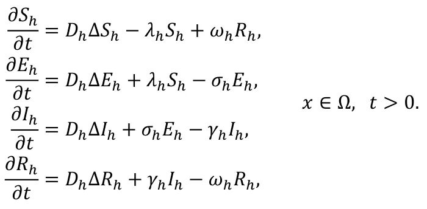

The questing adult mosquito subsystem represents females that are searching for hosts. The diffusion terms 𝐷𝑞Δ(⋅) model random movement, while the advection terms −∇⋅(𝜒ℎ𝑉ℎ ⋅) bias movement toward the center of human activity. Newly emerged adults enter the susceptible questing class through the maturation term 𝜈𝐿𝐿. The terms 𝜂𝑞𝑆𝑞, 𝜂𝑞𝐸𝑞, and 𝜂𝑞𝐼𝑞 transfer mosquitoes from questing to reproductive status after feeding, while the terms 𝜂𝑟𝑆𝑟, 𝜂𝑟𝐸𝑟, and 𝜂𝑟𝐼𝑟 return mosquitoes from the reproductive phase to the questing phase after oviposition. Infection of susceptible questing adults occurs through the term 𝜆𝑚𝑆𝑞, exposed questing adults progress to infectious questing adults at rate 𝜎𝑚, and all questing adults die due to age at rates 𝜇𝑞. The questing equations are

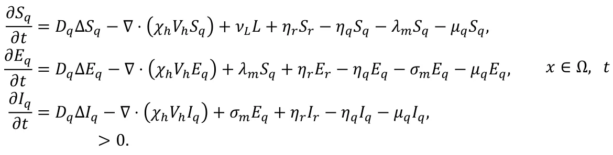

The reproductive adult mosquito subsystem represents gravid or oviposition-seeking females. The diffusion terms 𝐷𝑟Δ(⋅) describe random movement, while the advection terms −∇⋅(𝜒𝑤𝑉𝑤 ⋅) bias movement toward aquatic habitat. Mosquitoes enter this phase from the corresponding questing classes at rate 𝜂𝑞 and return to the questing phase at rate 𝜂𝑟. Exposed reproductive adults continue their latent development at rate 𝜎𝑚 even while seeking oviposition sites. All reproductive adults are also subject to age-related mortality through the terms 𝜇𝑟𝑆𝑟, 𝜇𝑟𝐸𝑟, and 𝜇𝑟𝐼𝑟. The reproductive equations are

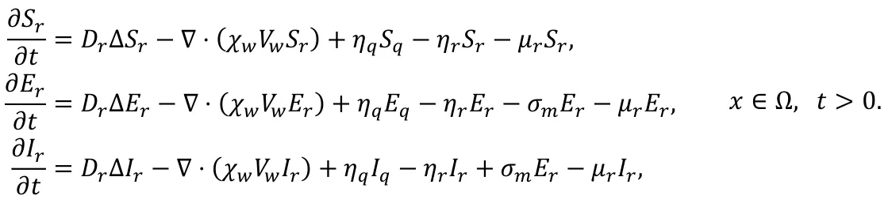

The larval mosquito equation is the key ecological bridge between fish-based control and epidemiological transmission. The diffusion term 𝐷𝐿Δ𝐿 represents limited dispersal within connected aquatic habitat. The recruitment term 𝑔𝑚𝑊(𝑥)𝑅𝑚 generates larvae from reproductive adult mosquitoes, so oviposition is restricted to water-bearing locations. The terms 𝜇𝐿𝐿 and 𝜈𝐿𝐿 represent natural larval mortality and maturation into adult mosquitoes, respectively, while 𝛼𝐿𝐿2 represents density-dependent crowding. Both fish populations may consume mosquito larvae. Accordingly, 𝛼𝑐𝐹𝑐𝐿 denotes larval consumption by the intervention fish and 𝛼𝑛𝐹𝑛𝐿 denotes larval consumption by the native fish. The larval dynamics are therefore

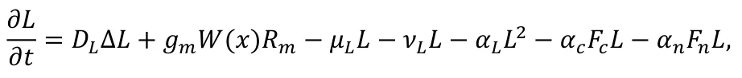

where 𝑥∈Ω𝑤.

The intervention fish equation combines local dispersal, density-dependent regulation, growth supported by larval consumption, natural mortality, and externally controlled pulse releases. The diffusion term 𝐷𝑐Δ𝐹𝑐 represents movement inside the aquatic network. Competition for local ecological capacity is represented by

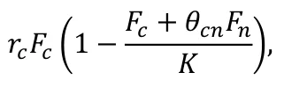

where 𝜃𝑐𝑛 measures the competitive effect of native fish on the intervention fish. The term 𝑞𝑐𝛼𝑐𝐹𝑐𝐿 converts larval consumption into intervention-fish growth, while 𝜇𝑐𝐹𝑐 represents natural mortality. To represent fish deployment as a pulse process, we define

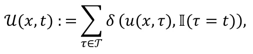

where 𝒯 is the set of release times, 𝕀(𝜏= 𝑡) is an indicator equal to 1 when 𝑡= 𝜏 and 0 otherwise, and 𝛿(𝑎, 1) = 𝑎 while 𝛿(𝑎, 0) = 0. The intervention-fish equation is therefore

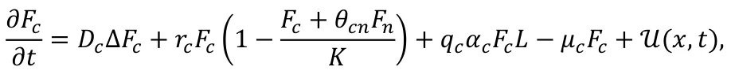

where 𝑥∈Ω𝑤.

The native-fish equation follows the same ecological structure but does not contain an external release term. Native fish disperse inside the aquatic habitat, compete with the intervention fish for ecological capacity, consume mosquito larvae, and experience natural mortality. Because native-fish predation contributes to the larval loss term in Eq. [eq:larva\_revised], the corresponding energetic contribution to native-fish growth is explicitly represented by 𝑞𝑛𝛼𝑛𝐹𝑛𝐿. Thus,

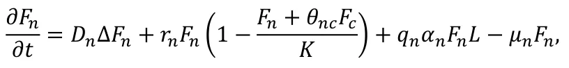

where 𝑥∈Ω𝑤. Here, 𝜃𝑛𝑐 measures the competitive effect of the intervention fish on the native population. This formulation ensures that larval consumption and the corresponding energetic gains are represented consistently for both fish populations.

Figure 1 presents a schematic view of this model. Each box stands for a eco-epidemiological state of one of the three species (humans, musthe The box with the double border is the intervention policy.

<figure id="fig-1">
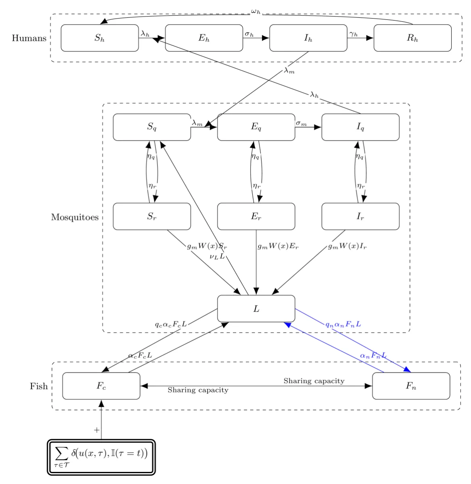
<figcaption>Figure 1. Schematic view of the coupled eco-epidemiological system. The box with the double border is the intervention policy.</figcaption>
</figure>

The full PDE system is completed with homogeneous no-flux boundary conditions on the outer city boundary and on the aquatic boundary, namely

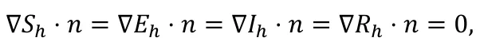

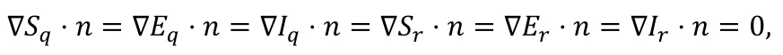

for 𝑥∈∂Ω, and

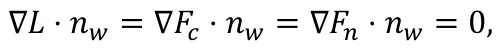

for 𝑥∈∂Ω𝑤. Initial conditions are taken to be nonnegative and spatially heterogeneous:

𝑆ℎ(𝑥, 0), 𝐸ℎ(𝑥, 0), 𝐼ℎ(𝑥, 0), 𝑅ℎ(𝑥, 0) ≥0, 𝑆𝑞(𝑥, 0), 𝐸𝑞(𝑥, 0), 𝐼𝑞(𝑥, 0) ≥0, 𝑆𝑟(𝑥, 0), 𝐸𝑟(𝑥, 0), 𝐼𝑟(𝑥, 0) ≥0, 𝐿(𝑥, 0), 𝐹𝑐(𝑥, 0), 𝐹𝑛(𝑥, 0) ≥0.

### 3.2 Agent-based simulation of the model

While the PDE system provides a compact description of transmission, predation, and ecological competition, its numerical realization is more naturally handled with an agent-based simulation (ABS) when movement is heterogeneous, contacts are local, and interventions are pulsed in space and time (Lazebnik 2025; Lorig et al. 2021; Alsharhan 2021). Agent-based epidemic models are particularly effective in such settings because they resolve interactions at the individual level and allow macroscopic patterns to emerge from movement and contact rules rather than from a homogeneous-mixing assumption (Eubank et al. 2004; Smith et al. 2018; Camponovo et al. 2024). Specifically, approximating PDE modeling using ABS allows the model to numerically solve complex geometries (Lazebnik and Friedman 2025). In malaria, this is especially useful because adult mosquito behavior alternates between host-seeking and oviposition-seeking phases, and because spatial hotspots depend on the relative placement of people, breeding sites, and intervention locations (Gu and Novak 2009; Pizzitutti et al. 2018).

Thus, we solve the model by replacing each continuous population field with a stochastic collection of agents or patch-level counters on a discrete spatial mesh. The spatial domain Ω is partitioned into square cells {𝐶𝑘}𝑘=1 𝑀 of side length ℎ, and time is advanced in steps of length Δ𝑡. Human agents are represented individually or as weighted agents when the local population is large. Adult mosquitoes are represented individually because infection, age, and behavioral phase must be tracked explicitly. Fish are also represented as individual agents when their numbers are moderate, whereas larvae are stored as patch-level counts on aquatic cells to avoid the prohibitive cost of one agent per larva. This mixed-resolution choice is consistent with hybrid ABM practice, where the most numerous and fastest entities are often aggregated while agents are retained for the organisms whose behavior drives the spatial dynamics (Cilfone et al. 2015; Marzban et al. 2021).

The simulation is initialized from the same spatially heterogeneous initial conditions as the PDE system. If 𝑌(𝑥, 0) denotes any initial density field, then the initial number of entities assigned to cell 𝐶𝑘 is sampled from 𝑁𝑘 𝑌(0) ∼Poisson (∫𝑌 (𝑥, 0) 𝑑𝑥). For 𝐶𝑘 humans this produces the initial susceptible, exposed, infectious, and recovered agent populations. For mosquitoes it generates the initial questing and reproductive adults in each epidemiological class. For aquatic habitat it generates the initial larval counts and the initial intervention and native fish populations. In this way, the ABM starts from a stochastic realization of the same macroscopic state used in the PDE formulation.

Human movement is updated first. If 𝑋𝑖 ℎ(𝑡) denotes the position of human agent 𝑖 at time 𝑡, then over one time step we use 𝑋𝑖 ℎ(𝑡+ Δ𝑡) = ΠΩ(𝑋𝑖 ℎ(𝑡) + √2𝐷ℎΔ𝑡 𝜉𝑖(𝑡)), where 𝜉𝑖(𝑡) ∼𝒩(0, 𝐼2) is a two-dimensional Gaussian increment and ΠΩ is a reflecting projection that keeps the agent inside the domain. This is the discrete random-walk analogue of the diffusion term in the human PDE. If commuting or routine movement is later added, a deterministic drift term can be inserted without changing the rest of the algorithm. Spatially explicit epidemic simulators often use precisely this kind of local movement rule to recover large-scale contact structure from individual trajectories (Eubank et al. 2004).

Adult mosquitoes are then moved according to their current behavioral phase. A questing mosquito is attracted toward human activity, while a reproductive mosquito is attracted toward water sources. If 𝑋𝑗 𝑞(𝑡) and 𝑋𝑗 𝑟(𝑡) denote the positions of questing and reproductive mosquitoes, respectively, then we update them by

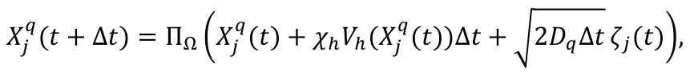

and

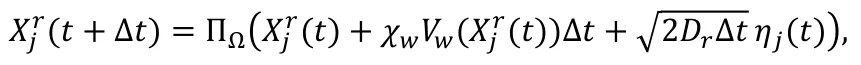

where 𝜁𝑗(𝑡), 𝜂𝑗(𝑡) ∼𝒩(0, 𝐼2). The drift fields 𝑉ℎ and 𝑉𝑤 are the same ones defined in the PDE section, so these update rules are the particle-level counterpart of the advection–diffusion operators. This movement mechanism mirrors malaria ABMs in which mosquitoes alternate between host-seeking and oviposition-seeking and switch from random search to directional movement when resources are detected (Gu and Novak 2009).

Disease transmission is evaluated after movement. Each questing mosquito searches for humans within a bite radius 𝑟𝑏. Let 𝐵𝑟𝑏(𝑥) denote the neighborhood of radius 𝑟𝑏 around location 𝑥. If human agent 𝑖 is susceptible and located at 𝑋𝑖 ℎ(𝑡), then its infection probability over one step is

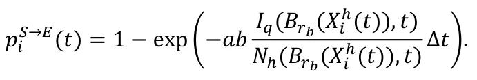

Similarly, if mosquito agent 𝑗 is susceptible and questing at location 𝑋𝑗 𝑞(𝑡), then its probability of becoming exposed is

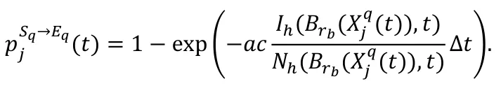

These Bernoulli transition rules are the stochastic counterpart of the incidence terms in the PDE system. They preserve local dependence on infectious mosquitoes and infectious humans while avoiding the artificial mixing that would occur if biting were evaluated only from domain-wide averages (Smith et al. 2018; Pizzitutti et al. 2018).

Latent progression, recovery, phase switching, and age-related mortality are then applied as independent stochastic events. If 𝑍 is a state governed by rate 𝜌, the probability that the corresponding transition occurs during one step is taken as 𝑝(𝜌) = 1 −exp(−𝜌Δ𝑡). Accordingly, exposed humans become infectious with probability 𝑝(𝜎ℎ), infectious humans recover with probability 𝑝(𝛾ℎ), recovered humans return to the susceptible class with probability 𝑝(𝜔ℎ) = 1 −exp(−𝜔ℎΔ𝑡), exposed mosquitoes in either adult phase become infectious with probability 𝑝(𝜎𝑚), questing mosquitoes switch to the reproductive phase with probability 𝑝(𝜂𝑞), and reproductive mosquitoes return to the questing phase with probability 𝑝(𝜂𝑟). Age-induced death is handled the same way, using probabilities 𝑝(𝜇𝑞) and 𝑝(𝜇𝑟) for questing and reproductive adults. This step is essential because the PDE model includes adult mortality explicitly, and malaria transmission is highly sensitive to adult survival (Aron and May 1982; Lou and Zhao 2011a).

Larval dynamics are updated on each aquatic cell after the reproductive mosquitoes have moved. Let 𝐿𝑘(𝑡) be the larval count in aquatic cell 𝐶𝑘 and let 𝑛𝑟,𝑘(𝑡) be the number of reproductive adult females currently in that cell. Before the local larval reaction processes are evaluated, limited larval dispersal between neighboring aquatic cells is applied as the discrete counterpart of the diffusion term 𝐷𝐿Δ𝐿. Let 𝒩𝑤(𝑘) denote the set of aquatic cells sharing an edge with aquatic cell 𝐶𝑘. For a square mesh, the probability of movement from 𝐶𝑘 to each adjacent aquatic cell during one simulation step is 𝑝𝐿 = 𝐷𝐿Δ𝑡 ℎ2 , where the numerical step is selected such that |𝒩𝑤(𝑘)|𝑝𝐿 ≤1. Conditional on the current larval count, the numbers moving to neighboring cells and the number remaining in the source cell are sampled jointly from a multinomial distribution. The resulting post-dispersal larval count is denoted by 𝐿𝑘 𝑑(𝑡) and is subsequently used in the local reaction processes.

New larvae are generated by oviposition according to

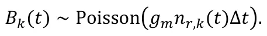

Natural mortality is sampled as

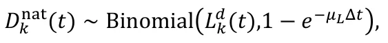

and maturation is sampled according to

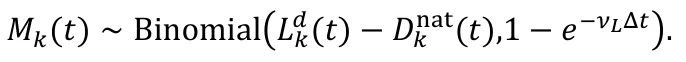

Density-dependent larval mortality is then represented by

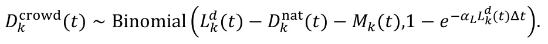

Defining

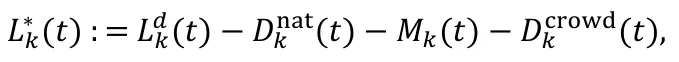

predation is sampled from the combined hazard generated by both fish populations:

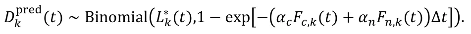

The updated larval population is therefore

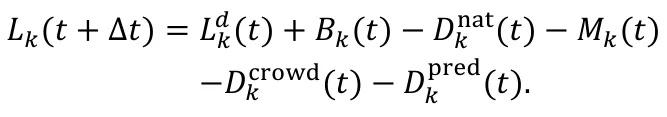

Thus, the stochastic predation hazard directly corresponds to the terms −𝛼𝑐𝐹𝑐𝐿− 𝛼𝑛𝐹𝑛𝐿 in Eq. [eq:larva\_revised]. Each matured larva contributes one new susceptible questing adult mosquito, which enters the host-seeking cycle during the next movement step.

This construction preserves the biological requirement that fish consume larvae rather than adults and that larvae are the source of new adult mosquitoes (Lou and Zhao 2011a).

Fish dynamics are updated on the same aquatic mesh. Each intervention fish and native fish remains inside Ω𝑤 and moves by a reflected random walk, defined by:

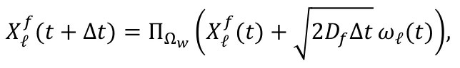

with 𝐷𝑓 = 𝐷𝑐 for intervention fish and 𝐷𝑓 = 𝐷𝑛 for native fish.

Reproduction, density-dependent regulation, and mortality are then sampled locally. If 𝐹𝑐,𝑘(𝑡) and 𝐹𝑛,𝑘(𝑡) denote the intervention- and native-fish counts in aquatic cell 𝐶𝑘, respectively, we define the local per-capita ecological growth components as

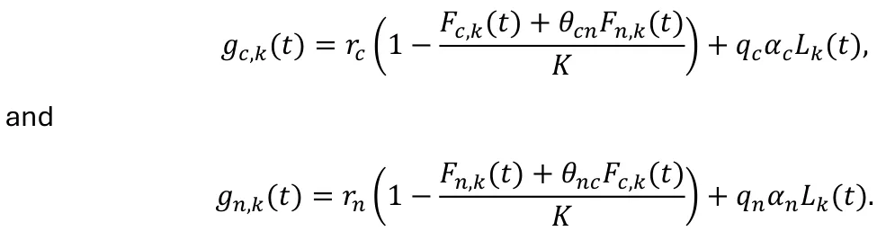

and To preserve both the positive and negative portions of the corresponding PDE reaction terms, positive ecological growth generates births, whereas negative ecological growth generates an additional density-dependent loss. For 𝑧∈{𝑐, 𝑛}, births are sampled according to 𝐵𝑧,𝑘(𝑡) ∼Poisson([𝑔𝑧,𝑘(𝑡)]+𝐹𝑧,𝑘(𝑡)Δ𝑡), where [𝑥]+ : = max(𝑥, 0).

The combined density-dependent and natural losses are sampled as

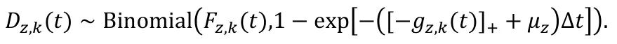

This construction preserves density-dependent decline when a local fish population exceeds its effective carrying capacity rather than representing competition solely through suppression of reproduction. It also maintains direct correspondence with the fish reaction terms in Eqs. [eq:control\_fish\_revised] and [eq:native\_fish\_revised].

The pulse release policy is implemented exactly at the prescribed intervention times. If 𝒯 is the release schedule and 𝑢(𝑥, 𝜏) is the release intensity chosen by either the offline or dynamic controller, then at every 𝜏∈𝒯 we add 𝑁𝑘rel(𝜏) = ⌊∫𝐶𝑘 𝑢(𝑥, 𝜏) 𝑑𝑥⌉ new intervention fish to aquatic cell 𝐶𝑘. This is the agent-based counterpart of the pulse term ∑𝜏∈𝒯 𝛿 (𝑢(𝑥, 𝜏), 𝕀(𝜏= 𝑡)) in the PDE formulation. In the offline strategy the map 𝑢(𝑥, 𝜏) is fixed before the simulation begins. In the dynamic strategy it is recomputed from monitored larval density, infectious human counts, and native-fish depletion at the designated observation times. Hybrid ABM frameworks commonly handle this kind of intervention by synchronizing discrete control actions with the simulation clock rather than by smearing releases over time (Cilfone et al. 2015; Marzban et al. 2021).

At the end of each time step, agent states are aggregated back to cell-level densities so that the simulation can be compared directly with the PDE variables. For example, if ℋ𝑘 𝑆(𝑡) is the set of susceptible human agents in cell 𝐶𝑘 at time 𝑡, then

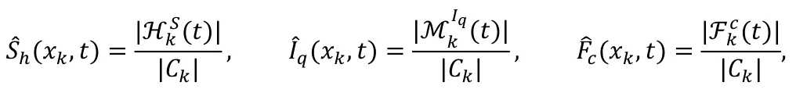

and similarly for the remaining compartments. These empirical fields are used to evaluate cumulative incidence, peak prevalence, larval suppression, and native-fish decline. Because the model is stochastic, all reported outcomes are estimated from multiple independent Monte Carlo realizations, and the main text reports means together with simulation intervals. This replication step is standard in malaria ABMs, where stochasticity in movement, contact, and local demography can substantially affect fine-scale outcomes even when the large-scale trend is stable (Smith et al. 2018; Pizzitutti et al. 2018).

Figure 2 presents a schematic view of the agent-based simulation, connecting the spatial reconstruction, the modeled agent classes, and the sequence of updates applied at each simulation step.

<figure id="fig-2">
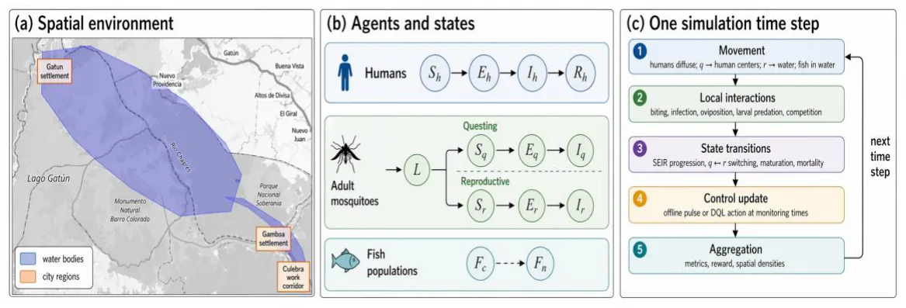
<figcaption>Figure 2. A schematic view of the agent-based simulation framework used to evaluate malaria control with larvivorous fish in a reconstructed Panama Canal Zone landscape. Panel (a) shows the spatial environment. Panel (b) summarizes the modeled agents and their epidemiological or ecological states. Panel (c) illustrates the sequence of updates within one simulation time step.</figcaption>
</figure>

### 3.3 Task formalization

The control objective in this study is inherently multi-objective. On the one hand, intervention fish should be released so as to suppress larval mosquitoes, reduce adult vector abundance, and ultimately decrease the human infection burden. On the other hand, the same intervention should avoid excessive ecological damage, especially depletion of the native fish population. In addition, because fish releases are operationally costly, the total amount of intervention should remain bounded. We therefore formulate the design problem as a constrained multi-objective optimization problem posed on top of the PDE–ABM dynamics.

Formally, let the intervention horizon be [0, 𝑇], and let the release times be 𝒯= {𝜏1, 𝜏2, … , 𝜏𝐾} ⊂[0, 𝑇]. At each release time 𝜏𝑘, the control variable is the spatial pulse intensity 𝑢𝑘(𝑥) = 𝑢(𝑥, 𝜏𝑘) for 𝑥∈Ω𝑤, which determines how many intervention fish are introduced at location 𝑥 in the aquatic habitat. The full control is therefore the sequence 𝑢= {𝑢1, 𝑢2, … , 𝑢𝐾}. In this context, we assume that releases are nonnegative and supported only on water-bearing cells, so the admissible control set is

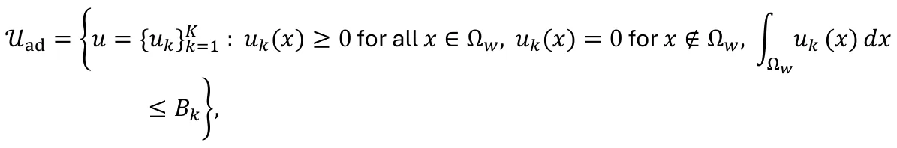

where 𝐵𝑘 is the release budget at pulse time 𝜏𝑘. The state of the system at time 𝑡 is denoted by 𝑿(𝑡) = (𝑆ℎ, 𝐸ℎ, 𝐼ℎ, 𝑅ℎ, 𝑆𝑞, 𝐸𝑞, 𝐼𝑞, 𝑆𝑟, 𝐸𝑟, 𝐼𝑟, 𝐿, 𝐹𝑐, 𝐹𝑛)(⋅, 𝑡), and evolves according to the continuous PDE formulation, while the agent-based model provides a stochastic grid-based approximation of the same movement, transition, interaction, and intervention mechanisms.

The first optimization metric is the cumulative epidemiological burden. This metric measures the total spatially aggregated infectious load in the human population over the intervention horizon. Since the most direct public-health target is to reduce human infection, we define

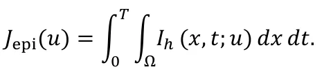

A smaller value of 𝐽epi corresponds to fewer infectious-person days and therefore to a more effective malaria-control strategy.

The second optimization metric is the ecological damage imposed on the native fish population. Because the goal is to preserve the native aquatic community, the intervention should keep the native fish population as close as possible to its reference trajectory in the absence of control. Let 𝐹𝑛 ref(𝑥, 𝑡) denote the native-fish density under the no-intervention baseline. We then define the cumulative native-fish loss by

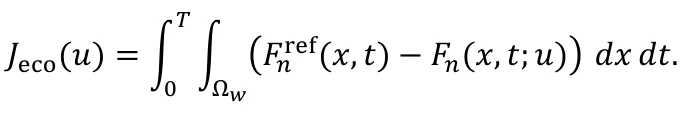

This quantity penalizes only depletion relative to the baseline state and therefore captures the ecological price of introducing the control fish.

The preceding two functionals define the main optimization criteria. In addition to them, we introduce a diagnostic metric that quantifies the relationship between infection and proximity to water sources. This quantity is not itself optimized, but it is used to analyze how the selected intervention redistributes infection risk across the city. Let 𝑑𝑤(𝑥) be the distance from 𝑥 to the nearest water source. The infection-weighted average distance to water is defined by

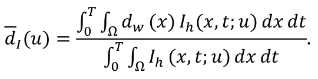

A smaller value of 𝑑𝐼 indicates that infection remains concentrated near water, whereas a larger value indicates broader inland spread. This metric is useful for interpreting whether an intervention successfully compresses malaria risk toward aquatic hotspots.

The intervention is evaluated through two distinct and potentially competing criteria, 𝑱(𝑢) = (𝐽epi(𝑢), 𝐽eco(𝑢)). We retain these two quantities separately when reporting policy performance so that the epidemiological–ecological trade-off remains explicit. Nonetheless, the optimization procedure used in the present experiments does not attempt to recover the complete Pareto-optimal set. Instead, both objectives are combined through one fixed normalized scalarization, denoted by Φ, and the reported offline policy is the minimizer of this scalar objective: 𝑢off ⋆ ∈ arg min 𝑢∈𝒰ad𝔼[Φ(𝑢)].

The dynamic monitoring strategy differs from the offline strategy in that the release at time 𝜏𝑘 is allowed to depend on the observed state of the system up to that time. Let 𝒪𝑘 denote the observation available at pulse time 𝜏𝑘. In the present study, this observation may include the monitored larval density, the local number of infectious humans, and the current state of the native fish population. A dynamic policy is therefore a sequence of feedback maps 𝜋= {𝜋1, 𝜋2, … , 𝜋𝐾} for 𝑢𝑘 = 𝜋𝑘(𝒪𝑘). Under such a policy, the control is no longer chosen all at once, but is generated adaptively from the state history. Since the ABM realization is stochastic, the dynamic problem is naturally posed in expectation. We define

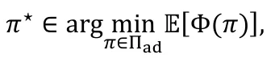

where Πad is the set of admissible feedback policies satisfying the same positivity and budget constraints as the offline controls. The expectation in Eq. [eq:dynamic\_problem] is taken over the stochasticity of the ABM simulation, including movement, contact, predation, maturation, and pulse outcomes.

### 3.4 Optimization algorithms

We solve the two intervention-design tasks with different optimization paradigms, reflecting the difference between one-shot planning and sequential feedback control. The offline problem is treated as an expensive black-box optimization problem and is solved with Bayesian optimization. The monitoring-based problem is treated as a sequential decision problem and is solved with deep Q-learning, implemented through a Double DQN architecture for improved stability (Lazebnik et al. 2023; Snoek et al. 2012; Frazier 2018; Mnih et al. 2015; Hasselt et al. 2016). Figure 3 presents a schematic view of these two policy learners.

<figure id="fig-3">
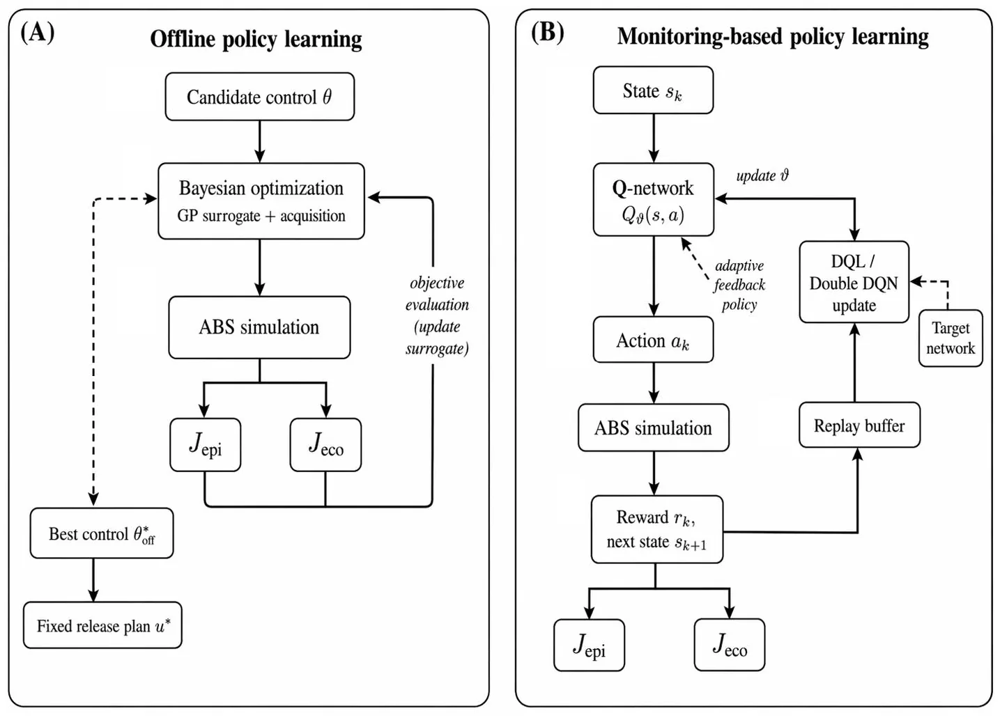
<figcaption>Figure 3. Schematic view of the two policy-learning frameworks considered in this study. Panel (A) illustrates the offline optimization pipeline. Panel (B) illustrates the monitoring-based optimization pipeline.</figcaption>
</figure>

#### 3.4.1 Offline optimization via Bayesian optimization

In the offline setting, all release decisions are chosen before the epidemic and ecological dynamics unfold. Rather than optimize the full field 𝑢(𝑥, 𝑡) directly, we introduce a finite-dimensional parameterization 𝜃∈Θ ⊂ℝ𝑑, where 𝜃 encodes the pulse magnitudes, spatial allocation weights, and, if desired, release timing parameters. For example, if releases are restricted to a set of candidate aquatic sites {𝑊1, … , 𝑊𝐽} and a fixed schedule 𝒯= {𝜏1, … , 𝜏𝐾}, then 𝜃 may consist of the coefficients 𝜃= {𝑢𝑘,𝑗}𝑘=1,…,𝐾 𝑗=1,…,𝐽 , with 𝑢𝑘,𝑗 denoting the amount of intervention fish released at site 𝑊𝑗 at pulse time 𝜏𝑘.

Given a parameter vector 𝜃, the simulator returns Monte Carlo estimates 𝐽̂epi(𝜃) and 𝐽̂eco(𝜃). These two objectives are converted to dimensionless quantities using positive normalization constants 𝑆epi and 𝑆eco:

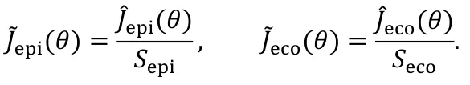

The scalar objective used by the optimizer is

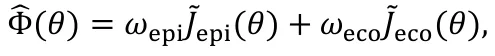

with equal weights 𝜔epi = 0.5, 𝜔eco = 0.5. The normalization constants are defined from the no-intervention Monte Carlo baseline as 𝑆epi = 𝔼[𝐽epi ∣ no intervention] and 𝑆eco = SD[𝐽eco ∣ no intervention]. Namely, the normalization constants are fixed before optimization and are not estimated separately for each candidate policy. As such, the optimization goal is

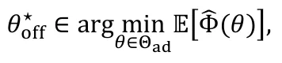

where Θad denotes the subset satisfying the positivity, budget, and ecological feasibility constraints.

Bayesian optimization proceeds iteratively. At iteration 𝑛, we have a dataset 𝒟𝑛 = {(𝜃(𝑖), 𝑦(𝑖))}𝑖=1 𝑛 such that 𝑦(𝑖) = Φ̂(𝜃(𝑖)). We place a Gaussian-process surrogate on the unknown objective Φ(𝜃) ∼𝒢𝒫(𝑚(𝜃), 𝑘(𝜃, 𝜃′)), and condition on 𝒟𝑛 to obtain a posterior mean 𝜇𝑛(𝜃) and posterior variance 𝜎𝑛 2(𝜃). The next candidate is selected by maximizing an acquisition function that balances exploration and exploitation. In the baseline implementation we use expected improvement in the form 𝛼𝑛(𝜃) = 𝔼 [max(0, Φmin (𝑛) −Φ(𝜃)) ∣𝒟𝑛], where Φmin (𝑛) = min1≤𝑖≤𝑛𝑦(𝑖). The next control parameter is then chosen as 𝜃(𝑛+1) ∈argmax𝜃∈Θad𝛼𝑛(𝜃). After simulating 𝜃(𝑛+1), the dataset is updated and the process repeats until the evaluation budget is exhausted.

This choice is well-suited to the offline problem because each simulator call is expensive, gradients are unavailable, the response surface is highly non-convex, and objective evaluations are noisy due to stochastic agent-based dynamics (Snoek et al. 2012; Frazier 2018). In practice, we return as the offline solution either the best observed feasible parameter vector 𝜃off ⋆ = argmin𝜃(𝑖)∈𝒟𝑁𝑦(𝑖), or the minimizer of the final posterior mean. The associated release field is then reconstructed from 𝜃off ⋆ and used throughout the full intervention horizon without further adaptation.

3.4.2 Monitoring-based optimization via deep Q-learning

In the monitoring-based setting, releases are updated sequentially at the observation times 𝒯= {𝜏1, 𝜏2, … , 𝜏𝐾}. This turns the control problem into a finite-horizon Markov decision process. At each monitoring time 𝜏𝑘, the controller observes a state vector 𝑠𝑘 summarizing the current epidemiological and ecological status of the system, chooses an action 𝑎𝑘 specifying the next pulse release, receives a reward 𝑟𝑘, and transitions to the next state 𝑠𝑘+1.

The state must be informative enough to support adaptive intervention while remaining low-dimensional enough for stable learning. We therefore define 𝑠𝑘 : = (𝑳𝑘, 𝑰ℎ,𝑘, 𝑭𝑐,𝑘, 𝑭𝑛,𝑘, 𝑏𝑘, 𝑘), where 𝑳𝑘 is a vector of larval densities across monitored aquatic zones, 𝑰ℎ,𝑘 is a vector of local infectious-human counts or densities, 𝑭𝑐,𝑘 and 𝑭𝑛,𝑘 summarize the intervention and native fish populations, 𝑏𝑘 is the remaining release budget, and 𝑘 is the current decision index. If desired, additional features such as distance-to-water summaries or recent trend indicators can be appended to the state.

Because Q-learning is naturally defined on discrete actions (Lazebnik 2023b), we discretize the release decision into a finite action set 𝒜= {𝑎(1), 𝑎(2), … , 𝑎(𝑀)}, where each action corresponds to a predefined pulse-allocation template. For example, one action may represent no release, another a small release in the highest-risk water patch, another a medium release split among the top two patches, and so on. If action 𝑎𝑘 = 𝑎(𝑚) is chosen at time 𝜏𝑘, the corresponding pulse field 𝑢(𝑥, 𝜏𝑘) is applied in the simulator.

The reward uses the same normalization constants and objective weights as the offline optimization so that the two controllers are evaluated under the same Δ𝐽epi,𝑘 epidemiological–ecological preference. Specifically, 𝑟𝑘 = −(𝜔epi 𝑆epi + Δ𝐽eco,𝑘 𝜔eco 𝑆eco ), where Δ𝐽epi,𝑘 and Δ𝐽eco,𝑘 are the incremental epidemiological burden and native-fish loss accumulated between 𝜏𝑘 and 𝜏𝑘+1, respectively. Thus, the offline and monitoring controllers use the same fixed scalarization, although one optimizes an open-loop control sequence and the other learns a sequential feedback policy. Under this definition, a policy that maximizes expected discounted return also minimizes the desired scalarized intervention loss.

We learn the policy with deep Q-learning. Let 𝑄𝜗(𝑠, 𝑎) be a neural-network approximation of the action-value function. Given a transition (𝑠𝑘, 𝑎𝑘, 𝑟𝑘, 𝑠𝑘+1), the standard DQN target is 𝑦𝑘 = 𝑟𝑘 + 𝛾max𝑎′∈𝒜𝑄𝜗‾ (𝑠𝑘+1, 𝑎′), where 𝛾∈(0,1] is the discount factor and 𝑄𝜗‾ is a slowly updated target network. To reduce overestimation bias, we use the Double DQN target

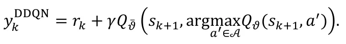

The online network parameters are updated by minimizing the temporal-difference loss

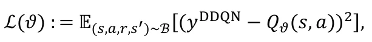

where ℬ is a replay buffer storing transitions collected from simulation episodes.

Action selection during training follows an 𝜀-greedy exploration rule (Bulut 2022):

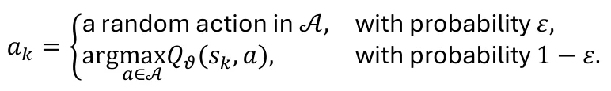

During evaluation, the learned monitoring policy is the greedy policy 𝜋DQL(𝑠) = argmax𝑎∈𝒜𝑄𝜗⋆(𝑠, 𝑎).

This monitoring algorithm is appropriate because the adaptive release task is inherently sequential: current releases affect future larvae, future adult abundance, future infections, and future ecological damage. Deep Q-learning is designed for precisely this class of delayed-reward decision problems, while target networks and replay improve stability, and the Double DQN modification mitigates the overestimation bias that can otherwise degrade performance (Mnih et al. 2015; Hasselt et al. 2016; Shuchami and Lazebnik 2025).

## 4 Numerical Analysis

We ground the experimental setting in a historically inspired reconstruction of the Panama Canal Zone during the U.S. construction period, with emphasis on the years 1905-1909 and on the Gatun Lake-Chagres River-Gamboa/Culebra corridor. This period is a suitable test case because malaria was a major constraint on canal construction, detailed records of malaria burden were kept for the workforce, and the landscape was strongly organized around water bodies, excavations, drainage structures, and settlements (Centers for Disease Control and Prevention 2025; Library of Congress 2025; University of South Florida 2025b). In particular, contemporary mosquito-control campaigns focused on eliminating breeding sites in standing water, swamps, pools, and drainage channels, and historical analyses of the canal environment indicate that both pre-existing wetlands and construction-driven land transformation contributed to mosquito proliferation (Harvard Library 2025; Arosemena Dı́az et al. 2023).

Our computational domain is therefore defined as a stylized spatial reconstruction of the central Canal Zone, around the Gamboa settlement. The reconstructed map includes the major water features of the corridor, namely the canal channel, the Chagres River system (University of South Florida 2025a, 2025c). We use this reconstructed geography to define aquatic habitat, candidate mosquito breeding patches, human population settlement, and potential release locations for intervention fish. Of note, the goal of this reconstruction is not to reproduce the historical epidemic exactly, but to create a realistic historically anchored testbed in which the spatial coupling among humans, mosquitoes, and aquatic habitat is realistic. Fig. 4 presents a schematic view of the area’s map with an overlay of the different areas of interest.

<figure id="fig-4">
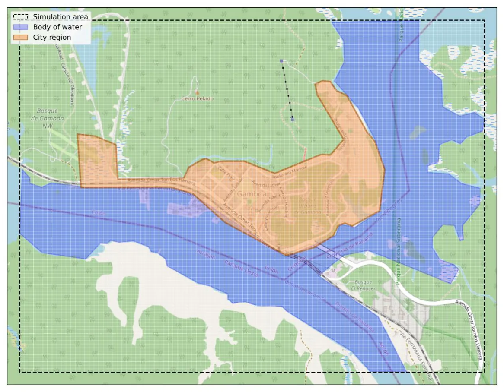
<figcaption>Figure 4. A schematic view of the use-case (Gamboa) area’s map. The white grid indicates the spatial discretizations used by the agent-based simulation.</figcaption>
</figure>

### 4.1 Experiments

All experiments are performed on the reconstructed Panama Canal Zone scenario introduced above, using the same spatial domain, the same aquatic network, and the same initial spatial distribution of humans, mosquitoes, intervention fish, and native fish. The simulation horizon is fixed to a single year ([0, 𝑇= 365]), and the PDE-ABM model is run under identical initial conditions across policies unless otherwise noted. Because the agent-based layer is stochastic, every experiment is repeated over 𝑛= 100 independent realizations. Reported policy scores are therefore based on sample means together with variability bands or confidence intervals.

First, we simulate the system without intervention fish release and observe how larval production in aquatic habitat generates adult mosquito movement, how the alternation between questing and reproductive phases structures mosquito space use, and how human infections emerge in relation to water sources and settlement regions. This experiment serves two purposes. It provides a sanity check for the dynamical model, and it establishes the no-intervention reference trajectories against which the optimized strategies will later be compared.

Second, in order to interpret the gains produced by the optimized controllers, we also include a no-intervention reference baseline. This analysis is organized around a direct policy comparison under identical stochastic environments. For each policy, we record the temporal evolution of larval burden, infectious human prevalence, intervention-fish density, and native-fish density. We then compare the final policy performance through the two optimization metrics defined earlier. The goal is not only to determine which strategy produces the smallest cumulative infection burden, but also to reveal the epidemiological–ecological trade-off induced by each policy.

Third, a sensitivity analysis focuses on central parameters. The first parameter is the mosquito biting rate 𝑎, which directly modulates force of infection and therefore changes the transmission intensity faced by both policies. The second parameter is the larval recruitment rate 𝑔𝑚, which controls the productivity of aquatic habitat and determines how rapidly mosquito populations can rebound after predation. The third parameter is the intervention-fish predation rate 𝛼𝑐, which captures how effective the control fish is at suppressing larvae. The fourth parameter is the competitive effect 𝜃𝑛𝑐 of the intervention fish on the native fish, since this term directly mediates the ecological cost of strong intervention. Technically, in each sensitivity experiment, one parameter is varied over a prescribed range while all remaining parameters are kept at their baseline values. For every value in the sweep, we re-evaluate the offline Bayesian-optimized strategy and the DQL monitoring strategy under the same simulation protocol and compare their performance metrics.

Table 1 summarizes the model parameters and their baseline values. The values combine values adopted from previous mathematical malaria models, biological-control literature, and explicit modeling assumptions. The stated uncertainty intervals are scenario-analysis ranges rather than empirical confidence intervals.

<figure class="table-figure" id="table-1">
<figcaption>Table 1. Model’s parameters with their default values.</figcaption>

<table style="overflow-wrap:normal"><tr><th>Parameter</th><th>Description</th><th>Default value</th><th>Source</th></tr><tr><td>𝐷ℎ</td><td>Human diffusion coefficient</td><td>5 km2/day</td><td>(Li et al. 2023)</td></tr><tr><td>𝐷𝑞</td><td>Diffusion coefficient of questing adult mosquitoes</td><td>0.03 km2/day</td><td>(Thomas et al. 2013)</td></tr><tr><td>𝐷𝑟</td><td>Diffusion coefficient of reproductive adult mosquitoes</td><td>0.015 km2/day</td><td>(Thomas et al. 2013; Chitnis et al. 2010)</td></tr><tr><td>𝐷𝐿</td><td>Larval diffusion coefficient within aquatic habitat</td><td>10−5 km2/day</td><td>(Lutz et al. 2020)</td></tr><tr><td>𝐷𝑐</td><td>Diffusion coefficient of intervention fish</td><td>10−3 km2/day</td><td>(National Center for Vector Borne Diseases Control n.d.)</td></tr><tr><td>𝐷𝑛</td><td>Diffusion coefficient of native fish</td><td>10−3 km2/day</td><td>(National Center for Vector Borne Diseases Control n.d.; Food and Agriculture Organization of the United Nations n.d.)</td></tr><tr><td>𝜒ℎ</td><td>Advection strength toward the center of human activity</td><td>0.20 day−1</td><td>(Lou and Zhao 2010)</td></tr><tr><td>𝜒𝑤</td><td>Advection strength toward water sources</td><td>0.25 day−1</td><td>(Lou and Zhao 2010)</td></tr><tr><td>𝑎</td><td>Mosquito biting rate</td><td>0.5 day−1</td><td>(Lou and Zhao 2011a)</td></tr><tr><td>𝑏</td><td>Transmission probability from mosquito to human per bite</td><td>0.5</td><td>(Lou and Zhao 2011a)</td></tr><tr><td>𝑐</td><td>Transmission probability from human to mosquito per bite</td><td>0.5</td><td>(Lou and Zhao 2011a)</td></tr><tr><td>𝜎ℎ</td><td>Human incubation rate</td><td>1/12 day−1</td><td>(Aron and May 1982)</td></tr><tr><td>𝛾ℎ</td><td>Human recovery rate</td><td>0.3 day−1</td><td>(Lou and Zhao 2011a)</td></tr><tr><td>𝜔ℎ</td><td>Waning immunity rate</td><td>0.02 day−1</td><td>(Tilahun 2017)</td></tr><tr><td>𝜎𝑚</td><td>Mosquito incubation rate</td><td>1/12 day−1</td><td>(Chitnis et al. 2010; Ohm et al. 2018)</td></tr><tr><td>𝜂𝑞</td><td>Transition rate from questing phase to reproductive phase</td><td>1 day−1</td><td>(Quiñones et al. 1997; Forattini et al. 2002)</td></tr><tr><td>𝜂𝑟</td><td>Transition rate from reproductive phase back to questing phase</td><td>1/2 day−1</td><td>(Quiñones et al. 1997; Forattini et al. 2002)</td></tr><tr><td>𝑔𝑚</td><td>Larval recruitment rate per reproductive adult mosquito</td><td>30 larvae mosquito−1day−1</td><td>(Lou and Zhao 2011a)</td></tr><tr><td>𝜇𝐿</td><td>Larval natural mortality rate</td><td>0.1 day−1</td><td>(Lou and Zhao 2011a)</td></tr><tr><td>𝜈𝐿</td><td>Larval maturation rate to adult mosquitoes</td><td>1/16 day−1</td><td>(Lou and Zhao 2011a)</td></tr><tr><td>𝛼𝐿</td><td>Density-dependent larval crowding coefficient</td><td>0.05 day−1</td><td>(Lou and Zhao 2011a)</td></tr><tr><td>𝜇𝑞</td><td>Age-related mortality rate of questing adult mosquitoes</td><td>0.1 day−1</td><td>(Lou and Zhao 2011a)</td></tr><tr><td>𝜇𝑟</td><td>Age-related mortality rate of reproductive adult mosquitoes</td><td>0.1 day−1</td><td>(Lou and Zhao 2011a)</td></tr><tr><td>𝛼𝑐</td><td>Effective predation coefficient of intervention fish on larvae</td><td>0.03 m2 fish−1day−1</td><td>(Lou and Zhao 2011a)</td></tr><tr><td>𝛼𝑛</td><td>Effective predation coefficient of native fish on larvae</td><td>0.004 m2 fish−1day−1</td><td>(Chala et al. 2016)</td></tr><tr><td>𝑞𝑐</td><td>Effective conversion from consumed larvae to intervention-fish population growth</td><td>5 ⋅10−4 fish larva−1</td><td>(Lou and Zhao 2011a)</td></tr><tr><td>𝑞𝑛</td><td>Effective conversion from consumed larvae to native-fish population growth</td><td>2 ⋅10−4 fish larva−1</td><td>Model assumption</td></tr><tr><td>𝑟𝑐</td><td>Intrinsic growth rate of intervention fish</td><td>0.3 day−1</td><td>(National Center for Vector Borne Diseases Control n.d.)</td></tr><tr><td>𝑟𝑛</td><td>Intrinsic growth rate of native fish</td><td>0.01 day−1</td><td>(National Center for Vector Borne Diseases Control n.d.)</td></tr><tr><td>𝜇𝑐</td><td>Mortality rate of intervention fish</td><td>1/365 day−1</td><td>(Lou and Zhao 2011a)</td></tr><tr><td>𝜇𝑛</td><td>Mortality rate of native fish</td><td>1/(4 ⋅365) day−1</td><td>(National Center for Vector Borne Diseases Control n.d.)</td></tr><tr><td>𝐾</td><td>Carrying capacity of the fish population</td><td>80 per 𝑚2</td><td>(National Center for Vector Borne Diseases Control n.d.)</td></tr><tr><td>𝜃𝑐𝑛</td><td>Competitive effect of native fish on intervention fish</td><td>0.05</td><td>(Food and Agriculture Organization of the United Nations n.d.)</td></tr><tr><td>𝜃𝑛𝑐</td><td>Competitive effect of intervention fish on native fish</td><td>0.05</td><td>(Food and Agriculture Organization of the United Nations n.d.)</td></tr></table>

</figure>

To complement the one-at-a-time sensitivity analysis, we performed a global uncertainty and sensitivity analysis in which the ecological and entomological parameters were varied jointly. The analysis included 𝑔𝑚, 𝛼𝑐, 𝛼𝑛, 𝜇𝑞, 𝜇𝑐, 𝜇𝑛, 𝑟𝑐, 𝑟𝑛, 𝐾, and 𝜃𝑛𝑐. Each parameter was varied over the scenario range reported in Table 3. These ranges are intended as scenario-analysis ranges. We first generated 500 joint parameter sets using Latin hypercube sampling (LHS) (Helton and Davis 2003). The normalized LHS coordinates were sampled over [0,1] and mapped linearly to the corresponding parameter ranges. For each sampled parameter set, we evaluated the no intervention, the fixed offline policy, and the fixed monitoring DQL policy. For each parameter set and policy, we ran 10 stochastic realizations. The same replicate seeds were paired across policies at each parameter set. We recorded the sample mean and standard deviation across the 10 realizations for 𝐽epi, 𝐽eco, peak human infectious prevalence, final human infectious prevalence, and the minimum native-fish abundance over the one-year simulation horizon. We also performed Morris elementary-effects screening (Sin and Gernaey 2009) on the same 10 parameters. The Morris design used 20 trajectories on the normalized parameter space, producing 20(10 + 1) = 220 design points, with a normalized step size Δ = 0.6. Each Morris design point was again evaluated with 10 paired stochastic realizations under the policies. For 𝐽epi and 𝐽eco, we report the mean absolute elementary effect 𝜇∗ and the standard deviation of the elementary effects 𝜎.

### 4.2 Results

Figure 5 shows the year-long evolution of all model compartments under the three policies. Without intervention (Figure 5a), the larval population rapidly saturates the aquatic habitat and remains elevated throughout the simulation, while the human infectious compartments remain non-zero over the modeled one-year horizon. No intervention fish are added under this policy, and the native-fish population grows toward its carrying capacity. Both active intervention policies substantially suppress human infection relative to the no-intervention baseline. Under the offline Bayesian optimization strategy (Figure 5b), the intervention-fish population expands across the channel network by approximately day 60, after which larval abundance progressively declines. The infected human compartments decline to zero at approximately day 175 within the simulated horizon. Under the monitoring strategy (Figure 5c), infection is similarly suppressed, with the infected human compartments reaching zero at approximately day 200, while a small residual larval population remains. In particular, the no-intervention trajectory does not undergo spontaneous extinction during the one-year experiment, whereas both intervention strategies strongly reduce the cumulative burden and prevalence.

<figure id="fig-5">
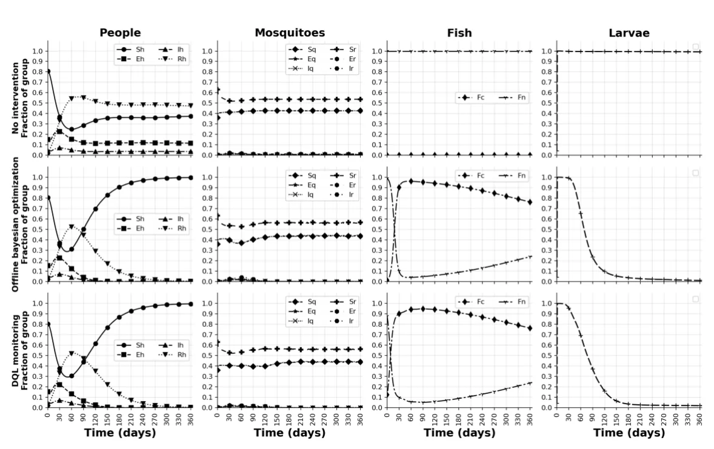
<figcaption>Figure 5. Compartment dynamics over one year.</figcaption>
</figure>

Figure 6 presents the normalized cumulative infection as a function of distance to the nearest water cell, i.e. the spatial profile underlying the diagnostic 𝑑𝐼 of Eq. [eq:Dwater\_metric] for the no-intervention case. Infection is strongly concentrated near water. About 44% of the cumulative burden falls within about 450 m of water, and about 80% within approximately 1000 m. The three policy curves are indistinguishable. That is, the interventions reduce the magnitude of infection but not its spatial distribution. This confirms that 𝑑𝐼 reflects the fixed geometry of the human-water configuration rather than differences between strategies.

<figure id="fig-6">
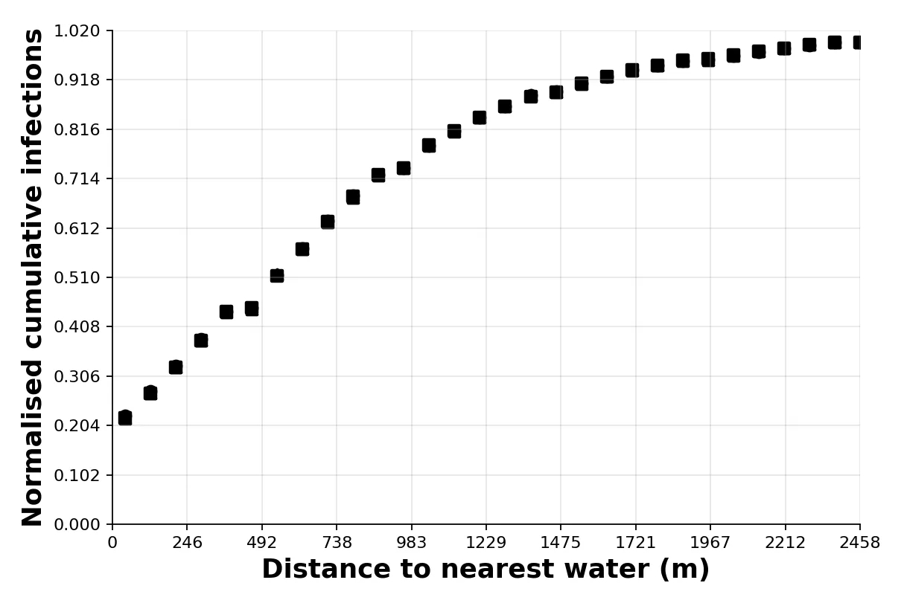
<figcaption>Figure 6. Normalized cumulative infection versus distance to the nearest water cell (the spatial profile underlying Eq. [eq:Dwater\_metric]).</figcaption>
</figure>

Figure 7 shows the spatial densities of larvae 𝐿, native fish 𝐹𝑛, and intervention fish 𝐹𝑐 across the aquatic domain on days 0, 180, and 360, respectively. Without intervention (Figure 7a) the larval population saturates the channels, and no intervention fish are present. Under both intervention policies (Figures 7b-7c), the intervention-fish population saturates the channels and the larval field remains low throughout, except for a weak residual near the outbreak region. Both the offline and the monitoring policies flood essentially the entire channel network rather than concentrating fish in a sub-region. Thus, little spatial structure remains for a policy to exploit. The difference is that the monitoring policy leaves a marginally stronger residual larval bloom and slightly lower intervention-fish density in peripheral cells.

<figure id="fig-7">
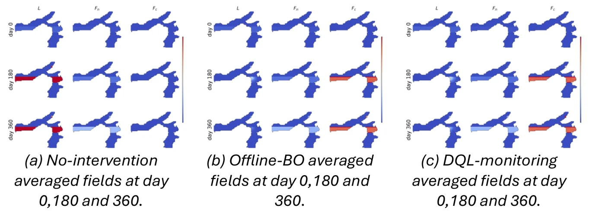
<figcaption>Figure 7. No-intervention (a), offline bayesian optimization (b) and DQL-monitoring (c) averaged fields at day 0,180 and 360: larvae 𝐿, native fish 𝐹𝑛, and intervention fish 𝐹𝑐 over the aquatic domain.</figcaption>
</figure>

Figure 8 shows the normalized 𝐽epi (left column) and 𝐽eco (right column), each as a function of the four swept parameters. The epidemiological burden is sensitive to the biting rate 𝑎, the larval recruitment 𝑔𝑚, and the predation rate 𝛼𝑐. It increases sharply with 𝑎 (from about 0.4 to 1.45 times the baseline) and with 𝑔𝑚. However, it is less sensitive to the competition coefficient 𝜃𝑛𝑐. As one can see in the 𝛼𝑐 panel, at low predation rate both policies are above baseline burden (∼1.6–1.8 factor). As 𝛼𝑐 increases, the burden rapidly falls to the baseline level, after which further increases provide little additional benefit. In contrast, the ecological cost is sensitive to 𝜃𝑛𝑐 (rises to about 7.7 times the baseline as 𝜃𝑛𝑐 grows), while is nearly flat in 𝑎, 𝑔𝑚, and 𝛼𝑐. This identifies intervention-native competition as the dominant lever on native-fish preservation. The two policies respond similarly across most parameter sweeps. However, the monitoring strategy’s burden rises more sharply at high recruitment 𝑔𝑚. This reduction in epidemiological performance is accompanied by a lower ecological cost, which remains at or below that of the offline strategy throughout the 𝑎, 𝑔𝑚, and 𝛼𝑐 sweeps. The difference is most pronounced at high 𝑔𝑚, where the monitoring strategy reduces the ecological cost to about 0.92 times the baseline value.

<figure id="fig-8">
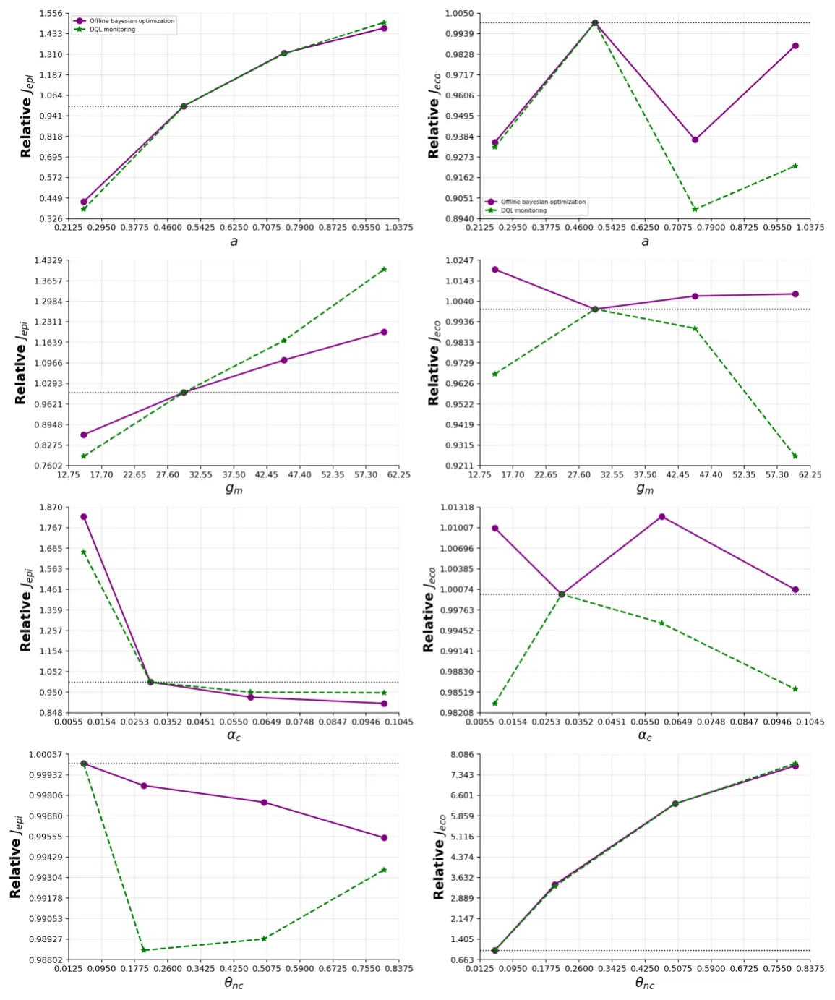
<figcaption>Figure 8. Parameter sensitivity of 𝐽𝑒𝑝𝑖 (left) and 𝐽𝑒𝑐𝑜 (right), normalized to baseline, for the biting rate 𝑎, recruitment 𝑔𝑚, predation rate 𝛼𝑐, and competition 𝜃𝑛𝑐 (rows), comparing the offline and monitoring policies.</figcaption>
</figure>

Figure 9 presents the joint distribution of epidemiological improvement and ecological outcome across the independent stochastic evaluation replicates of the two selected policies. Importantly, each cloud represents repeated realizations of one fixed optimized policy and therefore should not be interpreted as a Pareto front over alternative control policies. The offline strategy averts 69.5% of the no-intervention cumulative infection burden on average, whereas the monitoring strategy averts 66.4%. The offline realizations are more tightly clustered, indicating lower outcome variability under stochastic simulation, while the monitoring policy produces a broader range of epidemiological and ecological outcomes.

<figure id="fig-9">
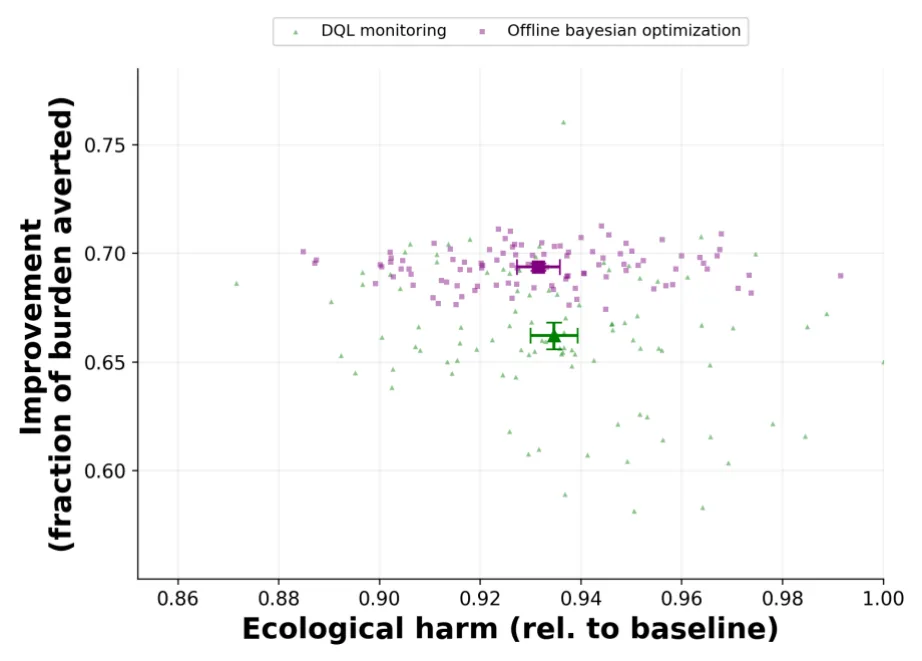
<figcaption>Figure 9. Joint epidemiological and ecological outcomes across stochastic evaluation replicates of the fixed offline and monitoring policies. Each point represents one independent realization.</figcaption>
</figure>

The global LHS analysis showed that both intervention policies reduced the cumulative epidemiological burden relative to no intervention throughout the 500 sampled parameter combinations. The fixed offline policy had a lower 𝐽epi than no intervention in all 500 parameter sets, with a median reduction of 72.0%. The corresponding median reduction under the fixed DQL policy was 64.2%. Across the sampled designs, the 2.5th-97.5th percentile ranges of the relative burden reduction were 21.5-77.4% for the offline policy and 16.9-69.1% for DQL. The offline policy produced a lower 𝐽epi than DQL in all 500 sampled parameter sets. The ecological objective showed the opposite policy ordering in nearly all sampled designs. The DQL policy produced a lower 𝐽eco than the offline policy in 497 of 500 parameter sets. The median 𝐽eco across the 500 designs was 2.106 × 106 for the offline policy and 1.807 × 106 for DQL. On a paired basis, the median reduction in 𝐽eco under DQL relative to the offline policy was 9.5%. Thus, under joint parameter uncertainty, the fixed offline controller consistently achieved the lower epidemiological burden, while the monitoring controller generally imposed the lower modeled ecological cost. Final infectious prevalence was lower than under no intervention at all 500 sampled parameter sets for both active policies. Its mean value was exactly zero across the 10 replicates in 437 of 500 offline designs and 410 of 500 DQL designs. Peak infectious prevalence changed comparatively little as the peak often occurred before the interventions had generated their full downstream effect. The minimum native-fish abundance remained equal to the initial native-fish abundance in 486 of 500 offline designs and 494 of 500 DQL designs.

Figure 10 and Table 2 present the global Morris sensitivity results for the fixed offline and monitoring DQL policies. For 𝐽epi, the largest 𝜇∗ values under both policies were associated with 𝜇𝑞, 𝛼𝑐, and 𝑔𝑚, followed by 𝐾 and 𝑟𝑐. For the offline policy, 𝜇∗ = 20,050 for 𝜇𝑞, 15,242 for 𝛼𝑐, and 9,135 for 𝑔𝑚. For DQL, the corresponding values were 24,602, 13,893, and 12,666. 𝐽eco was dominated by 𝜃𝑛𝑐 and 𝑟𝑛, with 𝐾 a distant third. For the offline policy, 𝜇∗ = 4.41 × 106 for 𝜃𝑛𝑐 and 4.01 × 106 for 𝑟𝑛. For DQL, the corresponding values were 4.17 × 106 and 3.69 × 106. Several of the dominant factors also had large 𝜎 relative to 𝜇∗, indicating substantial variation in their elementary effects across the joint parameter space.

<figure id="fig-10">
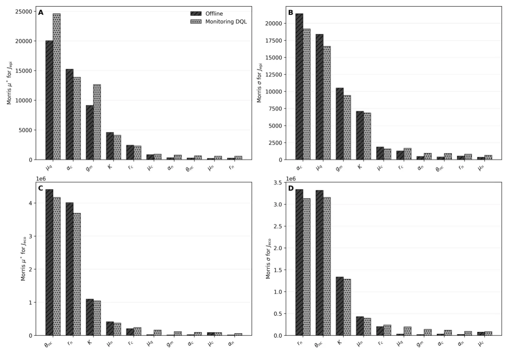
<figcaption>Figure 10. Global Morris sensitivity analysis for the fixed offline and monitoring DQL policies. Panels A and B show the Morris mean absolute elementary effect 𝜇∗ and elementary-effect standard deviation 𝜎, respectively, for 𝐽𝑒𝑝𝑖. Panels C and D show the corresponding quantities for 𝐽𝑒𝑐𝑜.</figcaption>
</figure>

<figure class="table-figure" id="table-2">
<figcaption>Table 2. Morris elementary-effects indices for the fixed offline and monitoring DQL policies. Each entry is based on 20 elementary effects.</figcaption>

<table style="overflow-wrap:normal"><tr><th rowspan="3">Parameter</th><th colspan="4">𝐽epi</th><th colspan="4">𝐽eco</th></tr><tr><th colspan="2">𝜇∗</th><th colspan="2">𝜎</th><th colspan="2">𝜇∗</th><th colspan="2">𝜎</th></tr><tr><th>Offline</th><th>DQL</th><th>Offline</th><th>DQL</th><th>Offline</th><th>DQL</th><th>Offline</th><th>DQL</th></tr><tr><td>𝑔𝑚</td><td>9,135.1</td><td>12,665.8</td><td>10,508.5</td><td>9,424.9</td><td>16,067.8</td><td>1.144e+05</td><td>20,896.3</td><td>1.389e+05</td></tr><tr><td>𝛼𝑐</td><td>15,242.1</td><td>13,893.3</td><td>21,414.0</td><td>19,187.3</td><td>20,941.7</td><td>93,049.1</td><td>31,871.7</td><td>1.204e+05</td></tr><tr><td>𝛼𝑛</td><td>332.8</td><td>767.7</td><td>477.2</td><td>938.0</td><td>16,120.2</td><td>62,455.7</td><td>23,756.0</td><td>94,363.6</td></tr><tr><td>𝜇𝑞</td><td>20,050.3</td><td>24,601.6</td><td>18,398.4</td><td>16,628.7</td><td>20,367.6</td><td>1.596e+05</td><td>31,117.5</td><td>1.947e+05</td></tr><tr><td>𝜇𝑐</td><td>840.3</td><td>931.2</td><td>1,862.4</td><td>1,578.8</td><td>87,251.0</td><td>85,252.7</td><td>76,023.9</td><td>86,932.2</td></tr><tr><td>𝜇𝑛</td><td>217.9</td><td>593.0</td><td>365.8</td><td>641.4</td><td>4.138e+05</td><td>3.729e+05</td><td>4.289e+05</td><td>3.931e+05</td></tr><tr><td>𝑟𝑐</td><td>2,446.1</td><td>2,307.6</td><td>1,285.0</td><td>1,679.4</td><td>2.039e+05</td><td>2.375e+05</td><td>2.001e+05</td><td>2.405e+05</td></tr><tr><td>𝑟𝑛</td><td>264.0</td><td>583.0</td><td>533.7</td><td>805.9</td><td>4.011e+06</td><td>3.692e+06</td><td>3.339e+06</td><td>3.132e+06</td></tr><tr><td>𝐾</td><td>4,588.6</td><td>4,113.1</td><td>7,088.9</td><td>6,842.0</td><td>1.097e+06</td><td>1.042e+06</td><td>1.337e+06</td><td>1.287e+06</td></tr><tr><td>𝜃𝑛𝑐</td><td>279.2</td><td>647.9</td><td>397.1</td><td>896.3</td><td>4.410e+06</td><td>4.170e+06</td><td>3.319e+06</td><td>3.158e+06</td></tr></table>

</figure>

## 5 Discussion

In this study, we developed a spatio-temporal eco-epidemiological framework that links malaria transmission, mosquito movement and reproduction, and competition between an introduced larvivorous fish population and a native fish population. The main purpose was to examine whether spatially targeted biological control can reduce human infection burden while limiting ecological damage. Across the simulated Panama Canal Zone scenario, the results indicate that aquatic habitat structure strongly organizes both vector production and human risk, that the epidemiological differences among active policies are modest at the reported mean scale, and that the dominant policy differences emerge more clearly through ecological loss. In particular, the fixed offline policy achieves somewhat stronger epidemiological control, whereas the monitoring policy generally incurs a lower ecological cost, indicating that the principal distinction between the two strategies lies in the epidemiological-ecological trade-off.

The intervention results also support the general rationale for larval source management. Because larvae are spatially constrained to identifiable aquatic habitat, suppressing the larval stage can propagate through the mosquito life cycle and reduce downstream human infections (Bousema et al. 2012). This is consistent with the argument that larval control is most promising when breeding habitats are sufficiently fixed, findable, and operationally manageable (Fillinger and Lindsay 2011). In the present model, both optimized policies exploit this structure and avert a large fraction of the no-intervention infection burden. At the same time, the interventions do not substantially change the shape of the infection-distance curve. Thus, fish release primarily reduces the intensity of transmission generated by water-associated habitats, rather than relocating risk or changing the underlying spatial geometry of exposure.

The comparison between the offline and monitoring policies is especially informative. The offline Bayesian-optimized policy achieves slightly stronger and more consistent epidemiological performance in the main experiment, whereas the monitoring policy accepts a small residual larval burden and produces a somewhat slower decline in infectious prevalence. In both intervention cases, the infectious compartments eventually reach zero within the one-year baseline simulation. This does not mean that monitoring is ineffective. Rather, it indicates that, in the reconstructed canal landscape, both policies quickly populate much of the connected aquatic network, leaving limited spatial structure for feedback control to exploit. The advantage of monitoring therefore appears less as a large gain in mean infection reduction and more as a mechanism for managing ecological and parametric uncertainty. This interpretation is consistent with integrated vector management principles, in which surveillance and adaptive decision-making are valuable because they help match control intensity to local conditions rather than simply maximizing intervention everywhere (Beier et al. 2008). Moreover, the sensitivity analysis clarifies this trade-off mechanistically. Epidemiological outcomes are most sensitive to the biting rate, larval recruitment, and intervention-fish predation rate. In contrast, ecological loss is dominated by the competition coefficient between intervention fish and native fish. This separation is important because it implies that the parameters governing infection control are not necessarily the same as those governing ecological harm. Increasing predation can improve control up to a saturation point, but stronger competition with native fish can increase ecological damage without proportional epidemiological gain. Therefore, the most important practical question is not only whether the introduced fish consumes larvae efficiently, but whether it can do so without exerting excessive competitive pressure on native aquatic species (Pyke 2008).

The global analysis clarifies that the epidemiological and ecological objectives are governed by different parts of the coupled system. Variation in 𝐽epi is driven primarily by adult-mosquito mortality 𝜇𝑞, intervention-fish predation 𝛼𝑐, and larval recruitment 𝑔𝑚, which directly control the production and persistence of infectious vectors. By contrast, variation in 𝐽eco is dominated by the competitive effect 𝜃𝑛𝑐, the native-fish growth rate 𝑟𝑛, and the shared carrying capacity 𝐾. The comparatively large Morris 𝜎 values for several dominant factors further show that the effect of a parameter can depend strongly on the joint values of the other parameters. At the policy level, the global LHS experiment preserved the same qualitative epidemiological-ecological trade-off across almost all sampled parameter sets. The fixed offline policy yielded the lower cumulative infection burden in all 500 designs, while DQL yielded the lower ecological cost in 497 of 500.

From an applied perspective, the model suggests that control planners should not think in terms of blanket fish introduction across all water bodies. Rather, explicit monitoring of native-fish response, and willingness to use adaptive policies when initial population sizes are uncertain and when the area’s topology is complex. As such, policymakers can use the proposed model as a decision-support tool for similar outbreak regions.

This study is not without limitations. First, the spatial domain is historically grounded but still stylized, so the reconstructed Panama Canal landscape is better interpreted as a realistic testbed than as a calibrated historical reconstruction - making the obtained results more generic on the one hand but less useful for the exact use-case, on the other hand. Second, the ABS implementation is a computational approximation of the PDE system and uses hybrid aggregation for larvae and some local populations, which may smooth fine-scale stochastic effects. Third, fish ecology is simplified to competition, growth, mortality, and larval predation, without explicit age structure, trophic cascades, or broader community interactions (Walters and Martell 2004). Fourth, the baseline epidemiological experiment does not include demographic turnover or exogenous reintroduction of malaria infection. Assessing long-term elimination would require explicit modeling of imported infections, population turnover, repeated introductions, and longer-term transmission dynamics. Finally, the epidemiological subsystem is a reduced phenomenological host–vector model designed to connect human infection burden to mosquito abundance and larval control. It does not explicitly represent parasite species, gametocyte dynamics, liver-stage biology, detailed parasite development within mosquitoes, asymptomatic infection, heterogeneous biting among individuals, or the acquisition and maintenance of malaria-specific immunity. As such, future work can proceed in several directions. A first priority is calibration against site-specific entomological, ecological, and epidemiological data so that the framework can be tested against measured larval densities, fish abundance, and human case patterns. A second priority is to represent seasonal rainfall, hydrological turnover, and habitat creation/destruction more explicitly, especially in landscapes where breeding sites are highly transient. A third direction is to extend the ecological module to include richer native-community response, including non-target species and food-web effects.

Taken jointly, the study shows that biologically informed malaria control in heterogeneous landscapes is best understood as a coupled epidemiological and ecological design problem rather than as a single-objective vector suppression task. Even when adaptive monitoring does not dominate simpler baselines on every aggregate metric, the framework developed here clarifies where malaria risk is generated, how intervention effects are redistributed across space and time, and why ecological side effects can materially alter which policy should be preferred. This model, as well as possible further extensions, can be used for data-driven policy design that is beneficial for both humans and the environment.

## Declarations

### Funding

No funding was received to assist with the preparation of this manuscript.

### Conflicts of interest/Competing interests

The authors have no competing interests to declare that are relevant to the content of this article.

### Consent to participate

Not applicable.

### Consent to publish

Not applicable.

### Ethics declaration

Not applicable.

### AI usage

The authors used AI models for a wide range of tasks in this study, including: ideation, code development, experiment design, experiment execution, and initial manuscript draft preparation. All AI outputs were manually checked and validated, and the authors take full responsibility for the final content.

### Data availability

All data used for this study are provided in the manuscript.

### Code availability

The code is freely available in the study’s Github repository: [github.com/teddy4445/maleria-spatio-temporal-epidemiological-model-fish-biological-control](https://github.com/teddy4445/maleria-spatio-temporal-epidemiological-model-fish-biological-control)

### Author contribution

Lee-or Alon: Formal analysis, Funding acquisition, Investigation, Methodology, Software, Visualization, Writing – review & editing.

Teddy Lazebnik: Conceptualization, Data curation, Formal analysis, Funding acquisition, Methodology, Project administration, Resources, Supervision, Validation, Visualization, Writing – original draft, Writing – review & editing.

### Acknowledgment

The authors wish to thank Meirav Har-Even for her administrative help with this study. Lee-or Alon is grateful to the Azrieli Foundation for the award of an Azrieli Fellowship.

## Appendix

In order to confirm that the monitoring policy is trained to convergence before it is evaluated, Figure 11 reports the temporal-difference loss of the Double-DQN over training. After an initial transient, the loss decreases steadily and plateaus, indicating a stable learned value function.

<figure id="fig-11">
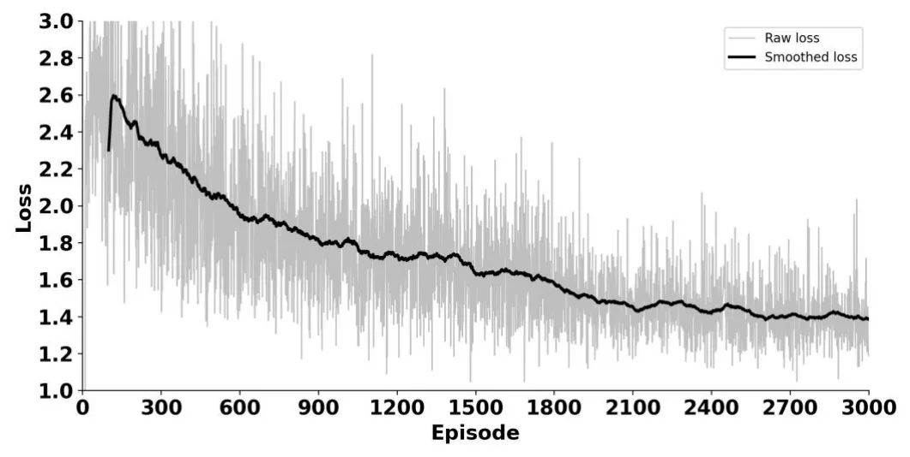
<figcaption>Figure 11. Double-DQN training: temporal-difference loss, shown raw (light) and smoothed (dark). After an initial transient the loss decreases and plateaus, indicating stable convergence of the learned value function.</figcaption>
</figure>

Because several ecological parameters cannot be directly estimated from species-specific measurements in the reconstructed historical setting, we distinguish three forms of parameter provenance. “Literature-derived” indicates that the baseline value is taken directly from, or follows the parameterization of, an existing model. “Literature-informed assumption” indicates that the literature supports the biological process or approximate scale but not the exact value for the reference species and location. “Model assumption” denotes a value selected to operationalize the ecological mechanism in the stylized simulation. This distinction is summarized in Table 3.

<figure class="table-figure" id="table-3">
<figcaption>Table 3. Biological interpretation, provenance, and scenario uncertainty ranges for the ecological parameters most relevant to the reviewer-raised species-specific assumptions.</figcaption>

<table style="overflow-wrap:normal"><tr><th>Parameter</th><th>Baseline value</th><th>Scenario range</th><th>Provenance</th><th>Biological interpretation</th></tr><tr><td>𝑔𝑚</td><td>30 larvae mosquito−1 day−1</td><td>15–45</td><td>Literature-derived</td><td>Effective larval recruitment per reproductive female; adopted from the malaria-modeling literature rather than estimated specifically for the Panama scenario (Lou and Zhao 2011a).</td></tr><tr><td>𝛼𝑐</td><td>0.03 m2 fish−1 day−1</td><td>0.005–0.105</td><td>Literature-informed</td><td>Effective larval-predation coefficient for the intervention-fish functional type, interpreted with <em>G. affinis</em> as the reference species. The value represents model-scale predation rather than a direct field feeding rate (Lou and Zhao 2011a; Pyke 2008).</td></tr><tr><td>𝛼𝑛</td><td>0.004 m2 fish−1 day−1</td><td>0.002–0.006</td><td>Literature-informed assumption</td><td>Lower effective larval-predation coefficient assigned to the native-fish population. The cited predation literature establishes the process and scale, but the baseline value is not a direct measurement for <em>P. gillii</em> (Chala et al. 2016).</td></tr><tr><td>𝑞𝑐</td><td>5 × 10−4 fish larva−1</td><td>2.5 × 10−4–7.5 × 10−4</td><td>Literature-informed assumption</td><td>Effective conversion coefficient linking larval consumption to intervention-fish population growth; it should not be interpreted as a measured individual-level assimilation efficiency.</td></tr><tr><td>𝑞𝑛</td><td>2 × 10−4 fish larva−1</td><td>1 × 10−4–3 × 10−4</td><td>Model assumption</td><td>Effective conversion coefficient for the native-fish population, chosen below 𝑞𝑐 to represent weaker dependence on mosquito larvae.</td></tr><tr><td>𝑟𝑐</td><td>0.3 day−1</td><td>0.15–0.45</td><td>Literature-informed assumption</td><td>Effective net population-growth coefficient for the intervention fish. It represents population-scale expansion in the simulation and is not interpreted as a directly measured reproductive rate of <em>G. affinis</em>.</td></tr><tr><td>𝑟𝑛</td><td>0.01 day−1</td><td>0.005–0.015</td><td>Model assumption</td><td>Effective net growth coefficient for the native-fish functional population.</td></tr><tr><td>𝜇𝑐</td><td>1/365 day−1</td><td>1/(2 ⋅ 365)–2/365</td><td>Literature-informed assumption</td><td>Background mortality hazard of the intervention-fish population over the simulation horizon.</td></tr><tr><td>𝜇𝑛</td><td>1/(4 ⋅365) day−1</td><td>1/(8 ⋅ 365)–1/(2 ⋅365)</td><td>Model assumption</td><td>Background mortality hazard assigned to the native-fish population.</td></tr><tr><td>𝐾</td><td>80 fish m−2</td><td>40–120 fish m−2</td><td>Literature-informed assumption</td><td>Effective local carrying capacity used by the density-dependent fish subsystem; it is a model-scale capacity rather than a measured capacity of the historical Canal Zone.</td></tr><tr><td>𝜃𝑐𝑛</td><td>0.05</td><td>0.0125–0.8375</td><td>Model assumption</td><td>Dimensionless competitive effect of the native population on the intervention population.</td></tr><tr><td>𝜃𝑛𝑐</td><td>0.05</td><td>0.0125–0.8375</td><td>Model assumption</td><td>Dimensionless competitive effect of the intervention population on the native population.</td></tr><tr><td>𝜇𝑞</td><td>0.1 day−1</td><td>0.05–0.15 day−1</td><td>Literature-informed range</td><td>Age-related mortality rate of questing adult mosquitoes (Stone et al. 2014).</td></tr></table>

</figure>

## References

- Aguiar, Maira, Eduardo Millán Ortuondo, Joseba Bidaurrazaga Van-Dierdonck, Javier Mar, and Nico Stollenwerk. 2020. “Modelling COVID 19 in the Basque Country from Introduction to Control Measure Response.” *Scientific Reports* 10 (1): 17306.
- Akowe, Emmanuel, Queeneth Ojoma Ahman, Benedict Celestine Agbata, et al. 2025. “A Novel Malaria Mathematical Model: Integrating Vector and Non-Vector Transmission Pathways.” *BMC Infectious Diseases* 25 (1): 322.
- Al-Akel, Ali Suliman, and Elamin Mohamed Suliman. 2011. “Biological Control Agent for Mosquito Larvae: Review on the Killifish, Aphanius Dispar Dispar (rüppel, 1829).” *African Journal of Biotechnology* 10 (44): 8683–88.
- Alsharhan, Abdulla M. 2021. “Survey of Agent-Based Simulations for Modelling COVID-19 Pandemic.” *Adv. Sci. Technol. Eng. Syst. J* 6 (2): 439–47.
- Angulo, Jose, Hwa-Lung Yu, Andrea Langousis, et al. 2013. “Spatiotemporal Infectious Disease Modeling: A BME-SIR Approach.” *PloS One* 8 (9): e72168.
- Aron, J. L., and Robert M. May. 1982. “The Population Dynamics of Malaria.” In *The Population Dynamics of Infectious Diseases: Theory and Applications*, edited by Roy M. Anderson. Chapman; Hall.
- Arosemena Dı́az, Graciela, Almyr Alba, and Marı́a Sánchez de Stapf. 2023. “The Construction of Sanitary Urban and Anti-Mosquito Landscaping in the Canal Zone.” In *Urban Development and the Panama Canal Zone*. Springer.
- Balcan, Duygu, Vittoria Colizza, Bruno Gonçalves, Hao Hu, José J. Ramasco, and Alessandro Vespignani. 2009. “Multiscale Mobility Networks and the Spatial Spreading of Infectious Diseases.” *Proceedings of the National Academy of Sciences of the United States of America* 106 (51): 21484–89. [doi:10.1073/pnas.0906910106](https://doi.org/10.1073/pnas.0906910106)
- Beck-Johnson, Lindsay M., William A. Nelson, Krijn P. Paaijmans, Andrew F. Read, Matthew B. Thomas, and Ottar N. Bjørnstad. 2013. “The Effect of Temperature on Anopheles Mosquito Population Dynamics and the Potential for Malaria Transmission.” *PLoS ONE* 8 (11): e79276. [doi:10.1371/journal.pone.0079276](https://doi.org/10.1371/journal.pone.0079276)
- Beier, John C., Joseph Keating, John I. Githure, Michael B. Macdonald, Daniel E. Impoinvil, and Robert J. Novak. 2008. “Integrated Vector Management for Malaria Control.” *Malaria Journal* 7 (Suppl 1): S4. [doi:10.1186/1475-2875-7-S1-S4](https://doi.org/10.1186/1475-2875-7-S1-S4)
- Bezabih, A Fentie, G Kenassa Edessa, and P Rao Koya. 2020. “Mathematical Eco-Epidemiological Model on Prey-Predator System.” *Math. Model. Appl* 5 (3): 183–90.
- Biswas, Md Haider Ali, Luı́s Tiago Paiva, and MDR De Pinho. 2014. “A SEIR Model for Control of Infectious Diseases with Constraints.” *Mathematical Biosciences and Engineering* 11 (4): 761.
- Blanchard, Rose C, and Joshuah S Perkin. 2026. “Assessing Movement Patterns of the Highly Invasive Western Mosquitofish (Gambusia Affinis).” *Proceedings of the Royal Society B: Biological Sciences* 293 (2062).
- Bomblies, Arne, Jean-Bernard Duchemin, and Elfatih A. B. Eltahir. 2008. “Hydrology of Malaria: Model Development and Application to a Sahelian Village.” *Water Resources Research* 44: W12445. [doi:10.1029/2008WR006917](https://doi.org/10.1029/2008WR006917)
- Bousema, Teun, Jamie T. Griffin, Robert W. Sauerwein, et al. 2012. “Hitting Hotspots: Spatial Targeting of Malaria for Control and Elimination.” *PLoS Medicine* 9 (1): e1001165. [doi:10.1371/journal.pmed.1001165](https://doi.org/10.1371/journal.pmed.1001165)
- Brady, Oliver J, H Charles J Godfray, Andrew J Tatem, et al. 2015. “Adult Vector Control, Mosquito Ecology and Malaria Transmission.” *International Health* 7 (2): 121–29.
- Bulut, Vahide. 2022. “Optimal Path Planning Method Based on Epsilon-Greedy q-Learning Algorithm.” *Journal of the Brazilian Society of Mechanical Sciences and Engineering* 44 (3): 106.
- Camponovo, Flavia, Aurélie Jeandron, Laura A Skrip, et al. 2024. “Malaria Treatment for Prevention: A Modelling Study of the Impact of Routine Case Management on Malaria Prevalence and Burden.” *BMC Infectious Diseases* 24 (1): 1267.
- Centers for Disease Control and Prevention. 2025. *The Panama Canal and Malaria*.
- Chala, Buze, Berhanu Erko, Abebe Animut, Abraham Degarege, and Beyene Petros. 2016. “Assessment of *Clarias Gariepinus* as a Biological Control Agent Against Mosquito Larvae.” *BMC Ecology* 16: 27. [doi:10.1186/s12898-016-0081-0](https://doi.org/10.1186/s12898-016-0081-0)
- Chandra, Goutam, Indranil Bhattacharjee, Subhas N. Chatterjee, and Aniruddha Ghosh. 2008. “Mosquito Control by Larvivorous Fish.” *Indian Journal of Medical Research* 127 (1): 13–27.
- Chitnis, Nakul, Allan Schapira, David L. Smith, Simon I. Hay, Thomas Smith, and Richard W. Steketee. 2010. *Mathematical Modelling to Support Malaria Control and Elimination*. Roll Back Malaria Partnership Secretariat / World Health Organization.
- Cilfone, Nicholas A., Denise E. Kirschner, and Jennifer J. Linderman. 2015. “Strategies for Efficient Numerical Implementation of Hybrid Multi-Scale Agent-Based Models to Describe Biological Systems.” *Cellular and Molecular Bioengineering*, ahead of print. [doi:10.1007/s12195-014-0363-6](https://doi.org/10.1007/s12195-014-0363-6)
- Colizza, Vittoria, and Alessandro Vespignani. 2008. “Epidemic Modeling in Metapopulation Systems with Heterogeneous Coupling Pattern: Theory and Simulations.” *Journal of Theoretical Biology* 251 (3): 450–67. [doi:10.1016/j.jtbi.2007.11.028](https://doi.org/10.1016/j.jtbi.2007.11.028)
- Collins, CM, JAS Bonds, MM Quinlan, and JD Mumford. 2019. “Effects of the Removal or Reduction in Density of the Malaria Mosquito, Anopheles Gambiae Sl, on Interacting Predators and Competitors in Local Ecosystems.” *Medical and Veterinary Entomology* 33 (1): 1–15.
- Cooper, Ian, Argha Mondal, and Chris G Antonopoulos. 2020. “A SIR Model Assumption for the Spread of COVID-19 in Different Communities.” *Chaos, Solitons & Fractals* 139: 110057.
- Esteva, L., and C. Vargas. 1998. “Analysis of a Dengue Disease Transmission Model.” *Mathematical Biosciences* 150 (2): 131–51. [doi:10.1016/S0025-5564(98)10003-2](https://doi.org/10.1016/S0025-5564(98)10003-2)
- Eubank, Stephen, Hasan Guclu, V. S. Anil Kumar, et al. 2004. “Modelling Disease Outbreaks in Realistic Urban Social Networks.” *Nature* 429 (6988): 180–84. [doi:10.1038/nature02541](https://doi.org/10.1038/nature02541)
- Fillinger, Ulrike, and Steven W. Lindsay. 2011. “Larval Source Management for Malaria Control in Africa: Myths and Reality.” *Malaria Journal* 10: 353. [doi:10.1186/1475-2875-10-353](https://doi.org/10.1186/1475-2875-10-353)
- Floore, Thomas G. 2006. “Mosquito Larval Control Practices: Past and Present.” *Journal of the American Mosquito Control Association* 22 (3): 527–33.
- Food and Agriculture Organization of the United Nations. n.d. *Oreochromis niloticus (Nile Tilapia) Species Fact Sheet*. FAO.
- Forattini, O. P., I. Kakitani, E. Massad, and D. Marucci. 2002. “Studies on Mosquitoes (Diptera: Culicidae) and Anthropogenic Environment. 10. Laboratory and Field Observations on Duration of Gonotrophic Cycle of Anopheles albitarsis s.l. In Southeastern Brazil.” *Journal of Medical Entomology* 39 (6): 926–30. [doi:10.1603/0022-2585-39.6.926](https://doi.org/10.1603/0022-2585-39.6.926)
- Frazier, Peter I. 2018. “A Tutorial on Bayesian Optimization.” *arXiv Preprint arXiv:1807.02811*.
- Gachelin, Gabriel, Paul Garner, Eliana Ferroni, Jan Peter Verhave, and Annick Opinel. 2018. “Evidence and Strategies for Malaria Prevention and Control: A Historical Analysis.” *Malaria Journal* 17 (1): 96.
- Ghosh, Bapan, and TK Kar. 2014. “Sustainable Use of Prey Species in a Prey–Predator System: Jointly Determined Ecological Thresholds and Economic Trade-Offs.” *Ecological Modelling* 272: 49–58.
- Ghosh, Joydev, Banshidhar Sahoo, and Swarup Poria. 2017. “Prey-Predator Dynamics with Prey Refuge Providing Additional Food to Predator.” *Chaos, Solitons & Fractals* 96: 110–19.
- Ghosh, Mini, Abid Ali Lashari, and Xue-Zhi Li. 2013. “Biological Control of Malaria: A Mathematical Model.” *Applied Mathematics and Computation* 219 (15): 7923–39. [doi:10.1016/j.amc.2013.02.053](https://doi.org/10.1016/j.amc.2013.02.053)
- Greenwood, Brian M., Kalifa Bojang, Christopher J. M. Whitty, and Geoffrey A. T. Targett. 2005. “Malaria.” *The Lancet* 365 (9469): 1487–98.
- Greenwood, Brian M., David A. Fidock, Dennis E. Kyle, et al. 2008. “Malaria: Progress, Perils, and Prospects for Eradication.” *Journal of Clinical Investigation* 118 (4): 1266–76.
- Grenfell, B. T., O. N. Bjørnstad, and J. Kappey. 2001. “Travelling Waves and Spatial Hierarchies in Measles Epidemics.” *Nature* 414 (6865): 716–23. [doi:10.1038/414716a](https://doi.org/10.1038/414716a)
- Griffin, Lachlan F, and Jon M Knight. 2012. “A Review of the Role of Fish as Biological Control Agents of Disease Vector Mosquitoes in Mangrove Forests: Reducing Human Health Risks While Reducing Environmental Risk.” *Wetlands Ecology and Management* 20 (3): 243–52.
- Gu, Weidong, and Robert J. Novak. 2009. “Agent-Based Modelling of Mosquito Foraging Behaviour for Malaria Control.” *Transactions of the Royal Society of Tropical Medicine and Hygiene* 103 (11): 1105–12. [doi:10.1016/j.trstmh.2009.01.006](https://doi.org/10.1016/j.trstmh.2009.01.006)
- Gumel, Abba B., Shigui Ruan, Troy Day, et al. 2004. “Modelling Strategies for Controlling SARS Outbreaks.” *Proceedings of the Royal Society B: Biological Sciences* 271 (1554): 2223–32. [doi:10.1098/rspb.2004.2800](https://doi.org/10.1098/rspb.2004.2800)
- Harvard Library. 2025. *Tropical Diseases and the Construction of the Panama Canal, 1904–1914*.
- Hasselt, Hado van, Arthur Guez, and David Silver. 2016. “Deep Reinforcement Learning with Double q-Learning.” *Proceedings of the AAAI Conference on Artificial Intelligence* 30. [doi:10.1609/aaai.v30i1.10295](https://doi.org/10.1609/aaai.v30i1.10295)
- Helton, Jon C, and Freddie Joe Davis. 2003. “Latin Hypercube Sampling and the Propagation of Uncertainty in Analyses of Complex Systems.” *Reliability Engineering & System Safety* 81 (1): 23–69.
- Hens, Niel, Ziv Shkedy, Marc Aerts, Christel Faes, Pierre Van Damme, and Philippe Beutels. 2012. “The SIR Model.” In *Modeling Infectious Disease Parameters Based on Serological and Social Contact Data: A Modern Statistical Perspective*. Springer.
- Howard, A. F., G. Zhou, and F. X. Omlin. 2007. “Malaria Mosquito Control Using Edible Fish in Western Kenya: Preliminary Findings of a Controlled Study.” *BMC Public Health* 7: 199.
- Igbani, F, N Nelson-Ebimie, and N Obadiah. 2024. “The Use of Larvivorous Fish Species to Control Malaria Transmission in Africa: A Review.” *International Journal of Fisheries and Aquaculture Research* 10 (1): 23–43.
- Kamareddine, Layla. 2012. “The Biological Control of the Malaria Vector.” *Toxins* 4 (9): 748–67.
- Keeling, Matthew J, and Bryan T Grenfell. 1997. “Disease Extinction and Community Size: Modeling the Persistence of Measles.” *Science* 275 (5296): 65–67.
- Kermack, W. O., and A. G. McKendrick. 1927. “A Contribution to the Mathematical Theory of Epidemics.” *Proceedings of the Royal Society of London. Series A, Containing Papers of a Mathematical and Physical Character* 115 (772): 700–721. [doi:10.1098/rspa.1927.0118](https://doi.org/10.1098/rspa.1927.0118)
- Killeen, Gerry F., Ulrike Fillinger, and Bart G. J. Knols. 2002. “Advantages of Larval Control for African Malaria Vectors: Low Mobility and Behavioural Responsiveness of Immature Mosquito Stages Allow High Effective Coverage.” *Malaria Journal* 1: 8.
- Kraemer, Moritz U. G., Chia-Hung Yang, Bernardo Gutierrez, et al. 2020. “The Effect of Human Mobility and Control Measures on the COVID-19 Epidemic in China.” *Science* 368 (6490): 493–97. [doi:10.1126/science.abb4218](https://doi.org/10.1126/science.abb4218)
- Kumar, A., V. P. Sharma, P. K. Sumodan, and D. Thavaselvam. 1998. “Field Trials of Biolarvicide *Bacillus Thuringiensis* Var. *Israelensis* Strain 164 and the Larvivorous Fish *Aplocheilus Blocki* Against *Anopheles Stephensi* for Malaria Control in Goa, India.” *Journal of the American Mosquito Control Association* 14 (4): 457–62.
- Lazebnik, Teddy. 2023a. “Computational Applications of Extended SIR Models: A Review Focused on Airborne Pandemics.” *Ecological Modelling* 483: 110422.
- Lazebnik, Teddy. 2023b. “Data-Driven Hospitals Staff and Resources Allocation Using Agent-Based Simulation and Deep Reinforcement Learning.” *Engineering Applications of Artificial Intelligence* 126: 106783.
- Lazebnik, Teddy. 2025. “Evaluating Supply Chain Resilience During Pandemic Using Agent-Based Simulation.” *Physica A: Statistical Mechanics and Its Applications* 674: 130780.
- Lazebnik, Teddy, and Avner Friedman. 2025. “Comparing Partial Differential Equations and Agent-Based Simulations in Spatio-Temporal Modeling of Cancer Growth and Shape.” *Journal of Computational and Applied Mathematics*, 117183.
- Lazebnik, Teddy, Labib Shami, and Svetlana Bunimovich-Mendrazitsky. 2023. “Intervention Policy Influence on the Effect of Epidemiological Crisis on Industry-Level Production Through Input–Output Networks.” *Socio-Economic Planning Sciences* 87: 101553.
- Leslie, P. H. 1945. “On the Use of Matrices in Certain Population Mathematics.” *Biometrika* 33 (3): 183–212. [doi:10.1093/biomet/33.3.183](https://doi.org/10.1093/biomet/33.3.183)
- Levins, Richard. 1969. “Some Demographic and Genetic Consequences of Environmental Heterogeneity for Biological Control.” *Bulletin of the Entomological Society of America* 15 (3): 237–40. [doi:10.1093/besa/15.3.237](https://doi.org/10.1093/besa/15.3.237)
- Li, Yao, Kathleen Stewart, Kay Thwe Han, et al. 2023. “Understanding Spatiotemporal Human Mobility Patterns for Malaria Control Using a Multiagent Mobility Simulation Model.” *Clinical Infectious Diseases* 76 (3): e867–74. [doi:10.1093/cid/ciac568](https://doi.org/10.1093/cid/ciac568)
- Library of Congress. 2025. *Property Map of the Canal Zone and Panama Canal Zone Map Collections*.
- Lorig, Fabian, Emil Johansson, and Paul Davidsson. 2021. “Agent-Based Social Simulation of the COVID-19 Pandemic: A Systematic Review.” *Journal of Artificial Societies and Social Simulation* 24 (3).
- Lou, Yijun, and Xiao-Qiang Zhao. 2010. “Periodic Ross–Macdonald Model with Diffusion and Advection.” *Applicable Analysis* 89 (7): 1067–89.
- Lou, Yijun, and Xiao-Qiang Zhao. 2011a. “Modelling Malaria Control by Introduction of Larvivorous Fish.” *Bulletin of Mathematical Biology* 73 (10): 2384–407. [doi:10.1007/s11538-011-9628-6](https://doi.org/10.1007/s11538-011-9628-6)
- Lou, Yijun, and Xiao-Qiang Zhao. 2011b. “Modelling Malaria Control by Introduction of Larvivorous Fish.” *Bulletin of Mathematical Biology* 73: 2384–407. [doi:10.1007/s11538-011-9628-6](https://doi.org/10.1007/s11538-011-9628-6)
- Lunde, Torleif Markussen, Mohamed Nabie Bayoh, and Bernt Lindtjørn. 2013. “How Malaria Models Relate Temperature to Malaria Transmission.” *Parasites & Vectors* 6: 20. [doi:10.1186/1756-3305-6-20](https://doi.org/10.1186/1756-3305-6-20)
- Lutz, Eleanor K., Kim T. Ha, and Jeffrey A. Riffell. 2020. “Distinct Navigation Behaviors in Aedes, Anopheles and Culex Mosquito Larvae.” *Journal of Experimental Biology* 223 (7): jeb221218. [doi:10.1242/jeb.221218](https://doi.org/10.1242/jeb.221218)
- Macdonald, George. 1952. “The Analysis of Equilibrium in Malaria.” *Tropical Diseases Bulletin* 49 (9): 813–29.
- Malaria, Roll Back et al. 2005. “World Malaria Report 2005.” *World Health Organization and UNICEF*.
- Marzban, Sadegh, Renji Han, Nóra Juhász, and Gergely Róst. 2021. “A Hybrid PDE–ABM Model for Viral Dynamics with Application to SARS-CoV-2 and Influenza.” *Royal Society Open Science* 8 (11): 210787. [doi:10.1098/rsos.210787](https://doi.org/10.1098/rsos.210787)
- McCallum, Hamish. 2008. *Population Parameters: Estimation for Ecological Models*. John Wiley & Sons.
- Milgroom, Michael G. 2023. “Epidemiology and Sir Models.” *Biology of Infectious Disease: From Molecules to Ecosystems*, 253–68.
- Mnih, Volodymyr, Koray Kavukcuoglu, David Silver, et al. 2015. “Human-Level Control Through Deep Reinforcement Learning.” *Nature* 518 (7540): 529–33. [doi:10.1038/nature14236](https://doi.org/10.1038/nature14236)
- Moore, Sean M., Elizabeth T. Borer, and Pejman R. Hosseini. 2010. “Predators Indirectly Control Vector-Borne Disease: Linking Predator–Prey and Host–Pathogen Models.” *Journal of the Royal Society Interface* 7 (42): 161–76.
- National Center for Vector Borne Diseases Control. n.d. *Guidelines on the Use of Larvivorous Fish for Vector Control*. Ministry of Health; Family Welfare, Government of India.
- Newton, Elizabeth A. C., and Paul Reiter. 1992. “A Model of the Transmission of Dengue Fever with an Evaluation of the Impact of Ultra-Low Volume (ULV) Insecticide Applications on Dengue Epidemics.” *The American Journal of Tropical Medicine and Hygiene* 47 (6): 709–20. [doi:10.4269/ajtmh.1992.47.709](https://doi.org/10.4269/ajtmh.1992.47.709)
- Ngwa, Gideon A., Miranda I. Teboh-Ewungkem, Yves Dumont, Rachid Ouifki, and Jacek Banasiak. 2019. “On a Three-Stage Structured Model for the Dynamics of Malaria Transmission with Human Treatment, Adult Vector Demographics and One Aquatic Stage.” *Journal of Theoretical Biology* 481: 202–22. [doi:10.1016/j.jtbi.2018.12.043](https://doi.org/10.1016/j.jtbi.2018.12.043)
- Ohm, Johanna R., Francesco Baldini, Priscille Barreaux, et al. 2018. “Rethinking the Extrinsic Incubation Period of Malaria Parasites.” *Parasites & Vectors* 11: 178. [doi:10.1186/s13071-018-2761-4](https://doi.org/10.1186/s13071-018-2761-4)
- Pizzitutti, Francesco, William Pan, Alisson Barbieri, et al. 2015. “A Validated Agent-Based Model to Study the Spatial and Temporal Heterogeneities of Malaria Incidence in the Rainforest Environment.” *Malaria Journal* 14 (1): 514.
- Pizzitutti, Francesco, William Pan, Beth Feingold, Ben Zaitchik, Carlos A. Álvarez, and Carlos F. Mena. 2018. “Out of the Net: An Agent-Based Model to Study Human Movements Influence on Local-Scale Malaria Transmission.” *PLOS ONE* 13 (3): e0193493. [doi:10.1371/journal.pone.0193493](https://doi.org/10.1371/journal.pone.0193493)
- Pyke, Graham H. 2008. “Plague Minnow or Mosquito Fish? A Review of the Biology and Impacts of Introduced Gambusia Species.” *Annual Review of Ecology, Evolution, and Systematics* 39: 171–91. [doi:10.1146/annurev.ecolsys.39.110707.173451](https://doi.org/10.1146/annurev.ecolsys.39.110707.173451)
- Quiñones, M. L., J. D. Lines, M. C. Thomson, M. Jawara, J. Morris, and B. M. Greenwood. 1997. “Anopheles gambiae Gonotrophic Cycle Duration, Biting and Exiting Behaviour Unaffected by Permethrin-Impregnated Bednets in the Gambia.” *Medical and Veterinary Entomology* 11 (1): 71–78. [doi:10.1111/j.1365-2915.1997.tb00292.x](https://doi.org/10.1111/j.1365-2915.1997.tb00292.x)
- Russell, Tanya L, Nigel W Beebe, Robert D Cooper, Neil F Lobo, and Thomas R Burkot. 2013. “Successful Malaria Elimination Strategies Require Interventions That Target Changing Vector Behaviours.” *Malaria Journal* 12 (1): 56.
- Saravanan, VijayaPrabha, Ganesh Priya Balakrishnan, and Rajivganthi Chinnathambi. 2025. “Spatio-Temporal Dynamics of Mosquito Populations Under Predation.” *Advances in Continuous and Discrete Models* 2025 (1): 153.
- Shocket, Marta S, Jamie M Caldwell, Paul J Huxley, Catherine A Lippi, Francis A Windram, and Alexander C Keyel. 2023. “Modelling the Effects of Climate and Climate Change on Transmission of Vector-Borne Disease.” In *Planetary Health* *Approaches to Understand and Control Vector-Borne Diseases*. Wageningen Academic.
- Shuchami, Adi, and Teddy Lazebnik. 2025. “Spatio-Temporal SIR Model of Pandemic Spread During Warfare with Optimal Dual-Use Health Care System Administration Using Deep Reinforcement Learning.” *Disaster Medicine and Public Health Preparedness* 19: e197.
- Sin, Gürkan, and Krist V Gernaey. 2009. “Improving the Morris Method for Sensitivity Analysis by Scaling the Elementary Effects.” In *Computer Aided Chemical Engineering*, vol. 26. Elsevier.
- Skellam, J. G. 1951. “Random Dispersal in Theoretical Populations.” *Biometrika* 38 (1–2): 196–218. [doi:10.1093/biomet/38.1-2.196](https://doi.org/10.1093/biomet/38.1-2.196)
- Smith, N. R., J. M. Trauer, M. Gambhir, et al. 2018. “Agent-Based Models of Malaria Transmission: A Systematic Review.” *Malaria Journal* 17 (1): 299. [doi:10.1186/s12936-018-2442-y](https://doi.org/10.1186/s12936-018-2442-y)
- Smithsonian Tropical Research Institute. n.d. *Poecilia Gillii, Molly*. Shorefishes of the Greater Caribbean Online Information System.
- Snoek, Jasper, Hugo Larochelle, and Ryan P. Adams. 2012. “Practical Bayesian Optimization of Machine Learning Algorithms.” *Advances in Neural Information Processing Systems* 25.
- Steindorf, Vanessa, Akhil Kumar Srivastav, Nico Stollenwerk, Bob W Kooi, and Maira Aguiar. 2022. “Modeling Secondary Infections with Temporary Immunity and Disease Enhancement Factor: Mechanisms for Complex Dynamics in Simple Epidemiological Models.” *Chaos, Solitons & Fractals* 164: 112709.
- Stone, Christopher M., Steve W. Lindsay, and Nakul Chitnis. 2014. “How Effective Is Integrated Vector Management Against Malaria and Lymphatic Filariasis Where the Diseases Are Transmitted by the Same Vector?” *PLoS Neglected Tropical Diseases* 8 (12): e3393. [doi:10.1371/journal.pntd.0003393](https://doi.org/10.1371/journal.pntd.0003393)
- Thomas, Christopher J., David E. Cross, and Claus Bøgh. 2013. “Landscape Movements of Anopheles gambiae Malaria Vector Mosquitoes in Rural Gambia.” *PLOS ONE* 8 (7): e68679. [doi:10.1371/journal.pone.0068679](https://doi.org/10.1371/journal.pone.0068679)
- Tilahun, Miliyon. 2017. “Backward Bifurcation in SIRS Malaria Model.” *arXiv Preprint arXiv:1707.00924*.
- Tizifa, Tinashe A, Alinune N Kabaghe, Robert S McCann, Henk van den Berg, Michele Van Vugt, and Kamija S Phiri. 2018. “Prevention Efforts for Malaria.” *Current Tropical Medicine Reports* 5 (1): 41–50.
- Tusting, Lucy S, Julie Thwing, David Sinclair, et al. 2013. “Mosquito Larval Source Management for Controlling Malaria.” *Cochrane Database of Systematic Reviews*, no. 8.
- Tuteja, Renu. 2007. “Malaria- an Overview.” *The FEBS Journal* 274 (18): 4670–79.
- University of South Florida. 2025a. *Gatun Dam, Spillway and Locks, 1913*.
- University of South Florida. 2025b. *Panama Canal Zone, 1916*.
- University of South Florida. 2025c. *United States Canal Zone, 1914*.
- Volterra, Vito. 1927. “Fluctuations in the Abundance of a Species Considered Mathematically.” *Nature* 119 (2983): 12–13. [doi:10.1038/119012b0](https://doi.org/10.1038/119012b0)
- Walker, Kim, and Michael Lynch. 2007. “Contributions of Anopheles Larval Control to Malaria Suppression in Tropical Africa: Review of Achievements and Potential.” *Medical and Veterinary Entomology* 21 (1): 2–21.
- Walters, Carl J, and Steven JD Martell. 2004. *Fisheries Ecology and Management*. Princeton University Press.
- Wang, Peipei, Xinqi Zheng, and Haiyan Liu. 2022. “Simulation and Forecasting Models of COVID-19 Taking into Account Spatio-Temporal Dynamic Characteristics: A Review.” *Frontiers in Public Health* 10: 1033432.
- Wearing, Helen J., Pejman Rohani, and Matt J. Keeling. 2005. “Appropriate Models for the Management of Infectious Diseases.” *PLoS Medicine* 2 (7): e174. [doi:10.1371/journal.pmed.0020174](https://doi.org/10.1371/journal.pmed.0020174)
- Weiss, Howard Howie. 2013. “The SIR Model and the Foundations of Public Health.” *Materials Matematics*, 0001–17.
- Wonham, Marjorie J., Tomás de-Camino-Beck, and Mark A. Lewis. 2004. “An Epidemiological Model for West Nile Virus: Invasion Analysis and Control Applications.” *Proceedings of the Royal Society B: Biological Sciences* 271 (1538): 501–7. [doi:10.1098/rspb.2003.2608](https://doi.org/10.1098/rspb.2003.2608)
- Worrall, Eve, and Ulrike Fillinger. 2011. “Large-Scale Use of Mosquito Larval Source Management for Malaria Control in Africa: A Cost Analysis.” *Malaria Journal* 10 (1): 338.
- Wu, Sean L, John M Henry, Daniel T Citron, et al. 2023. “Spatial Dynamics of Malaria Transmission.” *PLOS Computational Biology* 19 (6): e1010684.
- Xie, Meiling, Yuhan Li, Minyu Feng, and Jürgen Kurths. 2023. “Contact-Dependent Infection and Mobility in the Metapopulation SIR Model from a Birth–Death Process Perspective.” *Chaos, Solitons & Fractals* 177: 114299.
