## 1 Introduction

Human space exploration is transitioning from short-duration orbital missions toward exploration-class missions and eventual settlements beyond low Earth orbit, where radiation, altered gravity, confinement, isolation, and closed-loop life-support systems jointly shape human biological risk rather than acting as independent hazards [ 1–3 ]. Among the medical threats expected to become more consequential during long-duration missions, infections are distinctive because they can degrade individual health, spread through shared habitats, consume scarce medical resources, and compromise mission success [ 4, 5 ]. These concerns become sharper in the Mars-colony setting, where communication delays, limited evacuation options, restricted diagnostics, constrained pharmacy mass, and dependence on crew medical autonomy make even familiar terrestrial infections operationally unfamiliar [ 6–8 ]. Unlike terrestrial outbreaks, a Mars-colony epidemic would occur in a small, closed, highly structured population whose air, surfaces, schedules, waste streams, and medical resources are engineered parts of the transmission environment [ 9–12 ]. In parallel, the colony would be exposed to a radiation environment dominated by galactic cosmic rays and episodic solar particle events, requiring risk assessment that links habitat shielding, mission timing, and biological response [ 13, 14 ]. Measurements from the Mars Science Laboratory Radiation Assessment Detector showed that the Martian surface has a persistent ionizing–radiation environment modulated by atmosphere, heliophysics, and secondary-particle production [ 15, 16 ]. Measurements during the cruise phase to Mars further demonstrated that interplanetary transit itself can contribute a substantial fraction of total mission radiation exposure, making the outbound and return phases relevant to colony health even before permanent surface habitation begins [ 17 ].

The distinctiveness of epidemic risk in a Mars colony arises from the interaction of altered host susceptibility, potential changes in pathogen behavior, and the engineered habitat conditions that shape transmission opportunities [ 18 ]. The National Aeronautics and Space Administration’s (NASA) microbiology technical guidance explicitly frames spacecraft microbial contamination as a risk to crew health and onboard systems, noting that inflight infectious disease occurs, that some spaceflight conditions can alter microbial virulence, and that astronaut immune responses are modified during flight [ 19 ]. NASA’s Human Research Roadmap similarly identifies immune dysregulation, altered microbial virulence, and host–microorganism interactions as research gaps for exploration missions [ 20 ]. Operationally, NASA has historically mitigated acute preflight infection importation through health-stabilization procedures, and a retrospective analysis of missions from Apollo through 2024 provides evidence that such programs reduce, but do not conceptually eliminate, infection-related risk [ 21, 22 ]. At the quantitative-risk level, NASA’s Integrated Medical Model uses probabilistic Monte Carlo methods to estimate medical events, resource needs, and mission impacts across spaceflight scenarios [ 23 ]. More recent NASA work on the Medical Extensible Dynamic Probabilistic Risk Assessment Tool indicates a move toward higher-fidelity, event-based health-risk simulation for exploration missions [ 24 ]. Complementary international efforts coordinated by the Committee on Space Research (COSPAR) have identified knowledge gaps in microbial monitoring, crew health, and contamination control for human Mars missions [ 25, 26 ]. Nevertheless, probabilistic medical-event models do not by themselves resolve the epidemiological dynamics of an infection that begins silently in one colonist, becomes clinically active under altered host immunity, and then spreads through shared air in a closed settlement [ 27 ].

Human crewmembers and their associated microbiomes represent a principal source of microorganisms entering crewed space habitats. Additional introduction pathways include cargo, food, water, and environmental materials [ 28, 29 ]. Longitudinal astronaut microbiome studies show that spaceflight can alter microbial communities across gastrointestinal, skin, nasal, and oral body sites, linking the crew itself to the habitat microbiome [ 29 ]. Evidence from long-duration missions also shows that latent herpesviruses can reactivate and shed during spaceflight, making endogenous infection reservoirs a documented spaceflight phenomenon rather than a purely theoretical concern [ 30 ]. A later synthesis of herpesvirus reactivation in astronauts reported frequent viral shedding during Space Shuttle and International Space Station missions and associated this pattern with stress-axis activation and reduced cell-mediated immunity [ 31 ]. Latent tuberculosis infection provides a different but epidemiologically sharper endogenous reservoir because “Mycobacterium tuberculosis” can remain clinically silent for years and later progress to active disease, with progression risk strongly shaped by immunological status [ 32 ]. Public-health guidance distinguishes latent tuberculosis infection from active tuberculosis disease by noting that latent infection is not infectious, whereas reactivation can lead to transmissible disease [ 33 ]. Active pulmonary or laryngeal tuberculosis is transmitted through airborne particles generated during coughing, speaking, or singing, making shared indoor air a central transmission pathway [ 34 ]. Clinically, tuberculosis spans a spectrum from immunological containment within granulomas to symptomatic contagious pulmonary disease, making it well suited for models that couple host control, reactivation, and transmission [ 35 ]. Late reactivation is especially relevant to Mars settlement because systematic evidence indicates that tuberculosis can reactivate years after initial infection [ 36 ]. Pre-mission screening reduces the likelihood of undetected latent tuberculosis, but diagnostic tests are not infallible and cannot reliably predict progression to active disease [ 37, 38 ]. Consequently, latent tuberculosis is considered here as a hypothetical residual-risk scenario rather than an expected condition among screened astronauts.

Recent space-biomedicine studies have substantially improved the empirical basis for modeling this problem, but they have mostly characterized components rather than closed-population epidemic mechanisms [ 39 ]. The Inspiration4 longitudinal multi-omics study profiled host microbiome architecture and immune responses during short-duration spaceflight, showing that high-resolution microbial and immune time series are now feasible in civilian spaceflight contexts [ 40 ]. A companion single-cell multi- ome study identif ied conserved and sex- specif ic immune responses to spaceflight, including inflammatory markers, immune-gene signatures, and links between immune pathways and microbiome shifts [ 41 ]. Environmental studies of the International Space Station have also advanced from sparse monitoring toward spatially resolved habitat ecology, including a large 3D microbial and chemical map of the United States Orbital Segment [ 42 ]. Genomic and metabolic work on multidrug-resistant *Enterobacter bugandensis* isolated from the ISS shows that clinically relevant organisms can persist, adapt, and participate in microbial succession within spacecraft environments [ 43 ]. Analyzes of bacteriophages in ISS bacterial genomes further suggest that microbial adaptation to spaceflight may involve functions related to antimicrobial resistance, virulence, DNA repair, and dormancy [ 44 ]. Standardized human-health monitoring frameworks such as Spaceflight Standard Measures are beginning to make astronaut physiological and omics datasets more comparable across missions [ 45 ]. Nevertheless, recent medical-microbiology discussions of Mars-bound infection management still emphasize practical gaps in diagnostics, epidemiological data, antimicrobial decision-making, and mission-specific clinical breakpoints [ 46 ].

Overall, there is an absence of a mechanistic epidemiological model that links Mars radiation exposure, immune suppression, latent tuberculosis reactivation, and airborne transmission inside a growing extraterrestrial colony. Existing tuberculosis models have examined progression from latent infection to active disease in terrestrial populations [ 47 ], but their assumptions generally do not include radiation-mediated immune perturbation, engineered habitat mixing, solar-particle-event sheltering, or multi-wave Mars settlement. To this end, in this study, we develop a stochastic host-radiation-pathogen-habitat model for latent tuberculosis in a Mars colony.

The remainder of the paper is organized as follows. Section 2 formally defines the proposed host–radiation–pathogen– habitat model. Section 3 presents the optimal-control framework, describing the agent-based simulator and the partially observable countermeasure allocation model. Section 4 describes the experimental setup and reports the simulation results. Finally, Section 5 discusses the implications of the findings for Mars-colony health planning, summarizes the study limitations, and outlines future directions.

## 2 Model Definition

The Mars-colony epidemiological model considers a closed colony with a fixed number of individuals 𝑁. The colony is assumed to be well mixed, such that every living individual has the same average probability of epidemiological contact with every other living individual. This assumption follows the classical deterministic compartmental modeling framework introduced for epidemic dynamics and later generalized into SIR, SEIR, and SIRD-type models [ 48–51 ]. Unlike a standard SIRD model, however, the proposed model includes a latent tuberculosis state and an immune-mediated reactivation process, consistent with tuberculosis models that distinguish latent infection from active infectious disease [ 27, 35 ].

### 2.1 Epidemiological Model

Formally, each individual belongs to one of six epidemiological states: susceptible (𝑆), latent tuberculosis infection (𝐿), progressive active tuberculosis (𝑃), infectious active tuberculosis (𝐼), recovered or successfully treated (𝑅), and dead (𝐷). Susceptible individuals (𝑆) have not been infected with *Mycobacterium tuberculosis* . Latent individuals (𝐿) carry tuberculosis infection but are not infectious. Progressive active individuals (𝑃) represent individuals whose latent infection has reactivated, or whose new infection is progressing toward active disease, but who are not yet represented as infectious in the colony-level model. Infectious individuals (𝐼) have active pulmonary tuberculosis and can transmit infection. Recovered individuals (𝑅) are no longer infectious after successful treatment or immune control. Dead individuals (𝐷) died from active tuberculosis or tuberculosis-associated complications. Therefore, at any time (𝑡), 𝑁 = 𝑆(𝑡) + 𝐿(𝑡) + 𝑃(𝑡) + 𝐼(𝑡) + 𝑅(𝑡) + 𝐷(𝑡) .

Susceptible individuals (𝑆) become infected through contact with infectious individuals (𝐼). A newly infected individual enters the latent state (𝐿) with probability (1 − 𝜋), or the progressive active state (𝑃) with probability (𝜋). Latent individuals (𝐿) may reactivate into progressive active tuberculosis (𝑃) at a time-dependent rate (𝛼(𝑡) ). Individuals in (𝑃) become infectious at rate (𝜎). Infectious individuals (𝐼) leave the infectious state at rate (𝛾). A fraction (𝜙) of these individuals recover and move to (𝑅), while the remaining fraction (1 − 𝜙) die and move to (𝐷). Figure 1 presents a schematic view of the transition between epidemiological states.

The force of infection is defined using standard frequency-dependent transmission 𝜆(𝑡) = 𝛽 𝐼(𝑡)/(𝑁 − 𝐷(𝑡)), where 𝛽 is the effective transmission rate and 𝑁 − 𝐷(𝑡) is the number of living individuals in the colony. The denominator excludes dead individuals because they no longer participate in epidemiological contact. This form is a standard mass-action incidence assumption for well-mixed compartmental epidemic models [ 52, 53 ]. We define 𝑀(𝑡) ∈[0 , 1] as the average immune competence of the colony. The value 𝑀(𝑡) = 1 represents baseline pre-mission immune competence, while smaller values indicate immune suppression. Immune suppression is driven by chronic galactic cosmic radiation exposure. The immune state evolves according to

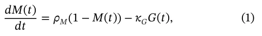

where 𝜌𝑀 is the immune recovery rate, 𝐺(𝑡) is chronic galactic cosmic radiation exposure, and 𝜅𝐺 determines how strongly chronic galactic cosmic radiation reduces immune competence. The first term, 𝜌𝑀 (1 − 𝑀(𝑡)) , represents recovery of immune competence toward the baseline value 𝑀(𝑡) = 1 , while the second term, 𝜅𝐺 𝐺(𝑡) , represents radiation-associated immune suppression. Spaceflight-associated immune dysregulation and latent viral reactivation provide evidence of altered host immune control [ 30, 31, 54 ]. Nonetheless, tuberculosis progression involves distinct pathogen-specific mechanisms, particularly the loss of immune-mediated containment of *Mycobacterium tuberculosis* [ 35, 55 ].

The latent tuberculosis reactivation rate is modeled as a multiplicative hazard that increases as immune competence decreases,

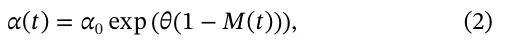

where 𝛼0 is the baseline latent tuberculosis reactivation rate under normal immune competence, and 𝜃 ≥ 0 controls the sensitivity of reactivation to immune suppression. The dimensionless coefficient 𝜃 is treated as an assumed scenario parameter rather than an empirically calibrated estimate for radiation-exposed tuberculosis. The exponential form follows the common proportional-hazards modeling idea that covariates multiply a baseline transition hazard [ 56 ]. In this model, radiation does not directly create tuberculosis infection; rather, chronic galactic cosmic radiation reduces immune competence, which increases the rate at which latent tuberculosis becomes active. This radiation–immune–reactivation relationship is a modeling hypothesis rather than an empirically validated quantitative relationship for tuberculosis under Martian conditions.

The epidemiological dynamics are described by Equations (3)–(8). In Equation (3), d𝑆(𝑡)/d𝑡 is the change in the number of susceptible individuals over time. Susceptible individuals decrease only when they are infected by infectious individuals. The infection rate is determined by the force of infection 𝜆(𝑡) .

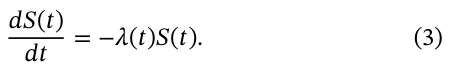

In Equation (4), d𝐿(𝑡)/d𝑡 is the change in the number of individuals with latent tuberculosis infection. This group increases when susceptible individuals become infected and enter latency with probability 1 − 𝜋. It decreases when latent individuals reactivate and move to the progressively active tuberculosis state at rate 𝛼(𝑡) .

<figure id="fig-1">
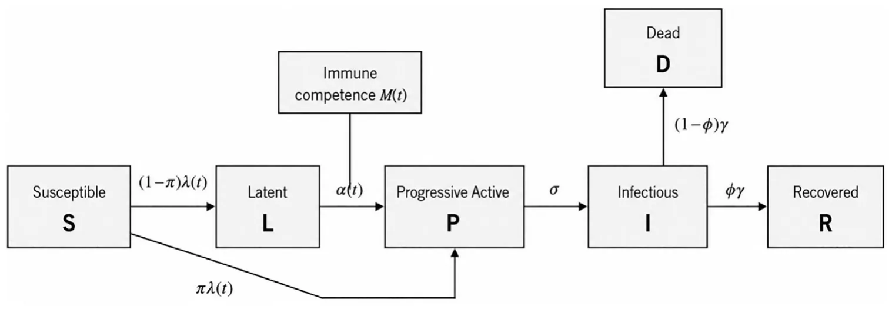
<figcaption><strong>FIGURE 1</strong> A schematic view of the transition between epidemiological states.</figcaption>
</figure>

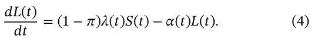

In Equation (5), d𝑃(𝑡)/d𝑡 is the change in the number of individuals with progressive active tuberculosis. This group increases through two pathways. First, newly infected susceptible individuals enter progressive active tuberculosis directly with probability 𝜋. Second, latent individuals reactivate at rate 𝛼(𝑡) . The group decreases when progressive active individuals become infectious at rate 𝜎.

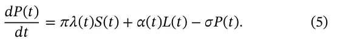

In Equation (6), d𝐼(𝑡)/d𝑡 is the change in the number of infectious active tuberculosis cases. This group increases when progressive active individuals become infectious at rate 𝜎. It decreases when infectious individuals leave the infectious state at rate 𝛾, either because they recover after treatment or immune control, or because they die.

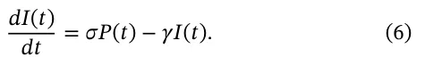

In Equation (7), d𝑅(𝑡)/d𝑡 is the change in the number of recovered or successfully treated individuals. A fraction 𝜙 of infectious individuals leaving the infectious state recover, such that the recovery flow is 𝜙𝛾𝐼(𝑡) .

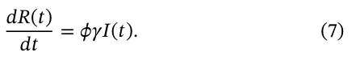

In Equation (8), d𝐷(𝑡)/d𝑡 is the change in the number of dead individuals. A fraction 1 − 𝜙 of infectious individuals leaving the infectious state die, such that the mortality flow is (1 − 𝜙) 𝛾𝐼(𝑡) .

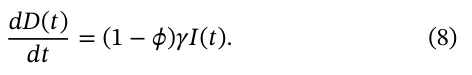

𝑑𝑡 = (1 − 𝜙) 𝛾𝐼(𝑡) . Combining Equations (3)–(8), the complete epidemiological model is 𝑑𝑆(𝑡) 𝑑𝑡 = − 𝜆(𝑡) 𝑆(𝑡) , 𝑑𝐿(𝑡) 𝑑𝑡 = (1 − 𝜋) 𝜆(𝑡) 𝑆(𝑡) − 𝛼(𝑡) 𝐿(𝑡) ,

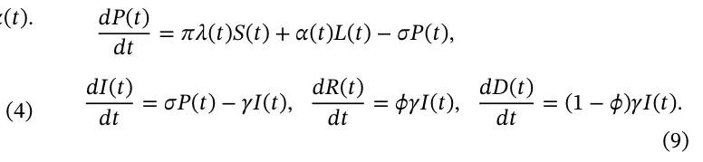

The general initial conditions are

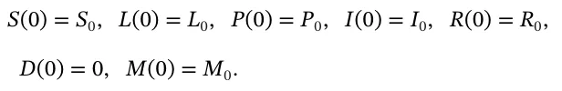

However, for a Mars-colony scenario focused on endogenous reactivation, one may set 𝐼0 = 𝑃0 = 0 and 𝐿0 *>* 0 . This represents a colony that begins with no active tuberculosis cases but contains one or more individuals with latent tuberculosis infection. In such a case, the first active case can only arise through the reactivation term 𝛼(𝑡) 𝐿(𝑡) , making immune suppression the initiating mechanism for the outbreak.

### 2.2 Countermeasures

We consider two post-reactivation countermeasures: isolation and medication. These interventions are activated after active tuberculosis appears in the colony and therefore act on the transmission and clinical-progression terms rather than on the initial latent reservoir [ 57, 58 ]. Formally, let 𝑢𝐼 (𝑡) ∈[0 , 1] denote the intensity of isolation at time 𝑡, where 𝑢𝐼 (𝑡) = 0 indicates no isolation and 𝑢𝐼 (𝑡) = 1 indicates maximal isolation. Isolation reduces the effective transmission rate according to 𝛽𝐼 (𝑡) = 𝛽 (1 − 𝜂𝐼 𝑢𝐼 (𝑡)) , where 𝜂𝐼 ∈[0 , 1] is the maximal effectiveness of isolation. If 𝜂𝐼 = 0 , isolation has no effect on transmission. If 𝜂𝐼 = 1 , maximal isolation can fully eliminate transmission from infectious individuals in the model. The force of infection under isolation is therefore

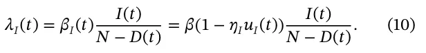

Medication is represented by a second control variable 𝑢𝑀 (𝑡) ∈ [0 , 1] , where 𝑢𝑀 (𝑡) = 0 indicates no active medication and 𝑢𝑀 (𝑡) = 1 indicates maximal medication intensity. Medication affects the model through two mechanisms. First, it increases the rate at which infectious individuals leave the infectious state ( ) 𝛾𝑀 (𝑡) = 𝛾 1 + 𝜂𝛾𝑢𝑀 (𝑡) , where 𝜂𝛾 ≥ 0 is the maximal propor-tional increase in the removal rate due to medication. Second, medication increases the probability that an infectious individual recovers rather than dies 𝜙𝑀 (𝑡) = 𝜙 + 𝜂𝜙𝑢𝑀 (𝑡)(1 − 𝜙) , where 𝜂𝜙 ∈ [0 , 1] is the maximal improvement in survival due to medication. Under this formulation, 𝜙𝑀 (𝑡) = 𝜙 when no medication is used, and 𝜙𝑀 (𝑡) ≤ 1 for all 𝑢𝑀 (𝑡) ∈[0 , 1] . Notably, medication-effectiveness parameters are assumed constant and do not explicitly account for possible radiation-induced drug degradation or spaceflight-related changes in patient pharmacological response.

Using isolation and medication, the controlled epidemiological dynamics are

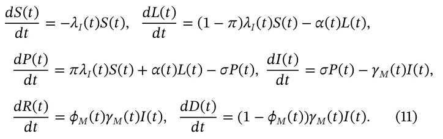

The use of both countermeasures is assumed to be costly. Isolation can reduce crew availability, impose psychological burden, and consume protected living space, while medication consumes limited medical stock, requires diagnostic confidence, and may produce side effects or drug-management constraints. Therefore, a countermeasure burden term takes the form [ 59, 60 ]:

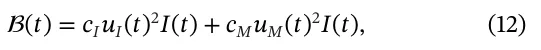

where 𝑐𝐼 and 𝑐𝑀 are the burden weights associated with isolation and medication, respectively. The quadratic form penalizes high-intensity countermeasure use more strongly than low-intensity use, reflecting the idea that strict isolation or aggressive medication becomes disproportionately costly in a constrained Mars-colony environment. Multiplication by 𝐼(𝑡) ensures that the burden is incurred primarily when countermeasures are applied to infectious individuals.

If medication stock is limited, an additional resource constraint can be imposed:

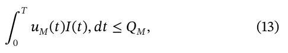

where 𝑄𝑀 is the total available medication capacity over the planning horizon 𝑇. Similarly, if isolation space or crew-support capacity is limited, one may impose

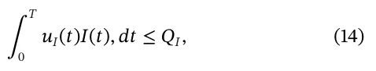

where 𝑄𝐼 is the total available isolation capacity. These constraints force the colony to use countermeasures strategically rather than applying maximal isolation and medication at all times.

The policy objective is to minimize disease burden, mortality, and countermeasure burden simultaneously:

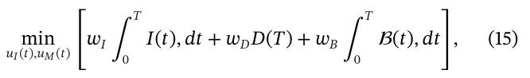

subject to 0 ≤ 𝑢𝐼 (𝑡) ≤ 1 , 0 ≤ 𝑢𝑀 (𝑡) ≤ 1 , and the resource constraints in Equations (13)–(14). Here, 𝑤𝐼 , 𝑤𝐷 , and 𝑤𝐵 are nonnegative weights assigned to infectious disease burden, mortality, and countermeasure burden, respectively. This formulation captures the operational tradeoff faced by a Mars colony where strong isolation and medication can suppress an outbreak, but excessive use may consume scarce resources and reduce mission functionality [ 61 ].

### 2.3 Outcome Metrics

In order to evaluate the epidemiological and operational consequences of latent tuberculosis reactivation in a Mars colony, we measure three model outcomes. The first captures how often latent or newly acquired infection progresses into active disease. The second captures how much infectious disease burden the colony experiences. The third captures the operational cost of using isolation and medication [ 62, 63 ].

The first outcome is the cumulative number of individuals who enter progressive active tuberculosis during the time horizon 𝑇. This metric is important because the central risk in the proposed Mars-colony scenario is not only direct transmission, but the activation of a silent latent reservoir. We define the cumulative active tuberculosis incidence 𝐶𝐴 (𝑡) by

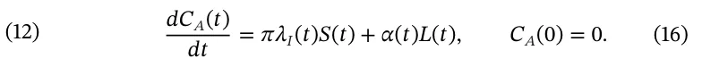

where the first term, 𝜋𝜆𝐼 (𝑡) 𝑆(𝑡) , represents newly infected susceptible individuals who progress directly into the progressive active state 𝑃. The second term, 𝛼(𝑡) 𝐿(𝑡) , represents latent tuberculosis reactivation.

The second outcome measures the clinical and transmission burden caused by active infectious tuberculosis. We define the infectious person-time burden as

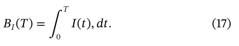

This metric represents the total amount of time the colony spends with infectious active tuberculosis present. It is relevant because transmission opportunity, clinical workload, monitoring demand, and operational disruption all increase with both the number of infectious individuals and the duration of infectiousness. We also measure the peak infectious burden,

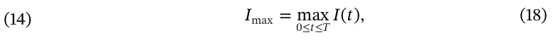

which captures the maximum simultaneous infectious load that the colony must manage. This is especially important in a small Mars colony, where even one or two active infectious cases may represent a substantial medical and operational burden.

The third outcome measures the burden of using isolation and medication. This metric is necessary because, in a resource-limited Mars colony, maximal use of all countermeasures at all times is unlikely to be operationally feasible. Isolation may reduce available crew labor and consume protected living space, while medication may consume limited pharmaceutical stock and require medical supervision. Therefore, we define the cumulative countermeasure burden as

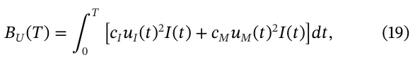

where 𝑢𝐼 (𝑡) ∈[0 , 1] is the isolation intensity, 𝑢𝑀 (𝑡) ∈[0 , 1] is the medication intensity, and 𝑐𝐼 , 𝑐𝑀 ≥ 0 are the respective burden weights. The quadratic form penalizes high-intensity intervention more strongly than low-intensity intervention, which is common in optimal-control formulations of biological and epidemiological systems [ 64 ].

For interpretation, we also report the controlled colony reproduction indicator:

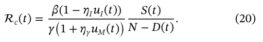

This quantity is not an additional objective term, but it helps interpret whether the current combination of isolation and medication is expected to suppress transmission. Values ℛ𝑐(𝑡) &lt; 1 indicate that active transmission is expected to decline under the current conditions, whereas ℛ𝑐(𝑡) &gt; 1 indicates that an infectious case may generate more than one secondary infection in the well-mixed colony. Reproduction-number thresholds are a standard tool for interpreting epidemic growth and control in compartmental models [ 65 ].

## 3 Optimal Control

The deterministic model in the previous section defines the average epidemiological dynamics of latent tuberculosis reactivation and transmission in a well-mixed Mars colony. However, for the purpose of countermeasure allocation, a deterministic Ordinary Differential Equation (ODE) model has two limitations.

First, the colony population may be small enough that stochastic effects, especially the timing of the first reactivation event, can strongly influence the outbreak trajectory. Second, isolation and medication are not merely continuous biological rates; they are operational decisions that must be allocated over time under resource and burden constraints. Therefore, we formulate the countermeasure problem as a sequential decision problem in which an agent observes the colony state and chooses isolation and medication intensities. The epidemiological dynamics are generated by an agent-based simulation (ABS), and the control policy is learned using deep reinforcement learning [ 66, 67 ].

### 3.1 Agent-Based Simulation Implementation

We construct an ABS that is consistent with the compartmental model but represents each colonist as an individual stochastic unit [ 68, 69 ]. Let 𝒜 = 1 , . . . , 𝑁 denote the set of colonists. Each colonist 𝑎 ∈ 𝒜 is assigned an epidemiological state 𝑋𝑎 (𝑡) ∈ 𝑆, 𝐿, 𝑃, 𝐼, 𝑅, 𝐷 , where the states have the same meaning as in the compartmental model. The aggregate compartment sizes are obtained by summing over agents:

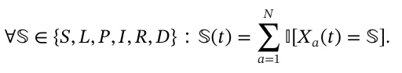

At each simulation step of length Δ𝑡, living susceptible agents 𝐼(𝑡) are exposed to the force of infection 𝜆𝐼 (𝑡) = 𝛽 (1 − 𝜂𝐼 𝑢𝐼 (𝑡)) 𝑁− 𝐷(𝑡) , where 𝑢𝐼 (𝑡) ∈[0 , 1] is the isolation intensity chosen by the controller. A susceptible agent becomes infected during the interval [ 𝑡 , 𝑡 + Δ𝑡) with probability 𝑝𝑆→𝐿,𝑃 (𝑡) = 1 − exp ( − 𝜆𝐼 (𝑡)Δ𝑡) .

If infection occurs, the agent enters the latent state 𝐿 with probability 1 − 𝜋 and the progressive active state (P) with probability 𝜋. Thus, the stochastic infection transition is

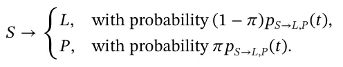

Latent agents reactivate according to the time-dependent reactivation rate 𝛼(𝑡) . The probability that a latent agent enters the progressive active state during one simulation step is 𝑝𝐿→𝑃 (𝑡) = 1 − exp ( − 𝛼(𝑡)Δ𝑡) , where 𝛼(𝑡) = 𝛼0 exp (𝜃(1 − 𝑀(𝑡))) .

The immune-competence variable 𝑀(𝑡) is updated at the colony level according to 𝑀(𝑡 + Δ𝑡) = 𝑀(𝑡) + Δ𝑡 [ 𝜌𝑀 (1 − 𝑀(𝑡)) − 𝜅𝐺 𝐺(𝑡)] .

After the update, 𝑀(𝑡 + Δ𝑡) is truncated to the interval [0 , 1] . This ensures that immune competence remains biologically interpretable. Progressive active agents become infectious with probability 𝑝𝑃→𝐼 = 1 − exp ( − 𝜎Δ𝑡) . Infectious agents leave the infectious state according to the medication-controlled removal ( ) rate 𝛾𝑀 (𝑡) = 𝛾 1 + 𝜂𝛾𝑢𝑀 (𝑡) , where 𝑢𝑀 (𝑡) ∈[0 , 1] is the medication intensity chosen by the controller. The probability that an infectious agent leaves the infectious state during one simulation step is 𝑝𝐼→𝑅,𝐷 (𝑡) = 1 − exp ( − 𝛾𝑀 (𝑡)Δ𝑡) . Conditional on leaving the infectious state, the agent recovers with probability 𝜙𝑀 (𝑡) = 𝜙 + 𝜂𝜙𝑢𝑀 (𝑡)(1 − 𝜙) , and dies with probability 1 − 𝜙𝑀 (𝑡) . Therefore,

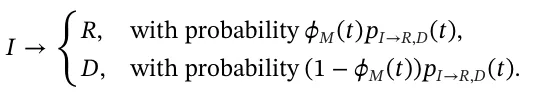

The simulation is initialized with 𝐼(0) = 𝑃(0) = 0 and 𝐿(0) *>* 0 in the endogenous reactivation scenario.

### 3.2 Deep Reinforcement Learning for Countermeasure Allocation Under Partial Observability

We formulate countermeasure allocation as a sequential decision-making problem in which the controller chooses isolation and medication intensities over time. However, unlike the ABS, the controller does not observe the true epidemiological state of every colonist as it is sampled from the colonists’ suits’ biometric indicators. This results in a partially observable control problem, which can be interpreted as a partially observable Markov decision process (MDP) [ 70, 71 ].

For each colonist 𝑎 ∈1 , . . . , 𝑁 , the true epidemiological state is 𝑋𝑎 (𝑡) ∈𝑆, 𝐿, 𝑃, 𝐼, 𝑅, 𝐷 . The monitoring system does not distinguish susceptible, latent, and progressive active individuals. Hence, all individuals in 𝑆, 𝐿, and 𝑃 appear identical to the controller and are observed as ˜𝑆 : 𝑋𝑎 (𝑡) ∈𝑆, 𝐿, 𝑃 ⟹ 𝑌𝑎 (𝑡) = ˜𝑆 . Thus, ˜𝑆 should not be interpreted as true susceptibility. Rather, it represents all individuals who are not detected as infectious, recovered, or dead. In addition, the controller does not observe the immune competence variable 𝑀(𝑡) . This means that the controller cannot directly observe the biological mechanism that increases the latent reactivation rate 𝛼(𝑡) .

The infectious state is detected probabilistically through the colony monitoring system. Let 𝜏𝑎𝐼(𝑡) denote the number of consecutive time steps for which colonist 𝑎 has been in the true infectious state 𝐼. We define 𝜁𝐼 ∈ (0, 1) as the one-step probability that a truly infectious individual remains undetected. Therefore, the probability that an infectious colonist remains undetected after 𝜏𝑎𝐼(𝑡) time steps is Pr(𝑌𝑎(𝑡) ≠ 𝐼̃ ∣ 𝑋𝑎(𝑡) = 𝐼) = 𝜁𝐼𝜏𝑎𝐼(𝑡). Equivalently, the probability that an infectious colonist is detected by time 𝑡 is Pr(𝑌𝑎(𝑡) = 𝐼̃ ∣ 𝑋𝑎(𝑡) = 𝐼) = 1 − 𝜁𝐼𝜏𝑎𝐼(𝑡). The recovered state is detected in the same manner. Let 𝜏𝑎𝑅(𝑡) denote the number of consecutive time steps for which colonist 𝑎 has been in the true recovered state 𝑅, and let 𝜁𝑅 ∈ (0, 1) denote the one-step probability that a truly recovered individual remains undetected. Then Pr(𝑌𝑎(𝑡) ≠ 𝑅̃ ∣ 𝑋𝑎(𝑡) = 𝑅) = 𝜁𝑅𝜏𝑎𝑅(𝑡) and Pr(𝑌𝑎(𝑡) = 𝑅̃ ∣ 𝑋𝑎(𝑡) = 𝑅) = 1 − 𝜁𝑅𝜏𝑎𝑅(𝑡). Dead individuals are assumed to be observed without uncertainty: 𝑋𝑎(𝑡) = 𝐷 ⟹ 𝑌𝑎(𝑡) = 𝐷.

The PPO policy receives the observation vector

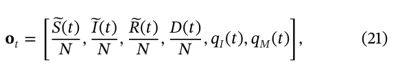

where 𝑞𝐼 (𝑡) and 𝑞𝑀 (𝑡) are the remaining isolation and medication capacities, respectively. If explicit capacity depletion is not modeled, 𝑞𝐼 (𝑡) and 𝑞𝑀 (𝑡) are omitted. Importantly, the observation vector does not include 𝐿(𝑡) , 𝑃(𝑡) , true 𝐼(𝑡) , true 𝑅(𝑡) , or 𝑀(𝑡) .

The action vector is 𝐚𝑡 = [ 𝑢𝐼 (𝑡) , 𝑢𝑀 (𝑡)] such that 𝑢𝐼 (𝑡) , 𝑢𝑀 (𝑡) ∈ [0 , 1] , where 𝑢𝐼 (𝑡) is the isolation intensity and 𝑢𝑀 (𝑡) is the medication intensity. However, these countermeasures can only be applied to individuals detected as infectious. Thus, isolation and medication affect agents with 𝑌𝑎 (𝑡) = ˜𝐼 , not all agents whose true state is 𝐼. In the individual-based simulator, this is implemented directly: if 𝑋𝑎 (𝑡) = 𝐼 and 𝑌𝑎 (𝑡) = ˜𝐼 , then isolation and medication modify that agent’s transition and transmission parameters; if 𝑋𝑎 (𝑡) = 𝐼 but 𝑌𝑎 (𝑡) = ˜𝑆 , the individual remains undetected, non-isolated, and untreated during that time step.

The reward is computed from the true epidemiological outcomes because deaths and infectious burden represent the actual mission cost. However, the policy chooses actions using only the partially observed vector 𝐨𝑡 . The immediate reward is

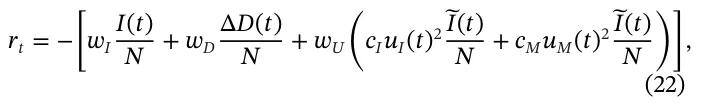

where Δ𝐷(𝑡) = 𝐷(𝑡 + Δ𝑡) − 𝐷(𝑡) . The first term penalizes the true infectious burden, the second term penalizes deaths, and the third term penalizes the operational burden of applying isolation and medication to detected infectious individuals. This formulation creates a realistic control problem: the controller is penalized for hidden infectious burden but can only act on detected cases.

The reinforcement-learning objective is to maximize the expected discounted return

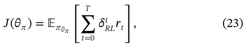

where 𝜋𝜃𝜋(𝐚𝑡 |𝐨𝑡 ) is the stochastic policy parameterized by neural-network weights 𝜃𝜋, and 𝛿𝑅𝐿 ∈(0 , 1] is the reinforcement-learning discount factor. We use 𝛿𝑅𝐿 rather than 𝜁 to avoid confusion with the monitoring parameters 𝜁𝐼 and 𝜁𝑅 .

The policy is trained using Proximal Policy Optimization (PPO), a policy-gradient method that improves stability by clipping large policy updates [ 72, 73 ]. Let

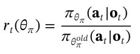

be the probability ratio between the updated policy and the previous policy. PPO maximizes the clipped surrogate objective

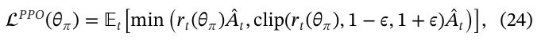

where ̂𝐴𝑡 is an advantage-function estimator, and 𝜖 is the clipping parameter. In the present setting, PPO learns a mapping from imperfect monitoring information to countermeasure intensities. For example, the policy may learn to apply medication aggressively once ˜𝐼 (𝑡) *>* 0 , conserve medication when no infectious cases are detected, or combine isolation and medication when the detected infectious count persists across multiple time steps [ 61, 74 ].

Training proceeds by repeatedly simulating Mars-colony outbreak episodes. At each time step, the monitoring process maps the true agent states 𝑋𝑎 (𝑡) to observed states 𝑌𝑎 (𝑡) , the PPO policy observes 𝐨𝑡 , selects 𝐚𝑡 = [ 𝑢𝐼 (𝑡) , 𝑢𝑀 (𝑡)] , and the ABS advances the true epidemic state.

## 4 Experiments

In this section, we outline in silico experiments that are designed to evaluate both the epidemiological behavior of the proposed Mars-colony tuberculosis model and the effectiveness of adaptive countermeasure allocation. We first define the experimental setup, followed by the obtained results.

### 4.1 Setup

Unless otherwise stated, time is measured in days, and the simulation horizon is 𝑇 = 1095 , corresponding to three Earth years. The default colony size is 𝑁 = 100 . The baseline scenario is an endogenous-reactivation scenario with 𝐿(0) *>* 0 , 𝑃(0) = 0 , and 𝐼(0) = 0 . Thus, the colony initially contains latent tuberculosis carriers, but no active tuberculosis cases, and the first active case can arise only through the reactivation term 𝛼(𝑡) 𝐿(𝑡) . The baseline latent reservoir, 𝐿(0) = 10 , represents a deliberately selected stress-test scenario rather than an estimate of tuberculosis prevalence among screened astronaut crews.

In addition, the model assumes that chronic galactic cosmic radiation affects tuberculosis risk indirectly through immune competence rather than directly creating infection. We define (G(t)) as the effective chronic galactic cosmic radiation exposure rate after colony shielding. In the baseline experiments, we use a constant exposure rate 𝐺(𝑡) = 𝐺0 (1 − 𝜂𝐺 ) , where 𝐺0 is the unshielded Mars surface radiation exposure rate, and 𝜂𝐺 ∈[0 , 1] is the effective shielding level. In the baseline setup, 𝜂𝐺 = 0 , so 𝐺(𝑡) = 𝐺0 . The radiation immune-suppression function is defined as Ψ𝐺 (𝑡) = 𝜅𝐺 𝐺(𝑡) , where 𝜅𝐺 converts chronic radiation exposure into loss of average immune competence.

Table 1 summarizes all parameters used in the experiments. Parameters are divided into four groups: ODE epidemiological parameters, radiation and immune parameters, ABS parameters, and PPO control parameters. When a value is not directly available from the literature, it is marked as assumed and evaluated through sensitivity analysis. Specifically, the baseline reactivation sensitivity is set to 𝜃 = 3 , with values of 1 and 7 examined in the sensitivity analysis to assess uncertainty in this assumption.

The experiments are organized into three complementary parts. First, we study the uncontrolled disease and immune-radiation dynamics in order to characterize when latent tuberculosis reactivation becomes epidemiologically important in a Mars-colony setting. In this part, no post-reactivation intervention is applied, i.e., 𝑢𝐼 (𝑡) = 𝑢𝑀 (𝑡) = 0 . We use the baseline parameter set in Table 1 and then perform sensitivity analyzes over the main uncertain and biologically relevant parameters. These include the initial number of latent tuberculosis carriers 𝐿(0) , the transmission rate 𝛽, the radiation exposure level 𝐺(𝑡) , the shielding level 𝜂𝐺 , the immune-recovery rate 𝜌𝑀 , the radiation immune-suppression coefficient 𝜅𝐺 , and the reactivation sensitivity parameter 𝜃. The goal of this experiment is to learn which parts of the coupled radiation–immune–tuberculosis system most strongly determine outbreak initiation, cumulative active tuberculosis incidence, peak infectious burden, mortality, and the timing of the first active case.

Second, we compare countermeasure strategies after active tuberculosis appears in the colony. We evaluate five policies under identical stochastic simulation conditions and identical initial states: no intervention, three baseline intervention policies, and the PPO-learned intervention policy. The no-intervention policy sets 𝑢𝐼 (𝑡) = 𝑢𝑀 (𝑡) = 0 throughout the simulation. The three baseline policies are: an isolation-only policy, in which detected infectious individuals are isolated with a fixed intensity; a medication-only policy, in which detected infectious individuals receive medication with a fixed intensity; and a combined fixed intervention policy, in which both isolation and medication are applied once at least one infectious individual is detected. These baseline policies provide interpretable reference strategies against which the PPO policy can be compared. The PPO policy chooses 𝑢𝐼 (𝑡) and 𝑢𝑀 (𝑡) adaptively from the partially observed colony state in Equation (21). All policies are evaluated using the same Monte Carlo seeds and are compared according to cumulative active tuberculosis incidence 𝐶𝐴 (𝑇) , infectious person-time burden 𝐵𝐼 (𝑇) , peak infectious burden 𝐼max , deaths 𝐷(𝑇) , cumulative countermeasure burden 𝐵𝑈 (𝑇) , and the policy objective in Equation (15).

Third, we examine how the learned intervention changes when the underlying dynamics change. This experiment serves both as a sensitivity analysis of the control policy and as an explanation of the PPO-learned intervention. We evaluate the trained PPO policy across parameter regimes that modify the epidemic, immune, and observation dynamics, including changes in 𝛽, 𝐿(0) , 𝐺(𝑡) , 𝜂𝐺 , 𝜅𝐺 , 𝜃, 𝜌𝑀 , 𝜁𝐼 , and 𝜁𝑅 . For each regime, we record not only epidemiological outcomes but also the action trajectories 𝑢𝐼 (𝑡) and 𝑢𝑀 (𝑡) . We then summarize how the learned policy allocates isolation and medication as a function of detected infectious burden, remaining resources, and outbreak stage. This analysis allows us to determine whether the PPO policy behaves consistently with epidemiological intuition, for example by increasing isolation when the detected infectious burden rises, increasing medication when mortality risk is high, or conserving resources when detected cases are absent. In addition, we use action-response plots and policy heatmaps over the observed state variables to explain how the learned intervention adapts to changes in the hidden radiation-mediated reactivation dynamics. Figure 2 provides a schematic view of the experimental design.

### 4.2 Results

We first examined the natural history of latent tuberculosis reactivation in the Mars-colony model without post-reactivation intervention, i.e., with 𝑢𝐼 (𝑡) = 𝑢𝑀 (𝑡) = 0 . The purpose of this experiment was to establish whether active tuberculosis can emerge endogenously from the latent reservoir when the colony begins with no progressive or infectious active cases. Figure 3 shows the baseline uncontrolled trajectories. The susceptible population decreased gradually over the three-year horizon, while latent, progressive, infectious, recovered, and dead states accumulated over time. In parallel, the colony-level immune competence 𝑀(𝑡) declined from its initial value of 1 to approximately 0.77, while the reactivation rate 𝛼(𝑡) increased. This supports the central mechanism of the model: chronic radiation does not create infection directly, but reduces immune competence and thereby increases latent tuberculosis reactivation.

In the same settings, the timing of the first active case was highly stochastic. Figure 4 shows that the median time to first active tuberculosis was 98.5 days, with a wide 95% interval of 7.95–403.9 days. Thus, even under identical baseline parameters, outbreak initiation can occur very early in some simulations and much later in others. This result is important for mission planning because the operational risk is not only the size of an outbreak after it begins, but also the uncertainty in when the first active case appears.

We next compared the learned PPO intervention policy with the four reference policies. Notably, the policies were evaluated under identical stochastic simulation settings and compared using cumulative active incidence, infectious burden, mortality, peak infectious burden, countermeasure burden, and the overall objective. Table 2 shows that all intervention policies reduced disease burden relative to the no-intervention baseline, but they did so through different tradeoffs. Without intervention, the colony experienced the highest infectious burden, with a mean value of 2405 infectious person-days, 1.04 deaths, and an overall objective value of 2457. Isolation alone reduced cumulative active incidence from 12.47 to 8.22 and reduced infectious burden by 23.24%, indicating that transmission suppression is effective once infectious cases are detected. However, its effect on mortality was moderate, with deaths reduced by 25.00%. In particular, medication-only produced a different pattern. Although it reduced cumulative active incidence less than isolation-only, it achieved a substantially larger reduction in infectious burden and mortality. Mean deaths decreased from 1.04 under no intervention to 0.22 under medication-only, corresponding to a 78.85% reduction. This reflects the direct effect of medication on shortening infectious duration and increasing recovery probability. Thus, the reported 78.85% mortality reduction is conditional on the assumed medication parameters and should not be interpreted as a clinical efficacy estimate for Mars missions. The combined fixed policy achieved the strongest disease suppression overall, producing the lowest cumulative active incidence, infectious burden, peak infectious burden, deaths, and objective value. However, this improvement came at the cost of the highest countermeasure burden. Notably, The PPO-learned policy occupied an intermediate position between the passive and aggressive fixed strategies. It reduced deaths by 48.08% and infectious burden by 31.87% relative to no intervention, while using the lowest countermeasure burden among the active policies. Its objective value was lower than no intervention and isolation-only, but higher than medication-only and combined fixed intervention. Thus, the learned policy should not be interpreted as the most disease-suppressive strategy. Rather, it learned a resource-conserving adaptive response that provides meaningful reductions in infectious burden and mortality while avoiding the higher operational cost of the fixed combined policy.

<figure class="table-figure" id="table-1">
<figcaption><strong>TABLE 1</strong> The model’s parameters with their default values.</figcaption>

<table><tr><th>Parameter</th><th>Description</th><th>Default value</th><th>Source</th></tr><tr><th colspan="4">ODE epidemiological parameters</th></tr><tr><td>𝑁</td><td>Initial colony size</td><td>100</td><td>Assumed</td></tr><tr><td>𝑇</td><td>Simulation horizon</td><td>1095 days</td><td>Assumed</td></tr><tr><td>𝛽</td><td>Effective transmission rate</td><td>0.0083 day−1</td><td>[75]</td></tr><tr><td>𝜋</td><td>Probability that a new infection enters 𝑃 rather than 𝐿</td><td>0.05</td><td>[27]</td></tr><tr><td>𝛼0</td><td>Baseline LTBI reactivation rate under normal immune competence</td><td>2.8 × 10−6 day−1</td><td>[32, 33]</td></tr><tr><td>𝜃</td><td>Sensitivity of reactivation to immune suppression</td><td>3</td><td>Assumed</td></tr><tr><td>𝜎</td><td>Rate from progressive active tuberculosis to infectious tuberculosis</td><td>1∕90 day−1</td><td>[27, 35]</td></tr><tr><td>𝛾</td><td>Baseline rate at which infectious individuals leave 𝐼</td><td>1∕180 day−1</td><td>[76]</td></tr><tr><td>𝜙</td><td>Probability of recovery after leaving 𝐼</td><td>0.88</td><td>[77]</td></tr><tr><th colspan="4">Radiation and immune parameters</th></tr><tr><td>𝐺0</td><td>Unshielded chronic Mars surface radiation exposure rate</td><td>0.64 mSv day−1</td><td>[15]</td></tr><tr><td>𝜂𝐺</td><td>Effective shielding level for chronic radiation</td><td>0</td><td>Assumed</td></tr><tr><td>𝜌𝑀</td><td>Immune recovery rate toward baseline</td><td>1∕180 day−1</td><td>Assumed</td></tr><tr><td>𝜅𝐺</td><td>Immune suppression per unit chronic radiation exposure</td><td>2.0 × 10−3 mSv−1</td><td>Assumed</td></tr><tr><th colspan="4">Agent-based simulation parameters</th></tr><tr><td>Δ𝑡</td><td>Simulation time step</td><td>1 day</td><td>Assumed</td></tr><tr><td>𝑛eval</td><td>Monte Carlo replications per evaluated policy</td><td>250</td><td>Assumed</td></tr><tr><td>—</td><td>Transition probability from rate 𝑟(𝑡) over one step</td><td>1 − exp[−𝑟(𝑡)Δ𝑡]</td><td>[78]</td></tr><tr><th colspan="4">Monitoring and partial observability parameters</th></tr><tr><td>𝜁𝐼</td><td>One-step probability that a truly infectious individual remains undetected</td><td>0.85</td><td>Assumed</td></tr><tr><td>𝜁𝑅</td><td>One-step probability that a truly recovered individual remains undetected</td><td>0.85</td><td>Assumed</td></tr><tr><th colspan="4">Countermeasure and PPO parameters</th></tr><tr><td>𝜂𝐼</td><td>Maximum proportional reduction in transmission due to isolation</td><td>0.75</td><td>Assumed</td></tr><tr><td>𝜂𝛾</td><td>Maximum proportional increase in removal rate due to medication</td><td>1.0</td><td>Assumed</td></tr><tr><td>𝜂𝜙</td><td>Maximum improvement in recovery probability due to medication</td><td>0.8</td><td>Assumed</td></tr><tr><td>𝑐𝐼</td><td>Isolation burden weight</td><td>0.10</td><td>Assumed</td></tr><tr><td>𝑐𝑀</td><td>Medication burden weight</td><td>0.10</td><td>Assumed</td></tr><tr><td>𝑤𝐼</td><td>Infectious-burden reward weight</td><td>1</td><td>Assumed</td></tr><tr><td>𝑤𝐷</td><td>Mortality reward weight</td><td>50</td><td>Assumed</td></tr><tr><td>𝑤𝑈</td><td>Countermeasure-burden reward weight</td><td>1</td><td>Assumed</td></tr><tr><td>𝛿𝑅𝐿</td><td>RL discount factor</td><td>0.99</td><td>[71]</td></tr><tr><td>—</td><td>Actor–critic hidden layers</td><td>2 layers, 64 units each</td><td>[79]</td></tr><tr><td>—</td><td>Learning rate</td><td>3 × 10−4</td><td>[79]</td></tr><tr><td>—</td><td>Generalized Advantage Estimation (GAE) parameter</td><td>0.95</td><td>[79]</td></tr><tr><td>—</td><td>Clip range</td><td>0.20</td><td>[72]</td></tr><tr><td>—</td><td>Rollout length</td><td>2048 steps</td><td>[79]</td></tr><tr><td>—</td><td>Batch size</td><td>64</td><td>[79]</td></tr><tr><td>—</td><td>Optimization epochs per rollout</td><td>10</td><td>[79]</td></tr></table>

</figure>

<figure id="fig-2">
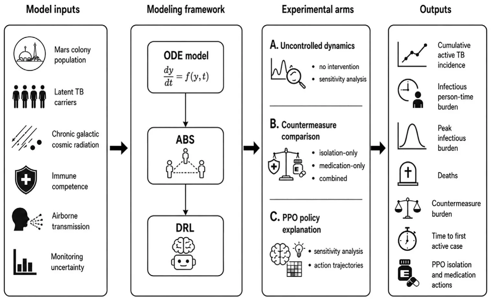
<figcaption><strong>FIGURE 2</strong> A schematic view of the experimental design.</figcaption>
</figure>

The trajectory-level comparison in Figure 5 explains why the policies differ. Isolation-only mainly reduced transmission, whereas medication-only shortened infectious duration and improved recovery outcomes. The combined fixed policy applied both interventions after detection, producing the strongest suppression. The PPO policy, however, learned a medication-dominant strategy and used essentially no isolation in the evaluated baseline setting. This behavior reduced mortality and infectious burden while avoiding the higher intervention burden associated with fixed combined control.

We then evaluated the PPO policy under altered biological, epidemiological, radiation, and monitoring regimes. This experiment asks whether the learned controller remains useful when the underlying Mars-colony risk environment changes. Table 3 reports representative regimes. Increasing the latent reservoir 𝐿(0) , the transmission rate 𝛽, the radiation exposure level 𝐺0 , the immune-suppression coefficient 𝜅𝐺 , or the reactivation sensitivity 𝜃 increased cumulative active incidence, infectious burden, deaths, and the objective. In contrast, stronger shielding 𝜂𝐺 and faster immune recovery 𝜌𝑀 reduced disease burden. A notable result is that the PPO policy remained qualitatively similar across regimes. Mean isolation use remained approximately zero, whereas mean medication intensity remained around 0.75 in most settings. Thus, the learned policy generalized mainly by applying a stable medication-oriented response rather than by switching between medication and isolation. This is useful because it makes the policy interpretable, but it also reveals a limitation: under the current reward and action design, PPO did not learn a strong role for isolation.

Finally, we performed a one-at-a-time sensitivity analysis to identify which model assumptions most strongly determine outbreak risk. Figure 6 summarizes the percentage change, relative to the baseline scenario, in five outcome metrics: cumulative active incidence (CAI), deaths, infectious burden (IB), peak infectious burden (PIB), and time to first active case (TOFAC). For CAI, deaths, IB, and PIB, positive values indicate an increase in epidemiological burden. For TOFAC, the interpretation is reversed: positive values indicate that the first active case occurs later, whereas negative values indicate earlier outbreak initiation. The sensitivity analysis shows that the strongest drivers of outbreak risk are the initial latent reservoir and the radiation–immune– reactivation pathway. The initial number of latent carriers 𝐿(0) has a particularly large effect on TOFAC. When 𝐿(0) is small, the first active case is substantially delayed, whereas larger latent reservoirs shorten the time to first active disease and increase cumulative active incidence, deaths, and infectious burden. This result indicates that pre-mission latent tuberculosis screening is one of the most important prevention measures in the model, because it affects the probability and timing of endogenous reactivation before any transmission chain begins. In addition, the radiation-related parameters also have a consistent effect. Increasing the chronic radiation exposure 𝐺0 increases CAI, deaths, IB, and PIB, while reducing TOFAC. A similar pattern appears for the radiation immune-suppression coefficient 𝜅𝐺 . Thus, stronger radiation exposure or stronger immune sensitivity to radiation leads to earlier and larger outbreaks. The reactivation sensitivity parameter 𝜃 produces one of the clearest monotonic effects: larger values sharply increase disease burden and shift the first active case earlier. In contrast, faster immune recovery, represented by larger 𝜌𝑀 , reduces most disease-burden metrics. This supports the central mechanism of the model: outbreak initiation is governed not only by tuberculosis transmission, but by the interaction between radiation exposure, immune suppression, and latent tuberculosis reactivation. Furthermore, the monitoring parameters 𝜁𝐼 and 𝜁𝑅 show weaker effects than the biological and radiation parameters. Since larger 𝜁 values correspond to a higher probability of remaining undetected at each time step, increasing 𝜁𝐼 modestly worsens several outcomes, especially deaths. This occurs because delayed infectious-case detection delays the application of countermeasures. The effect of 𝜁𝑅 is smaller and less systematic, as recovered-state detection has a weaker direct influence on transmission and treatment decisions than infectious-state detection. Overall, the sensitivity results separate two mechanisms: the timing of outbreak initiation is controlled mainly by the latent reservoir and radiation-mediated reactivation, whereas the magnitude of the outbreak after initiation is shaped by the resulting infectious burden and the ability to detect and treat active cases.

<figure id="fig-3">
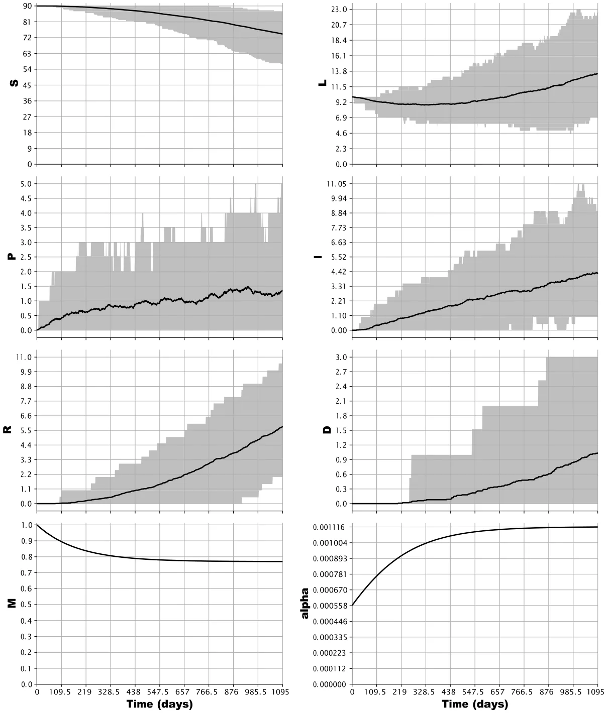
<figcaption><strong>FIGURE 3</strong> Uncontrolled baseline trajectories. The colony starts with latent tuberculosis carriers but no progressive or infectious active tuberculosis cases. The solid lines show mean trajectories and shaded regions indicate stochastic variability across 𝑛 = 1000 Monte Carlo simulations.</figcaption>
</figure>

<figure class="table-figure" id="table-2">
<figcaption><strong>TABLE 2</strong> Policy comparison summary. Values are means across Monte Carlo simulations. Percentage reductions are computed relative to the no-intervention policy.</figcaption>

<table><tr><th>Policy</th><th>Cumulative active incidence</th><th>Infectious burden</th><th>Peak infectious burden</th><th>Deaths</th><th>Countermeasure burden</th><th>Objective</th><th>Death reduction</th><th>Infectious-burden reduction</th></tr><tr><td>No intervention</td><td>12.47</td><td>2405</td><td>5.65</td><td>1.04</td><td>0.000</td><td>2457</td><td>0.00%</td><td>0.00%</td></tr><tr><td>Isolation only</td><td>8.22</td><td>1846</td><td>4.03</td><td>0.78</td><td>1.802</td><td>1887</td><td>25.00%</td><td>23.24%</td></tr><tr><td>Medication only</td><td>10.48</td><td>1414</td><td>3.82</td><td>0.22</td><td>1.360</td><td>1426</td><td>78.85%</td><td>41.21%</td></tr><tr><td>Combined fixed</td><td>7.89</td><td>1156</td><td>3.25</td><td>0.19</td><td>2.230</td><td>1168</td><td>81.73%</td><td>51.93%</td></tr><tr><td>PPO learned</td><td>11.00</td><td>1638</td><td>4.14</td><td>0.54</td><td>0.874</td><td>1666</td><td>48.08%</td><td>31.87%</td></tr></table>

</figure>

<figure id="fig-4">
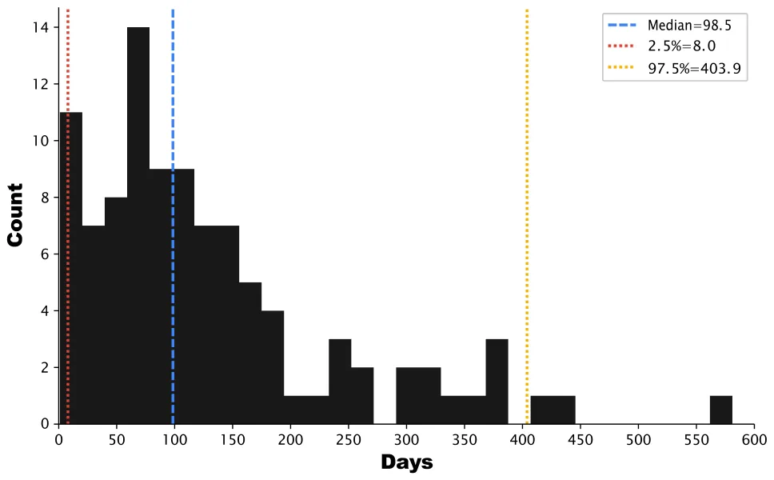
<figcaption><strong>FIGURE 4</strong> Distribution of the time to the first active tuberculosis case under the uncontrolled baseline scenario. The dashed vertical line marks the median and the dotted vertical lines mark the 95% interval.</figcaption>
</figure>

## 5 Discussion

In this study, we developed a stochastic host–radiation– pathogen–habitat model to examine how chronic Mars-surface radiation may contribute to latent tuberculosis reactivation through immune suppression, and how countermeasures can be allocated once active disease appears in the colony. The main outcome is that latent tuberculosis reactivation can become an operationally meaningful risk even when the colony begins with no active infectious cases. Across the experiments, the uncontrolled simulations showed that the first active case is typically driven by the interaction between latent infection, immune suppression, and reactivation sensitivity. In contrast, the intervention experiments showed that adaptive control can reduce infectious burden and deaths more efficiently than fixed countermeasure rules, with the PPO-learned policy providing the best balance between disease suppression and countermeasure burden. Although tuberculosis provides a tractable case study, other agents, including latent herpesviruses, opportunistic bacteria, and respiratory pathogens, may similarly threaten settlement health [ 31, 43 ]. Nonetheless, adapting the framework to such pathogens would require corresponding changes to the progression, transmission, and detection assumptions.

The uncontrolled simulations indicate that the most important early event is not a large transmission chain, but the first transition from latent infection into progressive active disease. Figure 4 shows that the median time to first active tuberculosis was 98.5 days, but with a wide 95% interval. This wide distribution is important because it means that two colonies with identical parameters may face very different operational timelines. In this respect, the results agree with broader stochastic epidemic theory: early outbreak behavior in small or structured populations can be dominated by chance events, so mean trajectories alone are insufficient for risk planning [ 80 ]. Here, chance events refer to stochastic individual-level transitions, including latent reactivation, disease progression, transmission, and recovery. Their relative influence is generally greater in small populations, while larger or spatially structured settlements may exhibit different dynamics requiring separate simulations. For a Mars colony, this implies that health planning should be based not only on expected outbreak size, but also on early-reactivation scenarios and high-percentile medical-resource demand. The intervention results further show that the choice of control policy changes both epidemiological burden and operational burden. As summarized in Table 2 , all active policies reduced infectious burden relative to no intervention, but no single policy dominated all metrics. The combined fixed policy produced the lowest cumulative active incidence, infectious burden, peak infectious burden, deaths, and objective value, but it also had the highest countermeasure burden, as expected. The dynamic-regime analysis in Table 3 reinforces this interpretation. Across changes in 𝐺0 , 𝐿(0) , 𝛽, 𝜂𝐺 , 𝜅𝐺 , 𝜌𝑀 , and 𝜃, the learned policy retained nearly the same qualitative action pattern: mean medication intensity remained high, whereas mean isolation remained approximately zero. This makes the policy interpretable, but it also shows that the policy did not learn a rich switching strategy between isolation and medication. The result refines the reinforcement-learning contribution of the paper: PPO is useful here as a partially observable adaptive policy benchmark, but the learned behavior remains shaped by reward design, intervention costs, and the available observation variables. This agrees with broader work on real-world reinforcement learning, which emphasizes that deployment-relevant RL must address partial observability, safety, robustness, and reward specification rather than only maximizing simulated return [ 81, 82 ].

<figure id="fig-5">
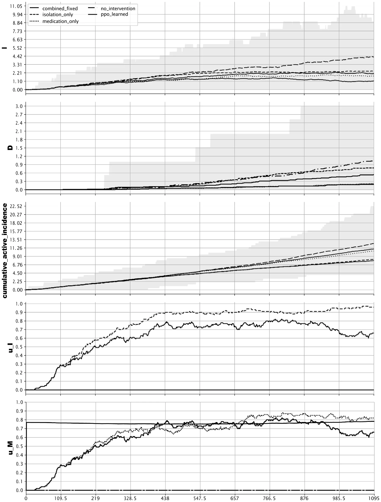
<figcaption><strong>FIGURE 5</strong> Policy trajectories for infectious cases, deaths, cumulative active incidence, and control actions.</figcaption>
</figure>

<figure class="table-figure" id="table-3">
<figcaption><strong>TABLE 3</strong> Representative PPO outcomes under altered model regimes. Values are means across Monte Carlo simulations. The baseline regime is 𝐺0 = 0.64 , 𝐿(0) = 10 , 𝛽 = 0.0083 , 𝜂𝐺 = 0 , 𝜅𝐺 = 0.002 , 𝜌𝑀 = 0.00556 , and 𝜃 = 3 .</figcaption>

<table><tr><th>Changed parameter</th><th>Value</th><th>Cumulative active incidence</th><th>Infectious burden</th><th>Deaths</th><th>Countermeasure burden</th><th>Mean 𝑢𝐼</th><th>Mean 𝑢𝑀</th></tr><tr><td>𝐺0</td><td>0.32</td><td>8.42</td><td>1223</td><td>0.320</td><td>0.655</td><td>0.000</td><td>0.763</td></tr><tr><td>𝐺0</td><td>0.64</td><td>10.56</td><td>1548</td><td>0.424</td><td>0.823</td><td>0.000</td><td>0.761</td></tr><tr><td>𝐺0</td><td>1.00</td><td>14.40</td><td>2029</td><td>0.604</td><td>1.065</td><td>0.000</td><td>0.758</td></tr><tr><td>𝐿(0)</td><td>1</td><td>1.14</td><td>171.2</td><td>0.020</td><td>0.093</td><td>0.000</td><td>0.768</td></tr><tr><td>𝐿(0)</td><td>10</td><td>10.56</td><td>1548</td><td>0.424</td><td>0.823</td><td>0.000</td><td>0.761</td></tr><tr><td>𝐿(0)</td><td>20</td><td>20.33</td><td>3061</td><td>0.900</td><td>1.594</td><td>0.000</td><td>0.752</td></tr><tr><td>𝛽</td><td>0.004</td><td>8.46</td><td>1323</td><td>0.368</td><td>0.710</td><td>0.000</td><td>0.763</td></tr><tr><td>𝛽</td><td>0.0083</td><td>10.56</td><td>1548</td><td>0.424</td><td>0.823</td><td>0.000</td><td>0.761</td></tr><tr><td>𝛽</td><td>0.016</td><td>15.65</td><td>2069</td><td>0.688</td><td>1.069</td><td>0.000</td><td>0.755</td></tr><tr><td>𝜂𝐺</td><td>0.00</td><td>10.56</td><td>1548</td><td>0.424</td><td>0.823</td><td>0.000</td><td>0.761</td></tr><tr><td>𝜂𝐺</td><td>0.50</td><td>8.42</td><td>1223</td><td>0.320</td><td>0.655</td><td>0.000</td><td>0.763</td></tr><tr><td>𝜂𝐺</td><td>0.75</td><td>7.49</td><td>1071</td><td>0.316</td><td>0.576</td><td>0.000</td><td>0.765</td></tr><tr><td>𝜅𝐺</td><td>0.001</td><td>8.42</td><td>1223</td><td>0.320</td><td>0.655</td><td>0.000</td><td>0.763</td></tr><tr><td>𝜅𝐺</td><td>0.002</td><td>10.56</td><td>1548</td><td>0.424</td><td>0.823</td><td>0.000</td><td>0.761</td></tr><tr><td>𝜅𝐺</td><td>0.004</td><td>17.33</td><td>2419</td><td>0.764</td><td>1.254</td><td>0.000</td><td>0.755</td></tr><tr><td>𝜌𝑀</td><td>0.00278</td><td>15.39</td><td>2116</td><td>0.656</td><td>1.100</td><td>0.000</td><td>0.756</td></tr><tr><td>𝜌𝑀</td><td>0.00556</td><td>10.54</td><td>1545</td><td>0.424</td><td>0.822</td><td>0.000</td><td>0.761</td></tr><tr><td>𝜌𝑀</td><td>0.01111</td><td>8.59</td><td>1265</td><td>0.356</td><td>0.678</td><td>0.000</td><td>0.763</td></tr><tr><td>𝜃</td><td>1</td><td>7.89</td><td>1118</td><td>0.292</td><td>0.601</td><td>0.000</td><td>0.765</td></tr><tr><td>𝜃</td><td>3</td><td>10.56</td><td>1548</td><td>0.424</td><td>0.823</td><td>0.000</td><td>0.761</td></tr><tr><td>𝜃</td><td>7</td><td>20.55</td><td>2885</td><td>0.892</td><td>1.476</td><td>0.000</td><td>0.751</td></tr></table>

</figure>

From an applicative perspective, the main lesson of the model is that the colony should not wait for a large number of infectious cases before acting aggressively and allocating a lot of resources. In many simulations, the operationally important event was not a large transmission chain but the first radiation-mediated transition from latent infection to progressive active disease. This means that a Mars-colony health system should treat the appearance of even a single detected infectious case as evidence that an unobserved reactivation process may already be underway. A possible operational implication is to initiate rapid diagnostic confirmation and containment after the first suspected or detected case, rather than gradually increasing intervention intensity as additional cases appear. These represent distinct response strategies, but were not separately evaluated in the present experiments, which optimize isolation and medication rather than diagnostic testing. In a small colony, the difference between one and two infectious cases may already represent a major increase in medical workload, contact tracing burden, and mission disruption.

A second implication is that resources should be allocated to reduce uncertainty, not only to treat visible disease. The PPO policy performed well because it was trained under partial observability: it could not see 𝐿(𝑡) , 𝑃(𝑡) , or 𝑀(𝑡) , and therefore had to infer hidden risk from delayed and imperfect observations. This suggests that monitoring quality is itself a countermeasure. Improving the probability and speed of detecting active tuber-culosis may be as valuable as increasing medication or isolation capacity, because earlier detection changes the timing of intervention before the infectious burden accumulates. Practically, this supports investing in repeated respiratory screening, symptom-triggered molecular testing, environmental air monitoring, and decision rules that account for detection delay. However, these monitoring approaches would require validation under mission-relevant conditions to establish their sensitivity, specificity, false-negative rates, and operational reliability. The monitoring-error parameters used here remain assumed rather than validated for Martian conditions [ 25, 46 ].

<figure id="fig-6">
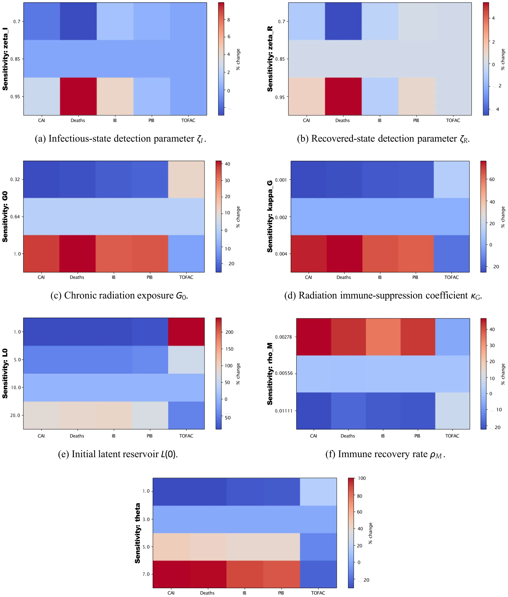
<figcaption><strong>FIGURE 6</strong> One-at-a-time sensitivity heatmaps. Color indicates the percentage change relative to the baseline scenario. Outcome abbreviations are cumulative active incidence (CAI), deaths, infectious burden (IB), peak infectious burden (PIB), and time to first active case (TOFAC). Red indicates an increase relative to baseline and blue indicates a decrease.</figcaption>
</figure>

A third lesson is that radiation shielding and medical stockpiles should be planned jointly. The sensitivity analysis indicates that shielding does not only affect classical radiation-health outcomes; by preserving immune competence, it can also change the expected timing and probability of tuberculosis reactivation. Therefore, shielding scenarios should be evaluated using infection outcomes such as time to first active case, cumulative active incidence, and peak infectious burden, not only dose-based health endpoints. Similarly, medication and isolation capacity should not be sized according to the mean outbreak trajectory alone. Because reactivation is stochastic, rare early-reactivation episodes can create disproportionate demand. A more useful planning output from this model is the upper-tail requirement: the amount of medication, isolation time, and diagnostic workload needed to cover high-percentile outbreak trajectories.

Despite its usability, this study is not without limitations. First, the model uses simplified immune dynamics summarized by a single colony-level immune competence variable, whereas real immune responses differ across individuals and involve interacting cellular, molecular, circadian, stress, and microbiome pathways [ 18, 41 ]. Second, several parameters are assumed or calibrated indirectly because there are no direct empirical data for tuberculosis reactivation under Mars-colony radiation, confinement, and monitoring conditions; indeed, NASA identifies the clinical significance of exploration-class immune dysregulation as an open gap, and recent medical-astrobiology reviews emphasize the scarcity of mission-specific epidemiological and diagnostic data [ 20, 46 ]. Third, the well-mixed contact assumption ignores spatial habitat structure, crew schedules, ventilation zones, and task-based contact networks, all of which may strongly shape airborne tuberculosis transmission in enclosed settings [ 83, 84 ]. Fourth, the PPO policy is trained and evaluated inside the same simulated model family, so its apparent advantage may partly reflect model-specific reward and observation assumptions, a known concern in reinforcement learning where policies can exploit proxy rewards or simulation-specif ic design choices [ 85, 86 ]. Fifth, the intervention model abstracts medication into a single intensity variable and does not represent drug resistance, side effects, adherence, diagnostic confirmation, or detailed treatment regimens, whereas current tuberculosis treatment guidance distinguishes drug-susceptible and drug-resistant disease and emphasizes regimen-specific treatment and care decisions [ 58, 87 ]. It also excludes potential radiation-induced changes in pharmaceutical stability and spaceflight-related changes in treatment response. Sixth, the model begins at colony arrival and does not explicitly simulate radiation exposure or possible infection reactivation during interplanetary transit. As such, the results are conditional on the assumed arrival health state; future extensions should incorporate transit-specific radiation profiles and pre-arrival immune dynamics [ 17 ].

Taken jointly, the results show that latent tuberculosis in a Mars colony should be understood as a coupled host–pathogen– environment control problem rather than as a conventional terrestrial outbreak transplanted into space. The proposed model demonstrates how radiation-mediated immune suppression can convert a silent latent reservoir into an active operational hazard, while also showing that adaptive countermeasure allocation can reduce disease impact under partial observability. Although the numerical findings should be interpreted as scenario-based rather than predictive, the framework provides a useful foundation for comparing prevention strategies, designing autonomous health-support tools, and integrating infectious-disease risk into broader Mars-mission medical planning.

### Author Contributions

Teddy Lazebnik: Conceptualization, Data curation, Formal analysis, Funding acquisition, Investigation, Methodology, Project administration, Resources, Software, Supervision, Validation, Visualization, Writing – original draft, Writing – review & editing

### Funding

This study received no funding.

### Conflicts of Interest

The authors declare no conflicts of interest.

### Data Availability Statement

The code and data is provided as a supplementary material to this study.

## References

1. . E. Afshinnekoo, R. T. Scott, M. J. MacKay, et al., “Fundamental Biological Features of Spaceflight: Advancing the Field to Enable Deep- Space Exploration,” Cell 183, no. 5 (2020): 1162–1184, . [doi:10.1016/j.cell.2020.10.050](https://doi.org/10.1016/j.cell.2020.10.050)
2. . V. Hessel, J. Stoudemire, H. Miyamoto, and I. Fisk, In-Space Manufacturing and Resources (Wiley Online Library, 2022).
3. . F. Neukart, “Towards Sustainable Horizons: A Comprehensive Blueprint for Mars Colonization,” Heliyon 10, no. 4 (2024): e26180.
4. . D. Cowen, R. Zhang, and M. Komorowski, “Infections in Long- Duration Space Missions,” The Lancet Microbe 5, no. 9 (2024): 100875, . [doi:10.1016/S2666-5247(24)00098-3](https://doi.org/10.1016/S2666-5247%2824%2900098-3)
5. . A. R. Castro-Costa, R. Siqueira-Batista, F. A. Alcântara, et al., “Infectious Diseases and the Use of Antimicrobials on Space Missions,” Space: Science and Technology 4 (2024): 0205.
6. . K.-A. Tran, N. W. Pollock, C. Rhéaume, et al., “Evidence Supporting the Management of Medical Conditions During Long-Duration Spaceflight: Protocol for a Scoping Review,” JMIR Research Protocols 10, no. 3 (2021): e24323, . [doi:10.2196/24323](https://doi.org/10.2196/24323)
7. . T. Zaccaria, Ö. Bulut, A. V. Ferreira, et al., “Effects of Simulated Martian Environmental Stressors on Specific Human Pathogen–Immune System Interactions,” Mbio 16, no. 9 (2025): e01099-25.
8. . S. Khoshtinat, J. Long-Fox, and S. M. J. Hosseini, “From Earth to Mars: A Perspective on Exploiting Biomineralization for Martian Construction,” Frontiers in Microbiology 16 (2025): 1645014.
9. . M. Mora, A. Mahnert, K. Koskinen, et al., “Microorganisms in Confined Habitats: Microbial Monitoring and Control of Intensive Care Units, Operating Rooms, Cleanrooms and the International Space Station,” Frontiers in Microbiology 7 (2016): 1573, . [doi:10.3389/fmicb.2016.01573](https://doi.org/10.3389/fmicb.2016.01573)
10. . T. Lazebnik and A. Alexi, “High Resolution Spatio-Temporal Model for Room-Level Airborne Pandemic Spread,” Mathematics 11, no. 2 (2023): 426, . [doi:10.3390/math11020426](https://doi.org/10.3390/math11020426)
11. . A. Alexi, A. Rosenfeld, and T. Lazebnik, “The Trade-Off between Airborne Pandemic Control and Energy Consumption Using Air Ventilation Solutions,” Sensors 22, no. 22 (2022): 8594, . [doi:10.3390/s22228594](https://doi.org/10.3390/s22228594)
12. . Y. Zhong, T. Wu, Y. Han, et al., “Advancements in Mars Habitation Technologies and Terrestrial Simulation Projects: A Comprehensive Review,” Aerospace 12, no. 6 (2025): 510, . [doi:10.3390/aerospace12060510](https://doi.org/10.3390/aerospace12060510)
13. . T. C. Slaba, C. M. Werneth, C. Zeitlin, et al., “Validated Space Radiation Exposure Predictions From Earth to Mars During Artemis-I,” npj Microgravity 11 (2025): 6, 025- 00459- y. [doi:10.1038/s41526-](https://doi.org/10.1038/s41526-)
14. . L. W. Townsend, J. H. Adams, S. R. Blattnig, et al., “Solar Particle Event Storm Shelter Requirements for Missions Beyond Low Earth Orbit,” Life Sciences in Space Research 17 (2018): 32–39, . [doi:10.1016/j.lssr.2018.02.002](https://doi.org/10.1016/j.lssr.2018.02.002)
15. . D. M. Hassler, C. Zeitlin, R. F. Wimmer-Schweingruber, et al., “Mars’ Surface Radiation Environment Measured With the Mars Science Laboratory’s Curiosity Rover,” Science 343, no. 6169 (2014): 1244797, . [doi:10.1126/science.1244797](https://doi.org/10.1126/science.1244797)
16. . A. R. Kennedy, “Biological Effects of Space Radiation and Development of Effective Countermeasures,” Life Sciences in Space Research 1 (2014): 10–43, . [doi:10.1016/j.lssr.2014.02.004](https://doi.org/10.1016/j.lssr.2014.02.004)
17. . C. Zeitlin, D. M. Hassler, F. A. Cucinotta, et al., “Measurements of Energetic Particle Radiation in Transit to Mars on the Mars Science Laboratory,” Science 340, no. 6136 (2013): 1080–1084, . [doi:10.1126/science.1235989](https://doi.org/10.1126/science.1235989)
18. . D. A. Winer, H. Du, J. Kim, et al., “Astroimmunology: The Effects of Spaceflight and Its Associated Stressors on the Immune System,” Nature Reviews Immunology 26 (2026): 189–212, 01226- 6 . [doi:10.1038/s41577-025-](https://doi.org/10.1038/s41577-025-)
19. . NASA Office of the Chief Health and Medical Officer, “NASA-STD- 3001 Technical Brief: Microbiology in Space Overview,” Technical Brief (2024).
20. . NASA Human Research Program, “Spaceflight-Induced Immune System Dysregulation and Microgravity-Associated Alterations in Microbial Virulence – Infectious Disease Risk for Astronauts,” Human Research Roadmap task page (2026).
21. . R. S. Blue, R. A. Mulcahy, A. J. Kreykes, et al., “Infectious Disease Outcomes of NASA’s Health Stabilization Program,” npj Microgravity 12 (2026): 66, 026- 00593- 1 . [doi:10.1038/s41526-](https://doi.org/10.1038/s41526-)
22. . S. Fedyay, A. Niiazov, S. Ponomarev, A. Polyakov, M. Belakovskiy, and O. Orlov, “Medical Support for Space Missions: The Case of the SIRIUS Project,” Aerospace 10, no. 6 (2023): 518, . [doi:10.3390/aerospace10060518](https://doi.org/10.3390/aerospace10060518)
23. . E. L. Antonsen, J. G. Myers, L. Boley, et al., “Estimating Medical Risk in Human Spaceflight,” npj Microgravity 8, no. 1 (2022): 8, . [doi:10.1038/s41526-022-00193-9](https://doi.org/10.1038/s41526-022-00193-9)
24. . M. T. Prelich, C. M. Gasiewski, L. McIntyre, B. Kadwa, J. Arellano, and J. G. Myers, “Assessment of Model Outcomes Between the Integrated Medical Model (IMM) and the Medical Extensible Dynamic Probabilistic Risk Assessment Tool (MEDPRAT),” NASA/TM-20240012058, National Aeronautics and Space Administration (2024).
25. . J. A. Spry, B. Siegel, C. Bakermans, et al., “Planetary Protection Knowledge Gap Closure Enabling Crewed Missions to Mars,” Astrobiology 24, no. 3 (2024): 230–274, . [doi:10.1089/ast.2023.0092](https://doi.org/10.1089/ast.2023.0092)
26. . A. Alexi, A. Rosenfeld, and T. Lazebnik, “The Trade-Off between Airborne Pandemic Control and Energy Consumption Using Air Ventilation Solutions,” Sensors 22, no. 22 (2022): 8594.
27. . N. A. Menzies, E. Wolf, D. Connors, et al., “Progression From Latent Infection to Active Disease in Dynamic Tuberculosis Transmission Models: A Systematic Review of the Validity of Modelling Assumptions,” The Lancet Infectious Diseases 18, no. 8 (2018): e228–e238, . [doi:10.1016/S1473-3099(18)30134-8](https://doi.org/10.1016/S1473-3099%2818%2930134-8)
28. . A. Checinska Sielaff, C. Urbaniak, G. B. M. Mohan, et al., “Characterization of the Total and Viable Bacterial and Fungal Communities Associated With the International Space Station Surfaces,” Microbiome 7 (2019): 50, 019- 0666- x. [doi:10.1186/s40168-](https://doi.org/10.1186/s40168-)
29. . A. A. Voorhies, C. M. Ott, S. Mehta, et al., “Study of the Impact of Long-Duration Space Missions at the International Space Station on the Astronaut Microbiome,” Scientific Reports 9 (2019): 9911, 019- 46303-8 . [doi:10.1038/s41598-](https://doi.org/10.1038/s41598-)
30. . S. K. Mehta, B. E. Crucian, R. P. Stowe, et al., “Latent Virus Reactivation in Astronauts on the International Space Station,” npj Microgravity 3 (2017): 11, 017- 0015- y. [doi:10.1038/s41526-](https://doi.org/10.1038/s41526-)
31. . B. V. Rooney, B. E. Crucian, D. L. Pierson, M. L. Laudenslager, and S. K. Mehta, “Herpes Virus Reactivation in Astronauts During Spaceflight and Its Application on Earth,” Frontiers in Microbiology 10 (2019): 16, . [doi:10.3389/fmicb.2019.00016](https://doi.org/10.3389/fmicb.2019.00016)
32. . World Health Organization, “Latent Tuberculosis Infection: Updated and Consolidated Guidelines for Programmatic Management,” (World Health Organization, 2018).
33. . Centers for Disease Control and Prevention, “Clinical Overview of Latent Tuberculosis Infection,” Web page (2024).
34. . Centers for Disease Control and Prevention, “Tuberculosis: Causes and How It Spreads,” Web page (2025).
35. . M. Pai, M. A. Behr, D. Dowdy, et al., “Tuberculosis,” Nature Reviews Disease Primers 2 (2016): 16076, . [doi:10.1038/nrdp.2016.76](https://doi.org/10.1038/nrdp.2016.76)
36. . M. A. Behr, P. H. Edelstein, and L. Ramakrishnan, “Quantifying the Rates of Late Reactivation Tuberculosis: A Systematic Review,” The Lancet Infectious Diseases 21 (2021): e303–e317, . [doi:10.1016/S1473-3099(20)30728-3](https://doi.org/10.1016/S1473-3099%2820%2930728-3)
37. . L. Muñoz, H. R. Stagg, and I. Abubakar, “Diagnosis and Management of Latent Tuberculosis Infection,” Cold Spring Harbor Perspectives in Medicine 5, no. 11 (2015): a017830, . [doi:10.1101/cshperspect.a017830](https://doi.org/10.1101/cshperspect.a017830)
38. . M. X. Rangaka, K. A. Wilkinson, J. R. Glynn, et al., “Predictive Value of Interferon- 𝛾 Release Assays for Incident Active Tuberculosis: A Systematic Review and Meta-Analysis,” The Lancet Infectious Diseases 12, no. 1 (2012): 45–55, . [doi:10.1016/S1473-3099(11)70210-9](https://doi.org/10.1016/S1473-3099%2811%2970210-9)
39. . F. E. Garrett-Bakelman, M. Darshi, S. J. Green, et al., “The NASA Twins Study: A Multidimensional Analysis of a Year-Long Human Spaceflight,” Science 364, no. 6436 (2019): eaau8650, . [doi:10.1126/science.aau8650](https://doi.org/10.1126/science.aau8650)
40. . B. T. Tierney, J. K. Kim, E. G. Overbey, et al., “Longitudinal Multi- Omics Analysis of Host Microbiome Architecture and Immune Responses During Short-Term Spaceflight,” Nature Microbiology 9 (2024): 1661–1675, . [doi:10.1038/s41564-024-01635-8](https://doi.org/10.1038/s41564-024-01635-8)
41. . J. Kim, B. T. Tierney, E. G. Overbey, et al., “Single-Cell Multi-Ome and Immune Profiles of the Inspiration4 Crew Reveal Conserved, Cell- Type, and Sex-Specific Responses to Spaceflight,” Nature Communications 15 (2024): 4954, 49211- 2 . [doi:10.1038/s41467-024-](https://doi.org/10.1038/s41467-024-)
42. . R. A. Salido, H. N. Zhao, D. McDonald, et al., “The International Space Station Has a Unique and Extreme Microbial and Chemical Environment Driven by Use Patterns,” Cell 188, no. 7 (2025): 2022–2041, . [doi:10.1016/j.cell.2025.01.039](https://doi.org/10.1016/j.cell.2025.01.039)
43. . P. Sengupta, S. K. Muthamilselvi Sivabalan, N. K. Singh, K. Raman, and K. Venkateswaran, “Genomic, Functional, and Metabolic Enhancements in Multidrug-Resistant Enterobacter bugandensis Facilitating Its Persistence and Succession in the International Space Station,” Microbiome 12 (2024): 62, 024- 01777- 1 . [doi:10.1186/s40168-](https://doi.org/10.1186/s40168-)
44. . I. Irby and J. T. Broddrick, “Microbial Adaptation to Spaceflight Is Correlated With Bacteriophage-Encoded Functions,” Nature Communications 15, no. 1 (2024): 3474, [doi:10.1038/s41467-023-42104-w](https://doi.org/10.1038/s41467-023-42104-w)
45. . J. G. Hardy, C. A. Theriot, T. Oswald, and G. Clément, “Spaceflight Standard Measures Is a Multidisciplinary Study That Systematically Monitors Risks to Astronaut Health and Performance,” npj Microgravity 11 (2025): 78, 025- 00532-6 . [doi:10.1038/s41526-](https://doi.org/10.1038/s41526-)
46. . A. L. Boschert, S. Leuko, C. L. Krämer, K. Siems, Y.-T. Ly-Sauerbrey, and F. Arndt, “Spaceflight and Medical Microbiology: Possible Implications for Standard Infection Diagnostics and Therapy,” Life 15, no. 11 (2025): 1757, . [doi:10.3390/life15111757](https://doi.org/10.3390/life15111757)
47. . A. Ibrahim, U. W. Humphries, Z. A. Attahir, and R. Zarin, “A Multi- Strain Tuberculosis Transmission Model With Treatment Stratification and Neural Networks,” Advanced Theory and Simulations 9, no. 2 (2026): e01393, . [doi:10.1002/adts.202501393](https://doi.org/10.1002/adts.202501393)
48. . W. O. Kermack and A. G. McKendrick, “A Contribution to the Mathematical Theory of Epidemics,” Proceedings of the Royal Society of London Series A 115, no. 772 (1927): 700–721, . [doi:10.1098/rspa.1927.0118](https://doi.org/10.1098/rspa.1927.0118)
49. . T. Lazebnik, “Computational Applications of Extended SIR Models: A Review Focused on Airborne Pandemics,” Ecological Modelling 483 (2023): 110422, . [doi:10.1016/j.ecolmodel.2023.110422](https://doi.org/10.1016/j.ecolmodel.2023.110422)
50. . H. W. Hethcote, “The Mathematics of Infectious Diseases,” SIAM Review 42, no. 4 (2000): 599–653, . [doi:10.1137/S0036144500371907](https://doi.org/10.1137/S0036144500371907)
51. . T. Lazebnik and G. Blumrosen, “Advanced Multi-Mutation With Intervention Policies Pandemic Model,” IEEE Access 10 (2022): 22769– 22781.
52. . F. Brauer, C. Castillo-Chavez, and Z. Feng, Mathematical Models in Epidemiology (Springer, 2019).
53. . T. Lazebnik, S. Bunimovich-Mendrazitsky, and L. Shami, “Pandemic Management by a Spatio-Temporal Mathematical Model,” International Journal of Nonlinear Sciences and Numerical Simulation 24, no. 6 (2023): 2307–2324, 2021- 0063 . [doi:10.1515/ijnsns-](https://doi.org/10.1515/ijnsns-)
54. . J. K. Sanzari, X. S. Wan, A. Muehlmatt, L. Lin, and A. R. Kennedy, “Comparison of Changes Over Time in Leukocyte Counts in Yucatan Minipigs Irradiated With Simulated Solar Particle Event-Like Radiation,” Life Sciences in Space Research 4 (2015): 11–16, . [doi:10.1016/j.lssr.2014.12.002](https://doi.org/10.1016/j.lssr.2014.12.002)
55. . I. K. Kudryavtsev, A. S. Starshinova, A. R. Rubinstein, et al., “The Role of the Immune Response in Developing Tuberculosis Infection: From Latent Infection to Active Tuberculosis,” Frontiers in Tuberculosis 2 (2024): 1438406, . [doi:10.3389/ftubr.2024.1438406](https://doi.org/10.3389/ftubr.2024.1438406)
56. . D. R. Cox, “Regression Models and Life-Tables,” Journal of the Royal Statistical Society: Series B 34, no. 2 (1972): 187–202, [doi:10.1111/j.2517-6161.1972.tb00899.x](https://doi.org/10.1111/j.2517-6161.1972.tb00899.x)
57. . Centers for Disease Control and Prevention, “Tuberculosis Infection Control,” Web page (2023).
58. . World Health Organization, “WHO Consolidated Guidelines on Tuberculosis: Module 4: Treatment and Care,” (World Health Organization, 2025).
59. . T. Lazebnik, L. Shami, and S. Bunimovich-Mendrazitsky, “Spatio- Temporal Influence of Non-Pharmaceutical Interventions Policies on Pandemic Dynamics and the Economy: The Case of COVID-19,” Economic Research-Ekonomska Istrazivanja 35, no. 1 (2022): 1833–1861, . [doi:10.1080/1331677X.2021.1925573](https://doi.org/10.1080/1331677X.2021.1925573)
60. . T. Lazebnik, L. Shami, and S. Bunimovich-Mendrazitsky, “A Hybrid Mathematical Model for an Optimal Border Closure Policy During a Pandemic,” International Journal of Applied Mathematics and Computer Science 33, no. 4 (2023): 583–601, . [doi:10.34768/amcs-2023-0042](https://doi.org/10.34768/amcs-2023-0042)
61. . T. Lazebnik, “Data-Driven Hospitals Staff and Resources Allocation Using Agent-Based Simulation and Deep Reinforcement Learning,” Engineering Applications of Artificial Intelligence 126 (2023): 106783, . [doi:10.1016/j.engappai.2023.106783](https://doi.org/10.1016/j.engappai.2023.106783)
62. . M. J. Keeling and P. Rohani, Modeling Infectious Diseases in Humans and Animals (Princeton University Press, 2008).
63. . O. Sharomi and T. Malik, “Optimal Control in Epidemiology,” Annals of Operations Research 251, no. 1–2 (2017): 55–71, 015- 1834- 4 . [doi:10.1007/s10479-](https://doi.org/10.1007/s10479-)
64. . S. Lenhart and J. T. Workman, Optimal Control Applied to Biological Models (Chapman and Hall/CRC, 2007).
65. . O. Diekmann, J. A. P. Heesterbeek, and M. G. Roberts, “The Construction of Next-Generation Matrices for Compartmental Epidemic Models,” Journal of the Royal Society Interface 7, no. 47 (2010): 873–885, . [doi:10.1098/rsif.2009.0386](https://doi.org/10.1098/rsif.2009.0386)
66. . A. Shuchami and T. Lazebnik, “Spatio-Temporal SIR Model of Pandemic Spread During Warfare With Optimal Dual-Use Health Care System Administration Using Deep Reinforcement Learning,” Disaster Medicine and Public Health Preparedness 19 (2025): e197, . [doi:10.1017/dmp.2025.10062](https://doi.org/10.1017/dmp.2025.10062)
67. . W. Li, X. Zhang, Y. Dong, Y. Lin, and H. Li, “Powered Landing Control of Reusable Rockets Based on Softmax Double DDPG,” Aerospace 10, no. 7 (2023): 590, . [doi:10.3390/aerospace10070590](https://doi.org/10.3390/aerospace10070590)
68. . E. Bonabeau, “Agent-Based Modeling: Methods and Techniques for Simulating Human Systems,” Proceedings of the National Academy of Sciences 99 (2002): 7280–7287, . [doi:10.1073/pnas.082080899](https://doi.org/10.1073/pnas.082080899)
69. . A. Truszkowska, B. Behring, J. Hasanyan, et al., “High-Resolution Agent-Based Modeling of COVID-19 Spreading in a Small Town,” Advanced Theory and Simulations 4, no. 3 (2021): 2000277, . [doi:10.1002/adts.202000277](https://doi.org/10.1002/adts.202000277)
70. . L. P. Kaelbling, M. L. Littman, and A. R. Cassandra, “Planning and Acting in Partially Observable Stochastic Domains,” Artificial Intelligence 101, no. 1–2 (1998): 99–134, . [doi:10.1016/S0004-3702(98)00023-X](https://doi.org/10.1016/S0004-3702%2898%2900023-X)
71. . R. S. Sutton and A. G. Barto, Reinforcement Learning: An Introduction (MIT Press, 2018).
72. . J. Schulman, F. Wolski, P. Dhariwal, A. Radford, and O. Klimov, “Proximal Policy Optimization Algorithms,” arXiv preprint arXiv:1707.06347 (2017), . [doi:10.48550/arXiv.1707.06347](https://doi.org/10.48550/arXiv.1707.06347)
73. . C. Ros Perez, A. Tyagi, A. Gupta, J. Kreeft, and C. Michler, “Deep Reinforcement Learning Applied to Wake Steering,” Advanced Theory and Simulations 8, no. 9 (2025): 2500199, . [doi:10.1002/adts.202500199](https://doi.org/10.1002/adts.202500199)
74. . A. Alexi, A. Rosenfeld, and T. Lazebnik, “A Security Games Inspired Approach for Distributed Control of Pandemic Spread,” Advanced Theory and Simulations 6, no. 2 (2023): 2200631, . [doi:10.1002/adts.202200631](https://doi.org/10.1002/adts.202200631)
75. . Y. Ma, C. R. Horsburgh, L. F. White, and H. E. Jenkins, “Quantifying TB Transmission: A Systematic Review of Reproduction Number and Serial Interval Estimates for Tuberculosis,” Epidemiology and Infection 146, no. 12 (2018): 1478–1494, . [doi:10.1017/S0950268818001760](https://doi.org/10.1017/S0950268818001760)
76. . Centers for Disease Control and Prevention, “Treatment for Drug- Susceptible Tuberculosis Disease,” Web page (2025).
77. . World Health Organization, “Global Tuberculosis Report 2024,” (World Health Organization, 2024).
78. . L. J. S. Allen, “A Primer on Stochastic Epidemic Models: Formulation, Numerical Simulation, and Analysis,” Infectious Disease Modelling 2, no. 2 (2017): 128–142, . [doi:10.1016/j.idm.2017.03.001](https://doi.org/10.1016/j.idm.2017.03.001)
79. . A. Raffin, A. Hill, A. Gleave, A. Kanervisto, M. Ernestus, and N. Dormann, “Stable-Baselines3: Reliable Reinforcement Learning Implementations,” Journal of Machine Learning Research 22, no. 268 (2021): 1–8.
80. . J. O. Lloyd-Smith, S. J. Schreiber, P. E. Kopp, and W. M. Getz, “Super-spreading and the Effect of Individual Variation on Disease Emergence,” Nature 438, no. 7066 (2005): 355–359, . [doi:10.1038/nature04153](https://doi.org/10.1038/nature04153)
81. . G. Dulac-Arnold, D. Mankowitz, and T. Hester, “Challenges of Real- World Reinforcement Learning: Definitions, Benchmarks and Analysis,” Machine Learning 110 (2021): 2419–2468, 05961- 4 . [doi:10.1007/s10994-021-](https://doi.org/10.1007/s10994-021-)
82. . B. E. Crucian, A. Choukèr, R. J. Simpson, et al., “Immune System Dysregulation During Spaceflight: Potential Countermeasures for Deep Space Exploration Missions,” Frontiers in Immunology 9 (2018): 1437, . [doi:10.3389/fimmu.2018.01437](https://doi.org/10.3389/fimmu.2018.01437)
83. . E. A. Nardell, “Transmission and Institutional Infection Control of Tuberculosis,” Cold Spring Harbor Perspectives in Medicine 6, no. 2 (2016): a018192, . [doi:10.1101/cshperspect.a018192](https://doi.org/10.1101/cshperspect.a018192)
84. . A. K. Deol, N. Shaikh, K. Middelkoop, M. Mohlamonyane, R. G. White, and N. McCreesh, “Importance of Ventilation and Occupancy to Mycobacterium Tuberculosis Transmission Rates in Congregate Settings,” BMC Public Health 22 (2022): 1772, . [doi:10.1186/s12889-022-14133-5](https://doi.org/10.1186/s12889-022-14133-5)
85. . A. Pan, K. Bhatia, and J. Steinhardt, “The Effects of Reward Misspec-ification: Mapping and Mitigating Misaligned Models,” in International Conference on Learning Representations (2022).
86. . O. Bolshov and D. Chumachenko, “Reinforcement Learning for Policymaking in Epidemic Control: A Scoping Review,” PLOS One 21, no. 6 (2026): e0351176, . [doi:10.1371/journal.pone.0351176](https://doi.org/10.1371/journal.pone.0351176)
87. . World Health Organization. WHO Consolidated Guidelines on Tuberculosis. Module 4: Treatment – Drug-Resistant Tuberculosis Treatment, 2022 Update . (Geneva: World Health Organization, 2022).
